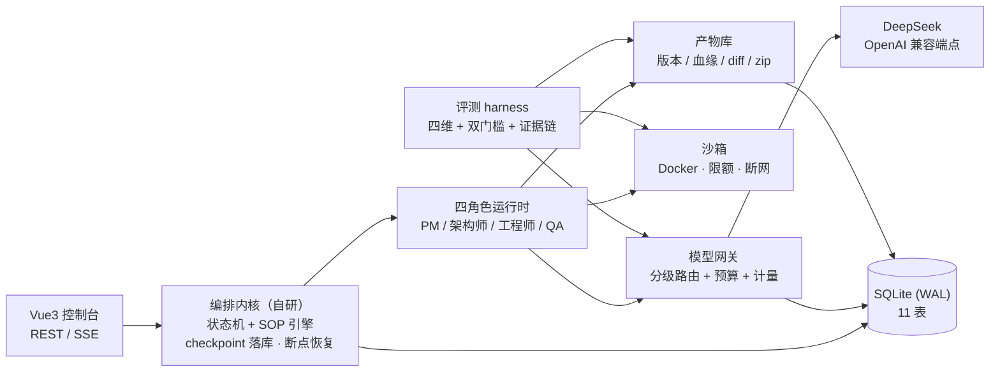

# ymir-agent

[](https://github.com/Eeyore104/Ymir-Agent/actions/workflows/ci.yml)
[](LICENSE)

> 多 Agent 协作的软件开发平台：输入一句自然语言需求，四个 AI 角色（产品经理 / 架构师 / 工程师 / QA）按可配置的 SOP 流水线协作，依次产出 **PRD → 架构设计 → 可运行代码 → 四维评测报告**；全程人工可在关键节点审批与驳回，所有产物统一版本管理。

一句话：**把一句需求，变成一套经过评审、评测、可导出的完整软件交付物。**

v1.1 起再加一层：**评测不达标会自动回边返工**——失败检查定向回灌工程师、最多 N 轮、预算守门，直到双门槛通过或轮次耗尽；耗尽后仍可人工接受最优版或追加一轮。

## 为什么值得一看

- **自研轻量编排内核**（不 fork 底座、不引编排框架）：状态机 + 声明式 SOP + HITL 挂点，流程每步落库 checkpoint —— 进程被杀后可恢复续跑，审批阻塞可原地等待；
- **OpenAI 兼容模型网关**：档位分级路由（推理模型做规划 / 快模型做执行）+ 失败沿候选链自动降级 + 预算前置拦截（单 run 50 万 token / 全局日 ¥50）+ 全量用量计量入库；
- **声明式流水线**：阶段 / 关卡 / 转移边全部 YAML 定义，**改流程不改代码**；加载时静态校验（ID 唯一 / 输入可被上游满足 / 转移边可达终点 / 角色已注册）；
- **Docker 沙箱**承接不可信代码执行：默认断网、`--cpus=2 --memory=4g --pids-limit=512` 限额，接口化设计可替换（无 Docker 时可降级 LocalSandbox）；
- **产物库 + 版本管理**：版本不可变 + `parent_version` 血缘 + 逐文件 unified diff + zip 导出（含 manifest）；内容进文件系统、元数据 / hash 进库；
- **四角色真实链路已跑通**：PM / 架构师 / 工程师 / QA 发真实模型调用，输出过 JSON schema 校验；单跑脚本一条命令从需求跑到任意角色，产物 / 消息 / 事件 / 用量全量落库；
- **四维评测体系**（差异化核心）：`需求符合度 / 可运行率 / 规范符合度 / 架构合理性` 加权总分 + **双门槛**（总分 ≥ 75 且可运行率 ≥ 60）+ **逐分证据链**，报告作为一等产物可版本 diff；批量跑分输出「性价比榜单」（total_score vs cost）。
- **声明式自愈回环（v1.1）**：评测裁决 `fail` → 自动作废 coding/evaluation 的 completed 执行并回边重跑；失败检查命令 + 错误摘要 + **上一版产物**定向注入工程师提示词（不回灌全量日志，受 `max_detail_chars` 预算约束）；轮次上限 + 单 run 预算**fail-closed** 预检；耗尽后支持 `accept-best` / `extend-repair` / `cancel` 三动作人工介入。
- **评测任务绑定与基准套件（v1.1）**：套件支持 `single` / `per_task` 两种绑定模式；`per_task` 下每个基准任务绑定自己的项目产物，未绑定或产物缺失**零成本跳过**（不启沙箱、不调 judge），跨项目零取材；内置 `benchmark-12`（12 任务 / 12 场景 / 执行型检查）。
- **模板约束注入（v1.2）**：垂直模板以声明式 YAML 定义技术栈 / 目录规范 / 规范文件集 / 依赖白名单 / 检查命令，并携带 3–5 个**骨架文件**（`pyproject.toml` / `ruff.toml` / `requirements.txt` / `app/main.py` / `.env.example`）；约束同时注入四角色提示词并驱动评测检查口径，两套模板：`fastapi-vue3` + `python-cli`。
- **增量合入与安全推送（v1.2）**：上传基线 → 只产出新增/修改（`noop` 自动丢弃）→ 「基线 ⊕ 补丁」合并树评测 → 跨产物 diff 人审 → GitHub 推送（Git Data API 单 commit、dry-run 前置、密钥双层过滤、默认推新分支）。

## 项目进度

按严格依赖链分五批推进，**T01–T05 全部完成，v1.0 收官**（v1.1 基准评测 + 自愈回环、v1.2 垂直模板库 + 增量 patch + GitHub 推送见下文对应章节）：

| 批次 | 内容 | 状态 |
|---|---|---|
| T01 | 项目基础设施 + 数据层：FastAPI 骨架 / 11 表 ORM 与迁移 / 统一响应与错误码 / CI | ✅ 2026-10-13 |
| T02 | 模型网关 + 编排内核：分级路由 / 预算计量 / SOP 引擎 / 状态机 / 事件消息 / SSE 断线重放 / 断点恢复 | ✅ 2026-10-14 |
| T03 | 角色运行时 + 沙箱 + 产物版本：四角色真实上线 / Docker 沙箱限额 / 版本不可变 + 血缘 + diff + zip / 单跑脚本 | ✅ 2026-10-14 |
| T04 | HITL 三模式审批完整版 + Web 控制台（六页面 + 五组件） | ✅ 2026-10-15 |
| T05 | 评测 harness（四维 + 双门槛 + 证据链 + 批量跑分）+ 导出 API + 使用手册 / e2e 收尾 | ✅ 2026-10-15 |

v1.0（面试旗舰 MVP）总验收目标：全链路浏览器可跑 / 驳回回退 / 四维评测报告 / diff + zip 导出 / 杀进程恢复 / CI 全绿。设计与任务分解见 `docs/05-增量设计与任务列表-v1.0.md`；**验收结论见 `docs/06-验收报告-v1.0.md`（六大验收线 6/6 通过；v1.0 终态 266 用例，完善周期增补至 302 用例 + 前端 vitest 26 用例）**。

**v1.0 完善周期新增能力**（巡检三线 → 全量 6 包，均经 QA 独立验证）：审批决策原子化（CAS，并发恰一方成功）· 驳回回退「下游级联重跑」· 包级循环依赖清零 + 依赖护栏进 CI · `GET /evaluations/{id}` 报告详情 · run 失败码透传（`error_code`）· 审批 N+1 优化（列表内联反馈链）· SSE 重建 `after_seq` 续传 + 事件按 seq 去重 · element-plus 按需导入（构建 −44%）· 前端 vitest 起步。

### v1.1（已收官 2026-10-21）：基准评测 + 自愈回环

| 批次 | 内容 | 状态 |
|---|---|---|
| T1 | 评测任务绑定（`single` / `per_task`）+ `benchmark-12` 基准套件 + 结构护栏 | ✅ |
| T3.1 | `RepairSpec` 声明式回边 + 9 条加载期校验 + 流水线 YAML v1.1 | ✅ |
| T3.2 | 裁决闸门 `EvaluationGate` + 回边状态机 + 轮次 / 预算守门（fail-closed） | ✅ |
| T3.3 | 修复上下文注入：失败检查 + 上一版产物 + 定向修复指令 | ✅ |
| T4.1 / T4.3 | 两种终态可区分 + B-07 三动作（accept-best / extend-repair / cancel）+ CLI | ✅ |
| T4.2 | 终局审批：中间候选 defer、终局只审最终版一次、防刷屏、驳回重跑 | ✅ 2026-10-21 |
| T5 | 可观测（时间线徽标 / 报告追溯）+ 基线表 + 交付文档 | ✅ 2026-10-21 |

**验收**：10 条验收线全过；7 份 QA 证书（含 T5 补签，均独立对抗验证 + 变异测试）；CI 后端 + 前端双 job 全绿。已知限制与遗留见 `docs/08-验收报告-v1.1.md` §7 / §9。

当时测试基线 **439 passed**（302 → 384 → 404 → 410 → 437 → 439 递增，全部 mock LLM、0 费用）＋ 前端 vitest **33**。设计与任务分解见 `docs/07-增量设计与任务列表-v1.1.md`；**验收结论见 `docs/08-验收报告-v1.1.md`**。

### v1.1 基准表（benchmark-12 · **12 任务全量**）

> 环境：Windows 11 / Python 3.12 / Docker `ymir-sandbox:latest`（pytest 8.4.2 + ruff 0.6.9 预置，`network=none`）
> 模型：planner=`deepseek-reasoner` / executor=`deepseek-chat`，**judge 关闭**（`--no-judge`）
> 批次 `20261026-1`｜跑分时间 2026-10-26T02:35Z｜流水线 software-dev v1.1 / 套件 benchmark-12 v1.1

| 任务 | 场景 | 首轮 | 修复后 | 最终通过 | 修复轮次 | 成本(¥) | 时长(s) |
|---|---|---|---|---|---|---|---|
| task-rest-crud-01 | REST CRUD | 93.3 ✅ | 93.3 | ✅ | 0 | 0.2418 | 122.9 |
| task-cli-notes-02 | CLI 工具 | 97.7 ✅ | 97.7 | ✅ | 0 | 0.2860 | 135.7 |
| task-data-clean-03 | 数据清洗 | 68.2 ❌ | 66.0 | ❌ | 2 | 0.3431 | 165.0 |
| task-file-batch-04 | 文件批处理 | 46.0 ❌ | 65.7 | ❌ | 2 | 0.3568 | 208.7 |
| task-parse-html-05 | HTML 解析 | 70.7 ❌ | **91.2** | ✅ | 2 | 0.2539 | 139.0 |
| task-algo-lru-06 | 算法库 | 97.2 ✅ | 97.2 | ✅ | 0 | 0.1604 | 74.9 |
| task-config-ini-07 | 配置解析 | 57.6 ❌ | **97.7** | ✅ | 2 | 0.4287 | 221.3 |
| task-text-wordcount-08 | 文本处理 | 72.7 ❌ | **98.0** | ✅ | 2 | 0.2929 | 151.1 |
| task-state-order-09 | 状态机 | 97.2 ✅ | 97.2 | ✅ | 0 | 0.1693 | 76.5 |
| task-validator-form-10 | 表单校验 | 98.4 ✅ | 98.4 | ✅ | 0 | 0.1743 | 81.8 |
| task-sql-query-11 | SQL 查询 | 97.2 ✅ | 97.2 | ✅ | 0 | 0.2279 | 101.0 |
| task-json-transform-12 | JSON 转换 | 90.5 ✅ | 90.5 | ✅ | 0 | 0.3021 | 146.9 |

- **12 任务全量**：首轮通过率 **58.3%（7/12）→ 最终通过率 83.3%（10/12）**；实测成本 **¥3.2370**（均价 ¥0.27/任务）；评分来源 pipeline 12 / fallback 0。
- **自愈回环贡献 +25 个百分点**：`parse-html-05`（70.7→91.2）、`config-ini-07`（57.6→97.7）、`text-wordcount-08`（72.7→98.0）三个任务首轮未达双门槛，经 2 轮定向修复后转为通过。
- 两个未通过任务（`data-clean-03`、`file-batch-04`）失败分类均为「检查失败」——沙箱内 `pytest` 存在失败用例；修复后分数虽升至 66.0 / 65.7，仍未达 `total≥75 ∧ runnability≥60` 双门槛。
- **与旧表不可逐题对比**：上一版是批次 `20261021-b` 的 3 任务部分执行，且本轮 `max_tokens` 由 8192 提高到 planner 32768 / executor 16384（v1.2 修复），生成质量基线已变。本表取代旧表作为 v1.2 的正式基线。
- **judge 对比（批次 `20261026-judge`）**：首轮 **75.0%（9/12）** → 最终 **91.7%（11/12）**，成本 ¥3.6313（比确定性版多 **¥0.394**）。
  两种口径**不可逐题对比** —— 同一个 run 在两把尺子下结论可以相反：
  `task-data-clean-03` 确定性 68.2 判不过、judge 96.5 判过（+28.3）；
  `task-cli-notes-02` 确定性 97.7 判过、judge 71.0 判不过（−26.7）。
  **正式口径采用确定性版**（可复现、零评分成本、不受判据漂移影响）；judge 版作为对照实验保留。
  详见 `docs/09` §15.7。
- 复现（需 Docker 与 `.env` 密钥；judge 关闭，12 任务约 ¥3.2）：

```bash
docker build -f docker/sandbox.Dockerfile -t ymir-sandbox:latest .
uv run python scripts/run_benchmark.py --suite benchmark-12 --no-judge
```

- 零费用复现（对已有产物做确定性评测，不发起 run、不调模型）：

```bash
uv run python scripts/run_eval.py --project-name <项目名> --versions v1 --no-judge
```

完整基线表字段、12 任务口径与 `--resume / --budget-cny / --report-only` 用法见 `docs/04-使用手册.md` §9.1。

### v1.2（验收完成 2026-10-26）：垂直模板库 + 增量 patch + GitHub 推送

从「从零生成一个能跑的项目」升级为「**按用户既有工程的规矩把改动增量合进去，并安全推到自己的仓库**」。

| 能力 | 一句话 |
|---|---|
| 垂直模板 | `fastapi-vue3` + `python-cli` 两套 YAML：技术栈 / 目录规范 / 规范文件集 / 依赖白名单 / 检查命令 + 3–5 个骨架文件 |
| 增量 patch | 「基线 ⊕ 补丁」→ 合并树；与基线逐字节相同的文件 `noop` 自动丢弃；`patch_manifest.json` 自描述（`base_content_hash` / `changed_paths` / `counts`） |
| 人工可审 | 跨产物 `diff-across` 复用既有 `DiffView`；骨架冲突与改动面（added / modified / noop）在审批卡片可见 |
| 安全推送 | Git Data API **1 次推送 = 1 个 commit**；dry-run 前置；密钥双层过滤（路径黑名单 + 内容指纹）；默认推新分支 `ymir/<artifact>-v<n>` |

**质量数据（v1.2 验收证书实测）**：后端 **724 passed**（8 轮全量 0 失败；含 T5.1 真跑后新增的 4 条 `CodeBundle` 语法预检用例）· 前端 **63 passed / 12 files** ·
`ruff check` / `scripts/check_import_graph.py`（分层 + 循环依赖）/ `alembic check`（新增 1 个迁移 `0004_add_exports`，双向可逆）全绿 ·
前端构建 `index.js` **483.58 kB（gzip 163.92）** / `vue-vendor` 157.37 / `markdown` 93.60 / `css` 173.60，1896 modules，`vue-tsc` 零错。

**零费用复现（不调真实模型、不依赖 Docker）**

```bash
uv run pytest -q                                # 724 passed
uv run python scripts/check_import_graph.py     # 分层护栏 PASS
cd web && npx vitest run && npm run build       # 63 passed / 12 files
```

> **模板端到端真跑（2026-10-26 已执行 11 次，¥3.40 / 743,959 tokens）**：
> `fastapi-vue3 × 从零` 达 **`conditional`** —— 沙箱内 `pytest` **20 passed**、后端需求 R-1~R-6 全覆盖；
> `python-cli × 从零` 与两个**增量**场景为 **`fail`**，原因都是**模型生成代码的缺陷**
> （未处理 argparse 错误路径 / 重写 `tests/conftest.py` 破坏既有测试），**不是模板或合并机制的问题**。
> **推送链路已端到端验证**（2026-10-26，测试仓库 `Eeyore104/ymir-export-test`）：dry-run 与真推均通过，
> `base_tree` 传 tree sha 未出现 422，`.env` 被拦（`path_blacklist`）、`.env.example` 已推、分支保护生效。
> **12 任务全量基线已完成**（批次 `20261026-1`，`--no-judge`）：首轮 **58.3%（7/12）→ 最终 83.3%（10/12）**，
> ¥3.2370 / 25 分钟，其中 3 个任务靠**自愈回环**转通过（净增益 **+25 个百分点**）。
> judge 对比（批次 `20261026-judge`）首轮 75.0% → 最终 91.7%、¥3.6313，但两种口径**不可逐题对比**
> （同一 run 可一过一不过），正式口径仍取确定性版。
> 完整数据（每轮 token/成本/耗时/verdict）见 `docs/09` §15；限制说明见 `docs/04` §10.4。

## 架构一览



关键设计（深度细节见 `docs/02-架构设计.md`）：

- **编排**：`pending → running → waiting_approval → completed / failed / paused`；启动恢复扫描未完成 run（running 从当前阶段重跑，waiting_approval 原地恢复）；
- **事件**：全局递增 `seq` 落库 + SSE 桥，断线重连按 seq 重放，重连不丢事件；
- **产物**：版本不可变，任何修改产生新版本并记录血缘；diff 按文件分组输出 unified diff；
- **安全**：模型密钥只走环境变量，禁止入库 / 入日志；预算超限自动暂停 run 并推送告警事件。

## 技术栈

| 层 | 选型 |
|---|---|
| 后端 | Python 3.12 · FastAPI · SQLAlchemy 2.0 (async) · Alembic · SQLite(WAL) |
| 编排 | 自研状态机 + 声明式 SOP（YAML / Pydantic）+ 事件 / 消息总线（SSE） |
| 模型网关 | OpenAI SDK（DeepSeek 先行；qwen / glm / kimi 同构预留）+ Anthropic 适配器接口 |
| 执行沙箱 | Docker（python:3.12-slim，限额 + 断网；LocalSandbox 降级） |
| 工程化 | uv · pytest（**724** 用例，全部 mock LLM）· vitest（**63** 用例）· ruff · GitHub Actions（后端 + 前端 job） |
| 前端 | Vue 3 · Element Plus · Pinia · vue-router · Vite · TypeScript |

## 快速开始

前置：Python 3.12、[uv](https://docs.astral.sh/uv/)；Docker（可选，沙箱功能用）；Node.js ≥ 18（前端控制台用）。

```bash
# 1) 安装依赖
uv sync

# 2) 准备环境变量（.env 不入库，模型密钥只放这里）
cp .env.example .env        # Windows: copy .env.example .env
#   编辑 .env，填入 DEEPSEEK_API_KEY=sk-...

# 3) 初始化数据库（SQLite，位于 data/ymir.db）
uv run alembic upgrade head

# 4) 启动后端 API（http://127.0.0.1:8000，接口文档 /docs）
uv run uvicorn ymir.api.app:app --port 8000

# 5) 启动前端控制台（另开终端；http://127.0.0.1:5173）
cd web && npm install && npm run dev

# 一键起（后端 + 前端，Ctrl+C 一并退出）—— Windows Git Bash / macOS / Linux 通用
bash scripts/dev.sh

# 或：容器化一键启动（本机无需 Python/Node，详见 docs/04）
docker compose up -d    # 后端 :8000 + 前端 :5173；`down` 停止，`down -v` 连数据卷一并清除
```

### 单跑演示（真实编排链路）

```bash
# 单跑 PM：需求 → PRD v1（产物 / 消息 / 事件 / 用量全量落库）
uv run python scripts/run_single_role.py --requirement "做一个命令行待办清单工具"

# 跑到指定角色为止（自动含上游链；engineer 阶段含沙箱冒烟）
uv run python scripts/run_single_role.py --requirement "..." --role engineer

# 演练：不调模型，打印将执行的阶段链与模型档位
uv run python scripts/run_single_role.py --requirement "x" --role qa --dry-run
```

### 质量门禁与自检

```bash
uv run ruff check .
uv run pytest -q                         # 全量单测 + 集成 + e2e（全部 mock LLM，0 费用）

# 模型网关真实调用冒烟（产生真实费用，需 .env 密钥）
uv run python scripts/smoke_gateway.py

# Docker 沙箱 8 项自检（探测 daemon / 限额 / exec / 超时 / 内存 / 文件 / 断网 / 销毁）
uv run python scripts/verify_docker_sandbox.py
```

### 前端控制台

```bash
cd web && npm install && npm run dev     # http://127.0.0.1:5173（六页面控制台）
```

### 评测（四维 + 批量跑分）

```bash
# 对项目 code 产物 v1、v2 批量跑分（确定性口径，0 费用）
uv run python scripts/run_eval.py --project-name demo --versions v1,v2 --no-judge

# 单版本 + 真实 judge，并把报告入库（需 .env 密钥）
uv run python scripts/run_eval.py --project-id <id> --suite default --save
```

评测套件定义见 `evals/suites/default.yaml`（四维权重 + 双门槛 + 回归基线任务）与
`evals/suites/benchmark-12.yaml`（12 任务 / 12 场景 / `per_task` 绑定，批量基准执行器随 T5 交付）。
Web 端「评测报告」页可查看四维分数与证据链。完整操作见 `docs/04-使用手册.md`。

### 修复耗尽后的人工介入（B-07）

```bash
# 接受历史中总分最高的一版（failed -> completed，写 repair.accepted 并发事件）
uv run python scripts/run_action.py <run_id> --action accept-best --by me

# 追加 1 轮修复（受单 run 预算预检；预算不足返回 1004 且保持 failed）
uv run python scripts/run_action.py <run_id> --action extend-repair

# 其余动作：pause / resume / cancel / retry-stage（也可走 POST /api/v1/runs/{id}/actions）
```

> 已知限制：`run_action.py` 是**离线控制面**——动作落库并置 `running`，推进任务需由 API 服务
> 启动时恢复（recovery）接管；服务在运行时请直接走 API 端点。

## 目录结构（monorepo）

```
ymir-agent/
├── src/ymir/
│   ├── config.py            # pydantic-settings 配置
│   ├── common/              # 业务错误码 / 异常基类 / 日志
│   ├── models/              # 11 表 ORM 实体与枚举
│   ├── storage/             # DB 引擎 / 会话 + Repository（含 artifact_repo）
│   ├── gateway/             # 模型网关：providers / 路由 / 预算 / 计量 / 适配器
│   ├── sop/                 # 声明式流水线：定义模型 / 加载 / 校验
│   ├── orchestrator/        # 编排内核：状态机 / 执行器 / 角色执行 / 恢复 / 回边控制器（repair）
│   ├── roles/               # 角色定义 / 注册表 / 运行时 / 提示词（含定向修复段）/ 输出校验
│   ├── sandbox/             # Sandbox 接口 + Docker/Local 实现 + 会话 / 工厂
│   ├── artifacts/           # 产物库：版本 / 血缘 / diff / zip
│   ├── tools/               # 角色工具（code_writer / doc_writer / read_artifact）
│   ├── events/              # 事件总线 + 落库 + SSE 桥
│   ├── messages/            # 角色消息协议与总线
│   ├── evaluation/          # 评测 harness：四维评估器 / 聚合 / 报告 / 套件 / 批量跑分 / 裁决闸门（gate）
│   └── api/                 # FastAPI app / schemas / routers
├── config/
│   ├── models.yaml          # 模型档位 / 路由 / 预算红线
│   ├── pipelines/           # 声明式 SOP 流水线定义（software-dev.yaml）
│   └── roles/               # 四角色 YAML + 提示词模板
├── evals/
│   └── suites/              # 评测套件（default：权重+双门槛+任务；benchmark-12：12 任务 per_task 基准）
├── migrations/              # Alembic 迁移
├── scripts/                 # 一键启动 / 单跑角色 / 批量跑分 / 人工介入（run_action）/ 网关冒烟 / 沙箱自检
├── docker/                  # 沙箱镜像构建（sandbox.Dockerfile）
├── web/                     # Vue3 控制台
├── tests/                   # 单元 + 边界 / 集成 / e2e 测试
└── data/                    # 运行时生成（SQLite + 产物，gitignore）
```

## 配置体系（改流程不改代码）

| 文件 | 作用 | 关键点 |
|---|---|---|
| `config/models.yaml` | 模型档位与路由 | planner = deepseek-reasoner / executor = deepseek-chat；失败沿候选链降级；预算红线（单 run 50 万 token / 日 ¥50） |
| `config/pipelines/software-dev.yaml` | 四阶段流水线 + 自愈回边 | prd → architecture → coding → evaluation；三关 gate 元数据（PRD 确认 / 设计评审 / 代码合并前）；`repair` 块声明回边（`evaluation --evaluation_failed--> coding`，max_rounds / 预算 / 明细预算）；加载时静态校验 |
| `config/roles/*.yaml` | 四角色定义 | 档位 / 能力 / 输入输出 / 输出 schema / 重试策略 + Jinja2 提示词 |

- 新增角色 = 加一个 YAML + 注册；新增模型 provider = 在 `models.yaml` 追加同构配置（qwen / glm / kimi 已留示例）；
- 改流程 = 改流水线 YAML，内核零改动；定义版本化入库（`pipelines` 表）。

## API 概览

统一前缀 `/api/v1`。已实现：

| 分组 | 端点 | 说明 |
|---|---|---|
| 系统 | `GET /health` | 健康检查 |
| 项目 | `POST /projects` · `GET /projects` · `GET /projects/{id}` | 创建 / 列表 / 详情聚合 |
| 运行 | `POST /projects/{id}/runs`（202）· `GET /runs/{id}` · `POST /runs/{id}/actions` | 发起 / 详情 / 控制动作（pause / resume / cancel / retry-stage / **accept-best / extend-repair**） |
| 事件 | `GET /runs/{id}/events`（SSE）· `GET /runs/{id}/messages` | 实时事件流（seq 断线重放）+ 角色消息 |
| 产物 | `GET /projects/{id}/artifacts` · `GET /artifacts/{id}` · `GET /artifacts/{id}/versions/{v}/content` · `GET /artifacts/{id}/diff` | 列表 / 详情 / 版本内容 / 版本 diff |
| 审批 | `GET /approvals` · `GET /approvals/{id}` · `POST /approvals/{id}/decision` | 审批中心列表 / 详情（含反馈链）/ 决策（approve / reject 带反馈回退） |
| 评测 | `GET /evaluations` · `GET /projects/{id}/evaluations` · `POST /projects/{id}/evaluations` · `GET /evaluations/{id}` | 全局 / 项目评测报告列表 · 对产物发起四维评测 · 报告详情（分数 + 证据链） |
| 导出 | `GET /projects/{id}/export` | 整库导出 zip（含 manifest.json） |
| 沙箱 | `GET /sandboxes` · `GET /sandboxes/{id}` | 会话列表 / 详情 |
| 网关 | `GET /models` · `GET /usage?scope=run\|project\|global` | 档位与路由解析 / token 与成本统计 |

响应约定：

- 成功：`{"code": 0, "data": ...}`；列表：`{"code": 0, "data": {"items": [...], "total": n}}`；错误：`{"code": <biz_code>, "message": "..."}`；
- 业务码：`1001` 参数错误 / `1002` 资源不存在 / `1003` 状态冲突 / `1004` 预算超限 / `1005` 沙箱错误 / `1006` 模型调用失败 / `500` 内部错误（未预期的服务端异常）；
- 时间一律 ISO 8601 UTC 存储，前端本地化渲染；ID 使用 UUID v4 字符串。

## 文档

| 文档 | 内容 |
|---|---|
| `docs/01-开源项目调研报告.md` | 开源组件调研与复用边界 |
| `docs/02-架构设计.md` | 分层架构 / 九大抽象 / 类图 / 时序图 |
| `docs/03-产品需求文档（PRD）.md` | PRD v1.1 定稿（含决策记录 D1–D7） |
| `docs/04-使用手册.md` | 环境要求 / Docker（Win10/WSL2）/ 一键启动 / 全流程操作 / 评测 / 导出备份 |
| `docs/05-增量设计与任务列表-v1.0.md` | v1.0 实施口径与任务分解（T01–T05） |
| `docs/06-验收报告-v1.0.md` | v1.0 版本验收报告（六大验收线 / 探针证据 / 遗留清单） |
| `docs/07-增量设计与任务列表-v1.1.md` | v1.1 实施口径与任务分解（基准评测 + 自愈回环，T1–T5） |
| `docs/08-验收报告-v1.1.md` | v1.1 版本验收报告（验收线 / 质量数据 / 真跑基线 / 缺陷与缺口台账 / 遗留） |
| `docs/09-增量设计与任务列表-v1.2.md` | v1.2 实施口径与任务分解（模板库 / 增量 patch / GitHub 推送，T1.1–T5.3）；**§15 为 T5.1 真跑验收记录**（四场景 verdict、成本表、5 个缺陷、12 任务基线 + judge 对比、已知限制） |

## License

MIT License（详见 [LICENSE](LICENSE)；合规边界见 `docs/02-架构设计.md` §8.3）。
