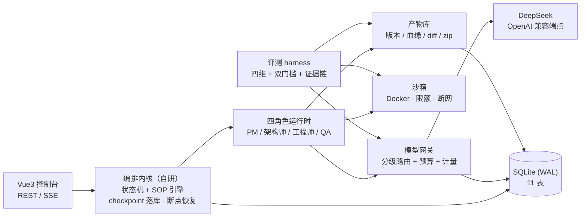

# ymir-agent

[](https://github.com/Eeyore104/Ymir-Agent/actions/workflows/ci.yml)
[](LICENSE)

> 多 Agent 协作的软件开发平台：输入一句自然语言需求，四个 AI 角色（产品经理 / 架构师 / 工程师 / QA）按可配置的 SOP 流水线协作，依次产出 **PRD → 架构设计 → 可运行代码 → 四维评测报告**；全程人工可在关键节点审批与驳回，所有产物统一版本管理。

一句话：**把一句需求，变成一套经过评审、评测、可导出的完整软件交付物。**

## 为什么值得一看

- **自研轻量编排内核**（不 fork 底座、不引编排框架）：状态机 + 声明式 SOP + HITL 挂点，流程每步落库 checkpoint —— 进程被杀后可恢复续跑，审批阻塞可原地等待；
- **OpenAI 兼容模型网关**：档位分级路由（推理模型做规划 / 快模型做执行）+ 失败沿候选链自动降级 + 预算前置拦截（单 run 50 万 token / 全局日 ¥50）+ 全量用量计量入库；
- **声明式流水线**：阶段 / 关卡 / 转移边全部 YAML 定义，**改流程不改代码**；加载时静态校验（ID 唯一 / 输入可被上游满足 / 转移边可达终点 / 角色已注册）；
- **Docker 沙箱**承接不可信代码执行：默认断网、`--cpus=2 --memory=4g --pids-limit=512` 限额，接口化设计可替换（无 Docker 时可降级 LocalSandbox）；
- **产物库 + 版本管理**：版本不可变 + `parent_version` 血缘 + 逐文件 unified diff + zip 导出（含 manifest）；内容进文件系统、元数据 / hash 进库；
- **四角色真实链路已跑通**：PM / 架构师 / 工程师 / QA 发真实模型调用，输出过 JSON schema 校验；单跑脚本一条命令从需求跑到任意角色，产物 / 消息 / 事件 / 用量全量落库；
- **四维评测体系**（差异化核心）：`需求符合度 / 可运行率 / 规范符合度 / 架构合理性` 加权总分 + **双门槛**（总分 ≥ 75 且可运行率 ≥ 60）+ **逐分证据链**，报告作为一等产物可版本 diff；批量跑分输出「性价比榜单」（total_score vs cost）。

## 项目进度

按严格依赖链分五批推进，**T01–T05 全部完成，v1.0 收官**：

| 批次 | 内容 | 状态 |
|---|---|---|
| T01 | 项目基础设施 + 数据层：FastAPI 骨架 / 11 表 ORM 与迁移 / 统一响应与错误码 / CI | ✅ 2026-10-13 |
| T02 | 模型网关 + 编排内核：分级路由 / 预算计量 / SOP 引擎 / 状态机 / 事件消息 / SSE 断线重放 / 断点恢复 | ✅ 2026-10-14 |
| T03 | 角色运行时 + 沙箱 + 产物版本：四角色真实上线 / Docker 沙箱限额 / 版本不可变 + 血缘 + diff + zip / 单跑脚本 | ✅ 2026-10-14 |
| T04 | HITL 三模式审批完整版 + Web 控制台（六页面 + 五组件） | ✅ 2026-10-15 |
| T05 | 评测 harness（四维 + 双门槛 + 证据链 + 批量跑分）+ 导出 API + 使用手册 / e2e 收尾 | ✅ 2026-10-15 |

v1.0（面试旗舰 MVP）总验收目标：全链路浏览器可跑 / 驳回回退 / 四维评测报告 / diff + zip 导出 / 杀进程恢复 / CI 全绿。设计与任务分解见 `docs/05-增量设计与任务列表-v1.0.md`；**验收结论见 `docs/06-验收报告-v1.0.md`（六大验收线 6/6 通过，266 用例全绿）**。

## 架构一览



关键设计（深度细节见 `docs/02-架构设计.md`）：

- **编排**：`pending → running → waiting_approval → completed / failed / paused`；启动恢复扫描未完成 run（running 从当前阶段重跑，waiting_approval 原地恢复）；
- **事件**：全局递增 `seq` 落库 + SSE 桥，断线重连按 seq 重放，重连不丢事件；
- **产物**：版本不可变，任何修改产生新版本并记录血缘；diff 按文件分组输出 unified diff；
- **安全**：模型密钥只走环境变量，禁止入库 / 入日志；预算超限自动暂停 run 并推送告警事件。

## 技术栈

| 层 | 选型 |
|---|---|
| 后端 | Python 3.12 · FastAPI · SQLAlchemy 2.0 (async) · Alembic · SQLite(WAL) |
| 编排 | 自研状态机 + 声明式 SOP（YAML / Pydantic）+ 事件 / 消息总线（SSE） |
| 模型网关 | OpenAI SDK（DeepSeek 先行；qwen / glm / kimi 同构预留）+ Anthropic 适配器接口 |
| 执行沙箱 | Docker（python:3.12-slim，限额 + 断网；LocalSandbox 降级） |
| 工程化 | uv · pytest（266 用例，全部 mock LLM）· ruff · GitHub Actions |
| 前端 | Vue 3 · Element Plus · Pinia · vue-router · Vite · TypeScript |

## 快速开始

前置：Python 3.12、[uv](https://docs.astral.sh/uv/)；Docker（可选，沙箱功能用）；Node.js ≥ 18（前端控制台用）。

```bash
# 1) 安装依赖
uv sync

# 2) 准备环境变量（.env 不入库，模型密钥只放这里）
cp .env.example .env        # Windows: copy .env.example .env
#   编辑 .env，填入 DEEPSEEK_API_KEY=sk-...

# 3) 初始化数据库（SQLite，位于 data/ymir.db）
uv run alembic upgrade head

# 4) 启动后端 API（http://127.0.0.1:8000，接口文档 /docs）
uv run uvicorn ymir.api.app:app --port 8000

# 5) 启动前端控制台（另开终端；http://127.0.0.1:5173）
cd web && npm install && npm run dev

# 一键起（后端 + 前端，Ctrl+C 一并退出）—— Windows Git Bash / macOS / Linux 通用
bash scripts/dev.sh
```

### 单跑演示（真实编排链路）

```bash
# 单跑 PM：需求 → PRD v1（产物 / 消息 / 事件 / 用量全量落库）
uv run python scripts/run_single_role.py --requirement "做一个命令行待办清单工具"

# 跑到指定角色为止（自动含上游链；engineer 阶段含沙箱冒烟）
uv run python scripts/run_single_role.py --requirement "..." --role engineer

# 演练：不调模型，打印将执行的阶段链与模型档位
uv run python scripts/run_single_role.py --requirement "x" --role qa --dry-run
```

### 质量门禁与自检

```bash
uv run ruff check .
uv run pytest -q                         # 全量单测 + 集成 + e2e（全部 mock LLM，0 费用）

# 模型网关真实调用冒烟（产生真实费用，需 .env 密钥）
uv run python scripts/smoke_gateway.py

# Docker 沙箱 8 项自检（探测 daemon / 限额 / exec / 超时 / 内存 / 文件 / 断网 / 销毁）
uv run python scripts/verify_docker_sandbox.py
```

### 前端控制台

```bash
cd web && npm install && npm run dev     # http://127.0.0.1:5173（六页面控制台）
```

### 评测（四维 + 批量跑分）

```bash
# 对项目 code 产物 v1、v2 批量跑分（确定性口径，0 费用）
uv run python scripts/run_eval.py --project-name demo --versions v1,v2 --no-judge

# 单版本 + 真实 judge，并把报告入库（需 .env 密钥）
uv run python scripts/run_eval.py --project-id <id> --suite default --save
```

评测套件定义见 `evals/suites/default.yaml`（四维权重 + 双门槛 + 回归基线任务）；Web 端
「评测报告」页可查看四维分数与证据链。完整操作见 `docs/04-使用手册.md`。

## 目录结构（monorepo）

```
ymir-agent/
├── src/ymir/
│   ├── config.py            # pydantic-settings 配置
│   ├── common/              # 业务错误码 / 异常基类 / 日志
│   ├── models/              # 11 表 ORM 实体与枚举
│   ├── storage/             # DB 引擎 / 会话 + Repository（含 artifact_repo）
│   ├── gateway/             # 模型网关：providers / 路由 / 预算 / 计量 / 适配器
│   ├── sop/                 # 声明式流水线：定义模型 / 加载 / 校验
│   ├── orchestrator/        # 编排内核：状态机 / 执行器 / 角色执行 / 恢复
│   ├── roles/               # 角色定义 / 注册表 / 运行时 / 提示词 / 输出校验
│   ├── sandbox/             # Sandbox 接口 + Docker/Local 实现 + 会话 / 工厂
│   ├── artifacts/           # 产物库：版本 / 血缘 / diff / zip
│   ├── tools/               # 角色工具（code_writer / doc_writer / read_artifact）
│   ├── events/              # 事件总线 + 落库 + SSE 桥
│   ├── messages/            # 角色消息协议与总线
│   ├── evaluation/          # 评测 harness：四维评估器 / 聚合 / 报告 / 套件 / 批量跑分
│   └── api/                 # FastAPI app / schemas / routers
├── config/
│   ├── models.yaml          # 模型档位 / 路由 / 预算红线
│   ├── pipelines/           # 声明式 SOP 流水线定义（software-dev.yaml）
│   └── roles/               # 四角色 YAML + 提示词模板
├── evals/
│   └── suites/              # 评测套件（default.yaml：权重 + 双门槛 + 任务）
├── migrations/              # Alembic 迁移
├── scripts/                 # 一键启动 / 单跑角色 / 批量跑分 / 网关冒烟 / 沙箱自检 / 清理演示库
├── docker/                  # 沙箱镜像构建（sandbox.Dockerfile）
├── web/                     # Vue3 控制台
├── tests/                   # 单元 + 边界 / 集成 / e2e 测试
└── data/                    # 运行时生成（SQLite + 产物，gitignore）
```

## 配置体系（改流程不改代码）

| 文件 | 作用 | 关键点 |
|---|---|---|
| `config/models.yaml` | 模型档位与路由 | planner = deepseek-reasoner / executor = deepseek-chat；失败沿候选链降级；预算红线（单 run 50 万 token / 日 ¥50） |
| `config/pipelines/software-dev.yaml` | 四阶段流水线 | prd → architecture → coding → evaluation；三关 gate 元数据（PRD 确认 / 设计评审 / 代码合并前）；加载时静态校验 |
| `config/roles/*.yaml` | 四角色定义 | 档位 / 能力 / 输入输出 / 输出 schema / 重试策略 + Jinja2 提示词 |

- 新增角色 = 加一个 YAML + 注册；新增模型 provider = 在 `models.yaml` 追加同构配置（qwen / glm / kimi 已留示例）；
- 改流程 = 改流水线 YAML，内核零改动；定义版本化入库（`pipelines` 表）。

## API 概览

统一前缀 `/api/v1`。已实现：

| 分组 | 端点 | 说明 |
|---|---|---|
| 系统 | `GET /health` | 健康检查 |
| 项目 | `POST /projects` · `GET /projects` · `GET /projects/{id}` | 创建 / 列表 / 详情聚合 |
| 运行 | `POST /projects/{id}/runs`（202）· `GET /runs/{id}` · `POST /runs/{id}/actions` | 发起 / 详情 / 控制动作（pause / resume / cancel / retry-stage） |
| 事件 | `GET /runs/{id}/events`（SSE）· `GET /runs/{id}/messages` | 实时事件流（seq 断线重放）+ 角色消息 |
| 产物 | `GET /projects/{id}/artifacts` · `GET /artifacts/{id}` · `GET /artifacts/{id}/versions/{v}/content` · `GET /artifacts/{id}/diff` | 列表 / 详情 / 版本内容 / 版本 diff |
| 审批 | `GET /approvals` · `GET /approvals/{id}` · `POST /approvals/{id}/decision` | 审批中心列表 / 详情（含反馈链）/ 决策（approve / reject 带反馈回退） |
| 评测 | `GET /evaluations` · `GET /projects/{id}/evaluations` · `POST /projects/{id}/evaluations` | 全局 / 项目评测报告列表 · 对产物发起四维评测 |
| 导出 | `GET /projects/{id}/export` | 整库导出 zip（含 manifest.json） |
| 沙箱 | `GET /sandboxes` · `GET /sandboxes/{id}` | 会话列表 / 详情 |
| 网关 | `GET /models` · `GET /usage?scope=run\|project\|global` | 档位与路由解析 / token 与成本统计 |

响应约定：

- 成功：`{"code": 0, "data": ...}`；列表：`{"code": 0, "data": {"items": [...], "total": n}}`；错误：`{"code": <biz_code>, "message": "..."}`；
- 业务码：`1001` 参数错误 / `1002` 资源不存在 / `1003` 状态冲突 / `1004` 预算超限 / `1005` 沙箱错误 / `1006` 模型调用失败；
- 时间一律 ISO 8601 UTC 存储，前端本地化渲染；ID 使用 UUID v4 字符串。

## 文档

| 文档 | 内容 |
|---|---|
| `docs/01-开源项目调研报告.md` | 开源组件调研与复用边界 |
| `docs/02-架构设计.md` | 分层架构 / 九大抽象 / 类图 / 时序图 |
| `docs/03-产品需求文档（PRD）.md` | PRD v1.1 定稿（含决策记录 D1–D7） |
| `docs/04-使用手册.md` | 环境要求 / Docker（Win10/WSL2）/ 一键启动 / 全流程操作 / 评测 / 导出备份 |
| `docs/05-增量设计与任务列表-v1.0.md` | v1.0 实施口径与任务分解（T01–T05） |
| `docs/06-验收报告-v1.0.md` | v1.0 版本验收报告（六大验收线 / 探针证据 / 遗留清单） |

## License

MIT License（详见 [LICENSE](LICENSE)；合规边界见 `docs/02-架构设计.md` §8.3）。
