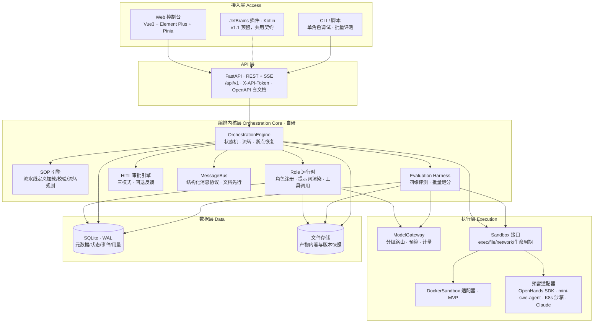
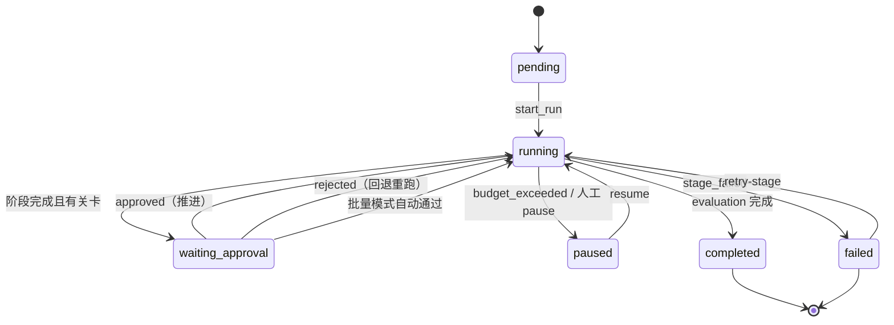
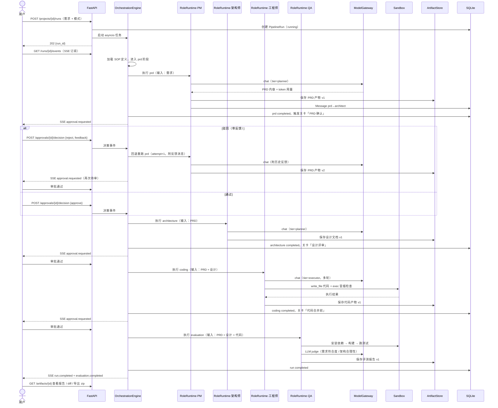
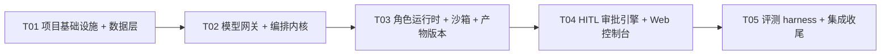

# ymir-agent 架构设计

> **作者**：高见远（架构师） | **日期**：2026-10-12 | **文档版本**：v1.0（设计稿，待主理人评审）
> **上游输入**：`docs/01-开源项目调研报告.md`（许清楚，产品经理）、主理人锁定的九项决策
> **读者**：主理人（评审）、工程师（实现依据）、面试官（作品叙事）
> **定位**：ymir-agent 是多 Agent 协作软件研发平台——多个 Agent 角色协作完成「需求 → PRD → 架构 → 代码 → 评测」全流程；面试旗舰作品 + 个人真实使用 + 未来垂直 SaaS 内部工具。

---

## 一、结论先行（TL;DR）

### 1.1 一句话架构

> **自研轻量编排内核（SOP 状态机 + 四角色 + HITL 审批）为核心；OpenAI 兼容模型网关（分级路由 + token 预算 + 用量计量）管控成本；Docker 沙箱承接代码执行；产物库统一版本管理代码/文档/评测报告；FastAPI 以 REST + SSE 供能，Vue3 控制台与 JetBrains 插件共用同一契约。**

不 fork 任何底座（Dify/JoyAgent 等），不引入 LangGraph/CrewAI 等重编排框架；借鉴 MetaGPT 角色 SOP、LangGraph 状态图、Aider 双模型分级、SWE-bench harness 的思想，全部以**自研轻量实现**落地；OpenHands SDK / mini-swe-agent 仅以**适配器接口**预留。

### 1.2 九项锁定决策 → 架构落点

| # | 锁定决策 | 架构落点（本设计如何满足） |
|---|---|---|
| 1 | 自研编排内核 + 开源适配器，不 fork 底座 | `ymir.orchestrator` / `ymir.sop` / `ymir.roles` / `ymir.messages` 全部自研（§3）；外部只经适配器接口接入（§4、§8.3） |
| 2 | Python（FastAPI）+ uv/pytest/ruff/CI | 技术栈见 §8.1；工程化配置全部收在 T01（§10） |
| 3 | 单租户起步，预留租户/权限扩展点 | 所有实体预留 `tenant_id`（MVP 恒为 `default`），Repository 层预留 tenant scope 参数，API 层预留 TenantContext 中间件接口（no-op）（§2.4） |
| 4 | v1.0 四角色跑通 需求→PRD→架构→代码→评测 | `config/pipelines/software-dev.yaml` 定义四阶段 SOP；角色 YAML 在 `config/roles/`（§3.1、§3.2） |
| 5 | OpenAI 兼容网关、DeepSeek 先行、分级路由、token 预算 | `ymir.gateway`：provider 注册表 + planner/executor 分级 + BudgetGuard + UsageRecorder（§3.9） |
| 6 | 产物库为主，版本管理，前端 diff/导出 zip，GitHub 推送预留 | `ymir.artifacts`：Artifact/ArtifactVersion 模型 + 快照存储 + difflib diff + zip 导出；`Exporter` 接口预留 GitHub 推送（§3.6） |
| 7 | 三模式并存同一套 HITL（关键节点/批量/调试） | `ymir.hitl`：`ApprovalPolicy.mode = key_node / batch / debug`，同一 `ApprovalRequest` 状态机（§3.8） |
| 8 | Sandbox 接口（exec/file/network/生命周期），MVP 本机 Docker | `ymir.sandbox`：Sandbox 抽象 + DockerSandbox 适配器；K8s/远程适配器接口预留（§3.5） |
| 9 | PC 控制台（Vue3 + Element Plus）；v1.x JetBrains 插件 | `web/`（Vue3 + Element Plus + Pinia）；`plugin/`（Kotlin，v1.1）共用 REST/SSE 契约（§6） |

### 1.3 设计原则

1. **文档先行（Document-first）**：角色间只传结构化产物引用（Message → Artifact），PRD → 设计 → 代码逐级传递，任何阶段可回溯到上游依据（借鉴 MetaGPT）。
2. **协议化解耦**：Role / SOP / Message / Sandbox / ModelGateway / Evaluator / Exporter 全部接口化，任一实现可替换（回应调研报告"引擎可替换、勿与单一项目深度绑定"的风险教训）。
3. **确定性优先**：流程控制用自研状态机（代码可读、可测试、可讲），不依赖黑盒框架的隐式行为。
4. **可恢复**：每个状态转移落库（checkpoint），进程重启后自动恢复未完成运行。
5. **可观测**：全事件日志（EventLog）+ 每次 LLM 调用计量（token/成本/延迟），SSE 实时推前端。
6. **Solo 友好**：单进程 asyncio 编排（无消息队列）、SQLite（零运维）、每批任务有独立演示产出（§10）。

---

## 二、总体架构

### 2.1 核心技术挑战与实现思路

| # | 挑战 | 实现思路 |
|---|---|---|
| C1 | **长时运行 + 中断恢复**：一次流水线数分钟到数十分钟，跨多次 LLM 调用 | 进程内 asyncio 任务 + DB checkpoint（每次状态转移落库）；启动时扫描未完成运行并恢复；阶段幂等（产物按 attempt 生成新版本，不覆盖） |
| C2 | **人工中断（HITL）**：审批时流水线必须暂停，决策后精准续跑或回退 | 状态机 `waiting_approval` 等待态 + 事件驱动唤醒；审批决策作为显式转移事件（approve/reject），reject 边可指回任意早前阶段并携带 feedback message |
| C3 | **token 成本失控**：自主 Agent 消耗大且不可预测 | ModelGateway 前置预算检查（BudgetGuard）+ 事后计量（UsageRecorder）；planner/executor 分级路由（贵模型规划、便宜模型执行）；超限暂停并 SSE 告警 |
| C4 | **代码执行安全**：生成的代码不可信 | Docker 容器隔离（每 run 一会话）、默认无网络、CPU/内存/pids 限额、仅挂载该 run 工作区；网络策略按需开启（如评测装依赖） |
| C5 | **产物版本与 diff**：代码/文档多版本、可回溯、可审计 | 内容落文件系统（快照目录）+ 元数据/hash 落库；difflib 生成 unified diff；版本 lineage（parent_version）可追溯 |
| C6 | **评测客观性**：LLM 打分易漂移 | 多维加权 + 证据链（每分附 evidence：文件/行号/命令输出/judge 理由）；静态检查（确定性）与 LLM judge（结构化 rubric）分离；同 task 可重复跑分对比 |
| C7 | **前后端实时性**：长任务进度、日志、审批待办需实时 | SSE（server→client 单向事件）+ REST（client→server 指令）；事件落库支持断线重放 |
| C8 | **Web 与 IDE 插件契约一致** | 插件（Kotlin）与 Web 共用 `/api/v1` REST + SSE，无私有协议；插件侧用原生 diff 视图渲染同一 diff 接口 |

### 2.2 分层架构图



### 2.3 层次职责边界

| 层 | 不允许做 | 只负责 |
|---|---|---|
| 接入层（Web/插件/CLI） | 直接访问 DB/文件系统；直连 LLM | 渲染与交互；经 REST/SSE 与后端通信 |
| API 层 | 业务编排逻辑 | 协议适配、参数校验、SSE 桥接、统一响应格式 |
| 编排内核层 | 直接实例化 LLM SDK/容器 | 流程推进、角色调度、审批、消息、评测编排 |
| 执行层 | 知道 SOP/角色语义 | 模型调用与计量、沙箱内执行 |
| 数据层 | 业务判断 | 持久化、版本快照、查询 |

**横切关注点**：配置（`config/` YAML + 环境变量）、事件日志（全链路）、用量计量（每次模型调用）、错误传播（阶段失败 → run failed + 事件 + 可重试）。

### 2.4 单租户扩展点（决策 3 的落地）

| 扩展点 | MVP 实现 | v2.x 多租户演进 |
|---|---|---|
| 租户上下文 | 所有实体预留 `tenant_id` 字段（恒为 `default`）；API 中间件 `TenantContext` 为 no-op 直通 | 中间件从 token 解析租户；Repository 强制 tenant scope |
| 权限模型 | 无登录（本机单用户）；插件用本地 `X-API-Token` | RBAC（借鉴 Sa-Token 的角色-权限模型）+ 审计日志表 |
| 数据隔离 | SQLite 单文件 + 文件系统单根目录 | 按租户分库/分 schema；存储根目录按租户隔离 |
| 配额 | 全局 token 预算（BudgetGuard） | 按租户配额与计费 |

---

## 三、核心抽象设计（面试可讲的"个人创作"核心）

> 九个抽象全部接口化、可单测、可替换；以下为接口/结构草案（设计而非实现代码）。

### 3.0 核心类图

```mermaid
classDiagram
    direction TB

    class Project {
        +UUID id
        +str name
        +str description
        +str tenant_id
        +datetime created_at
    }
    class PipelineRun {
        +UUID id
        +UUID project_id
        +str pipeline_id
        +RunMode mode
        +RunStatus status
        +str current_stage_id
        +JSON context
        +str error
        +datetime started_at
        +datetime finished_at
    }
    class StageExecution {
        +UUID id
        +UUID run_id
        +str stage_id
        +str role_id
        +StageStatus status
        +int attempt
        +JSON input_refs
        +JSON output_refs
        +str error
    }
    class RoleDefinition {
        +str id
        +str name
        +ModelTier tier
        +str system_prompt_path
        +list~str~ capabilities
        +list~str~ input_types
        +list~str~ output_types
        +RetryPolicy retry
    }
    class RoleRuntime {
        +execute(stage_input, run_context) StageOutput
    }
    class SopPipeline {
        +str id
        +str version
        +list~SopStage~ stages
        +list~Transition~ transitions
    }
    class SopStage {
        +str id
        +str role_id
        +list~str~ inputs
        +list~str~ outputs
        +SopGate gate
        +bool use_sandbox
    }
    class SopGate {
        +str name
        +GateType type
        +str on_reject_target
    }
    class Transition {
        +str from_stage
        +TransitionEvent event
        +str to_stage
    }
    class Message {
        +UUID id
        +UUID run_id
        +int seq
        +MessageType type
        +str from_role
        +str to_role
        +list~UUID~ content_refs
        +str summary
        +JSON payload
    }
    class Artifact {
        +UUID id
        +UUID project_id
        +str name
        +ArtifactType type
        +int current_version
        +str tenant_id
    }
    class ArtifactVersion {
        +UUID id
        +UUID artifact_id
        +int version
        +UUID run_id
        +str stage_id
        +str storage_path
        +str content_hash
        +int file_count
        +int size_bytes
        +str message
        +UUID parent_version_id
        +str created_by
    }
    class ApprovalRequest {
        +UUID id
        +UUID run_id
        +str stage_id
        +str gate_name
        +list~UUID~ artifact_refs
        +ApprovalStatus status
        +str decision
        +str feedback
        +datetime decided_at
    }
    class ApprovalPolicy {
        +ApprovalMode mode
        +dict gate_overrides
        +requires_approval(stage, mode) bool
    }
    class OrchestrationEngine {
        +start_run(project, requirement, mode, pipeline_id) PipelineRun
        +resume(run_id)
        +pause(run_id)
        +cancel(run_id)
        +handle_decision(approval_id, decision, feedback)
    }
    class StageExecutor {
        +execute(stage, run, attempt) StageResult
    }
    class EventBus {
        +publish(event)
        +subscribe(handler)
    }
    class MessageBus {
        +send(message) Message
        +history(run_id) list~Message~
    }
    class Sandbox {
        <<abstract>>
        +start() SandboxSession
        +stop(session)
        +destroy(session)
    }
    class SandboxSession {
        +exec(cmd, timeout) ExecResult
        +read_file(path) str
        +write_file(path, content)
        +list_files(path) list~str~
        +set_network_policy(policy)
    }
    class DockerSandbox {
        +start() SandboxSession
    }
    class ModelGateway {
        +chat(messages, tier, run_id, stage_id) ChatResult
    }
    class ProviderConfig {
        +str id
        +str base_url
        +str api_key_env
        +dict models
    }
    class BudgetGuard {
        +check(run_id, estimated_tokens) bool
        +on_exceed(run_id)
    }
    class UsageRecorder {
        +record(call) ModelCall
        +summary(scope) UsageSummary
    }
    class EvaluationHarness {
        +run_suite(suite_id, artifacts) EvaluationReport
        +evaluate(task, artifacts) list~EvalScore~
    }
    class Evaluator {
        <<abstract>>
        +evaluate(task, artifacts, sandbox) EvalScore
    }
    class EvaluationReport {
        +UUID id
        +UUID project_id
        +list~EvalScore~ scores
        +float total_score
        +bool passed
        +int total_tokens
        +float cost_cny
    }
    class EvalScore {
        +str dimension
        +float score
        +float weight
        +list~str~ evidence
    }
    class ArtifactStore {
        +save(artifact, files, message) ArtifactVersion
        +load(version_id) path
        +diff(v1, v2) DiffResult
        +export_zip(project_id) path
    }
    class Exporter {
        <<abstract>>
        +export(artifact_version, target) ExportResult
    }
    class GitHubExporter {
        +export(artifact_version, target) ExportResult
    }
    class RunRepository {
        +create(run)
        +get(run_id)
        +update_status(run_id, status)
        +list_unfinished()
    }

    Project "1" --> "*" PipelineRun
    PipelineRun "1" --> "*" StageExecution
    PipelineRun "1" --> "*" Message
    PipelineRun "1" --> "*" ApprovalRequest
    SopPipeline "1" --> "*" SopStage
    SopPipeline "1" --> "*" Transition
    SopStage "1" --> "0..1" SopGate
    RoleDefinition "1" --> "1" RoleRuntime
    OrchestrationEngine --> SopPipeline
    OrchestrationEngine --> StageExecutor
    OrchestrationEngine --> EventBus
    OrchestrationEngine --> MessageBus
    OrchestrationEngine --> ApprovalPolicy
    StageExecutor --> RoleRuntime
    StageExecutor --> Sandbox
    Sandbox <|-- DockerSandbox
    Sandbox "1" --> "*" SandboxSession
    RoleRuntime --> ModelGateway
    ModelGateway --> ProviderConfig
    ModelGateway --> BudgetGuard
    ModelGateway --> UsageRecorder
    Artifact "1" --> "*" ArtifactVersion
    EvaluationHarness --> Evaluator
    EvaluationHarness --> EvaluationReport
    EvaluationReport "1" --> "*" EvalScore
    EvaluationHarness --> ArtifactStore
    EvaluationHarness --> Sandbox
    ApprovalRequest --> ArtifactVersion
    ArtifactStore --> Exporter
    Exporter <|-- GitHubExporter
```



（类图源文件另存：`docs/class-diagram.mermaid`）

### 3.1 Role（角色抽象）

**职责**：把一个 Agent 角色定义为「规划/执行分级 + 能力集合 + 提示词模板 + 输入输出契约」的可配置单元，运行时由 StageExecutor 调度。

**定义结构（YAML，`config/roles/<id>.yaml`）**：

```yaml
id: pm                        # 角色唯一标识
name: 产品经理
description: 负责需求结构化与 PRD 撰写
tier: planner                 # planner=规划模型(贵) / executor=执行模型(廉)
system_prompt: roles/prompts/pm.md.j2   # Jinja2 模板，运行时注入变量
capabilities: [doc_write]     # 允许的工具白名单（MVP：doc_write / code_write / read_artifact）
inputs: [requirement, project_context]  # 上游产物类型
outputs: [prd]                # 产出产物类型
output_schema: PRDDocument    # 结构化输出契约（Pydantic），供校验与下游引用
retry: { max_attempts: 2 }    # 阶段级重试（审批驳回走回退边，不算 retry）
```

**运行时接口**：

```
RoleRuntime.execute(stage_input: StageInput, run_context: RunContext) -> StageOutput
  # StageInput: 上游 artifact 引用列表 + feedback 消息列表 + 用户原始需求
  # StageOutput: 产物文件集 + 结构化摘要 + token 用量
```

**v1.0 四角色**：

| 角色 | tier | 输入 | 输出 | 职责 |
|---|---|---|---|---|
| pm 产品经理 | planner | requirement | prd | 需求结构化、验收标准、用户故事 |
| architect 架构师 | planner | prd | design | 模块划分、技术选型、接口草案、目录结构 |
| engineer 工程师 | executor | prd + design | code | 在沙箱工作区写代码 + 冒烟执行 |
| qa 质量工程师 | executor | prd + design + code | evaluation_report | 调度评测 harness，汇总解读报告 |

**扩展点**：角色可热增（新 YAML + prompt 即生效）；`capabilities` 决定工具白名单——未来接 OpenHands/mini-swe-agent 适配器时，engineer 的 `capabilities` 增加 `agent_sdk` 即切换执行内核，SOP 不变（§4）。

### 3.2 SOP 流水线（可配置化阶段/关卡/流转规则）

**职责**：用声明式定义描述「阶段 → 关卡 → 流转规则」，编排内核只做解释执行，改流程不改代码。

**定义结构（YAML，`config/pipelines/<id>.yaml`）**：

```yaml
id: software-dev
version: "1.0"
description: 需求 → PRD → 架构 → 代码 → 评测
stages:
  - id: prd
    role: pm
    inputs: [requirement]
    outputs: [prd]
    gate: { name: "PRD 确认", type: human_approval, on_reject_target: prd }
  - id: architecture
    role: architect
    inputs: [prd]
    outputs: [design]
    gate: { name: "设计评审", type: human_approval, on_reject_target: architecture }
  - id: coding
    role: engineer
    inputs: [prd, design]
    outputs: [code]
    use_sandbox: true
    gate: { name: "代码合并前评审", type: human_approval, on_reject_target: coding }
  - id: evaluation
    role: qa
    inputs: [prd, design, code]
    outputs: [evaluation_report]
    gate: null                      # 评测后人工终审由 Web 端主动查看，不设阻断关卡
transitions:
  - { from: prd,          on: stage_completed, to: architecture }
  - { from: architecture, on: stage_completed, to: coding }
  - { from: coding,       on: stage_completed, to: evaluation }
  - { from: evaluation,   on: stage_completed, to: __end__ }
  # 关卡流转由 HITL 引擎注入：on: approved / rejected（见 §3.8）
```

**流转规则语义**：

| 事件 | 行为 |
|---|---|
| `stage_completed` | 阶段产物已入库；若该阶段有 gate 且当前模式要求审批 → 进入 `waiting_approval`；否则直接沿 transitions 推进 |
| `approved` | 沿 `approved` 边推进到下一阶段 |
| `rejected` | 携带 feedback message 回退到 `on_reject_target`，attempt+1 重跑（输入含全部历史反馈） |
| `stage_failed` | run 进入 `failed`，保留现场（阶段记录 + 已产产物），可 `retry-stage` 或整卷重来 |
| `budget_exceeded` | run 暂停（`paused`），SSE 告警，人工提额或改路由后恢复 |

**校验器（SopValidator）**：加载时静态校验——阶段 ID 唯一、`inputs` 能被上游 `outputs` 满足、转移边可达终点、`on_reject_target` 存在、角色 ID 已注册。**流水线定义本身也是产物**（存 DB 带版本），为 v1.x 可视化编排留数据基础。

### 3.3 Message（角色间结构化消息协议）

**职责**：角色之间不直接对话，只交换「结构化消息」；消息承载产物引用与摘要，实现 MetaGPT 式文档先行传递。

**消息结构**：

```
Message {
  id, run_id, seq            # seq 单调递增，保证顺序与可重放
  type: artifact | feedback | query | status | system
  from_role, to_role         # to_role=null 表示广播/人工可见
  subject: str               # 如 "PRD v2 已生成"
  content_refs: [artifact_id@version]   # 文档先行：内容是引用不是内联
  summary: str               # ≤500 字摘要，供下游角色快速建立上下文
  payload: JSON              # 结构化数据（如评测分数、审批决策）
  created_at
}
```

**v1.0 消息链**：`pm --artifact(prd)--> architect --artifact(design)--> engineer --artifact(code)--> qa --artifact(evaluation_report)--> 人`；审批驳回产生 `type=feedback` 消息回流到目标角色。所有消息在 RunDetail 页「消息流」面板可见——这是平台相对黑盒框架的可观测性卖点。

### 3.4 编排状态机（OrchestrationEngine，自研轻量状态图）

**职责**：解释执行 SOP 定义，驱动阶段推进/回退/人工中断/断点恢复。借鉴 LangGraph 状态图思想（节点=阶段、条件边=转移、checkpoint=落库、HITL=中断原语），自研实现约千行级，无外部编排框架依赖。

**运行状态机（PipelineRun.status）**：



**阶段状态机（StageExecution.status）**：`pending → running → completed | failed`；被回退阶段以 `attempt+1` 重新 `pending → running`。

**执行循环（每步落库，可恢复）**：

```
while run.status == running:
    stage = resolve_current_stage(run)               # 按 current_stage_id
    exec = StageExecutor.execute(stage, run, attempt)  # 角色运行时 + 工具 + 沙箱
    persist(exec)                                    # checkpoint 1：阶段结果
    if stage.gate and ApprovalPolicy.requires_approval(stage, mode):
        approval = create_approval(stage, artifacts)
        run.status = waiting_approval; persist        # checkpoint 2：等待态
        await decision_event(approval.id)            # 事件驱动挂起（不占线程）
        apply_transition(approved | rejected)        # checkpoint 3：决策
    else:
        apply_transition(stage_completed)
```

**恢复机制**：进程启动时 `RunRepository.list_unfinished()` → `running` 的标记为中断并从当前阶段 `attempt+1` 重跑（已产产物保留为历史版本，不丢）；`waiting_approval` 的原地恢复（审批不丢）。**并发模型**：MVP 单 run 串行执行（单用户）；引擎内部用 asyncio.Task 管理，接口层预留并发信号量（v1.x 多 run 并行只需放开限流）。

### 3.5 Sandbox（接口与适配器）

**职责**：为不可信代码提供隔离执行环境，接口稳定、实现可换（本机 Docker → K8s → 远程）。

**接口定义**：

```
Sandbox(ABC):
    start() -> SandboxSession          # 分配容器/环境，返回会话
    stop(session)                     # 停止（保留现场供排查）
    destroy(session)                  # 销毁（释放资源）

SandboxSession:
    exec(cmd: str, timeout: int) -> ExecResult{stdout, stderr, exit_code, duration_ms}
    read_file(path) / write_file(path, content) / list_files(path)
    set_network_policy(policy)        # none | restricted(pypi/npm 白名单) | open
```

**MVP 实现 DockerSandbox（docker-py）**：镜像 `python:3.12-slim`（预装 node 的变体留 v1.x）；每 run 一个会话，工作区 = 该 run 代码产物目录；限额 `--cpus=2 --memory=4g --pids-limit=512`；默认 `network=none`，评测阶段按需 `restricted`。用户机器需装 Docker Desktop（WSL2 后端；Win10 需 Build 19041+ 并手动安装 WSL2，Win11 开箱即用；运行机器的环境可能因人而异，Win10/Win11 双兼容，详见 PRD §N1）——环境检查与安装步骤列入使用手册。

**预留适配器（仅接口，MVP 不实现）**：`K8sSandbox`（OpenHands 式多租户沙箱）、`RemoteSandbox`（SSH/HTTP 远程执行）、`OpenHandsSandboxAdapter` / `MiniSweAgentAdapter`（把外部编码 Agent 包成 Sandbox + Role capabilities，engineer 角色可切换执行内核）。

### 3.6 Artifact 产物模型与版本管理

**职责**：代码 + PRD + 设计文档 + 评测报告统一存库，带版本管理、diff、导出——平台"产物库"形态（决策 6）的数据基础。

**模型**：

```
Artifact      { id, project_id, name, type[prd|design|code|test|report|doc], current_version, tenant_id }
ArtifactVersion {
  id, artifact_id, version            # 同一 artifact 内单调递增
  run_id, stage_id, created_by        # 溯源：哪次运行/阶段/角色产出
  storage_path                       # 文件系统快照目录
  content_hash, file_count, size_bytes
  message                            # 变更说明（如 "根据审批反馈补充验收标准"）
  parent_version_id                  # 血缘：上一版本
  created_at
}
```

**规则**：
- 产物内容**只进文件系统**（`data/artifacts/<project>/<artifact>/<version>/`），DB 只存元数据 + hash——避免 SQLite 存大文本/二进制。
- 版本**不可变**：任何再生成都是新版本（审批驳回重跑 → v2、v3…），历史永久可溯。
- `diff(v1, v2)`：逐文件 unified diff（difflib），前端按文件分组渲染；代码产物支持按文件树浏览。
- `export_zip(project_id)`：整库导出（含 PRD/设计/代码/评测报告 + `manifest.json`）。
- **Exporter 接口预留**：`GitHubExporter`（PAT 推送到指定 repo，v1.2）等导出通道统一实现 `Exporter.export(artifact_version, target)`。

### 3.7 Evaluation Harness（接口层）

**职责**：把"质量评估"变成可插拔、可复现的工程设施。接口在此定义，维度/指标/批量机制详见 §12 专项设计。

```
Evaluator(ABC):                       # 一个维度一个实现
    name: str                         # requirement_conformance / runnability / convention / architecture
    weight: float
    evaluate(task: EvalTask, artifacts: ArtifactRefs, sandbox: Sandbox) -> EvalScore

EvaluationHarness:
    run_suite(suite_id, artifact_refs) -> EvaluationReport     # 批量
    evaluate(task, artifacts) -> list[EvalScore]               # 单任务
```

### 3.8 HITL 审批引擎（三模式同一套机制）

**职责**：关键节点人工审批 + 驳回反馈回退（决策 7）；批量/调试模式复用同一状态机，只是策略不同。

```
ApprovalPolicy:
    mode: key_node | batch | debug
    # key_node：按流水线定义的 gate 阻断（默认三关：PRD确认/设计评审/代码合并前）
    # batch：所有 gate 自动通过（批量评测/全自动场景），决策记录仍落库供审计
    # debug：每个 stage 结束都生成审批（全步骤人审）
    requires_approval(stage, mode) -> bool

ApprovalRequest { id, run_id, stage_id, gate_name, artifact_refs, status[pending|approved|rejected], decision, feedback, decided_by, decided_at }
```

**驳回回退**：`POST /approvals/{id}/decision {decision: reject, feedback}` → 引擎沿 `rejected` 边回到 `on_reject_target`，feedback 以 `type=feedback` Message 进入该角色上下文；该阶段 `attempt+1` 重跑，产物出新版本。**审批卡片**前端展示：阶段摘要 + 待审产物（PRD/设计用 Markdown 渲染，代码用 diff/文件树）+ 历史反馈链。

### 3.9 ModelGateway（模型网关与分级路由）

**职责**：统一 OpenAI 兼容协议接入多家模型；分级路由控成本；token 预算兜底；全量计量（决策 5）。自研薄网关（约 300 行，openai SDK 打底），不引 LiteLLM（依赖重、超出需求，见 §8.4）。

```
ModelGateway:
    chat(messages, tier: planner|executor, run_id, stage_id) -> ChatResult{content, usage}
    # 1. BudgetGuard.check(run_id, estimated) —— 超限抛 BudgetExceeded（引擎转 paused）
    # 2. Router.resolve(tier, provider_priority) -> (provider, model)
    # 3. 经 OpenAI 兼容客户端调用；失败按 fallback 链重试下一 provider
    # 4. UsageRecorder.record(provider, model, tier, tokens, cost, latency)

ProviderConfig（config/models.yaml）:
    providers:
      deepseek:   { base_url: https://api.deepseek.com, api_key_env: DEEPSEEK_API_KEY,
                    models: { deepseek-reasoner: {tier: planner, price_in: 4, price_out: 12},   # 元/百万 token
                              deepseek-chat:    {tier: executor, price_in: 1, price_out: 2} } }
      qwen / glm / kimi: 同构（OpenAI 兼容端点）
    routing:
      planner:  [deepseek-reasoner, qwen-max, glm-x]     # 按优先级 + 健康探测
      executor: [deepseek-chat, qwen-flash, glm-air]
    budget:
      per_run_tokens: 500000        # 单次运行 token 上限（可配）
      per_day_cost_cny: 50          # 全局日成本上限
```

**适配器预留**：Claude（Anthropic 协议不同）实现 `AnthropicAdapter`，把 messages/响应翻译成网关内部结构；Ollama/vLLM 本身 OpenAI 兼容，加 provider 配置即可。**分级路由（Aider Architect 模式）**：planner 角色（PM/架构师）用推理模型，executor 角色（工程师/QA）用快模型；评测可 A/B 对比不同路由组合的性价比（§12.4）。

### 3.10 数据表设计（SQLite）

| 表 | 关键字段 | 说明 |
|---|---|---|
| `projects` | id, name, description, tenant_id, created_at | 项目 |
| `pipeline_runs` | id, project_id, pipeline_id, mode, status, current_stage_id, context(JSON), error, error_code, started_at, finished_at, tenant_id, created_at | 一次运行 |
| `stage_executions` | id, run_id, stage_id, role_id, status, attempt, input_refs, output_refs, error, started_at, finished_at, tenant_id, created_at | 阶段执行记录（checkpoint 载体） |
| `artifacts` | id, project_id, name, type, current_version, tenant_id, created_at | 产物 |
| `artifact_versions` | id, artifact_id, version, run_id, stage_id, storage_path, content_hash, file_count, size_bytes, message, parent_version_id, created_by, created_at | 版本快照元数据 |
| `messages` | id, run_id, seq, type, from_role, to_role, content_refs, summary, payload(JSON), created_at | 角色消息 |
| `approvals` | id, run_id, stage_id, gate_name, artifact_refs(JSON), status, decision, feedback, decided_by, decided_at, created_at | 审批 |
| `model_calls` | id, run_id, stage_id, provider, model, tier, prompt_tokens, completion_tokens, cost_cny, latency_ms, created_at | 用量计量 |
| `events` | id, run_id, seq, type, payload(JSON), created_at | 事件日志（SSE 重放源） |
| `sandbox_sessions` | id, run_id, container_id, image, status, created_at, destroyed_at | 沙箱会话 |
| `pipelines` | id, version, definition(JSON), tenant_id, created_at | 流水线定义快照（可版本化；主键 (id, version, tenant_id)，定义按租户隔离） |

所有表带 `tenant_id`（MVP 恒 `default`）；`events.seq` 与 `messages.seq` 按 run 单调递增，支撑断线重放与顺序渲染。

---

## 四、可持续升级设计：协议化插拔扩展点清单

> 平台"可持续升级"的根基：**所有可能演进的维度都定义为协议（抽象接口 + 注册机制 + 配置切换）**，新增能力 = 新增一个实现类 + 一行配置，不改内核。这也是面试中"架构可扩展性"的标准答案。

| # | 扩展点 | 协议/接口 | 注册/切换机制 | 已规划实现 | 演进路线 |
|---|---|---|---|---|---|
| E1 | **LLM 适配器** | `LLMClient` 协议（`chat(messages, **kw) -> ChatResult`，内部统一消息结构） | `ProviderConfig` 注册表（`config/models.yaml`）+ 路由优先级 | `OpenAICompatibleClient`（DeepSeek/Qwen/GLM/Kimi/Ollama/vLLM 全覆盖） | `AnthropicAdapter`（Claude）→ 本地推理适配 → 自托管网关 |
| E2 | **沙箱适配器** | `Sandbox` / `SandboxSession` 接口（exec/file/network/生命周期） | `SandboxFactory` 按配置/标签创建 | `DockerSandbox`（MVP 本机） | `LocalSandbox`（Docker 不可用降级）→ `K8sSandbox` → `RemoteSandbox` |
| E3 | **执行引擎适配器** | `RoleRuntime` 的 `capabilities` 白名单 + `EngineAdapter` 接口（`run(task, workspace) -> result`） | 角色 YAML 声明 `capabilities: [agent_sdk]` 即切换 | 自研最小执行循环（工具调用 + 多轮对话） | `OpenHandsAdapter`（software-agent-sdk）→ `MiniSweAgentAdapter`（ACI）→ 自研 ReAct 增强 |
| E4 | **角色可扩展机制** | `RoleDefinition` YAML + Jinja2 prompt + `output_schema` 契约 | 放入 `config/roles/` 即注册，SOP 引用 `role_id` 生效；无需改代码 | 四角色（pm/architect/engineer/qa） | 新增角色（如 devops/security/dba）→ 角色市场（v2.x） |
| E5 | **流水线可扩展机制** | `SopPipeline` 声明式定义（阶段/关卡/转移边） | YAML 定义 + `SopValidator` 校验 + 版本化存储 | `software-dev` v1.0 四阶段 | 新流程（如"修 bug 流水线""重构流水线"）→ 可视化编排（v1.x 画布编辑同一 YAML） |
| E6 | **评测器插件** | `Evaluator` 接口（`name/weight/evaluate`） | 注册表 + suite YAML 声明权重阈值 | 四维 evaluator | 新增维度（安全扫描/性能基准/部署成功率 v2.0）→ 第三方评测器 |
| E7 | **导出通道** | `Exporter` 接口（`export(artifact_version, target)`） | 注册表 + 目标配置 | 本地 zip 导出 | `GitHubExporter`（v1.2）→ GitLab/制品库/远程部署通道（v2.0） |
| E8 | **MCP / A2A 协议** | 工具层预留 `MCPClient` 接口（工具发现 + 调用）；消息层 `Message.type` 已含跨主体字段，`to_role` 可扩展为外部 Agent 标识 | 配置化接入，消息协议不变 | MVP 不实现（内置工具够用） | 接入 MCP 工具生态（v1.x）→ A2A 跨平台 Agent 协作（v2.x，对接 Java 侧 AgentScope/JoyAgent 生态） |
| E9 | **存储后端** | Repository 接口 + `ArtifactStore` 接口 | 依赖注入（T02 起全部经接口访问） | SQLite + 本地文件系统 | PostgreSQL（v2.x 多租户）→ 对象存储（S3/OSS） |
| E10 | **部署形态** | API 层无状态（除进程内引擎）；引擎可抽离为独立 worker 进程 | 配置开关 | 单进程（API + 引擎同进程） | 引擎独立进程 + 多 worker（v1.x 并发）→ 容器化部署（v2.0） |

**升级不兼容的防线**：① REST API 版本化（`/api/v1` → `/api/v2`，禁静默破坏，插件契约可见）；② 产物版本不可变 + schema 版本字段（旧版本永远可读）；③ 配置 YAML 带 `version` 字段 + 加载时迁移校验；④ 事件协议只增字段不删字段（SSE 消费者向后兼容）。

---

## 五、模块划分与职责边界（目录级）

| 模块 | 路径 | 职责 | 依赖 | 对外暴露 |
|---|---|---|---|---|
| config | `src/ymir/config.py` | 配置加载（env + YAML 合并）、路径解析、密钥只读 env | pydantic-settings | `Settings` |
| gateway | `src/ymir/gateway/` | 模型网关：provider 注册、分级路由、预算、计量、适配器 | openai, httpx | `ModelGateway` |
| roles | `src/ymir/roles/` | 角色定义/注册表/运行时/提示词渲染 | gateway, tools | `RoleRuntime` |
| tools | `src/ymir/tools/` | 角色工具：doc_write / code_write / read_artifact（预留 MCPClient） | artifacts | 工具函数集 |
| sop | `src/ymir/sop/` | 流水线定义模型、加载、静态校验 | pydantic, pyyaml | `SopPipeline`, `SopValidator` |
| orchestrator | `src/ymir/orchestrator/` | 状态机、阶段执行、流转、恢复、预算联动 | sop, roles, hitl, events, messages, storage | `OrchestrationEngine` |
| messages | `src/ymir/messages/` | 消息协议与总线 | models | `MessageBus` |
| hitl | `src/ymir/hitl/` | 审批策略、审批请求生命周期、回退 | models, events | `ApprovalEngine` |
| sandbox | `src/ymir/sandbox/` | Sandbox 接口、Docker 适配器、会话管理、工厂 | docker | `Sandbox`, `SandboxSession` |
| artifacts | `src/ymir/artifacts/` | 产物存取、版本、diff、zip 导出、Exporter 注册 | storage, difflib | `ArtifactStore` |
| evaluation | `src/ymir/evaluation/` | 评测 harness、四维 evaluator、聚合、报告、批量 runner | sandbox, gateway, artifacts | `EvaluationHarness` |
| events | `src/ymir/events/` | 事件总线、落库、SSE 桥接 | models | `EventBus` |
| storage | `src/ymir/storage/` | DB 引擎/会话、各实体 Repository | sqlalchemy, aiosqlite | `*Repository` |
| models | `src/ymir/models/` | ORM 实体（§3.10） | sqlalchemy | entities |
| api | `src/ymir/api/` | FastAPI app、routers、schemas、SSE 端点、错误处理 | 上述全部 | HTTP API |
| web | `web/` | Vue3 控制台（看板/流水线/产物库/审批/评测） | — | SPA |
| plugin | `plugin/` | JetBrains 插件（v1.1，Kotlin） | 共用 API | IDE 插件 |
| config/ | `config/` | 角色/流水线/模型 YAML 与提示词模板 | — | 配置即代码 |
| evals/ | `evals/` | 评测套件与任务集（YAML） | — | 评测资产 |
| tests | `tests/` | pytest 单测/集成/e2e | — | 质量门禁 |

**职责边界铁律**：① LLM 调用必须经 `ModelGateway`（计量/预算强一致，禁止角色直连 SDK）；② 产物内容只走 `ArtifactStore`（DB 不存大内容）；③ 流程状态只由 `OrchestrationEngine` 修改（API 只发指令）；④ 密钥只走环境变量，禁止入库/入日志。

---

## 六、关键接口/协议草案（REST + SSE，Web 与 JetBrains 插件共用契约）

### 6.1 REST API（`/api/v1`）

| 方法 | 路径 | 说明 |
|---|---|---|
| GET | `/health` | 健康检查（含 DB/网关可达性） |
| POST | `/projects` | 创建项目 `{name, description}` |
| GET | `/projects` | 项目列表 |
| GET | `/projects/{id}` | 项目详情（含 runs/artifacts 概览） |
| POST | `/projects/{id}/runs` | 发起运行 `{requirement, pipeline_id?, mode?, context_refs?}` → `202 {run_id}` |
| GET | `/runs/{id}` | 运行详情（stages、状态、context） |
| POST | `/runs/{id}/actions` | `pause / resume / cancel / retry-stage` |
| GET | `/runs/{id}/messages` | 角色消息流 |
| GET | `/runs/{id}/events` | **SSE** 事件流（支持 `Last-Event-ID` 重放） |
| GET | `/projects/{id}/artifacts` | 产物列表 |
| GET | `/artifacts/{id}` | 产物详情（版本列表） |
| GET | `/artifacts/{id}/versions/{v}/content` | 版本内容（单文件或文件树 JSON） |
| GET | `/artifacts/{id}/diff?v1=&v2=` | 版本 diff（unified，按文件分组） |
| GET | `/projects/{id}/export` | 导出 zip |
| GET | `/approvals?status=pending` | 审批列表（审批中心） |
| GET | `/approvals/{id}` | 审批详情（阶段摘要 + 待审内容） |
| POST | `/approvals/{id}/decision` | `{decision: approve\|reject, feedback?}` |
| GET | `/evaluations?project_id=` | 评测报告列表 |
| GET | `/evaluations/{id}` | 报告详情（分数 + 证据链） |
| POST | `/projects/{id}/evaluations` | 对指定产物版本发起（批量）评测 `{artifact_version_ids, suite_id}` |
| GET | `/models` | 模型提供方与路由配置（脱敏） |
| GET | `/usage?scope=run\|project\|global` | token/成本统计 |
| GET | `/sandboxes` | 沙箱会话列表（debug） |

### 6.2 SSE 事件协议（`GET /runs/{id}/events`）

事件统一信封：`{seq, type, run_id, timestamp, payload}`；`seq` 按 run 单调递增，断线后用 `Last-Event-ID: <seq>` 重放缺口。

| 事件类型 | 触发时机 | payload 要点 |
|---|---|---|
| `run.started` / `run.completed` / `run.failed` / `run.paused` | 运行生命周期 | status, error? |
| `stage.started` / `stage.completed` / `stage.failed` | 阶段生命周期 | stage_id, role_id, attempt |
| `stage.log` | 角色执行过程（工具调用、命令输出） | level, message |
| `approval.requested` / `approval.decided` | 审批生命周期 | approval_id, gate_name, artifact_refs, decision? |
| `artifact.created` | 新产物版本入库 | artifact_id, version, type |
| `message.created` | 角色间消息 | message 摘要 |
| `usage.updated` | 每次模型调用后 | tokens, cost_cny, model |
| `budget.exceeded` | 超限暂停 | limit, used |
| `evaluation.completed` | 评测报告生成 | report_id, total_score, passed |

**Web 端**：`EventSource` 订阅当前 run；审批待办同时进「审批中心」全局列表。**插件端**：Kotlin 用流式 HTTP 客户端消费同一 SSE，侧边栏渲染阶段进度。

### 6.3 响应约定与错误

- 成功：`{"code": 0, "data": ...}`；列表：`{"code": 0, "data": {"items": [...], "total": n}}`（与用户熟悉的 RuoYi 约定一致，降低上手成本）。
- 错误：`{"code": <biz_code>, "message": "..."}` + 合适 HTTP 状态码；业务码表：`1001 参数错误 / 1002 资源不存在 / 1003 状态冲突（如重复审批）/ 1004 预算超限 / 1005 沙箱错误 / 1006 模型调用失败 / 500 内部错误（未预期的服务端异常）`。
- 时间一律 ISO 8601 UTC 存储，前端本地化渲染；ID 用 UUID 字符串。
- 破坏性 API 变更升 `/api/v2`（契约对插件可见，禁止静默破坏）。

### 6.4 JetBrains 插件契约说明（v1.1）

插件作为**纯客户端**：REST 触发运行/审批 + SSE 订阅进度；原生 diff 视图直接渲染 `/artifacts/{id}/diff` 返回的 unified diff；上下文注入 = 创建 run 时附带 `context_refs`（IDE 中选中的文件/代码片段，作为 requirement 补充材料进 pm 角色输入）。**契约要求**：所有 API 无浏览器专属依赖（无 cookie/session，token 走 `X-API-Token` header），CORS 仅放行 localhost。

---

## 七、数据流：一次任务从需求到评测报告（时序图）



（时序图源文件另存：`docs/sequence-diagram.mermaid`）

**批量模式差异**：`mode=batch` 时所有 `approval.requested` 由 ApprovalPolicy 自动批准（仍落库审计），无人审分支，适合批量评测跑分。**调试模式差异**：每个 stage 完成都生成审批（全步骤人审）。

---

## 八、技术选型与理由

### 8.1 选型总表

| 关注点 | 选择 | 理由 | 备选（为何不选） |
|---|---|---|---|
| 后端框架 | **FastAPI**（MIT） | 异步原生（长时流水线 + SSE）、OpenAPI 自动文档（插件契约自文档）、Pydantic 校验、用户 Python 工程化经验可迁移 | Django（重）、Flask（异步/文档弱） |
| 包管理 | **uv**（Apache-2.0） | 用户 quant-demo 已有 uv+pytest+ruff+CI 经验，零学习成本 | poetry |
| 质量门禁 | **ruff + pytest + GitHub Actions** | 同上，沿用既有习惯 | — |
| ORM/迁移 | **SQLAlchemy 2.0 + Alembic**（MIT） | 成熟稳定；屏蔽 SQLite→PostgreSQL 差异（v2.x 平滑迁移） | SQLModel（生态薄）、Tortoise（迁移工具弱） |
| 数据库 | **SQLite（WAL）** | 单租户单用户本机部署：零运维、备份=复制文件、并发需求低 | PostgreSQL（v2.x 多租户再上，运维成本对 solo 不划算） |
| 长任务执行 | **进程内 asyncio + DB checkpoint** | 单用户无需消息队列；自研状态机可恢复、可测试、面试可讲 | Celery+Redis（运维重，杀鸡用牛刀） |
| LLM 客户端 | **openai SDK 自建薄网关**（Apache-2.0） | OpenAI 兼容是事实标准（DeepSeek/Qwen/GLM/Kimi/Ollama/vLLM 全覆盖）；自控路由/预算/计量是核心卖点 | LiteLLM（依赖重、版本节奏快、掩盖了想讲的机制） |
| 沙箱 | **docker-py**（Apache-2.0） | MVP 本机 Docker，接口预留 K8s/远程 | 直接 subprocess（隔离不足，仅作 Docker 不可用时的降级适配器） |
| 前端 | **Vue3 + Element Plus + Pinia**（MIT） | 用户 RuoYi-Vue-Plus（Element UI）熟练度直接迁移；后台组件齐全 | Naive UI（生态略小）、React（偏离用户背景） |
| 前端构建 | **Vite + TypeScript** | 标配 | — |
| 实时通信 | **SSE（EventSource）** | 事件单向（server→client）+ REST 指令足够；自动重连 + Last-Event-ID 重放；Kotlin 侧也易消费 | WebSocket（双向能力过剩，额外复杂度） |
| 提示词模板 | **Jinja2**（BSD-3） | 变量注入 + 条件渲染，角色配置即代码 | 字符串拼接（不可维护） |
| 产物 diff | **difflib（标准库）** | unified diff 无额外依赖，前端渲染 | diff-match-patch（字符级，过度设计） |

### 8.2 自研清单（平台核心，面试叙事主体）

| 自研模块 | 行数量级 | 对应开源思想（不引代码，只借鉴） |
|---|---|---|
| `orchestrator` 状态机引擎 | ~800 | LangGraph 状态图/checkpoint/HITL 原语 |
| `sop` 流水线引擎 + 校验器 | ~300 | MetaGPT SOP、ChatDev Chat Chain |
| `roles` 角色抽象 + 运行时 | ~400 | MetaGPT Role/Team、CrewAI Crews |
| `messages` 消息协议 | ~150 | MetaGPT 文档先行 Message |
| `hitl` 审批引擎 | ~300 | GPT-Pilot 人工检查点、Cline 人审哲学 |
| `gateway` 模型网关 | ~300 | Aider Architect 双模型分级、SWE-agent 成本上限 |
| `artifacts` 产物版本管理 | ~350 | Aider Git-native diff/commit 工作流 |
| `evaluation` 评测 harness | ~600 | SWE-bench harness、OpenHands Index |
| `api` REST/SSE | ~500 | — |
| **合计** | **~3700** | — |

### 8.3 适配器/依赖清单（License 合规：仅 MIT/Apache-2.0/BSD 无附加条款）

| 组件 | License | 出处 | 用途 |
|---|---|---|---|
| FastAPI / Starlette / uvicorn | MIT / BSD-3 / BSD-3 | tiangolo | Web 框架与 ASGI |
| Pydantic / pydantic-settings | MIT | pydantic | 数据模型与配置 |
| SQLAlchemy / Alembic / aiosqlite | MIT / MIT / MIT | sqlalchemy 等 | ORM、迁移、异步驱动 |
| openai | Apache-2.0 | openai/openai-python | OpenAI 兼容客户端（网关底座） |
| httpx | BSD-3 | encode | 异步 HTTP（provider 健康探测等） |
| docker | Apache-2.0 | docker/docker-py | Docker 沙箱适配器 |
| Jinja2 / PyYAML | BSD-3 / MIT | pallets / pyyaml | 提示词模板、YAML 配置 |
| ruff / pytest / pytest-asyncio | MIT | astral-sh / pytest-dev | 门禁与测试 |
| Vue / Vue Router / Pinia / Element Plus / Axios / markdown-it | MIT | vuejs / element-plus 等 | 前端 |
| Vite / TypeScript | MIT | vitejs / microsoft | 前端构建 |
| **预留适配器（接口已定义，MVP 不引入）** | | | |
| OpenHands `software-agent-sdk` | MIT | All-Hands-AI | v1.x 作为 engineer 执行内核候选（经 E3 适配器接口接入） |
| mini-swe-agent | MIT | SWE-agent | v1.x ACI 设计与沙箱执行参考/候选 |
| Anthropic SDK | MIT | anthropics | Claude 适配器（E1，v1.x） |

**合规边界**：Dify 修改版 Apache-2.0（多租户附加条款）不引用；GPT-Pilot（供应链安全事故黑名单）不引用；OWL（无 License 文件）不引用。ymir-agent 自身建议采用 **MIT** 发布（面试开源叙事，见 §14 待明确事项）。

### 8.4 关键取舍论证（面试常问）

1. **为什么不 fork Dify/JoyAgent 做底座？** 调研结论：无单一开源底座覆盖全流程；fork 后社区依赖风险高（MetaGPT/Devika 停更教训），且"平台壳 + 自研内核"才能把 SOP/评测/审批做成差异化。自研内核 ~3700 行，可控可讲。**补充（2026-10-13 用户确认，PRD §9-D7）**：维持不 fork；新增「可选边车」路线——v1.x 若需要 RAG 知识库或模型调试台，独立部署 Dify 经 REST API 集成（不 fork、不耦合），沿用协议化扩展点（§4）思路。
2. **为什么 SQLite 不上 PostgreSQL？** 单租户本机单用户，并发与运维成本不匹配；SQLAlchemy + Alembic 已屏蔽差异，v2.x 多租户时迁移成本可控。
3. **为什么自研网关不用 LiteLLM？** 分级路由/预算/计量是平台核心卖点，自研 300 行完全可控、可单测、可讲；LiteLLM 的广度功能（prompt 管理、代理服务）对单用户是负担。
4. **为什么 SSE 不用 WebSocket？** 事件天然单向；SSE 断线重放语义简单；JetBrains 插件侧消费成本低。
5. **为什么不引 LangGraph？** 其图/checkpoint/HITL 正是想讲的机制，引库等于把核心叙事外包；自研轻量状态图（节点=阶段、条件边、落库 checkpoint）足够且更易测试。

### 8.5 依赖包列表（Required Packages）

后端（`pyproject.toml`，uv 管理）：

```
- fastapi>=0.115: Web 框架（MIT）
- uvicorn[standard]>=0.30: ASGI 服务器（BSD-3）
- sqlalchemy[asyncio]>=2.0: ORM（MIT）
- aiosqlite>=0.20: SQLite 异步驱动（MIT）
- alembic>=1.13: 数据库迁移（MIT）
- pydantic>=2.7: 数据模型（MIT）
- pydantic-settings>=2.3: 配置管理（MIT）
- openai>=1.40: OpenAI 兼容客户端（Apache-2.0）
- httpx>=0.27: 异步 HTTP 客户端（BSD-3）
- docker>=7.1: Docker SDK（Apache-2.0）
- jinja2>=3.1: 提示词模板（BSD-3）
- pyyaml>=6.0: YAML 配置（MIT）
- ruff>=0.6: lint/format（MIT，dev）
- pytest>=8.2: 测试框架（MIT，dev）
- pytest-asyncio>=0.23: 异步测试（MIT，dev）
```

前端（`web/package.json`）：

```
- vue@^3.5: UI 框架（MIT）
- vue-router@^4.4: 路由（MIT）
- pinia@^2.2: 状态管理（MIT）
- element-plus@^2.9: 组件库（MIT）
- axios@^1.7: HTTP 客户端（MIT）
- markdown-it@^14: Markdown 渲染（MIT）
- vite@^5.4: 构建工具（MIT，dev）
- typescript@^5.5: 类型系统（MIT，dev）
- vue-tsc@^2.0: 模板类型检查（MIT，dev）
```

---

## 九、项目目录结构（monorepo）

```
ymir-agent/
├── README.md                        # 项目简介 + 快速开始 + 架构图入口
├── pyproject.toml                   # uv workspace 根：依赖、ruff/pytest 配置
├── .python-version                  # 3.12
├── .env.example                     # 环境变量样例（API Key 等，不入库）
├── .gitignore
├── docker/
│   └── sandbox.Dockerfile           # 沙箱基础镜像（python:3.12-slim + 常用工具）
├── .github/
│   └── workflows/
│       ├── ci.yml                   # ruff + pytest（push/PR 触发）
│       └── release.yml              # v1.x tag 触发打包（预留）
├── docs/
│   ├── 01-开源项目调研报告.md
│   ├── 02-架构设计.md               # 本文档
│   ├── 03-产品需求文档（PRD）.md    # 产品需求（v1.0 定稿）
│   ├── 04-使用手册.md               # T05 产出：Docker Desktop 安装、快速开始
│   ├── class-diagram.mermaid
│   └── sequence-diagram.mermaid
├── config/
│   ├── models.yaml                  # 模型提供方、路由、预算（密钥走 env）
│   ├── roles/                       # 角色定义（配置即代码）
│   │   ├── pm.yaml
│   │   ├── architect.yaml
│   │   ├── engineer.yaml
│   │   ├── qa.yaml
│   │   └── prompts/                 # Jinja2 系统提示词模板
│   │       ├── pm.md.j2
│   │       ├── architect.md.j2
│   │       ├── engineer.md.j2
│   │       └── qa.md.j2
│   └── pipelines/
│       └── software-dev.yaml        # v1.0 四阶段 SOP 定义
├── src/ymir/
│   ├── __init__.py
│   ├── config.py                    # Settings 单例
│   ├── common/                      # 错误码、基类、工具函数
│   ├── models/                      # ORM 实体（§3.10）
│   ├── storage/                     # DB 引擎/会话 + 各 Repository
│   ├── gateway/                     # 模型网关（§3.9）
│   ├── roles/                       # 角色抽象与运行时（§3.1）
│   ├── tools/                       # 角色工具（doc_write/code_write/read_artifact）
│   ├── sop/                         # 流水线定义与校验（§3.2）
│   ├── orchestrator/                # 状态机引擎（§3.4）
│   ├── messages/                    # 消息协议（§3.3）
│   ├── hitl/                        # 审批引擎（§3.8）
│   ├── sandbox/                     # 沙箱接口 + Docker 适配器（§3.5）
│   ├── artifacts/                   # 产物版本管理（§3.6）
│   ├── evaluation/                  # 评测 harness（§3.7、§12）
│   ├── events/                      # 事件总线 + SSE 桥
│   └── api/
│       ├── app.py                   # FastAPI 装配、中间件、异常处理
│       ├── schemas.py               # 请求/响应模型
│       └── routers/                 # projects/runs/artifacts/approvals/
│                                   # evaluations/models/usage/sandboxes/export
├── web/                             # Vue3 控制台
│   ├── package.json / vite.config.ts / tsconfig.json
│   └── src/
│       ├── main.ts / App.vue / router/
│       ├── api/                     # axios 客户端 + SSE composable
│       ├── stores/                  # Pinia：projects/runs/artifacts/approvals
│       ├── components/              # StageStepper/LogStream/ApprovalCard/MarkdownView/DiffView
│       └── views/                   # ProjectBoard/RunDetail/ArtifactLibrary/
│                                   # ApprovalCenter/EvalReport/Settings
├── plugin/                          # JetBrains 插件（v1.1，Kotlin + Gradle）
├── evals/
│   └── suites/                      # 评测套件 YAML（任务集 + 权重 + 阈值）
├── scripts/                         # 单角色调试、网关冒烟、批量评测 CLI
├── tests/
│   ├── unit/                        # 各模块单测（mock LLM）
│   ├── integration/                 # API + DB 集成
│   └── e2e/                         # 全流水线（假响应）
└── data/                            # 运行时生成（gitignore）：SQLite + 产物文件
```

---

## 十、任务列表（分批，适配 solo 开发节奏）

### 10.1 分批总览（5 个任务，每任务 1-2 周量级，独立演示价值）

| 任务 | 批次周期 | 覆盖模块 | 里程碑演示 |
|---|---|---|---|
| **T01 项目基础设施 + 数据层** | W1-2 | 工程化配置、FastAPI 骨架、ORM/迁移/Repository、Web 骨架 | CI 绿 + API 可建项目/查项目 + Web hello 页 |
| **T02 模型网关 + 编排内核** | W3-4 | ModelGateway（路由/预算/计量）、SOP、状态机、事件/消息、SSE | stub 角色跑通四阶段空流水线，SSE 全事件流；DeepSeek 真实调用并计量 |
| **T03 角色运行时 + 沙箱 + 产物版本** | W5-6 | Role 运行时、四角色定义与提示词、工具、DockerSandbox、ArtifactStore | 命令行单跑 PM 生成 PRD 产物（带版本）；沙箱内执行生成的代码；版本 diff |
| **T04 HITL 审批引擎 + Web 控制台** | W7-8 | 审批引擎（三模式）、审批 API、Web 全页面 | 浏览器完整跑通四角色流水线；三关审批可驳回回退 |
| **T05 评测 harness + 集成收尾** | W9-10 | 四维评测、批量跑分、导出 zip、e2e、文档 | 一键评测生成四维报告；产物导出；v1.0 验收清单全过 |

### 10.2 任务明细

| ID | 任务名称 | 源文件（创建/修改，相对路径） | 依赖 | 优先级 | 完成判据（可演示） |
|---|---|---|---|---|---|
| T01 | 项目基础设施 + 数据层 | `pyproject.toml`、`.python-version`、`.gitignore`、`.env.example`、`README.md`、`.github/workflows/ci.yml`、`src/ymir/__init__.py`、`src/ymir/config.py`、`src/ymir/common/`（错误码/基类）、`src/ymir/api/app.py`、`src/ymir/api/schemas.py`、`src/ymir/models/`（§3.10 全表 ORM）、`src/ymir/storage/db.py`、`src/ymir/storage/repositories.py`、`alembic.ini`、`migrations/env.py`、`migrations/versions/0001_initial.py`、`src/ymir/api/routers/projects.py`、`src/ymir/api/routers/runs.py`（创建/查询）、`web/package.json`、`web/vite.config.ts`、`web/tsconfig.json`、`web/index.html`、`web/src/main.ts`、`web/src/App.vue`、`web/src/router/index.ts`、`tests/test_models.py`、`tests/integration/test_projects_api.py` | — | P0 | `uv run pytest` 过；`/health` 200；CI 绿；API 可创建项目/发起 run 记录/查询；迁移可升可降；Web dev server 起 hello 页 |
| T02 | 模型网关 + 编排内核 | `src/ymir/gateway/gateway.py`、`providers.py`、`routing.py`、`budget.py`、`usage.py`、`adapters/anthropic.py`（接口预留）、`config/models.yaml`、`src/ymir/sop/loader.py`、`validator.py`、`models.py`、`src/ymir/orchestrator/engine.py`、`executor.py`、`transitions.py`、`recovery.py`、`src/ymir/events/bus.py`、`log.py`、`sse.py`、`src/ymir/messages/schema.py`、`bus.py`、`config/pipelines/software-dev.yaml`、`src/ymir/api/routers/events.py`、`src/ymir/api/routers/models.py`、`src/ymir/api/routers/usage.py`、`scripts/smoke_gateway.py`、`tests/test_gateway.py`、`tests/test_orchestrator.py` | T01 | P0 | stub 角色跑通四阶段空流水线；SSE 收到全事件流（含断线重放）；脚本调 DeepSeek 成功且 token/成本落 `model_calls`；预算超限触发暂停路径（单测覆盖）；杀进程重启 run 恢复 |
| T03 | 角色运行时 + 沙箱 + 产物版本 | `src/ymir/roles/definition.py`、`registry.py`、`runtime.py`、`prompts.py`、`src/ymir/tools/doc_writer.py`、`code_writer.py`、`read_artifact.py`、`config/roles/pm.yaml`、`architect.yaml`、`engineer.yaml`、`qa.yaml`、`config/roles/prompts/pm.md.j2`、`architect.md.j2`、`engineer.md.j2`、`qa.md.j2`、`src/ymir/sandbox/base.py`、`docker_sandbox.py`、`session.py`、`factory.py`、`src/ymir/artifacts/store.py`、`versioning.py`、`diff.py`、`src/ymir/storage/artifact_repo.py`、`src/ymir/api/routers/artifacts.py`、`src/ymir/api/routers/sandboxes.py`、`docker/sandbox.Dockerfile`、`scripts/run_single_role.py`、`tests/test_roles.py`、`tests/test_sandbox.py`、`tests/test_artifacts.py` | T02 | P0 | 命令行单跑 PM：输入需求 → PRD 产物 v1 入库 + Message 落库，输出过 `PRDDocument` schema 校验；工程师产物落盘成版本；沙箱内 exec 冒烟通过；`/artifacts/{id}/diff` 返回 unified diff |
| T04 | HITL 审批引擎 + Web 控制台 | `src/ymir/hitl/engine.py`、`policy.py`、`service.py`、`src/ymir/orchestrator/gates.py`、`src/ymir/api/routers/approvals.py`、`web/src/api/client.ts`、`sse.ts`、`web/src/stores/projects.ts`、`runs.ts`、`artifacts.ts`、`approvals.ts`、`web/src/components/StageStepper.vue`、`LogStream.vue`、`ApprovalCard.vue`、`MarkdownView.vue`、`DiffView.vue`、`web/src/views/ProjectBoard.vue`、`RunDetail.vue`、`ArtifactLibrary.vue`、`ApprovalCenter.vue`、`EvalReport.vue`、`Settings.vue`、`web/src/App.vue`、`web/src/router/index.ts`、`tests/test_hitl.py` | T03 | P0 | 浏览器完成：建项目→发起→流水线实时推进→三关审批（含驳回反馈回退，产物版本递增）；batch/debug 模式单测覆盖 |
| T05 | 评测 harness + 集成收尾 | `src/ymir/evaluation/harness.py`、`runner.py`、`aggregator.py`、`report.py`、`evaluators/base.py`、`requirement.py`、`runnability.py`、`convention.py`、`architecture.py`、`evals/suites/default.yaml`、`src/ymir/api/routers/evaluations.py`、`src/ymir/api/routers/export.py`、`scripts/run_eval.py`、`scripts/dev.sh`、`docker-compose.yml`（一键起，可选）、`docs/04-使用手册.md`、`README.md`（完善）、`tests/test_evaluation.py`、`tests/e2e/test_full_pipeline.py` | T04 | P0 | 对代码产物一键评测：四维分数 + 证据链 + 通过判定；批量跑 ≥2 任务并出对比；产物导出 zip；e2e（mock LLM）绿；v1.0 验收清单（§11）全过；一键启动可复现 |

**分批逻辑**：T01 纯基建无外部依赖；T02 起每任务建立在前一任务之上（内核→角色/沙箱→审批/台面→评测/验收），依赖链清晰；每任务结束即有可演示产出，面试素材滚动积累。T02/T03 内部模块（网关与内核、角色与沙箱）可并行开发再合入。

### 10.3 共享知识（跨切面约定，工程师必须遵守）

1. **API 响应格式**：成功 `{"code": 0, "data": ...}`；列表 `{"code": 0, "data": {"items": [...], "total": n}}`；错误 `{"code": <biz_code>, "message": "..."}`，业务码见 §6.3。
2. **LLM 调用必须经 `ModelGateway`**：禁止任何模块直接实例化 openai SDK 客户端（计量/预算强一致）。
3. **产物内容只进文件系统**（`data/artifacts/`），DB 只存元数据与 hash；`data/` 与 `.env` 不入库。
4. **时间**：ISO 8601 UTC 存储，前端本地化；**ID**：UUID v4 字符串。
5. **事件与消息**：按 run 单调 `seq`，落库可重放；SSE 支持 `Last-Event-ID`。
6. **提示词**：一律 Jinja2 模板（`config/roles/prompts/`），变量由 StageExecutor 注入；禁止在代码里拼接系统提示词。
7. **配置优先 YAML**（`config/`），密钥只走环境变量（`.env`，不入库不入日志）。
8. **API 版本前缀 `/api/v1`**；破坏性变更升 v2；插件与 Web 不引入私有端点。
9. **前端**：Pinia + composables 管理状态，组件不直接 fetch；SSE 连接按 run 粒度建立/销毁。
10. **测试**：单测 mock LLM（不产生真实调用费用）；e2e 用假响应；CI 必跑 ruff + pytest。

### 10.4 任务依赖图



---

## 十一、版本路线图（阶段性方案）

| 版本 | 目标 | 范围 | 验收标准 |
|---|---|---|---|
| **v1.0**<br>（W1-10） | **面试旗舰 MVP**：四角色全流程 + 评测 + 产物库 + 审批 + Web 控制台 | 四角色 SOP 流水线（需求→PRD→架构→代码→评测）；HITL 三模式（关键节点/批量/调试）；产物版本管理 + diff + zip 导出；四维评测 harness；模型网关（DeepSeek/Qwen/GLM/Kimi + 分级路由 + token 预算）；Docker 沙箱；REST/SSE；Vue3 控制台（项目看板/流水线可视化/产物库/审批中心/评测报告）；uv+pytest+ruff+CI | ① 需求输入→PRD→设计→代码→评测报告全链路浏览器可跑；② 三关审批可驳回并带反馈回退（产物版本递增）；③ 评测报告四维分数 + 证据链 + 通过判定；④ 产物可版本 diff、导出 zip；⑤ 杀进程重启 run 自动恢复；⑥ CI 绿 + e2e 绿 + 一键启动可复现 |
| **v1.1**<br>（+4-6 周） | **IDE 协同**：JetBrains 插件 | Kotlin 插件（IntelliJ Platform SDK）：IDE 内触发运行、侧边栏阶段进度（SSE）、原生 diff 人审（审批卡片）、上下文注入（选中代码作为需求补充材料） | ① IDEA 内完成「触发→进度→审批→查看产物」闭环；② 插件与 Web 共用 `/api/v1` 契约零分叉（同一 OpenAPI 生成客户端）；③ 插件侧审批驳回同样触发流水线回退 |
| **v1.2**<br>（+4-6 周） | **垂直场景模板库**（垂直扩展第一步） | 场景模板（Python 生态：FastAPI+Vue3 全栈、Python CLI/自动化工具）：模板定义 YAML（技术栈约定/目录规范/规范文件集）；「生成到现有项目结构」= 增量 patch 模式（不覆盖、可审 diff）；GitHub 推送导出（Exporter 接口落地）；模板可贡献 | ① 选模板后生成代码可合入现有项目并编译通过；② 增量 patch 以 diff 呈现可人审；③ 可选推送到指定 GitHub repo；④ 模板库 ≥2 个垂直场景 |
| **v2.0**<br>（+6-8 周） | **部署落地**：从"生成代码"到"可运行系统" | 制品打包：Dockerfile / docker-compose / K8s manifests 生成；部署链路：本地 compose up、远程 SSH 部署；部署评测维度（部署成功率、健康检查、启动时长）；部署产物版本管理 | ① 生成应用在本机一键部署并可访问；② 部署过程可回滚（版本化制品）；③ 评测报告新增「部署成功率」维度；④ 远程部署有超时与失败现场保留 |
| **v2.x**<br>（持续） | **平台化/商业化** | 多租户（tenant_id 实体化 + 数据隔离）；RBAC + 审计日志；配额与成本看板；MCP 工具生态接入；A2A 跨平台协作（对接 Java 侧 AgentScope/JoyAgent 生态）；开源社区化（MIT + CONTRIBUTING + 模板市场） | ① 租户数据隔离（库/目录级）；② 角色权限模型可配置；③ 全操作审计可查；④ 第三方可按模板规范贡献场景 |

**升级路径逻辑**：v1.0 证明「全流程 + 评测」核心价值 → v1.1 把入口搬到开发者主战场（IDE）→ v1.2 深入垂直场景（用户 Java/uni-app 背景变现）→ v2.0 补齐最后一环（部署）→ v2.x 平台化。每个版本都可在上一版本不停机的前提下演进（协议化扩展点 + API 版本化 + 产物版本不可变，§4）。

---

## 十二、评测体系专项设计（平台差异化核心）

> 调研报告结论：「SWE-bench 只评修 bug，缺乏 PRD 质量、架构合理性、需求符合度、代码可运行率、部署成功率的全链路评测」——这是 ymir-agent 的差异化主战场。接口层见 §3.7，本节定义维度、指标、harness 结构与批量机制。

### 12.1 评测维度与指标定义

| 维度 | 定义 | 度量方式（确定性 + 模型分工） | 数据来源 | 权重 |
|---|---|---|---|---|
| **需求符合度**<br>`requirement_conformance` | 生成物对原始需求的覆盖与满足程度 | ① 从 PRD 抽取需求项 checklist（确定性：结构化解析）；② 每项由 LLM judge 在代码/文档中找证据并打 0-5 分（rubric 约束）；③ 归一化到 0-100 | PRD + 设计 + 代码 | 30% |
| **代码可运行率**<br>`runnability` | 代码在干净沙箱中构建与测试的通过程度 | 确定性：沙箱执行「依赖安装 → 构建/编译 → 测试」全链路，按步骤通过率加权 | Sandbox exec 退出码/输出 | 30% |
| **规范符合度**<br>`convention` | 编码规范与工程规范遵循程度 | ① 确定性：lint/format 工具通过率（Python=ruff；JS/TS=eslint）；② 结构规范：目录约定检查（确定性规则）；③ 命名/注释规范 LLM 抽检（采样 ≤20 个符号） | 工具输出 + 代码树 | 20% |
| **架构合理性**<br>`architecture` | 架构与设计文档一致性 + 结构健康度 | ① 确定性：分层违规、循环依赖、模块规模异常（静态分析）；② 设计一致性 LLM judge（设计文档 vs 实际结构）；③ 汇总为扣分制分数 | 静态分析 + 设计文档 | 20% |

### 12.2 Harness 结构

```
EvaluationHarness.run_suite(suite_id, artifact_refs):
    suite = EvalSuite.load(suite_id)               # evals/suites/*.yaml
    for task in suite.tasks:                       # MVP 串行；预留并发信号量
        sandbox = SandboxFactory.create()          # 每 task 独立会话，保证隔离与可复现
        workdir = ArtifactStore.load(task.artifact_version)   # 检出待评版本
        scores = await gather(*[evaluator.evaluate(task, workdir, sandbox)
                                for evaluator in registry])   # 四维并行调度
        report.add(task, scores)
    return Aggregator.aggregate(report)            # 加权总分 + 通过判定 + 证据链
```

**EvalSuite（YAML）示例结构**：

```yaml
id: default
version: "1.0"
weights: { requirement_conformance: 0.3, runnability: 0.3, convention: 0.2, architecture: 0.2 }
thresholds: { total: 75, runnability: 60 }         # 总分与单项双门槛
tasks:
  - id: task-todo-api
    requirement: "实现一个待办事项 REST API……"      # 原始需求（回归基线）
    artifact_ref: { artifact_id: ..., version: latest }
    checks:                                        # 可复现的确定性检查
      - { type: command, run: "pytest -q", weight: 0.6 }
      - { type: command, run: "ruff check .", weight: 0.4 }
```

### 12.3 质量指标与通过标准

| 指标 | 定义 | 说明 |
|---|---|---|
| `dimension_score` | 单维 0-100 | 每分必须附 `evidence[]`（文件路径、行号、命令输出或 judge 理由片段） |
| `total_score` | 加权总分 | Σ(dimension_score × weight) |
| `passed` | 是否通过 | `total_score ≥ thresholds.total` **且** `runnability ≥ thresholds.runnability`（双门槛，防"分高但跑不起来"） |
| `cost_cny` / `total_tokens` | 评测自身成本 | judge 调用经 ModelGateway 计量，可算"每分成本" |
| `wall_time` | 评测耗时 | 沙箱执行 + judge 延迟 |
| `stability` | 稳定性（v1.x） | 同 task 重复 N 次的分数方差（衡量 judge 一致性） |

### 12.4 批量跑分机制

1. **触发方式**：① 流水线 `evaluation` 阶段自动跑（QA 角色调度 harness）；② Web/API 对任意产物版本手动发起（回归评测）；③ CLI 批量（`scripts/run_eval.py --suite default --versions v1,v2`）。
2. **对比维度（面试亮点）**：同一 suite 对不同「模型路由组合」跑分——如 `planner=deepseek-reasoner / executor=deepseek-chat` vs `planner=qwen-max / executor=qwen-flash`，输出**性价比榜单**（total_score vs cost_cny 散点 + 表格），直接验证分级路由策略的有效性。
3. **回归基线**：suite 中 task 的 `requirement` 固定，任何提示词/角色/流水线变更后重跑，分数变化即回归信号（CI 可挂 nightly 批量）。
4. **结果存储**：`EvaluationReport` 作为一等产物入库（`type=report`），带版本，可 diff（两次报告分数对比）。

### 12.5 各阶段质量职责

| 阶段 | 质量动作 |
|---|---|
| PRD | 结构化 schema 校验 + 需求项可抽取性检查（pm 产物质量门槛） |
| 设计 | 与 PRD 的一致性检查（设计是否覆盖全部需求项） |
| 代码 | 沙箱冒烟（engineer 自测）+ 合并前三关人审 |
| 评测 | 四维 harness 全量评估 + 报告入库 |
| 变更后 | 对受影响维度重跑（回归） |

### 12.6 Judge Prompt 设计要点（保证可复现）

- **结构化输出**：judge 必须返回 `{item, score(0-5), evidence, rationale}` 的 JSON（Pydantic 校验，失败重试）。
- **证据优先**：找不到证据的项强制 0-1 分并注明"未找到对应实现"——抑制幻觉打分。
- **Rubric 锚定**：0=完全未实现，1=有骨架无功能，2=部分实现有明显缺陷，3=主要功能正确，4=完整正确，5=完整且优雅（含边界与错误处理）。
- **低温**：judge 调用 temperature≤0.2；同 task 多次跑分取中位数（v1.x）。

---

## 十三、待明确事项与假设（留给主理人/用户确认）

| # | 事项 | 影响 | 本设计的默认假设 | 建议确认人 |
|---|---|---|---|---|
| 1 | 用户机器 Docker Desktop 可用性（Windows 版本/WSL2） | 沙箱与评测能否用 Docker | Win10（Build 19041+）/ Win11 + WSL2 双兼容（运行环境可能因人而异）；若 WSL2 不可用，MVP 增加 `LocalSandbox` 降级适配器（subprocess + 资源限额，隔离性弱但有） | 用户 · 已确认（PRD §9-D1） |
| 2 | DeepSeek API Key 与月度预算量级 | 网关配置与默认预算值 | 用户自备 Key；默认 `per_run_tokens=50 万`、`per_day_cost=¥50`（可在 `config/models.yaml` 调） | 用户 |
| 3 | 「代码合并前」第三关默认是否开启 | 审批体验（三关 vs 两关） | 默认开启（决策 7 的三关）；项目级可关闭 | 主理人 |
| 4 | 评测的测试来源：QA 角色生成 vs 外部给定 | runnability 维度口径 | QA 生成测试 + 支持人工向产物挂载测试目录（`/tests` 约定路径优先） | 用户 |
| 5 | 产物存储位置与备份策略 | 数据安全 | `data/artifacts/` 文件系统 + SQLite；建议 `data/` 定期 `git init` 快照备份（使用手册给出命令） | 用户 |
| 6 | 前端 UI 库：Element Plus vs Naive UI | T04 实现 | Element Plus（RuoYi-Vue-Plus 熟练度迁移） | 主理人 |
| 7 | 是否需要「需求澄清多轮对话」（PM 反问用户） | v1.0 角色复杂度 | MVP 不做多轮反问，用审批反馈回路替代 | 主理人 |
| 8 | 是否允许多 run 并行 | 引擎并发模型 | MVP 单 run 串行；引擎预留并发信号量 | 主理人 |
| 9 | GitHub 推送导出的 PAT 权限范围 | v1.2 安全 | 最小权限（仅目标 repo 的 `repo` scope），Token 只走 env | 用户（v1.2 前） |
| 10 | v1.2 垂直模板的优先场景 | 模板库规划 | Python 生态优先：首选 FastAPI+Vue3 全栈模板（与平台自身栈一致），次选 Python CLI/自动化工具；不考虑 Java 方向 | 用户 · 已确认（PRD §9-D5） |
| 11 | ymir-agent 自身开源 License | 面试叙事与未来商业化 | 建议 MIT（最大化传播与面试叙事）；v2.x 商业化前再评估双 license | 主理人 |
| 12 | 引擎是否随 v1.1 拆分为独立 worker 进程 | 部署形态 | v1.1 保持单进程；多 worker 留 v1.x 按需 | 主理人 |

> **闭合记录（2026-10-13）**：事项 1、2、4、5、10 已由用户确认闭合（详见 `docs/03-产品需求文档（PRD）.md` §9 决策记录 D1-D5）；事项 3、6、7、8、11、12 由主理人按默认假设闭环。本文档与此后 PRD 不一致处，以 PRD 为准并回写同步。

---

## 附录

### A. 图表源文件

- 类图：`docs/class-diagram.mermaid`
- 时序图：`docs/sequence-diagram.mermaid`

### B. 术语表

| 术语 | 含义 |
|---|---|
| SOP | Standard Operating Procedure，标准作业程序（此处指可配置的流水线定义） |
| 关卡（Gate） | 阶段完成后的人工/自动检查点 |
| HITL | Human-in-the-Loop，人机协同审批 |
| Artifact | 产物（PRD/设计/代码/评测报告等），平台统一管理单元 |
| planner/executor | 模型分级：规划模型（贵，用于 PM/架构师）与执行模型（廉，用于工程师/QA） |
| ACI | Agent-Computer Interface（SWE-agent 提出，mini-swe-agent 的设计参考） |
| A2A / MCP | Agent 间协议 / 模型上下文协议（v2.x/v1.x 预留接入） |

### C. 面试叙事映射（作品故事线）

| 面试问题 | 本设计对应章节 |
|---|---|
| "讲讲你的架构设计" | §2 分层 + §3 九大抽象（自研内核是叙事主体） |
| "为什么不用 LangGraph/Dify？" | §8.4 取舍论证 |
| "多 Agent 怎么协作？" | §3.1-3.4（角色/SOP/消息/状态机，文档先行） |
| "Agent 产出质量怎么保证？" | §12 评测体系（四维 + 证据链 + 批量跑分） |
| "成本怎么控制？" | §3.9 分级路由 + 预算 + 计量 |
| "人怎么参与？" | §3.8 HITL 三模式 + 驳回回退 |
| "系统挂了怎么办？" | §3.4 checkpoint 恢复 |
| "怎么扩展？" | §4 协议化插拔扩展点清单 |

---

*本文档为设计稿，待主理人评审与用户确认 §13 事项后进入 T01 实现阶段。*
