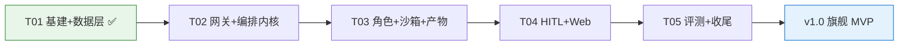
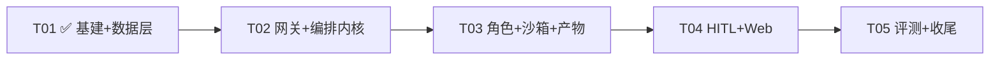

# 05 · 增量设计与任务列表 · v1.0（多 Agent 协作软件开发平台 · 面试旗舰 MVP）

> **文档性质**：增量系统设计 + 任务分解（**待评审**）。评审通过后按 §8 实施顺序分轮落地；v1.0 完工后出《06-验收报告-v1.0》。
> **编制**：主理人齐活林 ｜ **日期**：2026-10-13 ｜ **评审人**：用户（待评审）
> **目标版本**：v1.0（W1–W10）｜ **仓库**：`github.com/Eeyore104/Ymir-Agent`（main）
> **上游文档**：`docs/01-开源项目调研报告.md`、`docs/02-架构设计.md`、`docs/03-产品需求文档（PRD）.md`（v1.1 定稿）
> **写作原则**：全中文 · 结论先行 · 只写增量 · 表格化 · 面向工程师可直接编码
> **当前基线（2026-10-13）**：T01 已完成并验收（41 tests 全绿）；本版聚焦 T02–T05；架构深度细节以 `docs/02` 为准，本文档负责「版本级实施口径」。

---

## 0. 一页速览（结论先行）

| 关键问题 | 结论 |
|---|---|
| 平台一句话 | 输入一句需求 → 四角色（PM / 架构师 / 工程师 / QA）按 SOP 协作 → 产出 PRD / 设计 / 代码 / 四维评测报告 |
| 编排内核 | **自研**（不 fork 底座、不引 LangGraph）：SOP 状态机 + checkpoint 落库恢复 + HITL 三模式 |
| 模型网关 | OpenAI 兼容薄网关：分级路由（planner=reasoner / executor=chat）+ BudgetGuard + UsageRecorder；DeepSeek 先行 |
| 沙箱 | `Sandbox` 接口 + `DockerSandbox`（python:3.12-slim，默认无网，`--cpus=2 --memory=4g --pids-limit=512`）；LocalSandbox 降级预留 |
| 产物库 | 内容进文件系统（`data/artifacts/`）+ 元数据/hash 进库；版本不可变 + 血缘 + diff + zip 导出 |
| 人工参与 | HITL 三模式：key_node（三关：PRD 确认 / 设计评审 / 代码合并前）/ batch / debug；驳回带反馈回退 |
| 评测体系 | 四维（需求 30% / 可运行 30% / 规范 20% / 架构 20%）+ 双门槛（total≥75 且 runnability≥60）+ 证据链 |
| 成本控制 | 单 run 50 万 token、全局日 ¥50（`config/models.yaml` 可调）；超限暂停 + SSE 告警 |
| 任务结构 | T01 ✅ → T02 → T03 → T04 → T05（严格依赖链）；T02 / T03 批内模块可并行 |
| v1.0 总验收 | 六条（§5）：全链路浏览器可跑 / 驳回回退 / 四维报告 / diff+zip / 杀进程恢复 / CI+e2e 绿 |



---

## 1. 版本目标与范围

### 1.1 一句话目标

把「一句自然语言需求」变成「经过评审、评测、可导出的完整软件交付物」——v1.0 证明平台核心价值：**四角色全流程 + 三关审批 + 产物库 + 四维评测 + 成本可控**。

### 1.2 本期范围（做）——功能域 → 批次映射

| 功能域（PRD §4） | 核心内容 | 批次 |
|---|---|---|
| F1 项目管理 | 创建 / 查看项目、详情聚合 | T01 ✅ / T04 |
| F2 流水线运行与编排 | 202 发起、状态机、pause/resume/cancel/retry-stage、SOP YAML | T01 ✅（记录层）/ T02（引擎） |
| F3 四角色运行时 | 角色 YAML、pm/architect/engineer/qa、结构化消息 | T02（stub）/ T03（真实角色） |
| F4 HITL 三模式审批 | key_node 三关 / batch / debug；驳回回退 | T02（状态机挂点）/ T04（完整） |
| F5 产物库与版本 | 不可变版本、diff、zip 导出 | T01 ✅（数据层）/ T03（Store+API） |
| F6 评测体系 | 四维、双门槛、证据链、批量跑分 | T05 |
| F7 模型网关与成本 | 多 provider、分级路由、预算、计量 | T02 |
| F8 沙箱执行 | Sandbox 接口、DockerSandbox、网络策略 | T03 |
| F9 Web 控制台 | 六页面 + 五组件 | T01 ✅（骨架）/ T04（完整） |
| F10 实时事件 | 八类 SSE 事件、断线重放、消息流 | T02 |
| F11 断点恢复与容错 | checkpoint、启动恢复、失败保留现场 | T02 |

### 1.3 本期明确不做

- 多租户 / RBAC / 登录（v2.x；本轮仅预留 `tenant_id` + TenantContext no-op）
- 部署落地（制品生成 + 实际部署，v2.0）
- JetBrains 插件（v1.1）；可视化编排画布（v1.x）；移动端（不做）
- MVP 不做「PM 多轮需求澄清」（用审批反馈回路替代）；单 run 串行（不做多 run 并行）
- Java / Spring Boot 模板（不排期，Python 生态优先）

---

## 2. 需求基线（已锁定，不再讨论）

### 2.1 九项锁定决策（摘要）

| # | 决策 |
|---|---|
| 1 | 自研编排内核 + 开源组件适配器复用，不 fork 底座（组件仅 MIT / Apache-2.0 无附加条款） |
| 2 | Python（FastAPI）+ uv / pytest / ruff / GitHub Actions CI |
| 3 | 单租户起步，全实体预留 `tenant_id`（MVP 恒 `default`） |
| 4 | v1.0 四角色跑通 需求→PRD→架构→代码→评测；部署留 v2.0 |
| 5 | OpenAI 兼容网关、DeepSeek 先行（reasoner=planner / chat=executor）、分级路由 + 预算（50 万 token / ¥50 日） |
| 6 | 产物库为中心：版本不可变 + diff + zip 导出；GitHub 推送预留（v1.2） |
| 7 | HITL 三模式：关键节点三关 / 批量全自动 / 调试全步骤人审 |
| 8 | Sandbox 接口，MVP 本机 Docker（Win10 Build 19041+ / Win11 双兼容 + WSL2；不可用降级 LocalSandbox） |
| 9 | Vue3 + Element Plus 控制台；v1.1 插件预留；不做移动端 |

### 2.2 用户决策记录（D1–D7，详见 PRD §9）

| # | 结论 |
|---|---|
| D1 | Docker 可用；Win10 / Win11 双兼容 + WSL2；保留 LocalSandbox 降级 |
| D2 | DeepSeek Key 够用；预算默认 50 万 token / ¥50 日，可调 |
| D3 | 评测测试来源：QA 生成 + 人工挂载 `/tests` 路径优先 |
| D4 | 存储备份：`data/` + SQLite + 定期 git 快照（使用手册给命令） |
| D5 | Python 优先（不考虑 Java 方向）；v1.2 模板 Python 生态 |
| D6 | 流程：PRD 定稿 → 框架搭建 → 分轮实现（本批次的由来） |
| D7 | Dify 处置：不引入；v1.x 需要时可作「可选边车」经 REST 集成（不 fork 不耦合） |

主理人已闭环默认项（不再讨论）：第三关默认开启（项目级可关）、Element Plus、MVP 不做多轮澄清、单 run 串行、引擎不拆独立进程、License 建议 MIT。

---

## 3. 架构落点（实施级速查）

> 深度设计见 `docs/02-架构设计.md`（§3 核心抽象 / §6 接口契约 / §12 评测专项），本节只做「批次归属」速查。

### 3.1 模块地图（`src/ymir/`）

| 模块 | 职责 | 批次 | 状态 |
|---|---|---|---|
| `config.py` + `common/` | Settings 单例、错误码 / 异常基类 | T01 | ✅ 已建 |
| `models/` | 11 表 ORM（02 §3.10） | T01 | ✅ 已建 |
| `storage/` | async engine（WAL）+ Repository（tenant scope 预留） | T01 | ✅ 已建 |
| `api/`（骨架 + projects/runs 路由） | FastAPI 装配、统一响应、CORS、中间件 | T01 | ✅ 已建 |
| `gateway/` | 模型网关：providers / routing / budget / usage / 适配器 | T02 | 🔜 待建 |
| `sop/` | 流水线定义（Pydantic）+ loader + validator | T02 | 🔜 待建 |
| `orchestrator/` | 状态机 engine / executor / transitions / recovery | T02 | 🔜 待建 |
| `events/` + `messages/` | 事件总线 / 落库 / SSE 桥；消息协议与总线 | T02 | 🔜 待建 |
| `roles/` + `tools/` | 角色定义 / 注册表 / 运行时 / 提示词；角色工具 | T03 | 🔜 待建 |
| `sandbox/` | Sandbox 接口 + DockerSandbox + 会话 / 工厂 | T03 | 🔜 待建 |
| `artifacts/` | ArtifactStore：版本 / 血缘 / diff / zip | T03 | 🔜 待建 |
| `hitl/` | 审批策略 / 引擎 / 服务 | T04 | 🔜 待建 |
| `evaluation/` | harness / 四维 evaluator / aggregator / report | T05 | 🔜 待建 |
| `web/` | Vue3 控制台（六页面 + 五组件） | T01 骨架 ✅ / T04 完整 | 进行中 |

### 3.2 数据层（已就绪）

- 11 张表全部已建（迁移 `0001_initial`，升 / 降 / 升已验证）：`projects / pipeline_runs / stage_executions / artifacts / artifact_versions / messages / approvals / model_calls / events / sandbox_sessions / pipelines`。
- 约定：全表带 `tenant_id`（默认 `default`）；`events.seq` / `messages.seq` 按 run 单调递增（唯一约束）；时间 ISO 8601 UTC；ID UUID v4 字符串。
- T02 起模型变更走增量迁移（`0002+`），并在 CI 增加 `alembic check` 漂移护栏。

### 3.3 API 契约（23 端点 + SSE）

- **T01 已实现 6 个**：`GET /health`、`POST /projects`、`GET /projects`、`GET /projects/{id}`、`POST /projects/{id}/runs`（202）、`GET /runs/{id}`。
- 批次补齐：**T02** `runs/{id}/actions`、`runs/{id}/messages`、`runs/{id}/events`（SSE）、`models`、`usage`；**T03** `projects/{id}/artifacts`、`artifacts/{id}`、`artifacts/{id}/versions/{v}/content`、`artifacts/{id}/diff`、`sandboxes`；**T04** `approvals`（列表 / 详情 / 决策）；**T05** `evaluations`、`projects/{id}/evaluations`、`projects/{id}/export`。
- 统一约定：`{code:0,data}` 信封；业务码 1001–1006 + 500（内部错误）；SSE 八类事件（run / stage / approval / artifact / message / usage / budget / evaluation），支持 `Last-Event-ID` 重放。

### 3.4 关键技术设计（实施要点索引）

**① ModelGateway（T02）** —— 薄网关约 300 行（openai SDK 打底，不引 LiteLLM）：`config/models.yaml` provider 注册表（deepseek 先行，qwen / glm / kimi 同构）；Router 按 tier 优先级 + fallback 链；BudgetGuard 前置检查（超限 → `BudgetExceeded` → run paused + SSE 告警）；UsageRecorder 每次调用落 `model_calls`；Anthropic 适配器接口预留。详见 02 §3.9。

**② SOP 引擎（T02）** —— `config/pipelines/software-dev.yaml` 四阶段（prd → architecture → coding → evaluation）+ 三关 gate + 转移边；`SopValidator` 加载时静态校验（ID 唯一 / 输入可被上游满足 / 转移边可达终点 / reject 目标存在 / 角色已注册）；定义版本化入库（`pipelines` 表）。

**③ 编排状态机（T02）** —— 状态：`pending → running → waiting_approval → completed / failed / paused`；每步落库（checkpoint）；启动恢复：扫描未完成 run（running 从当前阶段 attempt+1 重跑、waiting_approval 原地恢复）；MVP 单 run 串行 + 并发信号量预留。**T02 先用 stub 角色跑通空流水线**，真实角色在 T03 接入。

**④ 事件与消息（T02）** —— EventBus（落库 + SSE 桥，seq 断线重放）；MessageBus（文档先行：`content_refs` 引用 + ≤500 字摘要）。

**⑤ 沙箱（T03）** —— 接口：`start / stop / destroy` + 会话 `exec / read_file / write_file / list_files / set_network_policy`；DockerSandbox：`python:3.12-slim`、每 run 一会话、默认 `network=none`、评测按需 `restricted`（pypi/npm 白名单）、限额 `--cpus=2 --memory=4g --pids-limit=512`；工厂 + LocalSandbox 降级预留（本机 Docker 已确认可用，降级不阻塞主线）。

**⑥ 产物库（T03）** —— `save / load / diff / export_zip`；内容只进 `data/artifacts/<project>/<artifact>/<version>/`；版本不可变 + `parent_version_id` 血缘；difflib unified diff 按文件分组；zip 含 `manifest.json`。

**⑦ 角色运行时（T03）** —— 角色 YAML（tier / capabilities / inputs / outputs / output_schema / retry）+ Jinja2 提示词 + 工具白名单；四角色：pm / architect = planner，engineer / qa = executor；输出过 schema 校验（如 `PRDDocument`）。

**⑧ HITL（T04）** —— `ApprovalPolicy.mode = key_node / batch / debug`；审批状态机（pending → approved / rejected）；驳回：feedback 消息入角色上下文 + `attempt+1` 重跑 + 产物新版本；审批卡片数据面（阶段摘要 + 产物 + 历史反馈链）。

**⑨ 评测 harness（T05）** —— 四维 evaluator（独立实现可单测）；聚合加权 + 双门槛；每分附 `evidence[]`；judge 结构化 JSON + 低温（≤0.2）+ 证据缺失强制低分；批量跑分对 ≥2 路由组合出性价比榜单。详见 02 §12。

---

## 4. 任务列表（T01–T05）

> 规则：按功能模块分组；每任务有独立「里程碑演示」；批内模块可并行者已注明。完成判据均**可演示**。

### T01 项目基础设施 + 数据层 —— ✅ 已完成（2026-10-13 验收）

- **交付**：工程化（pyproject / CI / .env.example / README）+ FastAPI 骨架 + 11 表 ORM / Repository / 迁移 + Web 骨架 + 测试；共 41 个文件。
- **验收证据**：`pytest 41 passed`（21 基线 + 20 QA 边界）；`ruff` 0 error；迁移升 / 降 / 升通过；`/health` 200（真实 DB 探测，反例 503）；建项目 → 列表 → 发起 run(202) → 查询冒烟通过；Web `npm run build` 通过；QA 独立验证 **ROUTE: NoOne**。
- **遗留（非阻塞）**：`ruff format` 8 文件待统一；`alembic check` 护栏待 T02 加入 CI；`web/src/api/client.ts` 待 T04 重构。

### T02 模型网关 + 编排内核（W3–4）

- **目标**：stub 角色跑通四阶段空流水线 + SSE 全事件流 + DeepSeek 真实调用计量 + 预算暂停路径 + 断点恢复。
- **交付物（文件级）**：
  - `src/ymir/gateway/`：`gateway.py`、`providers.py`、`routing.py`、`budget.py`、`usage.py`、`adapters/anthropic.py`（接口预留）
  - `config/models.yaml`
  - `src/ymir/sop/`：`models.py`、`loader.py`、`validator.py`；`config/pipelines/software-dev.yaml`
  - `src/ymir/orchestrator/`：`engine.py`、`executor.py`、`transitions.py`、`recovery.py`
  - `src/ymir/events/`：`bus.py`、`log.py`、`sse.py`；`src/ymir/messages/`：`schema.py`、`bus.py`
  - `src/ymir/api/routers/`：`events.py`、`models.py`、`usage.py`
  - `scripts/smoke_gateway.py`；`tests/test_gateway.py`、`tests/test_orchestrator.py`

- **子任务细分**：

  | # | 子任务 | 产出 | 依赖 |
  |---|---|---|---|
  | T2-1 | 网关基座：注册表 / 路由 / 预算 / 计量 / fallback 降级链 | `gateway/*` + `config/models.yaml` | — |
  | T2-2 | SOP：定义模型 + 加载 + 静态校验 | `sop/*` + `software-dev.yaml` | — |
  | T2-3 | 编排内核：状态机 / 阶段执行（stub）/ 启动恢复 | `orchestrator/*` | T2-2 |
  | T2-4 | 事件与消息：总线 / 落库 / SSE 桥 / 断线重放 | `events/*`、`messages/*`、routers | T2-3 |
  | T2-5 | 联调验证：冒烟脚本 + DeepSeek 实测 + 杀进程恢复演示 + 测试 | `smoke_gateway.py` + tests | 全部 |

- **验收点**：① stub 四阶段空流水线跑通；② SSE 收到全事件流（含断线重放）；③ DeepSeek 真实调用成功且 token / 成本落 `model_calls`；④ 预算超限触发暂停路径（单测覆盖）；⑤ 杀进程重启 run 自动恢复；⑥ pytest / ruff 全绿；⑦ CI 增加 `alembic check` 护栏。
- **里程碑演示**：终端 + curl 演示「一次 run：pending → … → completed + 事件流 + 用量表」。

### T03 角色运行时 + 沙箱 + 产物版本（W5–6）

- **目标**：真实四角色上线；命令行单跑 PM 出 PRD v1；沙箱内执行生成代码；产物版本 diff。
- **交付物（文件级）**：
  - `src/ymir/roles/`：`definition.py`、`registry.py`、`runtime.py`、`prompts.py`
  - `config/roles/`：`pm.yaml`、`architect.yaml`、`engineer.yaml`、`qa.yaml` + `prompts/*.md.j2`（4 个）
  - `src/ymir/tools/`：`doc_writer.py`、`code_writer.py`、`read_artifact.py`
  - `src/ymir/sandbox/`：`base.py`、`docker_sandbox.py`、`session.py`、`factory.py`
  - `src/ymir/artifacts/`：`store.py`、`versioning.py`、`diff.py`；`src/ymir/storage/artifact_repo.py`
  - `src/ymir/api/routers/`：`artifacts.py`、`sandboxes.py`；`docker/sandbox.Dockerfile`
  - `scripts/run_single_role.py`；`tests/test_roles.py`、`tests/test_sandbox.py`、`tests/test_artifacts.py`

- **子任务细分**：

  | # | 子任务 | 产出 | 依赖 |
  |---|---|---|---|
  | T3-1 | 角色运行时：定义 / 注册 / 提示词渲染 / 输出校验 | `roles/*` + `config/roles/*` | T02 |
  | T3-2 | 工具三件套（doc_write / code_write / read_artifact） | `tools/*` | T3-1 |
  | T3-3 | 沙箱：接口 + Docker 适配 + 网络策略 + 工厂 | `sandbox/*` + Dockerfile | —（可与 T3-1 并行） |
  | T3-4 | 产物版本：Store / 血缘 / diff + API | `artifacts/*` + routers | —（可与 T3-1 并行） |
  | T3-5 | 联调：PM 单跑出 PRD v1 + 沙箱冒烟 + diff 演示 + 测试 | `run_single_role.py` + tests | 全部 |

- **验收点**：① `run_single_role.py` 单跑 PM：需求 → PRD 产物 v1 入库 + Message 落库，且过 `PRDDocument` schema 校验；② 工程师产物落盘成版本；③ 沙箱内 exec 冒烟通过（资源限额生效）；④ `/artifacts/{id}/diff` 返回 unified diff；⑤ 全量回归零失败。
- **里程碑演示**：命令行出 PRD 产物（带版本号）+ 沙箱执行生成代码 + 版本 diff。

### T04 HITL 审批引擎 + Web 控制台（W7–8）

- **目标**：浏览器完整跑通四角色流水线；三关审批可驳回回退（产物版本递增）。
- **交付物（文件级）**：
  - `src/ymir/hitl/`：`engine.py`、`policy.py`、`service.py`；`src/ymir/orchestrator/gates.py`；`src/ymir/api/routers/approvals.py`
  - `web/src/api/`：`client.ts`、`sse.ts`（**T01 遗留：HomeView 直连 axios 在此重构**）
  - `web/src/stores/`：`projects.ts`、`runs.ts`、`artifacts.ts`、`approvals.ts`
  - `web/src/components/`：`StageStepper.vue`、`LogStream.vue`、`ApprovalCard.vue`、`MarkdownView.vue`、`DiffView.vue`
  - `web/src/views/`：`ProjectBoard.vue`、`RunDetail.vue`、`ArtifactLibrary.vue`、`ApprovalCenter.vue`、`EvalReport.vue`、`Settings.vue`；`App.vue`、`router/index.ts`
  - `tests/test_hitl.py`

- **子任务细分**：

  | # | 子任务 | 产出 | 依赖 |
  |---|---|---|---|
  | T4-1 | 审批引擎：策略三模式 + 审批生命周期 + 驳回回退 | `hitl/*` + `gates.py` + `approvals.py` | T03 |
  | T4-2 | 前端基座：api client / SSE composable / Pinia stores | `web/src/api`、`stores` | T02（SSE） |
  | T4-3 | 组件五件套 | `components/*` | T4-2 |
  | T4-4 | 页面六件套 + 路由 | `views/*` | T4-3 |
  | T4-5 | 联调验收：全流程演示 + 驳回回退 + 三模式单测 | tests + 演示 | 全部 |

- **验收点**：① 浏览器完成「建项目 → 发起 → 实时推进 → 三关审批（含驳回反馈回退，产物版本递增）」；② batch / debug 模式单测覆盖；③ 断线重订阅不丢事件；④ 全量回归零失败。
- **里程碑演示**：浏览器全流程录屏素材（面试核心演示）。

### T04.1 演示期缺陷热修 —— 空响应 fail-fast（2026-10-15，T05 前置）

- **背景**：里程碑演示时（11:41–12:12）遭遇外部瞬时 stall——DeepSeek 调用被挂至 ~900s 后返回**退化空响应（content 空 + 0 token）**；网关将其视为成功，导致角色校验两次重试各烧 15 分钟、运行失败（排查详情见 `.workbuddy/memory/2026-10-15.md`）。
- **交付物（文件级）**：`src/ymir/gateway/gateway.py`（`_invoke` 防御性判定）；`tests/test_gateway.py`（新增空响应用例）。
- **修复口径（QA 按此验证）**：当 `content` 为空**且** 总 token（prompt+completion）为 0 时抛出 `ModelCallError`（附带 provider/model 与"上游异常或网络中断"提示），使其进入网关候选链降级/最终显式失败；**不得误伤**「content 空但 usage>0」的合法场景（max_tokens 截断等，应维持现有成功返回 + 校验重试链路）。
- **验收点**：① 空响应 → 抛错，候选链降级生效；② usage>0 空内容不受影响；③ 全量回归零失败 + ruff 全绿。

### T05 评测 harness + 集成收尾（W9–10）

- **目标**：一键评测出四维报告；批量跑分对比；导出 zip；v1.0 验收清单全过。
- **交付物（文件级）**：
  - `src/ymir/evaluation/`：`harness.py`、`runner.py`、`aggregator.py`、`report.py`；`evaluators/`：`base.py`、`requirement.py`、`runnability.py`、`convention.py`、`architecture.py`
  - `evals/suites/default.yaml`；`src/ymir/api/routers/`：`evaluations.py`、`export.py`
  - `scripts/run_eval.py`、`scripts/dev.sh`、`docker-compose.yml`（一键起，可选）
  - `docs/04-使用手册.md`、`README.md`（完善）
  - `tests/test_evaluation.py`、`tests/e2e/test_full_pipeline.py`

- **子任务细分**：

  | # | 子任务 | 产出 | 依赖 |
  |---|---|---|---|
  | T5-1 | 四维 evaluator + 加权聚合 + 双门槛 | `evaluators/*` + `aggregator.py` | T03 |
  | T5-2 | harness / runner + suite YAML + 报告 | `harness.py` 等 + `default.yaml` | T5-1 |
  | T5-3 | 批量跑分：路由组合对比榜单 | `runner.py` + `run_eval.py` | T5-2 |
  | T5-4 | 导出 zip + evaluations API | `export.py`、`evaluations.py` | T03 |
  | T5-5 | 收尾：e2e（假响应）+ 使用手册 + README + v1.0 验收清单 | `tests/e2e` + `docs/04` + README | 全部 |

- **验收点**：① 对代码产物一键评测：四维分数 + 证据链 + 通过判定；② 批量 ≥2 任务出性价比对比；③ 导出 zip 可还原项目全貌（含 manifest.json）；④ e2e（mock LLM）绿；⑤ 使用手册含 Docker 安装（Win10/WSL2）与备份命令；⑥ v1.0 验收清单（§5）全过。
- **里程碑演示**：一键评测报告 + 导出包 + 演示视频素材。
- **T5-5 收尾追加项（T04 演示期登记，2026-10-15）**：① `run.started` 事件 payload 补 `mode` 字段（前端当前显示"模式 -"）；② 前端 bundle 1.24MB 优化（Element Plus 按需/manualChunks）；③ Settings 用量补 run/project scope 展示；④ `message.created` 前端增量刷新（现为整体刷新）；⑤ 演示库遗留测试数据清理（现无 DELETE 端点，可加清理脚本）。

### 任务依赖图



> **并行建议**：批间严格依赖（逐批递进）；**批内** T2-1 / T2-2 可并行，T3-3 / T3-4 可并行（开发完再合入，合入前跑全量回归）。

---

## 5. 验收标准（v1.0 总口径）

v1.0 六大验收（PRD §7.2，逐条可演示）：

| # | 验收线 | 判定方式 |
|---|---|---|
| ① | 需求输入 → PRD → 设计 → 代码 → 评测报告**全链路浏览器可跑** | T04 / T05 全流程演示 |
| ② | 三关审批可**驳回并带反馈回退**（产物版本递增） | T04 演示 + 产物版本号核验 |
| ③ | 评测报告**四维分数 + 证据链 + 通过判定** | T05 报告抽查证据可定位 |
| ④ | 产物可**版本 diff**、导出 **zip** | T03 / T05 演示 |
| ⑤ | **杀进程重启 run 自动恢复** | T02 演示（后续批次回归复测） |
| ⑥ | **CI 绿 + e2e 绿 + 一键启动可复现** | 推送后 CI + `scripts/dev.sh` |

附加质量口径：双门槛 `total ≥ 75 且 runnability ≥ 60`；成本红线 50 万 token / ¥50 日；每批次完成后跑全量回归（零回归），QA 独立验证给出路由判定。

---

## 6. 测试计划（增量）

- **现状**：41 个（21 基线 + 20 QA 边界），全绿。
- **增量计划（预计 +90~120，v1.0 收官约 130–160）**：

| 批次 | 测试文件 | 覆盖点 |
|---|---|---|
| T02 | `tests/test_gateway.py`、`tests/test_orchestrator.py` | 路由 / 预算 / fallback 降级链、状态机全迁移、断点恢复、SSE 重放、seq 单调 |
| T03 | `tests/test_roles.py`、`tests/test_sandbox.py`、`tests/test_artifacts.py` | 角色注册 / 提示词渲染 / schema 校验、沙箱 mock 全接口、版本不可变 / 血缘 / diff |
| T04 | `tests/test_hitl.py` | 三模式策略、驳回回退迁移、审批状态机、重复决策（1003） |
| T05 | `tests/test_evaluation.py`、`tests/e2e/test_full_pipeline.py` | 四维 evaluator 逐维、双门槛聚合、批量对比、全链路假响应 e2e |

> 纪律：单测一律 mock LLM（0 费用）；e2e 用假响应；真实 DeepSeek 仅用于冒烟脚本（手动触发）。

---

## 7. 风险与开放项

| # | 风险 / 开放项 | 应对 |
|---|---|---|
| R1 | Docker / WSL2 环境差异（演示 / 换机场景） | 双兼容设计 + LocalSandbox 降级；使用手册给检查步骤 |
| R2 | LLM 输出不稳定（结构化失败 / 幻觉） | schema 校验 + retry；judge 结构化 + 低温 + 证据缺失强制低分 |
| R3 | 成本超支 | BudgetGuard 前置拦截 + 计量落库；批量跑分优先 executor 档 |
| R4 | 网络环境（GitHub 推送 / npm / PyPI） | 推送遇阻「绕过代理直连」；npm 用 npmmirror；PyPI 备用清华镜像 |
| R5 | 文件回退（项目历史 2 次事故） | 动既有文档前先重读；队友活动后 md5 核验；重要文档保留备份快照 |
| R6 | 沙箱资源占用（本机） | 单 run 串行 + 资源限额（2C / 4G / 512pids）；会话用后销毁 |
| R7 | 前端构建环境个例（如 esbuild EBUSY） | 前端不进 CI；e2e 假响应不依赖外网 |
| R8 | PRD 开放项（Q2 第三关 / Q3 预算 / Q5 澄清对话） | Q2 T04 前再确认；Q3 首次真实跑分后复评；Q5 留 v1.1 评估 |

---

## 8. 实施顺序

1. **T02 网关 + 编排内核**（stub 四阶段空流水线 → SSE → 真实计量 → 断点恢复）
2. **T03 角色 + 沙箱 + 产物**（PM 单跑 → 沙箱执行 → 版本 diff）
3. **T04 HITL + Web**（三关审批 + 六页面全流程）
4. **T05 评测 + 收尾**（四维报告 → 批量 → 导出 → e2e → 验收）

**批内节奏（每批统一）**：实现（含自测 / 一致性审查）→ QA 独立验证（路由判定）→ 主理人终验（含防回退核验）→ 里程碑演示 → 用户确认节点（提交推送按需）→ 下一批。

**完成定义（每批）**：验收点全过 + 全量回归零失败 + ruff / pytest 绿 + 演示产出可复现。

---

## 9. 待评审确认项（默认按建议执行，不阻塞）

| # | 事项 | 默认建议 | 拍板 |
|---|---|---|---|
| 1 | 提交节奏：每批完成提交一次 vs v1.0 全完合一 | 每批里程碑经用户确认后提交（增量提交，附 CI 首次运行） | 用户 |
| 2 | CI 增加 `alembic check` 迁移漂移护栏（QA 建议） | 加（T02 一并落地） | 主理人默认 |
| 3 | `ruff format` 全量统一（T01 遗留 8 文件） | T02 开工前顺手执行并复验测试 | 主理人默认 |
| 4 | `BizCode.INTERNAL_ERROR=500` 补录进业务码表（02 §6.3 / PRD） | 随本评审一并增量修订 | 用户 |
| 5 | 评测 judge 默认模型与温度 | `deepseek-chat`，temperature 0.2 | 主理人默认 |
| 6 | 沙箱镜像是否预装 Node（前端类产物评测用） | 不纳入 v1.0（留 v1.x 镜像变体） | 主理人默认 |

---

## 附录 A · T01 交付物核验基线（2026-10-13）

- 文件：41 个（Python 27 文件 / 2479 行 + Web 5 源文件 + 迁移 / CI / 工程化配置）。
- 验证：`uv sync --locked` ✅；`ruff check` 0 error ✅；`pytest 41 passed` ✅；`alembic upgrade / downgrade / upgrade` ✅；`alembic check` 无新操作 ✅；`/health` 200（真实 DB 探测）✅；建项目 → run 记录 → 查询冒烟 ✅；Web `npm run build` ✅。
- QA 结论：**ROUTE: NoOne（零源码 Bug）**；遗留为非阻塞优化项（format 统一 / 漂移护栏 / T04 重构 client.ts）。

## 附录 B · 一键命令一览（v1.0 完成后的目标状态）

```bash
uv sync && uv run pytest && uv run ruff check .          # 质量门禁
uv run uvicorn ymir.api.app:app --port 8000              # 启动 API
cd web && npm run dev                                    # 启动控制台（代理 8000）
uv run python scripts/smoke_gateway.py                   # 网关冒烟（真实调用 + 计量）
uv run python scripts/run_single_role.py --role pm       # 单跑 PM 出 PRD 产物
uv run python scripts/run_eval.py --suite default        # 一键评测（四维报告）
uv run pytest tests/e2e -q                               # 全链路 e2e（假响应）
```

---

> 本文档为《05 增量设计与任务列表 · v1.0》（**待评审**）——上游 `docs/01 / 02 / 03`，配套图 `docs/class-diagram.mermaid`、`docs/sequence-diagram.mermaid`；评审通过后按 §4 任务列表与 §8 实施顺序落地，完工后出《06-验收报告-v1.0》。
> 变更走增量修订：版本号 +1，记录于下表。

| 修订 | 日期 | 变更 |
|---|---|---|
| v1.0（初稿） | 2026-10-13 | 首版：v1.0 全量设计 + 任务列表（T01 ✅ + T02–T05 细化），待用户评审 |
