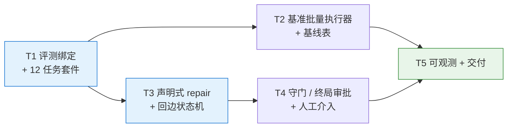
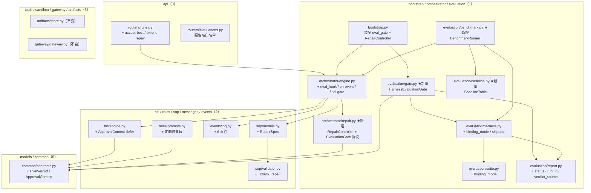
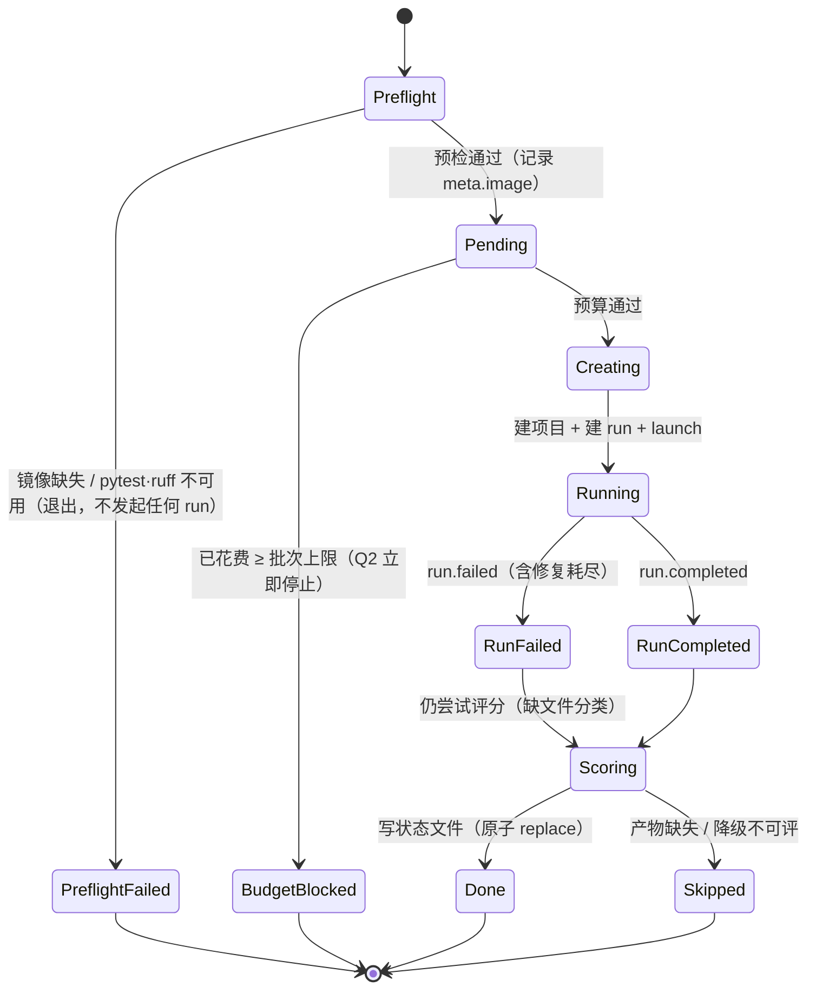
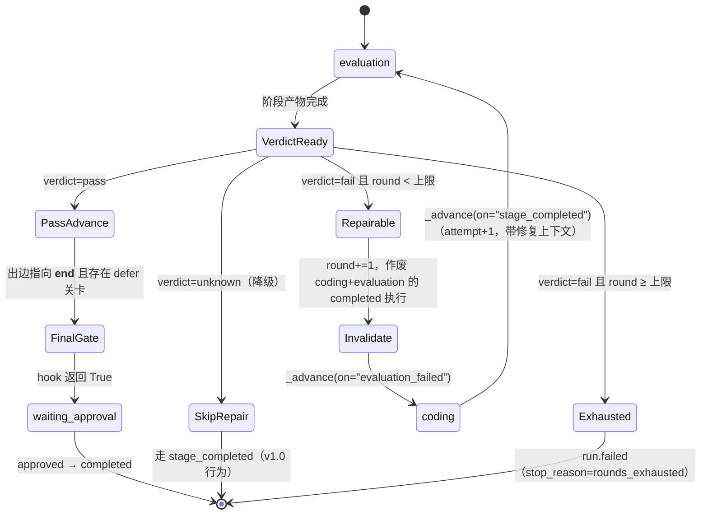
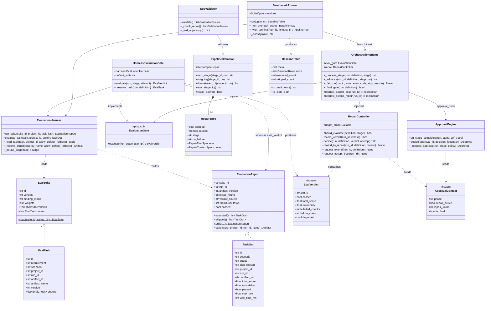
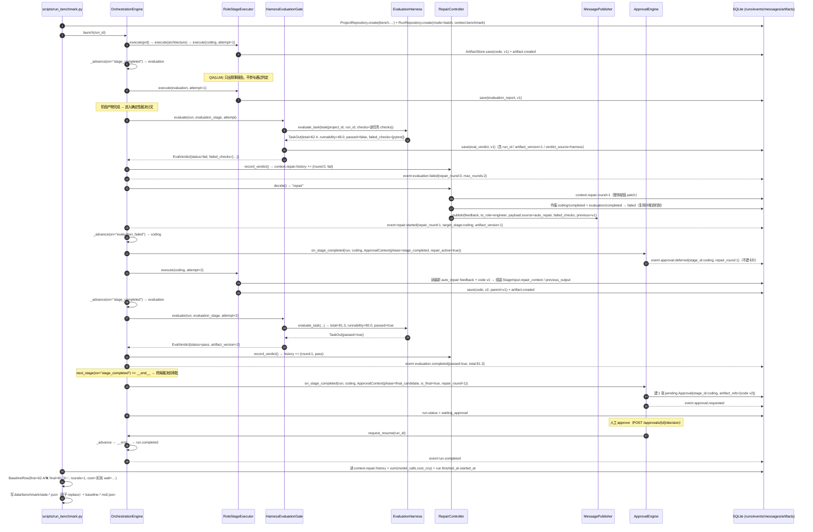
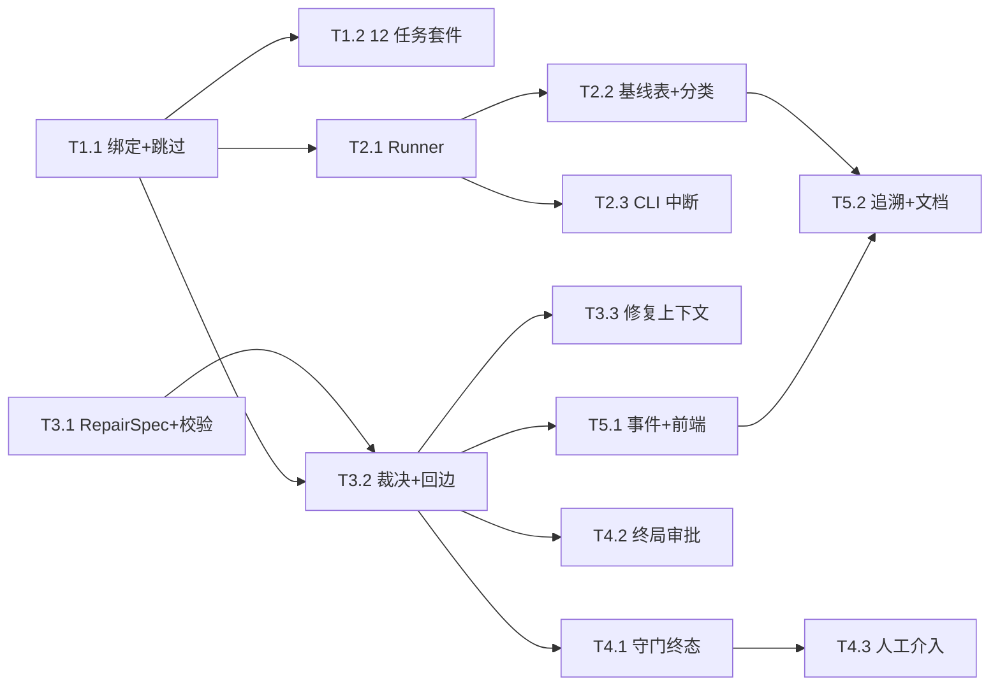

# 07 · 增量设计与任务列表 · v1.1（可验证性 + 自愈）

> **文档性质**：增量系统设计 + 任务分解（**待评审**）。只描述**相对 v1.0 的变更**，不重复已交付内容；v1.0 基线以 `docs/06-验收报告-v1.0.md` 为准（pytest 302 / vitest 26 / CI 双 job 绿）。  
> **编制**：架构师 高见远 ｜ **日期**：2026-10-19 ｜ **上游**：`docs/03-产品需求文档（PRD）.md`、`docs/06-验收报告-v1.0.md`、v1.1 增量 PRD（13 条 P0 / R1–R9 / RK1–RK9）  
> **写作原则**：全中文 · 结论先行 · 只写增量 · 表格化 · 面向工程师可直接编码 · 关键接口签名 / YAML / 事件 payload 给全，不写完整实现  
> **配套图**：`docs/class-diagram-v1.1.mermaid`、`docs/sequence-diagram-v1.1.mermaid`（**不覆盖** v1.0 的 `class-diagram.mermaid` / `sequence-diagram.mermaid`）


---

## 0. 一页速览（结论先行）

| 关键问题      | 结论                                                                                                                                                                       |
| --------- | ------------------------------------------------------------------------------------------------------------------------------------------------------------------------ |
| 本期范围      | A（评测证据层 1 → 12 任务 + 基线表）+ B（评测未过 → 定向修复 ≤2 轮）。C/D 随后，E/F 延后                                                                                                              |
| A 的核心缺陷修复 | `EvalTask` 增 `project_id` / `run_id` / `scenario`；套件增 `binding_mode`；`per_task` 模式下**未绑定任务 → `skipped`**，彻底移除跨项目 `_DEFAULT_ARTIFACT` 回退（回退仅在 `single` 模式保留，v1.0 行为逐字节不变） |
| B 的裁决源    | **确定性 harness 是唯一通过判定者**；QA（LLM）只做叙事与证据补充，不参与双门槛判定。裁决经 `EvaluationGate` 协议注入编排引擎                                                                                         |
| 回边        | 事件名 `evaluation_failed`；`repair` 配置块声明「开关 / 上限 / 目标阶段 / 评估套件」；**0 轮 = 走 `stage_completed`，与 v1.0 等价**                                                                    |
| 轮次计数      | `run.context["repair"]`（JSON，**零数据库迁移**），`round` 单调递增、`history[]` 留全程裁决                                                                                                  |
| HITL      | 修复循环内的 `coding.gate` **延迟（defer）**，仅在「裁决通过 + 即将进终点」时对**最终候选版本**发 1 张卡片；pending 复用防刷屏                                                                                     |
| 守门        | 轮次（配置）/ 单 run token（50 万）/ 日成本（¥50）三守门；执行中超限仍 `paused`（v1.0 语义），**修复发起前预检超限 → `failed`（`error_code=1004`）**                                                              |
| 数据库       | **0 张表 / 0 个字段变更 → 0 个新迁移**（RK9 直接消解）；如需 SQL 聚合再补 `0004`                                                                                                                 |
| 新增依赖      | **Python 依赖零新增**（仅用现有 pydantic / PyYAML / asyncio / SQLAlchemy）；沙箱**镜像层**新增 `ruff`（不进 `uv.lock`，见 §9）                                                                    |
| 任务分解      | **5 个主任务 / 13 个子任务**，按 T1 → T5 递进，T1 与 T3 可并行起步                                                                                                                          |



---

## 1. 版本范围与目标

### 1.1 一句话目标

> 让 ymir-agent 从「能跑通一次」升级为「**能被量化验证，并且能自己改到通过**」。

| 目标      | 验收线（PRD §1）  | 本设计的对应交付                                    |
| ------- | ------------ | ------------------------------------------- |
| G1 证据可信 | A1 / A2 / A3 | 12 任务套件（T1.2）+ 逐任务产物绑定（T1.1）+ 批量执行器与基线表（T2） |
| G2 闭环自愈 | B1 / B2 / B3 | 回边状态机（T3）+ 守门终态（T4.1）+ 可观测（T5.1）            |
| G3 叙事可讲 | A-05         | 基线表 Markdown/JSON + 案例（T5.2）                |

### 1.2 本期做 / 不做

| 做（P0 13 条）                                                         | 不做（明确）                                                                             |
| ------------------------------------------------------------------ | ---------------------------------------------------------------------------------- |
| A-01~A-06：12 任务、任务↔产物绑定、批量脚本（limit/resume/budget）、基线表、README、失败六分类 | JetBrains 插件、部署落地、GitHub 导出、多租户/RBAC、多轮澄清、可视化编排、新增评测维度或改阈值、真实跑分进 CI、新重型依赖          |
| B-01~B-07：回边、触发与终止、三重守门、可观测、配置化、HITL 语义、耗尽后人工介入                    | P1-01~P1-05（基线历史 diff / Web 基线页 / 修复策略分级 / 效益统计 / 扩到 16+）——本次不做，但 T2.2 的分层已为其留出派生点 |

### 1.3 版本决策（已拍板，直接实施）

| #  | 决策                                                     |
| -- | ------------------------------------------------------ |
| Q1 | 自动修复不产生审批卡片；第三关一次 run 内只对**最终候选版本**审 1 次               |
| Q2 | 批次预算达上限 → **立即停止、不补跑**；剩余任务标「未执行」，不做零费用补分（避免实测/估算混算）   |
| Q3 | 未执行/无效任务**不计入通过率分母**，但基线表与 README 必须显式披露数量             |
| Q4 | 12 个任务全部从零生成，不提供起跑代码或夹具                                |
| Q5 | 修复耗尽后的人工介入只做 **CLI/API**（接受最优版 / 追加 1 轮 / 终止），Web 只读展示 |
| 版本 | v1.1 = A + B；C/D 随后；E/F（插件、部署）延后                       |

---

## 2. 现状与差距（含已核实的代码事实）

> 下列事实已由主理人逐点核实，**直接采用，不再重复踩点**；本设计的所有改动点均以此为基准。

| #   | 现状（代码事实，标注位置）                                                                                                                                                                                                 | 缺陷性质                                 | 本设计对策                                                               |
| --- | ------------------------------------------------------------------------------------------------------------------------------------------------------------------------------------------------------------- | ------------------------------------ | ------------------------------------------------------------------- |
| C1  | `evaluation/harness.py:255 run_suite(suite_id, *, project_id, ...)` 对套件内**全部任务用同一个 `project_id`** 取产物                                                                                                         | A2 直接冲突                              | `run_suite` 增 `binding_mode` 分支，逐任务解析项目（§4.1）                       |
| C2  | `harness.py:323 _load_task` 按 `artifact_name` 在**该项目**产物里找；`harness.py:347 _resolve_target` 未命中时回退 `_DEFAULT_ARTIFACT="code"`（`harness.py:43`）                                                                | 「一套代码评 12 次」的根因                      | 回退改为**显式开关**，`per_task` 模式关闭回退 → 标记 `skipped`（§4.1）                 |
| C3  | `sop/models.py:37 TransitionSpec.on` 已是任意字符串（默认 `stage_completed`）；`PipelineDefinition.next_stage(stage_id, *, on=...)` 支持按事件选边（`models.py:81`）                                                               | 回边**无需改数据结构**                        | 直接新增一条事件为 `evaluation_failed` 的边（YAML 里键须写 `"on":`，见 §4.3.2）        |
| C4  | `sop/validator.py:106 _fwd_adjacency()` 只把 `on == "stage_completed"` 的边纳入可达性 / 输入可满足性校验                                                                                                                       | 回边不会破坏「可达终点」校验                       | 复用；新增 `_check_repair` 单独校验回边（§4.3）                                  |
| C5  | `sop/validator.py:86 _check_transitions()` 仍校验 `to` 必须存在                                                                                                                                                      | 回边目标写错能在加载期被拒                        | 直接满足 B-05 ③                                                         |
| C6  | `orchestrator/engine.py:248 _process_stage()`：执行 → `_finish_stage_exec` → emit `stage.completed` → `approval_hook(run, stage)` → `_advance()`（`engine.py:310`，内部 `next_stage(stage.id)` 默认 `stage_completed`） | 无「阶段后置裁决」位置，`_advance` 无事件参数         | 增 `eval_gate` 挂点 + `_advance(..., on=...)`（§4.3）                    |
| C7  | `engine.py:256` 恢复分支：最新执行记录 `completed` 时**直接补推进、不重跑**；`hitl/engine.py:357 _apply_reject()` 正是靠「把 completed 改 failed」让引擎自然 `attempt+1`                                                                        | 回边必须复用同一机制，否则回到 coding 立刻被跳过         | `RepairController` 复用「作废 completed 记录」手法，并同步作废下游 `evaluation`（§4.3） |
| C8  | `StageOutcome`（`orchestrator/executor.py:19`）字段 `output_refs / summary / message_type / payload`，`payload` 可承载裁决                                                                                              | 裁决无需新契约类即可传递                         | 裁决另走 `EvalVerdict`（跨层合同）+ `payload` 冗余（§4.4）                        |
| C9  | `stage_executions.attempt`（`models/entities.py:120`）已表达「同阶段第 N 次执行」，与「自动修复轮次」语义不同（一次修复 = coding `attempt+1`，但人工驳回同样 `attempt+1`）                                                                              | 不能复用 attempt 计轮次                     | 轮次独立记 `run.context["repair"].round`（§4.3）                           |
| C10 | `evaluation` 阶段是 `role=qa` 的 **LLM 角色**（`config/roles/qa.yaml`，输出 `EvalSummary` 简化版），确定性 harness 在阶段之外；`api/routers/evaluations.py:68` 明确「qa 阶段简化版报告不含 suite_id/total_score，跳过不收摘要」                           | 两套口径并存，B 需要确定性裁决驱动回边                 | QA 降级为「叙事」，harness 独占裁决权（§4.4）；报告名分离（§4.4）                          |
| C11 | judge 成本归属缺口：`LLMJudge.judge()`（`evaluators/base.py:228`）调 `gateway.chat(...)` **不传 `run_id`**，而 `gateway.chat`（`gateway.py:130`）支持 `run_id` → judge 成本落库时 `model_calls.run_id = NULL`                        | R3「任务成本含 judge」无法按 run 聚合            | `LLMJudge.with_run(run_id)` 绑定副本（§4.2，**新发现的阻塞点**）                  |
| C12 | `hitl/engine.py:141 on_stage_completed(run, stage) -> bool`：`key_node` 下 `coding.gate` 每完成一次就建 pending 审批                                                                                                     | 自动修复每轮都会弹卡片（RK1）                     | 带 `ApprovalContext` 的 defer 语义（§4.5）                                |
| C13 | `scripts/check_import_graph.py:35 LAYERS`：`orchestrator/evaluation=1`、`sop/hitl/roles=2`、`tools/sandbox/gateway/artifacts=3`                                                                                  | 新增代码不得逆层                             | 裁决协议放 `orchestrator`，实现放 `evaluation`，合同放 `common`（§3.2）            |
| C14 | `run.context` 是 `JSON` 列（`entities.py:76`），`_load_run` 每轮重读                                                                                                                                                   | 可存轮次状态，但 **SQLAlchemy JSON 不追踪原地修改** | 一律「读 → 复制 → 整体赋值 → commit」（§10 共享知识）                                |

---

## 3. 总体方案

### 3.1 分层与组件图（增量部分高亮）



### 3.2 关键取舍（4 条，全部有被否方案）

| #  | 取舍                                                                                                    | 被否方案                                                      | 理由                                                                                                                                                                          |
| -- | ----------------------------------------------------------------------------------------------------- | --------------------------------------------------------- | --------------------------------------------------------------------------------------------------------------------------------------------------------------------------- |
| K1 | 裁决协议 `EvaluationGate` 放 **orchestrator**，实现 `HarnessEvaluationGate` 放 **evaluation**，合同类型放 **common** | 把 harness 直接塞进 `RoleStageExecutor`                        | ① 执行器职责是「产出产物」，评测是「判定产物」，混在一起 coding 阶段也会被评；② `orchestrator(1) → evaluation(1)` 同层合法，`roles(2) → evaluation(1)` 逆层会被 CI 拦                                                   |
| K2 | 新增**确定性「裁决闸门」**，不新增 `evaluator` 角色                                                                    | 注册 `role: evaluator` 走角色注册表                               | 角色注册表是 LLM 角色（tier/prompt/output_schema），确定性 harness 无模型、无提示词，塞进去会污染 `RoleRuntime` 语义并造成 `roles → evaluation` 逆层依赖（C13）                                                     |
| K3 | 轮次状态放 `run.context["repair"]`                                                                         | 给 `pipeline_runs` 增 `repair_rounds` 列                     | 零迁移 = RK9 直接消解；单 run 串行无并发写；`context` 本就是 checkpoint 主体。代价：无法用 SQL 直接聚合轮次（本期不需要，基线表由脚本内存汇总）                                                                                 |
| K4 | 修复上下文走 **Message（`type=feedback`, `payload.source="auto_repair"`）**                                   | 新增 `messages.type=repair` 或 `run.context["repair_input"]` | 复用 T03 已实现的 `to_role` 过滤 + 提示词「历史反馈」通道（`role_executor.py:175`、`prompts.py:57`），零新通道；`payload` 是 JSON 可承载完整失败输出，不被 500 字 summary 限制（`messages/schema.py:SUMMARY_MAX_LENGTH`） |

---

## 4. 详细设计

### 4.1 A · 评测任务模型与产物绑定

#### 4.1.1 数据结构变更（pydantic，非 DB）

```python
# evaluation/evaluators/base.py
class EvalTask(BaseModel):
    id: str
    requirement: str = ""
    scenario: str = ""                    # ★新增：场景类别（REST CRUD / CLI / 数据清洗 …）
    project_id: str | None = None          # ★新增：任务↔产物绑定（per_task 模式必填）
    run_id: str | None = None              # ★新增：来源 run（追溯 + judge 成本归属）
    artifact_id: str | None = None
    artifact_name: str | None = "code"     # 缺省值保留（v1.0 兼容）
    version: int | None = None             # None = latest
    checks: list[EvalCheck] = Field(default_factory=list)

# evaluation/suite.py
class EvalSuite(BaseModel):
    id: str
    version: str = "1.0"
    description: str = ""
    binding_mode: Literal["single", "per_task"] = "single"   # ★新增，缺省 = v1.0 行为
    weights: dict[str, float] = ...
    thresholds: Thresholds = ...
    tasks: list[EvalTask] = ...
```

#### 4.1.2 绑定解析规则（唯一权威表）

| `binding_mode`           | 任务级 `project_id` | 产物解析                              | 未命中行为                                                                                                                                          |
| ------------------------ | ---------------- | --------------------------------- | ---------------------------------------------------------------------------------------------------------------------------------------------- |
| `single`（**缺省，v1.0 兼容**） | 忽略               | 用 `run_suite(project_id=...)` 的项目 | `artifact_name` 未命中 → 回退 `code`（**保留现状**）                                                                                                      |
| `per_task`（benchmark-12） | **必填**           | 用任务自己的 `project_id`               | 无绑定 → `TaskOut.status="skipped"`,`skip_reason="unbound_task"`；有绑定但产物缺失 → `skipped` / `missing_artifact`。**永不回退到其它项目、永不回退 `_DEFAULT_ARTIFACT`** |

#### 4.1.3 接口签名变更（向后兼容）

```python
# evaluation/harness.py
async def run_suite(
    self,
    suite_id: str,
    *,
    project_id: str | None = None,          # 由「必填」放宽为「可选」→ 旧调用不变
    version_override: int | None = None,
    suites_dir: Any = None,
    task_ids: Sequence[str] | None = None,   # ★新增：限量 / 续跑（只评子集）
) -> EvaluationReport: ...

async def evaluate_task(
    self, task: EvalTask, *, project_id: str | None,
    version_override: int | None = None, suite: EvalSuite | None = None,
) -> TaskOut: ...

async def _load_task(
    self, task: EvalTask, project_id: str | None, version_override: int | None,
    *, allow_default_fallback: bool,        # ★新增：single=True / per_task=False
) -> tuple[dict[str, str], dict[str, Any], dict[str, dict[str, str]]]: ...
```


```

`_resolve_target` 增加分支：`allow_default_fallback=False` 且 `artifact_name` 未命中 → 返回 `None`（不再返回 `by_name[_DEFAULT_ARTIFACT]`）。
`evaluate_task` 在 `artifact_ref["name"] is None` 时**短路**：不启沙箱、不调 judge、`cost_cny=0`、直接构造 skipped 的 `TaskOut`。

#### 4.1.4 报告与口径变更（A-04 / R2 / R3）

```python
# evaluation/report.py
class TaskOut(BaseModel):
    id: str
    scenario: str = ""
    status: Literal["evaluated", "skipped"] = "evaluated"   # ★缺省值保证旧报告可解析
    skip_reason: str | None = None                           # "unbound_task" | "missing_artifact" | "budget" | "not_run"
    project_id: str | None = None
    run_id: str | None = None
    artifact_ref: dict[str, Any] = ...
    ... # 其余字段不变

class EvaluationReport(BaseModel):
    run_id: str | None = None              # ★追溯（R6）
    artifact_version: int | None = None    # ★追溯
    repair_round: int | None = None        # ★追溯
    verdict_source: Literal["harness", "llm_qa"] = "harness"   # ★裁决来源
    ... # 其余不变
    @property
    def executed(self) -> list[TaskOut]: ...   # status == evaluated
    @property
    def skipped(self) -> list[TaskOut]: ...    # status == skipped
```

- **通过率口径**：分母 = `len(self.executed)`；`passed` 判定只在 `executed` 上计算均值后过双门槛（全为 `evaluated` 时与 v1.0 逐字节等价）。
- 新增汇总字段 `executed_count / skipped_count / first_pass_rate / final_pass_rate`（`Optional[float]`，分母 0 时为 `None` 而非 0，避免「0% 通过率」误读 —— Q3 披露要求的机器可读形态）。
- **派生不变量（实现收口，r4 补）**：四个汇总字段**只能由 `tasks` 派生、禁止外部覆写为不一致值** —— 计数每次重算；`first_pass_rate` / `final_pass_rate` 在有 `executed` 时恒等于 `passed 比例`（单次评测报告只评一个版本，二者相等；**批量层面的「首轮 / 最终」通过率归 `BaselineTable`**，见 §4.2.7）。理由：R6「任何分数可追到 run → 版本 → 检查输出」，报告里出现 `passed=false` 而 `final_pass_rate=1.0` 属自相矛盾。`T3` 的裁决闸门**不得覆写**这两个字段；「人工接受未达标版」只走 `run.context.repair.accepted` + `repair.accepted` 事件（§4.5.3），不进报告字段。
- **`per_task` 模式的 `project_id`**：`run_suite(project_id=...)` 的传参**只作报告级记录、不参与产物解析**；批量调用**建议不传**（`project_id=None`），以免报告头被误读成「所有任务同属一个项目」—— 项目维度的真实归属逐任务记在 `TaskOut.project_id`，批次维度记在状态文件 `meta.batch_id`。

#### 4.1.5 v1.0 兼容性证明（不能变的行为）

| 行为 | 保障手段 |
|---|---|
| `run_suite(suite_id, project_id=X)` 结果不变 | `binding_mode` 缺省 `single` → 走原分支；`allow_default_fallback=True` |
| `evaluate_project(...)` 完全不变 | 不进入 `binding_mode` 分支；内部自建 `EvalTask`，`project_id` 显式传入 |
| `/projects/{id}/evaluations` 与 `/evaluations` 返回不变 | `TaskOut.status` 缺省 `evaluated`；旧报告 JSON 缺字段用默认值解析 |
| `run_eval.py --versions latest` 不变 | 仍走 single 模式 + `version_override` |
| `evals/suites/default.yaml` 可用 | 仅追加 `binding_mode: single`（显式化），任务内容不动 |


### 4.2 A · 基准批量执行器

#### 4.2.1 命令与模式

```bash
# 先校准 3 个（RK2/RK8）
uv run python scripts/run_benchmark.py --suite benchmark-12 --limit 3 --no-judge
# 续跑剩余
uv run python scripts/run_benchmark.py --suite benchmark-12 --resume --batch-id 20261019-a
# 全量 + 批次预算硬上限
uv run python scripts/run_benchmark.py --suite benchmark-12 --budget-cny 20 --batch-id 20261019-a
# 只重算基线表（不发起 run）
uv run python scripts/run_benchmark.py --suite benchmark-12 --batch-id 20261019-a --report-only
```

| 参数 | 语义 | 默认 |
|---|---|---|
| `--suite` | 套件 ID（须 `binding_mode: per_task`） | `benchmark-12` |
| `--batch-id` | 批次标识（状态文件键 + 项目名前缀）；缺省按 UTC 日期生成 | 自动 |
| `--limit N` | 本次最多发起 N 个任务；报告标注「部分执行」 | 全量 |
| `--resume` | 读状态文件，跳过 `status=done` 的任务 | 关 |
| `--budget-cny X` | 批次实测成本硬上限（R3） | 无上限 |
| `--no-judge` | 纯确定性口径（judge 成本 0），用于零费用演练 / RK5 复现 | 关 |
| `--sandbox-image` | 沙箱镜像 tag（缺省读 `YMIR_SANDBOX_IMAGE`，回落 `ymir-sandbox:latest`） | `ymir-sandbox:latest` |
| `--concurrency` | **固定 1**（单 run 串行，v1.x 再放开） | 1 |

**启动预检（强制，失败即退出，不发起任何 run）**

> 目的：杜绝「静默用 `python:3.12-slim`（无 pytest）跑出一张全红基线」—— 那种基线比没有基线更有害（污染叙事与调参依据）。

| 检查 | 判定方式 | 失败动作 |
|---|---|---|
| **镜像存在** | `docker image inspect <image>` 成功 | `SystemExit(2)`，打印 `docker build -f docker/sandbox.Dockerfile -t ymir-sandbox:latest .` |
| **pytest 可用** | 镜像内 `python -m pytest --version` exit 0 | 同上（提示重建镜像，**禁止回退到 `python:3.12-slim`**） |
| **ruff 可用** | 镜像内 `ruff --version` exit 0 | 同上（v1.0 的 `docker/sandbox.Dockerfile` **未装 ruff**，本期必须补装） |
| **网络策略** | 批量跑分固定 `network=none`（镜像已预置依赖，评测期不联网） | `InvalidParamError`（1001） |
| **镜像 tag 记录** | 写入状态文件与基线表 `meta.image`（A-04② / RK6） | — |

预检结果（镜像 tag + 三个探测的版本号）在启动时打印一行并落入 `meta.image`，作为「本次基线的执行环境指纹」。

#### 4.2.2 每任务状态机



#### 4.2.3 引擎复用方式（不新造编排）

```python
# evaluation/benchmark.py
@dataclass
class BenchmarkOptions:
    suite_id: str = "benchmark-12"
    batch_id: str = ""
    limit: int | None = None
    resume: bool = False
    budget_cny: float | None = None
    no_judge: bool = False
    state_path: Path | None = None       # 缺省 data/benchmark/state-<suite>-<batch>.json

class BenchmarkRunner:
    def __init__(
        self, *, session_factory, stack: ExecutionStack, orchestrator: OrchestrationEngine,
        harness: EvaluationHarness, settings: Settings,
    ) -> None: ...

    async def run(self, options: BenchmarkOptions) -> BaselineTable: ...
    async def _run_one(self, task: EvalTask, state: BenchmarkState) -> BaselineRow: ...
    async def _wait_terminal(self, run_id: str, timeout_s: float = 1800) -> PipelineRun: ...
```

**依赖前提（镜像预置，不联网安装）**

> 本节口径为**唯一事实来源**，QA 与工程师不得按其它说法判定「依赖缺失」。

| 项 | 内容（唯一口径） |
|---|---|
| 镜像实际预装 | 预装 `pytest>=8.2,<9` / `pytest-cov` / `httpx` / `pydantic`（**v1.0 既有，本期不动**）+ `ruff>=0.6,<1`（**本期新增**）—— 即 `docker/sandbox.Dockerfile` 在现有 `pip install` 行追加 ruff 后的实际内容 |
| 任务依赖白名单 | **标准库 + pytest + ruff**。任务是**被评测对象**，即使镜像里有 `httpx`/`pydantic`，任务也不得依赖（保证「从零生成、零第三方」的可比性；`httpx`/`pydantic` 仅供引擎侧使用） |
| 二者关系 | 镜像预装清单 ⊃ 任务白名单；**白名单是任务设计约束，不是镜像清单** —— 不要因为镜像装了 httpx 就认为任务可以用 httpx |
| `dependency_missing` 判据 | **只按运行期 `ImportError` 判**（检查输出命中 `ModuleNotFoundError` / `No module named` 等），**不是**「静态白名单扫描命中」。白名单由 T1.2 的静态结构用例守，与运行期分类是两条互不相干的判据，不得混用 |
| 网络 | 批量跑分固定 `network=none`（镜像已预置依赖，评测期不联网） |
| 特殊场景 | 「爬虫解析」类改为解析**需求中内嵌的 HTML 字符串**；数据清洗用内嵌 CSV、数据转换用内嵌 JSON、数据库类用 `sqlite3` **内存库**（全部离线、无夹具、无起跑代码 Q4） |

12 个任务的正式内容见 `.workbuddy/tmp/benchmark12_tasks.md`（产品产出，已通过「结构 + 依赖白名单」预检）。

复用要点（**不新造任何编排能力**）：
1. 建项目：`ProjectRepository(session).create(name=f"bench-{batch_id}-{task.id}")`，`description` 记 `suite@version`。
2. 建 run：`RunRepository.create(..., mode=RunMode.BATCH, context={"requirement": task.requirement, "benchmark": {"batch_id":…, "task_id":…, "eval_suite": suite_id, "eval_task": task.id}})`。
   - `mode=batch` → 无审批阻断（自动化优先，R8⑤）；`eval_suite/eval_task` 让 `HarnessEvaluationGate` 用**该任务自己的检查集**（R1 一致）。
3. `orchestrator.launch(run_id)` → `_wait_terminal()` 轮询 `run.status ∈ {completed, failed}`（**不用 HTTP API**，脚本内直连引擎，避免 uvicorn 依赖）。
4. 终态后评分：**主路径不额外调 harness** —— 首轮/最终裁决由流水线内 `HarnessEvaluationGate` 产出并落在 `run.context["repair"].history`，脚本读 context（`first_*` = `history[0]`，`final_*` = 末条）。
   **兜底（`history` 为空：`max_rounds=0`、gate 降级、或 v1.0 线性流水线）必须是一次完整评测**：调 `harness.evaluate_task(task, project_id=project_id)`，**与主路径同口径、同套件、同 judge 配置**（不得只跑确定性检查凑分，也不得绕过 judge）。两条硬约束：
   - ① 兜底产生的 **judge 成本与沙箱执行成本必须计入该任务成本**（依赖 §4.2.4 的 `LLMJudge.with_run(run_id)` 归属到同一 run；否则成本统计偏低 → 批次预算失真）。
   - ② 行内 `score_source` 必须区分 `"pipeline"`（主路径，裁决来自流水线）与 `"fallback"`（脚本兜底补评）；基线表在 `score_source="fallback"` 行加脚注「该分数为事后补评，非流水线内裁决」，**两类行不得混算首轮通过率**（首轮通过率只统计 `score_source="pipeline"` 的行，`fallback` 行单列披露）。
5. 成本：`SELECT COALESCE(SUM(cost_cny),0) FROM model_calls WHERE run_id = :run_id`（**实测口径**，R3）＋ judge 成本已归属（靠 4.2.4 的修复，含兜底补评）。行内 `cost_source="measured"`，`--先跑 3 个校准时` 用 `estimate` 仅作展示，**两者不混算**（R3 硬约束）。

#### 4.2.4 新发现阻塞点：judge 成本归属（C11）

| 现状 | 影响 | 设计对策 |
|---|---|---|
| `LLMJudge.judge()` 不传 `run_id` | judge 的成本无法归到 run → R3「任务成本含 judge」不可验证；批次预算判定失真 | `LLMJudge.with_run(run_id: str, stage_id: str | None = None) -> LLMJudge` 返回绑定副本；`EvaluationHarness.evaluate_task` 在 `task.run_id` 非空时用 `self._bound_judge(task)`（`hasattr(judge, "with_run")` 鸭子判定）→ **零 Protocol 变更、零既有 fake judge 破坏** |

#### 4.2.5 断点续跑状态文件（必须 gitignore）

- 路径：`data/benchmark/state-<suite_id>-<batch_id>.json`（`data/` 已在 `.gitignore` ✔）
- 写入：`tmp = path.with_suffix(".tmp"); tmp.write_text(...); os.replace(tmp, path)` —— 中断不产生半截 JSON
- 格式（**可直接抄**）：

```json
{
  "schema": 1,
  "batch_id": "20261019-a",
  "suite_id": "benchmark-12",
  "suite_version": "1.1",
  "pipeline_id": "software-dev",
  "pipeline_version": "1.1",
  "started_at": "2026-10-19T02:10:00+00:00",
  "meta": {"model_routing": "planner=deepseek-reasoner/executor=deepseek-chat",
           "sandbox": "docker", "image": "ymir-sandbox:latest",
           "image_probe": {"pytest": "8.3.3", "ruff": "0.6.9"},
           "network": "none", "judge": "deepseek-chat/temp=0.1"},
  "budget_cny": 20.0,
  "spent_cny": 3.421,
  "limit": 3,
  "partial": true,
  "tasks": {
    "task-todo-api": {
      "status": "done",
      "project_id": "b1f0…", "run_id": "9c2a…",
      "first_total": 62.4, "first_pass": false,
      "final_total": 81.3, "final_pass": true,
      "repair_rounds": 1,
      "cost_cny": 0.3172, "cost_source": "measured",
      "wall_time_ms": 173600, "score_source": "pipeline",
      "failure_class": null, "failure_reason": "",
      "artifact_version": 2, "sandbox": "docker"
    },
    "task-csv-clean": {
      "status": "skipped", "skip_reason": "budget",
      "cost_cny": 0.0, "failure_class": null, "failure_reason": "批次预算达上限（Q2 立即停止）"
    }
  }
}
```

#### 4.2.6 失败六分类映射（A-06 固定口径，first-match 顺序判定）

| 序号 | `failure_class` | 中文 | 判定条件（按此顺序，命中即止） |
|---|---|---|---|
| 1 | `missing_artifact` | 缺文件 | 项目内无 `code` 产物，或 run 因 `InvalidParamError`「缺少上游产物」失败 |
| 2 | `dependency_missing` | 依赖缺失 | 任一检查 stderr 命中 `ModuleNotFoundError\|No module named\|Could not find a version\|No matching distribution`（典型成因：**生成的产物 import 了镜像外依赖**，如 `pandas` / `requests`） |
| 3 | `timeout` | 超时 | 任一检查 `timed_out=True`，或 run 因阶段执行超时失败 |
| 4 | `check_failed` | 检查执行失败 | 任一检查 `exit_code != 0`（且未命中 2/3）。**含 `pytest` 退出码 5（no tests collected）—— 判失败而非跳过、也不归 `degraded_scoring`；`failure_reason` 取输出首行** |
| 5 | `below_threshold` | 未达双门槛 | 检查全过但 `total < 75` 或 `runnability < 60` |
| 6 | `degraded_scoring` | 评分降级 | 任一维度 `degraded=True` 或沙箱回退 `local`（RK6） |

未执行任务不用 `failure_class`（用 `status=skipped` + `skip_reason`），保证「失败分类」与「未执行」两个维度不混。每条 row 必须带一句 `failure_reason`（≤120 字，取首个失败检查的输出首行）。

#### 4.2.7 基线表（A-04）

`BaselineTable` 输出两份：`data/benchmark/baseline-<batch>.md`（人读）+ `.json`（机读）。

```markdown
# v1.1 基准表（套件 benchmark-12 v1.1）
- 跑分时间：2026-10-19T02:10Z ｜ 批次：20261019-a ｜ 部分执行：是（limit=3）
- 模型路由：planner=deepseek-reasoner / executor=deepseek-chat ｜ judge=deepseek-chat(temp 0.1)
- 沙箱：docker `ymir-sandbox:latest`（python:3.12-slim + pytest 8.3.3 / ruff 0.6.9 预置，network=none） ｜ 成本口径：实测
- 执行 3 / 跳过 9 → 首轮通过率 33.3%（1/3）｜ 最终通过率 66.7%（2/3）

| 任务 | 场景 | 首轮 | 首轮通过 | 修复后 | 最终通过 | 轮次 | 成本(¥) | 时长(s) | 失败分类 | 原因 |
|---|---|---|---|---|---|---|---|---|---|---|
| task-todo-api | REST CRUD | 62.4 | ❌ | 81.3 | ✅ | 1 | 0.3172 | 173.6 | — | — |
| task-csv-clean | 数据清洗 | 71.0 | ❌ | 71.0 | ❌ | 2 | 0.6841 | 402.1 | below_threshold | total 71.0 < 75 |
| … | | | | | | | | | | |
```

**必含元信息**（A-04②）：日期、批量 ID、`limit`/`partial`、模型路由、judge 模型与温度、沙箱**类型与镜像 tag（`meta.image`）**、`network`、套件版本、流水线版本、成本口径、`executed/skipped` 数量（Q3 披露）、`score_source` 分布（`pipeline` / `fallback` 各几行）。


### 4.3 B · 流水线回边（声明式）

#### 4.3.1 YAML schema 变更（`sop/models.py`）

```python
#: 主链路事件名（唯一允许出现在默认向前边上的事件）
MAIN_EVENT = "stage_completed"
#: 非主链事件的保留字（禁止用主链路事件名做回边）
RESERVED_EVENTS = frozenset({MAIN_EVENT})

class RepairContextSpec(BaseModel):
    max_failed_checks: int = Field(default=5, ge=1, le=20)
    max_detail_chars: int = Field(default=1200, ge=200, le=4000)

class RepairEvalSpec(BaseModel):
    suite: str = "default"          # 裁决套件（缺省沿用 v1.0 project 级口径）
    task: str | None = None         # 套件内任务（缺省取 tasks[0].checks）

class RepairSpec(BaseModel):
    enabled: bool = True
    max_rounds: int = Field(default=2, ge=0, le=5)   # 0 = 关闭回边（退回 v1.0 线性）
    stage: str = "coding"                             # 允许修复的目标阶段（v1.1 单目标）
    on_failure: str = "evaluation_failed"             # 回边事件名
    eval: RepairEvalSpec = Field(default_factory=RepairEvalSpec)      # 用 default_factory（避免共享缺省实例）
    context: RepairContextSpec = Field(default_factory=RepairContextSpec)

class PipelineDefinition(BaseModel):
    ...
    repair: RepairSpec | None = None      # ★新增（None = v1.0 行为）

    def eval_stage_id(self) -> str | None:
        """回边的起点阶段（即 `on == repair.on_failure` 的出边 from）。"""
    def downstream_of(self, stage_id: str, *, on: str = "stage_completed") -> list[str]:
        """沿主链可达的下游阶段（从 hitl/engine.py:_downstream_stage_ids 提升为公共纯函数）。"""
    def repair_active(self) -> bool:
        """enabled 且 max_rounds > 0 且 repair 块存在。"""
```

#### 4.3.2 `config/pipelines/software-dev.yaml`（★可直接抄，v1.1 完整版）

> 注意：PyYAML 按 YAML 1.1 解析，键 `on` 不加引号会变成布尔 `True`，导致 `TransitionSpec.on` 静默回退为 `stage_completed`。所有非主链事件边必须写成 `"on":`。

```yaml
id: software-dev
version: "1.1"
description: 需求 → PRD → 架构 → 代码 → 评测 →（未达标）定向修复 ≤2 轮

repair:                       # ★新增：声明式自愈（改这里即可，不改代码）
  enabled: true
  max_rounds: 2               # 0 = 关闭回边（退出 v1.0 线性行为，不报错）
  stage: coding               # 允许修复的阶段（v1.1 单目标）
  on_failure: evaluation_failed
  eval:
    suite: default            # 裁决套件；benchmark 脚本用 run.context 覆盖为 benchmark-12
    task: null
  context:
    max_failed_checks: 5
    max_detail_chars: 1200

stages:
  - id: prd
    role: pm
    inputs: [requirement]
    outputs: [prd]
    gate: { name: "PRD 确认", type: human_approval, on_reject_target: prd }
  - id: architecture
    role: architect
    inputs: [prd]
    outputs: [design]
    gate: { name: "设计评审", type: human_approval, on_reject_target: architecture }
  - id: coding
    role: engineer
    inputs: [prd, design]
    outputs: [code]
    use_sandbox: true
    gate: { name: "代码合并前评审", type: human_approval, on_reject_target: coding }
  - id: evaluation
    role: qa
    inputs: [prd, design, code]
    outputs: [evaluation_report]
    gate: null

transitions:
  # ⚠️ 事件键必须写成 "on":（带引号）—— YAML 1.1 中 `on` 是布尔字面量，
  # 不加引号会被 PyYAML 解析成键 `True`，`on` 字段于是回退缺省 `stage_completed`，
  # 该边被静默降级成第二条主链边（详见 §4.3.3 加固说明）。
  - { from: prd,          "on": stage_completed,   to: architecture }
  - { from: architecture, "on": stage_completed,   to: coding }
  - { from: coding,       "on": stage_completed,   to: evaluation }
  - { from: evaluation,   "on": stage_completed,   to: __end__ }        # 通过 / 关闭回边时走这条
  - { from: evaluation,   "on": evaluation_failed, to: coding }         # ★新增回边
```

#### 4.3.3 加载期校验（`sop/validator.py` 新增 `_check_repair`）

| 检查 | 级别 | code | 说明 |
|---|---|---|---|
| `repair` 块存在但 `stage` 不在 `stages` | error | `repair-target-missing` | B-05 ③ |
| `repair_active()` 但不存在 `on == on_failure` 的出边 | error | `repair-edge-missing` | 必须能从评估阶段回到 `stage`。**该规则同时是「YAML 事件键未加引号」的兜底网**：`on:` 被解析成布尔键 `True` 后，`on` 回退缺省 `stage_completed`，回边静默消失 → 只剩这条能拦住（见下方加固说明） |
| 该出边的 `to != repair.stage` | error | `repair-edge-target-mismatch` | 声明与实际边不一致 |
| `on_failure in RESERVED_EVENTS` | error | `repair-event-reserved` | 防止把主链事件名挪作回边 |
| `stage == initial_stage()` | error | `repair-target-is-entry` | 回边到入口 = 无限重做上游 |
| `max_rounds < 0`（pydantic 已拦，兜底） | error | `repair-max-rounds-invalid` | B-05 ③「轮次为负」 |
| `enabled=false` 但存在回边 | **warning** | `repair-disabled-ignored` | 合法但会被忽略：`max_rounds: 0` / 关闭必须「不报错」（B-05 ①），只提示 |
| `max_rounds == 0` 但存在回边 | **warning** | `repair-zero-rounds` | 同上，行为退回线性 |
| 回边事件名与 `repair.on_failure` 不一致（存在其它非主链边） | warning | `foreign-event-edge` | 提示该边永不触发 |

> 设计说明：**「非法」与「关闭」严格分离** —— 指向不存在的阶段 / 轮次为负 / 边缺失 = error（加载期拒绝，run 不启动）；关闭开关或 0 轮 = warning + 运行期退化为 v1.0 线性（B-05 ① 要求「不报错」）。
>
> 两条 warning 的关系：`enabled=false` **且** `max_rounds=0` 时**两条都发**（`repair-disabled-ignored` + `repair-zero-rounds`），不做去噪——二者回答的是不同问题（「开关关了」vs「轮次为 0」），合并反而让「为什么没生效」更难查。
>
> **「非法」与「关闭」是两条正交轴（语义澄清，r7）**：`max_rounds=0` / `enabled=false` 只抑制**回边运行**，**不抑制结构性 error** —— 如回边指向别处（`repair-edge-target-mismatch`）、目标阶段不存在（`repair-target-missing`）、事件名占用主链（`repair-event-reserved`）等，在**关闭态下依然于加载期被拒绝**（fail-fast，不因「反正不跑」而放行）；同时 `repair-zero-rounds` / `repair-disabled-ignored` 两条 warning 可与这些 error 同时存在。判定顺序：先结构 error（拒绝启动），再关闭态 warning（放行 + 退化线性）。
>
> **加固说明（已实测的静默陷阱，已并入任务 #7）**：PyYAML 走 YAML 1.1，`on:` 不加引号时**键**被解析为布尔 `True`（实测 `{'from': 'evaluation', True: 'evaluation_failed', 'to': 'coding'}`），`TransitionSpec.on` 拿不到值 → 回退缺省 `stage_completed`，回边变成第二条主链边，**且不抛异常**；`downstream_of("evaluation")`、`outgoing()`、HITL 驳回级联随之全错。v1.0 之所以从未暴露，是因为它所有边恰好都是 `stage_completed`。
> 因此要求**双层护栏**（缺一不可）：
> **第一层（loader）**：`sop/loader.py` 在 `yaml.safe_load` 后校验 —— `transitions` 条目里若出现**非字符串键（如布尔 `True`/`False`、整数键 `1`、`null`）**，直接抛 `SopDefinitionError`，消息提示「事件键 `on` 需加引号」。**理由**：`repair-edge-missing` 只在 repair 启用时兜底，任何**不带 repair 块**的流水线（含 v1.0 风格与未来新增流水线）仍会静默降级。error 级、零成本、对既有 YAML 无影响（现有文件已全部加引号）。
> **第二层（模型）**：`TransitionSpec` 增加 `model_config = ConfigDict(extra="forbid")` —— 任何多余键（含布尔键 `True`）在 `model_validate` 阶段直接失败，防「**全裸 `on` + repair 关闭 + 回边排在主链边前**」这一组合导致**主链成环**（此时第一层若被绕过或未覆盖该路径，`next_stage()` 会取到错误的首条边）。两层都在加载期失败，不进运行期。

#### 4.3.4 轮次模型（`run.context["repair"]`）

```json
{
  "round": 1,
  "max_rounds": 2,
  "extra_rounds": 0,
  "stage": "coding",
  "history": [
    {"round": 0, "verdict": "fail", "total": 62.4, "runnability": 48.0,
     "failed_checks": ["python -m pytest -q"], "artifact_version": 1,
     "cost_cny": 0.0, "wall_time_ms": 41200, "at": "2026-10-19T02:12:11+00:00"},
    {"round": 1, "verdict": "pass", "total": 81.3, "runnability": 80.0,
     "failed_checks": [], "artifact_version": 2,
     "cost_cny": 0.0, "wall_time_ms": 38900, "at": "2026-10-19T02:15:44+00:00"}
  ],
  "stop_reason": null,
  "accepted": null
}
```

- `round` = 已发起的修复轮次（0 = 首轮）；`max_rounds + extra_rounds` = 生效上限（`extend-repair` 只加 `extra_rounds`，**不改 YAML**）。
- `history` **首轮必记**（`round=0`），即便回边关闭（`repair_active()=false` 时不跑 gate，此时由脚本兜底补分）。
- 写入唯一入口：`_patch_run_context(run_id, patch)`（读 → `dict(...)` 复制 → 整体赋值 → commit），避免 JSON 原地修改不被 SQLAlchemy 追踪（C14）。

#### 4.3.5 状态机（引擎内，含回边）



#### 4.3.6 引擎改动（`orchestrator/engine.py`，最小侵入）

| 改动点 | 现状 | 改动 |
|---|---|---|
| 构造 | `approval_hook` | 增 `eval_gate: EvaluationGate \| None = None`、`repair: RepairController \| None = None` |
| `_advance` | `next_stage(stage.id)` | 增关键字 `on: str = "stage_completed"`（旧调用不变） |
| `_process_stage` 尾部 | 只走主链 | 在 `approval_hook` **之前**插入「裁决分叉」（见下） |
| `_publish_stage_message` | `next_stage(stage.id)` | 同样传 `on=event`（消息去向与边一致） |
| `_fail_run` | 3 参 | 增 `stop_reason: str \| None = None` → 写入 `context["repair"]["stop_reason"]` |

```python
# _process_stage 尾部（伪代码，顺序即实现要求）
event = "stage_completed"
if self._repair is not None and self._repair.should_evaluate(definition, stage):
    verdict = await self._eval_gate.evaluate(run=run, stage=stage, attempt=attempt)
    await self._repair.record_verdict(run_id, verdict)          # history += {round, verdict...}
    decision = await self._repair.decide(run, definition, verdict, attempt)
    if decision == "repair":
        event = definition.repair.on_failure
    elif decision == "exhausted":
        await self._fail_run(run_id, ..., stop_reason="rounds_exhausted")
        return "failed"
    # "pass" / "skip" / "budget_blocked" 见 4.5
# 审批（含终局 defer 语义）
if self._approval_hook is not None and await self._approval_hook(run, stage, self._approval_ctx(...)):
    await self._enter_waiting_approval(run_id); return "halted"
result = await self._advance(run_id, definition, stage, on=event)
```

#### 4.3.7 `RepairController`（`orchestrator/repair.py` ★新增）

```python
class EvaluationGate(Protocol):
    """确定性裁决闸门（编排层只认契约，实现由 bootstrap 注入）。"""
    async def evaluate(self, *, run: PipelineRun, stage: StageSpec, attempt: int) -> EvalVerdict: ...

class RepairController:
    def __init__(self, *, session_factory, events, messages,
                 budget_probe: Callable[[str], Awaitable[BudgetSnapshot]]) -> None: ...

    def should_evaluate(self, definition: PipelineDefinition, stage: StageSpec) -> bool:
        """repair_active 且 stage.id == definition.eval_stage_id()。"""

    async def record_verdict(self, run_id: str, verdict: EvalVerdict) -> dict[str, Any]: ...

    async def decide(self, run: PipelineRun, definition: PipelineDefinition,
                     verdict: EvalVerdict, attempt: int) -> Literal["pass", "skip", "repair", "exhausted", "budget_blocked"]:
        """纯判定 + 副作用（作废执行 / 发消息 / 发事件 / 写轮次）。"""

    async def rewind_to_repair(self, run_id: str, definition: PipelineDefinition,
                               reason: str) -> None:
        """把 coding 与下游的 completed 执行标记 failed（复用 C7 机制），供回边与 extend-repair 共用。"""
```

**回边一步到位必须做两件事**（否则陷入「补推进」死循环，C7）：
1. 作废 `repair.stage` 最新 `completed` 执行 → 引擎走 `attempt+1` 重跑；
2. 作废 `evaluation`（`repair.stage` 的全部 `downstream_of`）`completed` 执行 → 否则重跑 coding 后 evaluation 会被「补推进」跳过、不重评。

### 4.4 B · 裁决与修复上下文

#### 4.4.1 职责边界（QA vs harness，唯一权威表述）

| 角色 | 产出 | 参与通过判定 | 成本 | 落库 |
|---|---|---|---|---|
| **harness（确定性）** | `EvaluationReport`（`evaluated` 任务均值 + 双门槛） | ✅ **唯一裁决源**（R2） | 确定性检查 0 元；judge 可选 | 产物 `eval_verdict`（`type=report`），报告内 `verdict_source="harness"` |
| **QA（LLM，`evaluation` 阶段）** | `EvalSummary`（风险点 / 建议 / 自评） | ❌ 不参与；仅供叙事与证据补充 | 1 次模型调用 | 产物 `evaluation_report`（`type=report`），`verdict_source="llm_qa"` |

**两套分数不打架的三条硬规则**：
1. `RunDetail` / `EvalReport` 顶部徽标只显示 harness 判定，QA 分数折叠在「补充意见」区；
2. 数据库/API 层：`/evaluations` 列表**优先**返回 `eval_verdict`（含 `suite_id`+`total_score`），`evaluation_report` 中 QA 简化版仍被过滤（现状 `evaluations.py:68` 逻辑保留）；
3. 任何自动化分支（回边 / 终态 / 基线）**只读 `EvalVerdict`**，绝不读 QA 输出。

#### 4.4.2 `EvalVerdict`（`common/contracts.py` ★新增，跨层合同）

```python
@dataclass(frozen=True)
class EvalVerdict:
    status: str                  # "pass" | "fail" | "unknown"（unknown = 降级，不回边）
    passed: bool
    total_score: float
    runnability: float
    thresholds: dict[str, float]
    suite_id: str
    suite_version: str
    artifact_name: str = "code"
    artifact_version: int | None = None
    failed_checks: tuple[FailedCheck, ...] = ()
    failure_class: str | None = None
    cost_cny: float = 0.0
    wall_time_ms: int = 0
    degraded: bool = False
    reason: str = ""

@dataclass(frozen=True)
class FailedCheck:
    command: str
    exit_code: int | None
    timed_out: bool
    output: str                  # 已截断（max_detail_chars）

@dataclass(frozen=True)
class ApprovalContext:
    phase: Literal["stage_completed", "final_candidate"]
    repair_active: bool = False
    repair_round: int = 0
    is_final: bool = False
```

#### 4.4.3 `HarnessEvaluationGate`（`evaluation/gate.py` ★新增）

```python
class HarnessEvaluationGate:
    def __init__(self, *, harness: EvaluationHarness, store: Any,
                 default_suite: str = "default", artifact_name: str = "code",
                 detail_chars: int = 1200) -> None: ...

    async def evaluate(self, *, run: PipelineRun, stage: StageSpec, attempt: int) -> EvalVerdict:
        """① 解析套件/任务 → ② 构造 EvalTask（project_id=run.project_id, run_id=run.id）
        → ③ harness.evaluate_task() → ④ 报告存为 eval_verdict 产物 → ⑤ 归为 EvalVerdict。"""
```

- 套件/任务解析优先级：`run.context["benchmark"]["eval_suite"/"eval_task"]` > `definition.repair.eval.suite/task` > `"default"`。
- `unknown` 触发条件（任一）：套件加载失败、产物缺失、沙箱降级且检查无法执行、harness 抛异常。**降级不阻断流水线**（回退 v1.0 线性），但 `EvalVerdict.status="unknown"` + 事件披露 + 基线行 `degraded_scoring`。
- 报告落盘名 **`eval_verdict`**（不与 QA 的 `evaluation_report` 抢名，避免版本混淆）：`report.save(store, project_id=run.project_id, run_id=run.id, stage_id="evaluation", name="eval_verdict")`；报告内写入 `run_id / artifact_version / repair_round / verdict_source="harness"`（R6 追溯）。

#### 4.4.4 修复输入组装（定向修复，B-01 ③ / RK7）

失败即发 1 条 Message（`Type=feedback`，`payload.source="auto_repair"`）：

```json
{
  "type": "feedback",
  "from_role": "evaluator",
  "to_role": "engineer",
  "content_refs": [{"artifact_id": "…", "name": "code", "version": 1}],
  "summary": "[自动修复 第1轮] 未达标 total=62.4(<75) runnability=48.0(<60)；失败检查 1 条：python -m pytest -q exit=1",
  "payload": {
    "source": "auto_repair",
    "repair_round": 1,
    "max_rounds": 2,
    "verdict": {"total": 62.4, "runnability": 48.0, "thresholds": {"total": 75, "runnability": 60}},
    "failed_checks": [
      {"command": "python -m pytest -q", "exit_code": 1, "timed_out": false,
       "output": "FAILED tests/test_api.py::test_create - AssertionError: 404 != 201\n…"}
    ],
    "previous": {"artifact_name": "code", "version": 1, "file_count": 6},
    "directive": "只修改与上述失败检查相关的实现；已通过的部分（ruff check）保持不动；不要重写整个项目；不要删除已有测试。"
  }
}
```

消费侧三处改动：

| 位置 | 改动 |
|---|---|
| `roles/io.py` | `StageInput` 增 `repair_context: RepairContext \| None = None`、`previous_output: UpstreamArtifact \| None = None` |
| `orchestrator/role_executor.py` | `_collect_input` 增查最新 `type=feedback AND payload.source=auto_repair` 的消息 → 构造 `RepairContext`；同时按 `previous.artifact_name/version` 读**上一版自身产物**注入 `previous_output`（B-01 ③「上一版产物」）；该消息 `summary` **不再**重复并入 `feedback` 列表（避免双份） |
| `roles/prompts.py` + `engineer.md.j2` | 新增「## 定向修复（第 N 轮）」段：失败检查清单（命令 + exit + 输出摘要，总长 ≤ `max_detail_chars`）+ 上一版产物（按 `MAX_FILE_CHARS` 截断）+ `directive` 原文 |

> 成本控制（RK7）：修复输入**只**含「失败检查项 + 错误摘要 + 上一版产物 + 指令」，不追加全量日志；`prd/design` 仍按 `stage.inputs` 常规注入（不放大）。单 run token 上限不放开。

### 4.5 B · HITL 与守门

#### 4.5.1 第三关时机（Q1 落地）

| 场景 | `coding` 完成后 | 审批发生点 | 审批记录数 |
|---|---|---|---|
| `repair` 未启用 / `max_rounds=0`（v1.0） | 立即审（现状不变） | `coding` 阶段完成 | 1 |
| `repair` 启用，中间候选版本 | **defer**：不建卡片，发 `approval.deferred` 事件 | — | 0 |
| `repair` 启用，裁决 `pass` 且即将进终点 | 触达终局 → 对**最终 code 版本**审 1 次 | `evaluation` 完成、`_advance` 之前 | 1 |
| `repair` 启用，轮次/预算耗尽 → `failed` | 不审 | 由 B-07 人工介入（accept-best / extend-repair / cancel），见下条 | 0 |

- **defer 判定**：`ApprovalEngine.on_stage_completed(run, stage, ctx)` 中，若 `ctx.phase == "stage_completed" and ctx.repair_active` 且该 stage 属于修复闭环（`[repair.stage .. eval_stage]` 的 `stage_completed` 闭包）→ 只 emit `approval.deferred` 并返回 `False`。
- **终局触发**：`_process_stage` 在 `event == "stage_completed"` 且 `next_stage(...) == END_TOKEN` 时，先调 `_final_gate(run, definition)`：对每个「defer 过的关卡阶段」调 `approval_hook(run, gate_stage, ApprovalContext(phase="final_candidate", repair_round=round, is_final=True))`；返回 True → `_enter_waiting_approval`。
- **防刷屏**：`_request_approval` 前查「同 run + 同 stage 是否存在 pending 审批」→ 存在则复用（不新建）。人工驳回后重新进入终局会**新建一次**（R8③ 语义：人工判定是新一轮），符合 B-06 ②「一次 run 内只对最终候选版本产生 1 次」。
- **exhausted 路径不进入终局审批**：轮次耗尽（`stop_reason=rounds_exhausted`）或预算中断（`budget_exceeded`）时**直接进终态，不建第三关卡片、不调 `_final_gate`**（`failed` 即终态，由 §4.5.3 的 B-07 三动作人工介入）。终局审批只在「裁决 `pass` 且即将进入 `__end__`」这一条路径上触发。
- **签名兼容**：`ApprovalHook` 由 `(run, stage)` 扩为 `(run, stage, ctx: ApprovalContext | None = None)`；`gates.build_approval_hook` 与 `ApprovalEngine.on_stage_completed` 的第三参数带缺省值 → 既有 `tests/test_hitl.py` 两参调用不回归。

#### 4.5.2 守门落点（三重，位置互不重叠）

| 守门 | 判定位置 | 超限行为 | 终态 |
|---|---|---|---|
| 轮次上限 | `RepairController.decide()`（纯判定，0 成本） | 不再回边 | `failed`，`stop_reason="rounds_exhausted"`，`error_code=None` |
| 单 run token（50 万） | ① **修复发起前预检** `budget_probe(run_id)`；② `BudgetGuard` 每次模型调用前（既有） | ① → 不发起修复、直接终态；② → 阶段失败 → `_pause_for_budget` | ① `failed`，`error_code=1004`、`stop_reason="budget_exceeded"`；② `paused`（**v1.0 语义不变**，可提额 resume） |
| 日成本（¥50）/ 批次预算 | `BudgetGuard` / `BenchmarkRunner` | 同上 / 不再发起新任务（Q2） | 同上 / 该任务 `skipped{budget}` |
| 单检查超时 | `ctx.exec_timeout`（默认 120s，未改为 180，见 §5） | 检查判失败 | 计入 `timeout` 分类 |

**两种终态区分**（B-02 ③ / R4，不新增枚举）：

| 情形 | `run.status` | `error_code` | `context.repair.stop_reason` | `run.error`（人读） |
|---|---|---|---|---|
| 质量未达标（轮次耗尽） | `failed` | `None` | `rounds_exhausted` | `评测未达标：2 轮修复后仍未通过（total=71.0<75）` |
| 预算中断（修复前预检） | `failed` | `1004` | `budget_exceeded` | `修复未发起：单 run token 已用 498,120 ≥ 上限 500,000` |
| 预算中断（执行中） | `paused` | `1004` | `budget_exceeded` | 沿用 `_pause_for_budget` 文案 |
| 人工终止 | `failed` | `None` | `cancelled` | `cancelled by user` |
| 人工接受 | `completed` | `None` | `accepted` | `人工接受未达标版本 v2（total=71.0）` |

> **不加 `BizCode` 新码、不加 `RunStatus` 新态**：机器可读原因统一走 `context.repair.stop_reason`（枚举字符串），避免与 `docs/02 §6.3` 六码表、前端错误码映射三处漂移。

#### 4.5.3 修复耗尽后的人工介入（B-07，仅 CLI/API）

| 动作 | API | CLI | 前置 | 效果 |
|---|---|---|---|---|
| 接受最优版 | `POST /runs/{id}/actions {"action":"accept-best"}` | `--action accept-best` | `status=failed` 且 `history` 非空 | 取 `history` 中 `total` 最高轮次的 `artifact_version`，写 `context.repair.accepted`；`failed → completed`；emit `repair.accepted` + `run.completed{accepted_unqualified:true}` |
| 追加 1 轮 | `{"action":"extend-repair"}` | `--action extend-repair` | 同上 + 预算预检通过 | `extra_rounds += 1`；`failed → running`；`rewind_to_repair(reason="manual_extend")`；emit `repair.started{manual:true}` |
| 终止 | `{"action":"cancel"}`（**复用现有**） | `--action cancel` | 任意非终态 | 保留现场（全部版本 + 报告 + 分类） |

`RunActionPayload.action` 由 `Literal[...]` 放宽为 `str` + 白名单校验（白名单非法 → `InvalidParamError` 1001，保持既有 4 个动作行为不变）。

### 4.6 可观测（事件 / SSE / 前端）

#### 4.6.1 新增事件类型（`events/log.py`，6 个）

| `EventType` | wire 名 | 触发点 | payload 关键字段 |
|---|---|---|---|
| `EVALUATION_FAILED` | `evaluation.failed` | 裁决 `fail` | `total, runnability, thresholds, failed_checks[], failure_class, repair_round, max_rounds, artifact_version, degraded` |
| `REPAIR_STARTED` | `repair.started` | 回边发起 | `repair_round, max_rounds, target_stage, from_stage, artifact_version, manual, directive_digest` |
| `REPAIR_COMPLETED` | `repair.completed` | 下一轮裁决 `pass` | `repair_round, total, runnability, artifact_version, wall_time_ms, cost_cny` |
| `REPAIR_EXHAUSTED` | `repair.exhausted` | 轮次/预算耗尽、人工终止 | `repair_round, stop_reason, last_total, last_runnability, error_code` |
| `REPAIR_ACCEPTED` | `repair.accepted` | `accept-best` | `accepted_version, total, runnability, accepted_by` |
| `APPROVAL_DEFERRED` | `approval.deferred` | 中间候选跳过第三关 | `stage_id, gate_name, repair_round, reason` |

既有 `evaluation.completed` 继续用于 `pass` 路径（含 `verdict / total_score / runnability / suite_id`），前端无需改既有分支。

#### 4.6.2 SSE 帧样例（断线重放零改动，走既有 `events.seq`）

```
event: evaluation.failed
id: 42
data: {"seq":42,"type":"evaluation.failed","run_id":"9c2a…","timestamp":"2026-10-19T02:14:03.221Z",
       "payload":{"total":62.4,"runnability":48.0,"thresholds":{"total":75,"runnability":60},
                  "failed_checks":[{"command":"python -m pytest -q","exit_code":1}],
                  "failure_class":"check_failed","repair_round":0,"max_rounds":2,
                  "artifact_version":1,"degraded":false}}
```

#### 4.6.3 前端改动（克制，不新增大页面）

| 文件 | 改动 |
|---|---|
| `web/src/views/RunDetail.vue` | 时间线增加「修复」分组：`repair.started` 起一条带 `round` 徽标的折叠块，`repair.completed` / `repair.exhausted` 收尾；块内显示触发原因（`evaluation.failed` 摘要）、耗时、结果、产物版本跳转 |
| `web/src/components/RepairTimeline.vue` ★新增 | 上述折叠块组件（约 120 行，props: `rounds: RepairRound[]`） |
| `web/src/stores/runs.ts` | `ingestEvent` 增 6 个分支维护 `repairRounds`；`default` 分支已忽略未知类型（不抛错） |
| `web/src/views/EvalReport.vue` | 头部补 `run_id` / `artifact_version` / `repair_round` / `verdict_source`（harness｜llm_qa）徽标，实现 R6「报告追到 run 与版本」 |

---

## 5. 假设与取舍说明（影响实现，需知悉）

| # | 事项 | 结论 | 理由 |
|---|---|---|---|
| A1 | 单检查超时 | **沿用 120s**（`settings.sandbox_exec_timeout`），不改 180s | PRD RK5 的「≤180s」是上限约束而非要求值；改默认值会让既有测试变慢、且 12 任务最慢检查（pytest）在本机实测 < 60s。若某任务需 180s，在套件 `checks` 里无法单独配，需要时再给 `EvalCheck.timeout` 加字段（本期不做） |
| A2 | 修复轮次是否受墙钟限制 | **不设**墙钟守门 | B-03 只要求三重守门（轮次/token/成本）；加时间门会让 mock 单测变 flaky。时长只在基线表暴露 |
| A3 | 回边是否允许多目标阶段 | v1.1 单目标（`repair.stage`） | 多目标需多条回边 + 多条评估边，复杂度/收益不划算（B-05 默认仅 coding） |
| A4 | `evaluation` 阶段是否保留 QA（LLM） | **保留** | 叙事与证据补充有价值（A-05 案例需要「质量意见」）；成本仅 1 次调用，且不参与判定（§4.4.1） |
| A5 | `eval_verdict` 是否进 `/evaluations` 列表 | **进** | 用户需要一个「确定性判定」入口；QA 简化版继续被过滤 |
| A6 | 沙箱类型混表 | 基线表**强制**标注沙箱；`BaselineTable` 拒绝合并 `docker` 与 `local` 两批（RK6） | 直接落 PRD 硬约束 |

---

## 6. 类图（新增 / 变更）



---

## 7. 时序图：首轮未过 → 修复 1 轮 → 通过（全链路）



---

## 8. 文件清单

### 8.1 新增（11）

| 文件 | 职责（一句话） |
|---|---|
| `src/ymir/orchestrator/repair.py` | `EvaluationGate` 协议 + `RepairController`（轮次、作废重跑、修复上下文组装、extend/accept） |
| `src/ymir/evaluation/gate.py` | `HarnessEvaluationGate`：调 harness 得裁决、落 `eval_verdict` 产物、归为 `EvalVerdict` |
| `src/ymir/evaluation/benchmark.py` | `BenchmarkRunner`：建项目 → 发起 run → 等终态 → 汇总行 → 断点状态文件 |
| `src/ymir/evaluation/baseline.py` | `BaselineRow` / `BaselineTable`：失败六分类 + Markdown/JSON 渲染 + 沙箱不混表校验 |
| `evals/suites/benchmark-12.yaml` | 12 任务基准套件（`binding_mode: per_task`，≥8 场景，每任务 ≥2 检查）；**文本来源 = 产品产出的 `.workbuddy/tmp/benchmark12_tasks.md`（id / scenario / requirement / checks），工程师按 T1.2 转写为 YAML** |
| `scripts/run_benchmark.py` | 批量跑分 CLI（`--limit/--resume/--budget-cny/--no-judge/--report-only`） |
| `scripts/run_action.py` | 人工介入 CLI（`accept-best` / `extend-repair` / `cancel`） |
| `web/src/components/RepairTimeline.vue` | RunDetail 时间线的「修复轮次」折叠块 |
| `tests/test_repair.py` | 回边状态机 / 轮次 / 守门 / defer 审批 / 终局审批 / 耗尽终态（四种组合） |
| `tests/test_benchmark.py` | BenchmarkRunner（fake executor 全链）/ 断点续跑 / 预算停止 / 六分类 / 基线表 |
| `docs/class-diagram-v1.1.mermaid`、`docs/sequence-diagram-v1.1.mermaid` | 本次两张图的源文件（不覆盖 v1.0） |

### 8.2 修改（21）

| 文件 | 改动要点 |
|---|---|
| `src/ymir/common/contracts.py` | 新增 `EvalVerdict` / `FailedCheck` / `ApprovalContext`（跨层合同） |
| `src/ymir/evaluation/evaluators/base.py` | `EvalTask` 增 `scenario/project_id/run_id`；`LLMJudge.with_run()` |
| `src/ymir/evaluation/suite.py` | `EvalSuite.binding_mode` |
| `src/ymir/evaluation/harness.py` | `run_suite` 增 `task_ids`/`project_id` 可选；`per_task` 解析；`_load_task(allow_default_fallback)`；skip 短路；`_bound_judge` |
| `src/ymir/evaluation/report.py` | `TaskOut.status/skip_reason/scenario/project_id/run_id`；报告 `run_id/artifact_version/repair_round/verdict_source`；`executed/skipped` 口径 |
| `src/ymir/evaluation/__init__.py` | 导出新增类型 |
| `src/ymir/sop/models.py` | `RepairSpec` / `RepairEvalSpec` / `RepairContextSpec`；`repair` 字段；`downstream_of()` / `eval_stage_id()` / `repair_active()` |
| `src/ymir/sop/validator.py` | `_check_repair()`（9 条规则） |
| `src/ymir/orchestrator/engine.py` | `eval_gate` / `repair` 注入；`_advance(on=)`；裁决分叉；`_final_gate`；`_fail_run(stop_reason=)`；`request_accept_best` / `request_extend_repair` |
| `src/ymir/orchestrator/gates.py` | hook 三参适配（带缺省） |
| `src/ymir/orchestrator/role_executor.py` | 收集 `auto_repair` 消息 → `RepairContext` + 上一版产物 |
| `src/ymir/roles/io.py` | `StageInput.repair_context` / `previous_output`；`RepairContext` 数据类 |
| `src/ymir/roles/prompts.py` | 渲染「定向修复（第 N 轮）」段 |
| `src/ymir/hitl/engine.py` | `on_stage_completed(run, stage, ctx)`；defer + `approval.deferred`；pending 复用 |
| `src/ymir/hitl/policy.py` | `is_deferred_gate(run, stage, definition)` 纯函数（关卡语义唯一来源） |
| `src/ymir/events/log.py` | 6 个新事件类型 |
| `src/ymir/bootstrap.py` | 装配 `HarnessEvaluationGate` + `RepairController`（含 `budget_probe`） |
| `src/ymir/api/routers/runs.py` | actions 增 `accept-best` / `extend-repair`（白名单校验） |
| `src/ymir/api/schemas.py` | `RunActionPayload.action` 放宽 + 白名单；`RunOut` 暴露 `repair` 摘要（只读） |
| `src/ymir/api/routers/evaluations.py` | 报告名白名单 `{evaluation_report, eval_verdict}` |
| `config/pipelines/software-dev.yaml` | `repair` 块 + `evaluation_failed` 回边 + `version: "1.1"` |
| `evals/suites/default.yaml` | 显式 `binding_mode: single`（不改变行为） |
| `config/roles/prompts/engineer.md.j2` | 定向修复段的输出约束（只改相关实现、不重写全项目） |
| `docker/sandbox.Dockerfile` | **在现有 `pip install` 行追加 `ruff`（锁 `>=0.6,<1`，合并安装、不新增镜像层）**；既有 `pytest / pytest-cov / httpx / pydantic` 不动；保持 `docker build -f docker/sandbox.Dockerfile -t ymir-sandbox:latest .` 一键可用。口径见 §4.2.3 唯一事实表（**任务白名单只有 标准库 + pytest + ruff**） |
| `web/src/views/RunDetail.vue` / `web/src/stores/runs.ts` / `web/src/views/EvalReport.vue` | 时间线与追溯字段（§4.6.3） |
| `README.md` / `docs/04-使用手册.md` | 「基准结果」小节（A-05）+ 跑分命令 + 事件/错误说明 |
| `tests/test_evaluation.py` / `tests/test_sop.py` / `tests/test_hitl.py` / `tests/test_orchestrator.py` | 增量用例（不改既有断言） |

> **零迁移声明**：本期不改任何表结构，`migrations/versions/` 不变（`0001~0003` 保持）。RK9「新增迁移破坏可逆性」→ **无需缓解，直接消解**；如后续需要 SQL 聚合轮次，再补 `0004_repair_rounds`（升/降双向）。

---

## 9. 依赖包变更

**无新增 Python 第三方依赖。**

| 能力 | 实现方式 | 已有依赖 |
|---|---|---|
| 批量 CLI | `argparse` + `asyncio` | 标准库 |
| 状态文件原子写 | `pathlib` + `os.replace` | 标准库 |
| 套件/流水线配置 | `PyYAML` + `pydantic` | 已有 |
| 成本聚合 | `SQLAlchemy` 聚合查询 | 已有 |
| 基线表 | 手写 Markdown/JSON | 标准库 |

**镜像层新增（不进 Python 依赖图，`pyproject.toml` / `uv.lock` 不变）**：

| 层 | 内容 | 理由 |
|---|---|---|
| `docker/sandbox.Dockerfile` | **新增 `ruff>=0.6,<1`**（合并进现有 `pip install` 行，保持单层、清华镜像源） | v1.0 镜像只预装 `pytest / pytest-cov / httpx / pydantic`，**没有 ruff**；而 12 任务的「规范检查」全是 `ruff check .`。评测期 `network=none` 无法现场装 → 必须在镜像层预置（评审决策 §13-5） |

> 因此 §0 的「零新增依赖」仍成立：**代码依赖零新增**；`ruff` 属沙箱镜像内工具（`ymir-sandbox:latest`），落点是 Dockerfile 一行 pip 安装，不影响 `uv sync` 与 CI 后端依赖安装。

若后续要做趋势图（P1-01），候选 `matplotlib`（BSD）**本期不引入**。

---

## 10. 任务列表（按实现顺序）

> 5 个主任务 / 13 个子任务。**每个任务都能独立跑通验收命令**；T1 与 T3 可并行起步（无交叉文件），T2 依赖 T1，T4/T5 依赖 T3。
> 规模：S ≤ 1 天、M ≈ 2–3 天、L ≈ 4–5 天（单人节奏）。

### T1 · 评测任务绑定与 12 任务套件（P0）

| 子任务 | 目标 | 涉及文件 | 验收标准 | 依赖 | 规模 |
|---|---|---|---|---|---|
| **T1.1** 绑定模型与跳过语义 | 让「任务 ↔ 产物」一一绑定，未绑定任务标记未执行，且**不再跨项目取材** | `evaluation/evaluators/base.py`、`evaluation/suite.py`、`evaluation/harness.py`、`evaluation/report.py`、`evaluation/__init__.py`、`evals/suites/default.yaml`、`tests/test_evaluation.py` | ① `uv run pytest tests/test_evaluation.py -q` 全绿；② 新增用例：spy store 断言 `per_task` 模式下 `list_artifacts` **只被调用一次/任务且 project_id 与任务一致**（构造 A 项目有 code、B 项目无 code → B 任务 `status=skipped`,`skip_reason=missing_artifact`，报告里 `artifact_ref.name is None`，**不出现 A 项目产物**）；③ 旧断言（`single` 模式）逐条不变；④ `evaluate_project` 快照测试与 v1.0 输出一致 | — | M |
| **T1.2** benchmark-12 套件与结构护栏 | 12 任务、≥8 场景、每任务 ≥2 检查（≥1 执行型），**依赖只用标准库 + pytest + ruff** | `evals/suites/benchmark-12.yaml`（转写自 `.workbuddy/tmp/benchmark12_tasks.md`）、`tests/test_benchmark.py`（结构用例） | ① 12 个 `tasks`，`binding_mode: per_task`；② `scenario` 去重后 ≥8 类；③ 每任务 `len(checks) >= 2` 且至少 1 条属**执行型**——执行型定义：`python -m pytest` / `ruff check` / 命令输出或退出码断言，**含 `python -m <被测模块>` 入口命令**（如 `python -m notes list`、`python -m configkit --help`）；纯「文件存在性」检查不算；④ `--no-judge` 下 `EvalSuite.load("benchmark-12")` 成功且无模型调用（fake provider 断言 gateway 零调用）；⑤ **依赖白名单用例**：解析 12 条 `checks` 的 `run` 字符串 + 扫描静态导入，只允许 `pytest` / `ruff` / 标准库，命中 `pandas\|numpy\|requests\|bs4\|scrapy\|flask\|fastapi\|httpx\|pydantic` 即 fail；「爬虫解析」任务须内嵌 HTML 字符串离线执行（断言无 `http://`/`https://` 字面量）；⑥ `requirement` 逐字取自产品文件（结构用例比对首句指纹，防止转写改写基线）；⑦ `uv run pytest tests/test_benchmark.py -q -k structure` 绿 | T1.1 | S |

### T2 · 基准批量执行器与基线表（P0）

| 子任务 | 目标 | 涉及文件 | 验收标准 | 依赖 | 规模 |
|---|---|---|---|---|---|
| **T2.1** BenchmarkRunner 状态机 | 复用引擎完成「建项目 → launch → 等终态 → 汇总」，支持 limit/resume | `evaluation/benchmark.py`、`tests/test_benchmark.py` | ① mock 全链（stub executor + fake sandbox，**0 费用**）：`--limit 2` 只发起 2 个 run，`partial=true`；② 跑 2 个后中断 → `--resume` 只补跑剩余、已 `done` 不重跑（断言 `launch` 调用次数）；③ 状态文件原子写（kill 中断后 JSON 仍可解析）；④ `uv run pytest tests/test_benchmark.py -q -k runner` 绿 | T1.1 | L |
| **T2.2** 基线表与失败六分类 | 产出 A-04 要求的 Markdown/JSON 基线表 + A-06 六分类 | `evaluation/baseline.py`、`tests/test_benchmark.py` | ① 12 行字段无空缺（`skipped` 行填 `skip_reason`）；② 表头含日期/路由/沙箱/套件版本/成本口径/`executed+skipped`；③ 六分类各 1 条构造用例（按 first-match 顺序命中）；④ `docker` 与 `local` 混表 → 抛 `InvalidParamError`；⑤ 同一状态文件两次渲染字节一致（时长除外） | T2.1 | M |
| **T2.3** CLI 与中断语义 | `--budget-cny` 立即停止不补跑（Q2）；`--report-only` 重算表；**镜像/依赖预检** | `scripts/run_benchmark.py`、`tests/test_benchmark.py` | ① 预算触发后剩余任务 `skipped{budget}` 且**零模型调用**（断言 gateway 调用数不增）；② `--limit 3 --budget-cny 0.5` 在超限任务后立即停；③ `--report-only` 不发起 run；④ `uv run python scripts/run_benchmark.py --help` 正常；⑤ **预检用例**：`docker image inspect` 失败 → 退出码 ≠ 0、stderr 含 `docker build -f docker/sandbox.Dockerfile -t ymir-sandbox:latest .`、**`launch` 调用数 = 0**；镜像存在但 `ruff --version` 非 0 → 同样退出且**不回退 `python:3.12-slim`**（断言 `settings.sandbox_image` 未被替换）；预检通过时 `meta.image` 与 `image_probe` 写入状态文件 | T2.1 | S |

### T3 · 声明式 repair 与回边状态机（P0）

| 子任务 | 目标 | 涉及文件 | 验收标准 | 依赖 | 规模 |
|---|---|---|---|---|---|
| **T3.1** RepairSpec + 校验 + YAML | 回边/轮次/目标阶段全部 YAML 可配，非法配置加载期拒绝 | `sop/models.py`、`sop/validator.py`、`config/pipelines/software-dev.yaml`、`tests/test_sop.py` | ① 9 条规则逐条用例（§4.3.3）；② `max_rounds: 0` → **无 error**（仅 warning）且 `repair_active()=False`；③ `stage: no-such` → `SopDefinitionError`（1001）；④ `on_failure: stage_completed` → 拒绝；⑤ `uv run pytest tests/test_sop.py -q` 绿 + 既有 `test_sop.py` 断言不变 | — | M |
| **T3.2** EvalVerdict + EvaluationGate + 引擎回边 | 确定性裁决驱动回边；版本递增、attempt+1 重跑、轮次生效 | `common/contracts.py`、`orchestrator/repair.py`、`orchestrator/engine.py`、`evaluation/gate.py`、`bootstrap.py`、`tests/test_repair.py` | ① **四种组合**全覆盖（fake gate 可控返回值）：首轮过 / 1 轮过 / 2 轮过 / 2 轮不过；② 2 轮不过 → `run.status=failed`、`stop_reason=rounds_exhausted`、**不得 completed**；③ 每次修复产出新 `code` 版本（v1 不可变、v2 `parent_version_id=v1`、`/diff` 可出）；④ 双门均过时**不产生额外版本**（版本数断言）；⑤ `verdict=unknown` → 不回边，走 `stage_completed`；⑥ `uv run pytest tests/test_repair.py tests/test_orchestrator.py -q` 绿 | T3.1、T1.1 | L |
| **T3.3** 修复上下文注入 | 定向修复输入 = 失败检查 + 错误摘要 + 上一版产物 | `roles/io.py`、`orchestrator/role_executor.py`、`roles/prompts.py`、`config/roles/prompts/engineer.md.j2`、`tests/test_repair.py` | ① 第 2 次 coding 的提示词包含失败命令、退出码、输出摘要（≤ `max_detail_chars`）、上一版 `code` v1 文件；② `StageInput.repair_context` 非空且 `failed_checks` 数量 ≤ `max_failed_checks`；③ 上下文为空时**不发修复**（构造无失败检查 → 判 `below_threshold` 仅带分数）；④ 既有反馈注入（人工驳回）行为不变 | T3.2 | M |

### T4 · 守门、终局审批与人工介入（P0）

| 子任务 | 目标 | 涉及文件 | 验收标准 | 依赖 | 规模 |
|---|---|---|---|---|---|
| **T4.1** 轮次/预算守门与终态 | 三重守门，两种终态可区分 | `orchestrator/repair.py`、`orchestrator/engine.py`、`tests/test_repair.py` | ① mock `budget_probe` 返回「已用 ≥ 上限」→ **第三次修复不被发起**（`launch`/`execute` 次数断言）、`run.status=failed`、`error_code=1004`、`stop_reason=budget_exceeded`；② 执行中抛 `BudgetExceededError` → 仍 `paused`（v1.0 断言不变）；③ 轮次耗尽 vs 预算中断 两条终态字段互不串味；④ 事件流含 `repair.exhausted{stop_reason}` | T3.2 | S |
| **T4.2** 终局审批与 HITL 语义 | 一次 run 内第三关只对最终候选审 1 次；自动修复零卡片 | `hitl/engine.py`、`hitl/policy.py`、`orchestrator/gates.py`、`orchestrator/engine.py`、`tests/test_hitl.py`、`tests/test_repair.py` | ① 修复 2 轮的 run：`approvals` 表里 `stage_id=coding` 记录 **恰 1 条**，`artifact_refs` 指向 v3（最终版）；② 中间轮次产出 `approval.deferred` 事件且**无 pending 审批**；③ 人工驳回仍按原语义（版本递增、feedback 进上下文、**不计入**自动修复轮次）；④ `repair` 关闭时 `coding` 完成即审（v1.0 断言不变）；⑤ `uv run pytest tests/test_hitl.py -q` 绿 | T3.2 | M |
| **T4.3** 人工介入 CLI/API | 三动作可用且落库留事件 | `api/routers/runs.py`、`api/schemas.py`、`orchestrator/engine.py`（`request_accept_best` / `request_extend_repair`）、`scripts/run_action.py`、`tests/test_repair.py` | ① `accept-best` → `status=completed`、`context.repair.accepted` 落库、`repair.accepted` + `run.completed{accepted_unqualified:true}`；② `extend-repair` → `extra_rounds+1`、回 coding 重跑、有事件；③ `cancel` → `failed` 且全部版本/报告/分类保留；④ 非法 action → 1001；⑤ 非 `failed` 状态调用 accept → 1003 | T4.1 | M |

### T5 · 可观测与交付（P0）

| 子任务 | 目标 | 涉及文件 | 验收标准 | 依赖 | 规模 |
|---|---|---|---|---|---|
| **T5.1** 事件与前端时间线 | B-03/B-04：事件可区分、断线重放、时间线可见每轮触发原因/轮次/耗时/结果 | `events/log.py`、`orchestrator/repair.py`、`web/src/components/RepairTimeline.vue`、`web/src/views/RunDetail.vue`、`web/src/stores/runs.ts`、`tests/test_repair.py` | ① 6 个事件在 mock run 中全部出现且 payload 字段齐全；② `Last-Event-ID` 重放能补齐修复事件（复用既有 SSE 测试手法）；③ 前端 `npm run build` 通过、`npx vitest run` 26 例不回归 + 新增 `RepairTimeline` 2 例；④ 时间线展示「未过 → 修复第 N 轮 → 结果」 | T3.2 | M |
| **T5.2** 报告追溯 + 文档与基线落库 | R6 追溯 + A-05 演示物 | `evaluation/report.py`、`web/src/views/EvalReport.vue`、`README.md`、`docs/04-使用手册.md`、`api/routers/evaluations.py` | ① `eval_verdict` 报告内可见 `run_id / artifact_version / repair_round / verdict_source`；② `/evaluations` 列表同时能列出 `eval_verdict` 与旧 `evaluation_report`；③ README 含基准表摘要 + 跑分命令 + 环境/日期 + 陌生人可零费用复现 1 个任务；④ `docs/04` 含 `run_benchmark` / `run_action` 用法与 `--resume` 语义 | T2.2、T5.1 | S |

### 10.1 任务依赖图



> 并行建议：**T1 与 T3.1 可同时开工**（文件不交叉）；T2 在 T1.1 后即可与 T3.x 并行；T5.2 收口。

### 10.2 每个任务的统一完成定义

```
uv run ruff check . && uv run pytest -q            # 302 + 新增用例全绿（含既有零回归）
uv run python scripts/check_import_graph.py        # PASS（无逆层 / 无环）
cd web && npm run build && npx vitest run          # T5.x / 前端改动时
alembic upgrade head && alembic downgrade -1 && alembic upgrade head   # 本期无迁移 → 应无变化
```

---

## 11. 兼容性契约（v1.0 不可变清单）

| # | 不得改变的行为 | 保护手段 |
|---|---|---|
| 1 | `run_suite(suite_id, project_id=X)` 结果与 v1.0 一致 | `binding_mode` 缺省 `single` + `allow_default_fallback=True` |
| 2 | `evaluate_project(...)` 签名 / 返回 / 双门槛判定 | 不进新分支 |
| 3 | `GET/POST /projects/{id}/evaluations`、`/evaluations`、`/evaluations/{id}` 响应结构 | 新字段全部有默认值；报告名白名单为**并集** |
| 4 | `POST /runs/{id}/actions` 的 `pause/resume/cancel/retry-stage` | 白名单保留四动作语义；新增动作不改变旧动作 |
| 5 | `ApprovalHook(run, stage)` 两参调用可用 | 第三参数带缺省值 |
| 6 | `BudgetExceededError → paused` 语义 | 只在「修复发起前预检」新增 `failed` 路径，不动 `_pause_for_budget` |
| 7 | 八类 SSE 事件名与 `seq` 单调 / 断线重放 | 只**增**事件类型，不改既有 payload 键 |
| 8 | `evals/suites/default.yaml` 单任务可用 | 仅追加 `binding_mode: single` |
| 9 | pytest 302 / vitest 26 全绿 | 既有断言不改，新增用例独立文件 |
| 10 | `migrations/` 无新版本 | 零 DB 变更 |

---

## 12. 风险对策（RK1–RK9 逐条）

| # | 风险 | 本设计对策 | 判定 |
|---|---|---|---|
| RK1 | HITL 语义冲突（卡片刷屏 / 评审形同虚设） | Q1 落地：修复循环内 `defer`（`approval.deferred` 可审计）+ 终局 1 次 + pending 复用；驳回仍走原语义并**不计入**自动轮次（§4.5.1） | **已缓解** |
| RK2 | 预算失控（12×3×¥0.317≈¥11.4，须 <¥20） | 三守门 + `--budget-cny` 立即停止（Q2）+ `--limit 3` 校准 + judge 成本归属修复（§4.2.4，否则成本统计偏低→预算失真）+ 单任务超 ¥2 在基线行标 `cost_warn` | **已缓解** |
| RK3 | 评测任务同质化 | 套件强制 `scenario` 去重 ≥8 类 + 每任务 ≥1 执行型检查（T1.2 结构护栏，CI 可跑）| **已缓解** |
| RK4 | 基线全红（叙事反效果） | 先 `--limit 3` 校准；首轮 <30% 时先调任务难度/提示词再定基线；基线表把「未执行」单列，不混入分母（Q3） | **接受（产品口径）** |
| RK5 | 评测环境不可复现 | **镜像预置 + 启动预检**：`ymir-sandbox:latest` 预装 pytest / pytest-cov / httpx / pydantic + **ruff（本期新增）**（口径见 §4.2.3 唯一事实表），Dockerfile 在现有 `pip install` 行追加 ruff；12 任务依赖白名单仍只允许 标准库 + pytest + ruff，评测期 `network=none`（离线）；批量脚本启动预检镜像与依赖，缺失即退出并给 build 指引；每任务显式声明检查命令；基线表记 `meta.image` + `image_probe`；A-04「两次一致」验收；`degraded_scoring` 暴露降级 | **已缓解** |
| RK6 | 沙箱降级口径漂移 | 基线表强制标 `sandbox`；`BaselineTable` 拒绝 `docker`/`local` 混表（A6） | **已缓解** |
| RK7 | 修复成本放大（token 翻 3 倍） | 修复输入限定「失败检查 + 错误摘要 + 上一版产物 + 指令」，输出摘要两级截断（`max_detail_chars` / `MAX_FILE_CHARS`）；单 run token 上限不放开；`budget_probe` 预检 | **已缓解** |
| RK8 | 工期/时间成本（≈1.7h） | `--limit` / `--resume` / `--report-only`；单 run 串行不并行（避免本机 Docker 打架）；目标单批 ≤90 分钟 | **已缓解** |
| RK9 | 新增迁移破坏可逆性 | **本期零迁移**（全部走 `run.context` JSON / `messages.payload` / 既有列）；如未来补迁移，须 `alembic upgrade/downgrade` 双向验证 | **已消解** |

---

## 13. 5 项待明确事项 —— 已全部闭环（2026-10-19 主理人裁决）

| # | 事项 | 决策 | 落地位置 / 工程师动作 | 状态 |
|---|---|---|---|---|
| 1 | `benchmark-12.yaml` 的 12 条 `requirement` 文本与检查命令 | 由产品（许清楚）产出 **`.workbuddy/tmp/benchmark12_tasks.md`**（`id / scenario / requirement / checks`），架构与工程**不自造任务内容** | **已交付并定稿**（**189 行**，12 任务，已过「结构 + 依赖白名单」预检）；工程师按 **T1.2** 转写为 `evals/suites/benchmark-12.yaml`（`requirement` **逐字**照抄、权重照抄、**删 `batch` 字段**，改动即视为新套件版本）；§8.1 新增清单保留该 YAML | ✅ **已闭环（含预检）** |
| 1b | 场景矩阵口径（PRD 列了「测试补齐」，产品未单列） | **认可不单列**：PRD A-01 的 8 类是「等」的非穷尽示例，实际 12 类去重 12（`rest_crud / cli_tool / data_cleaning / file_batch / html_parsing / algo_lib / config_parsing / text_processing / state_machine / validator / sql_query / json_transform`）已 ≥8；「测试补齐」要求**既有代码**作输入，与 Q4「全部从零生成、不给起跑代码」冲突，故改为**每个任务的共同硬要求**（12 条 requirement 全部强制附带 pytest 测试） | T1.2 结构用例只校验「去重 `scenario` ≥8」，不校验场景名必须等于 PRD 列举词 | ✅ **已决策** |
| 2 | 裁决 `fail` 且**轮次耗尽**时，是否发第三关审批卡片 | **不发**。`failed` 即终态，由 B-07 三动作（accept-best / extend-repair / cancel）介入 | §4.5.1 行 4 + 新增条目「**exhausted 路径不进入终局审批**」；T4.2 用例覆盖「耗尽 run 的 pending 审批数 = 0」 | ✅ **已决策** |
| 3 | `repair.max_rounds=0` 时「首轮通过率」如何取得 | 脚本兜底补评，但**必须是完整评测**（`harness.evaluate_task`，与主路径同套件、同 judge 配置，**不得只跑确定性检查**）；兜底产生的 judge / 沙箱成本**必须计入该任务成本**（靠 §4.2.4 `with_run` 归属）；`score_source="fallback"` 必须与 `"pipeline"` 分列展示、不混算首轮通过率 | §4.2.3 第 4 条（已按两条硬约束收紧）；§4.2.7 元信息新增 `score_source` 分布 | ✅ **已决策** |
| 4 | `eval_verdict` 是否出现在 `/evaluations` 列表 | **进列表**；UI 打「**确定性判定** / **LLM 补充**」标签区分两份报告 | §4.4.1 规则 2；`api/routers/evaluations.py` 报告名白名单取并集；T5.2 验收②③ | ✅ **已决策** |
| 5 | 12 任务的依赖预置策略 | **镜像预置，不联网安装**。理由：`config.py:51` 缺省镜像 `python:3.12-slim` 无 pytest；`docker/sandbox.Dockerfile` 有 pytest 但**无 ruff**；`NetworkPolicy.RESTRICTED` 在 v1.0 的语义是「允许出网」而非白名单，评测期联网既慢又不可复现。落地：① Dockerfile 增装 `ruff`（锁 `>=0.6,<1`）且保持一键 build；② 12 任务**只允许标准库 + pytest + ruff**，「爬虫解析」类改为解析**需求中内嵌的 HTML 字符串**（离线可复现）；③ `run_benchmark.py` **启动预检**（镜像不存在或缺 pytest/ruff → 报错退出 + 给 build 指引，**不得静默回退 `python:3.12-slim`**）；④ 基线表 `meta.image` 记录镜像 tag 与版本探测 | §4.2.1（预检表）、§4.2.2（Preflight 状态）、**§4.2.3「唯一口径」表**、§4.2.7（`meta.image`）、§8.2（Dockerfile 行）、§9（镜像层 ruff）、T1.2③⑤、T2.3⑤ | ✅ **已决策** |

**执行约定（转写冲突时按此处理）**：若 T1.2 转写发现产品文本里出现 `pandas` / `requests` / `bs4` 等镜像外依赖，按「**改任务、不改镜像**」处理（改写成标准库实现或内嵌数据），并回产品确认；**不得**为个别任务放宽镜像白名单（否则 RK5 复现性失效）。

> 无剩余阻塞项：T1 / T2 / T3 可立即开工。

---

## 14. 共享知识（跨文件约定，工程师必须遵守）

```
事件命名      : 域.动作，snake_case（run./stage./approval./evaluation./repair.）；新增事件必须同步 web/src/stores/runs.ts 分支
失败分类      : missing_artifact | dependency_missing | timeout | check_failed | below_threshold | degraded_scoring（顺序即优先级）
跳过原因      : unbound_task | missing_artifact | budget | not_run（skip 不算失败，不进通过率分母）
轮次字段      : repair_round（0 = 首轮）、stop_reason（rounds_exhausted|budget_exceeded|cancelled|accepted）
裁决字段      : status（pass|fail|unknown）、verdict_source（harness|llm_qa）、degraded、score_source（pipeline|fallback）
镜像纪律      : 镜像预装 pytest / pytest-cov / httpx / pydantic + ruff；12 任务依赖白名单 = 标准库 + pytest + ruff（白名单 ⊂ 镜像清单，httpx/pydantic 仅供引擎侧，任务不得依赖）
               评测只跑在 ymir-sandbox:latest（network=none）；批量脚本启动必须做镜像/依赖预检，缺失即退出并打印 build 命令
               禁止静默回退 python:3.12-slim；基线表记 meta.image + image_probe
               dependency_missing 只按运行期 ImportError 判；静态白名单命中不算运行期判据（两条判据不混用）
执行型检查    : python -m pytest / ruff check / 命令输出或退出码断言，含 python -m <被测模块> 入口命令；纯「文件存在性」检查不算执行型
               退出码语义（含 pytest exit 5）见 §4.2.6 第 4 行，本处不重复
成本纪律      : 任务成本 = sum(model_calls.cost_cny WHERE run_id)（含 judge 与兜底补评）；estimate 只做展示，不与实测混算
YAML 键名     : repair.{enabled,max_rounds,stage,on_failure,eval.{suite,task},context.{max_failed_checks,max_detail_chars}}
               suite.binding_mode（single|per_task）、task.scenario、task.project_id
               transitions[].on 必须带引号 —— 写 `"on":`（YAML 1.1 布尔键陷阱）
错误码        : 不新增；预算 = 1004（BizCode.BUDGET_EXCEEDED）；状态冲突 = 1003；参数非法 = 1001
YAML 引号纪律 : pipeline YAML 的 transitions 事件键必须写 `"on":`（带引号）—— YAML 1.1 里 `on` 是布尔字面量，
               不加引号会被解析成键 True、`on` 回退 stage_completed，该边静默降级（无异常），
               连带 downstream_of / outgoing / HITL 级联全错；新增流水线必检这一条
JSON 列纪律   : run.context 修改必须「读 → dict(...) 复制 → 整体赋值 → commit」；禁止原地改（SQLAlchemy 不追踪）
单 run 串行   : 轮次/预算判定不做并发保护（task-per-run 已串行）；多 run 并行前必须重审 BudgetGuard TOCTOU
测试纪律      : 单测一律 fake executor / fake sandbox provider / fake Judge / fake EvaluationGate（0 费用、0 Docker）
               CI 只验证「套件可加载 + 结构合法 + 确定性检查可执行」；真实跑分只走 scripts/run_benchmark.py
依赖纪律      : 新增跨包 import 必须过 scripts/check_import_graph.py；裁决协议在 orchestrator、实现在 evaluation、合同在 common
制品纪律      : 报告落盘名分离（eval_verdict=确定性 / evaluation_report=QA 叙事）；版本不可变、parent 血缘必填
追溯纪律      : 任何分数必须能答「哪个 run、哪个产物版本、哪条第 N 轮、哪条命令输出」
```

---

## 15. 修订记录

| 修订 | 日期 | 变更 |
|---|---|---|
| v1.1（初稿） | 2026-10-19 | 首版：A（评测绑定 + 12 任务 + 基线表）+ B（声明式回边 + 守门 + 终局审批 + 人工介入）增量设计与 5/13 任务分解；零 DB 迁移、零新增 Python 依赖 |
| v1.1-r1 | 2026-10-19 | 主理人评审裁决落地（§13 五项全部闭环）：① 12 条任务文本转由产品 `benchmark12_tasks.md` 提供（§8.1 / T1.2）；② 耗尽不发第三关卡片，明确「exhausted 不进入终局审批」（§4.5.1）；③ `max_rounds=0` 兜底收紧为「完整评测 + 成本计入 + `score_source` 分列」（§4.2.3/§4.2.7）；④ `eval_verdict` 进 `/evaluations`（§13-4）；⑤ 依赖改为**镜像预置**：Dockerfile 补 `ruff`、12 任务依赖白名单、脚本启动预检（§4.2.1/§4.2.2/§4.2.3/§8.2/§9/T1.2⑤/T2.3⑤），RK5 由「部分缓解」升为「已缓解」 |
| v1.1-r2 | 2026-10-19 | 产品交付 12 任务清单（`benchmark12_tasks.md`，**189 行**，含删 `batch` 字段 + 补转换提示 ⑤⑥ 的定稿版）并通过架构「结构 + 依赖白名单」预检 → §13-1 标「已闭环（含预检）」；新增 §13-1b 说明「测试补齐」不单列的口径（与 Q4 冲突，改为共同要求）；**统一环境唯一口径**（§4.2.3 新增「镜像预装 ⊃ 任务白名单」事实表，§8.2 / §13-5 / §14 同步）避免 QA 按另一份口径误判 `dependency_missing`；T1.2 显式定义「执行型」（含 `python -m <被测模块>` 入口命令）并新增转写指纹校验（⑥）；§14 增「执行型检查」与 pytest 退出码 5 口径 |
| v1.1-r3 | 2026-10-19 | 主理人裁决「镜像预装 vs 任务白名单」口径，三处表述统一：① §4.2.3 唯一事实表补全镜像预装为 `pytest/pytest-cov/httpx/pydantic`（v1.0 既有）+ `ruff`（本期新增），并新增「`dependency_missing` 只按运行期 `ImportError` 判、静态白名单命中不算」一行；② §12 RK5 同步完整清单；③ §14 镜像纪律改为「镜像预装 pytest/pytest-cov/httpx/pydantic + ruff；白名单 = 标准库 + pytest + ruff」；④ §8.2 改为「在现有 `pip install` 行追加 ruff（合并安装、不新增镜像层）」，避免表述成「镜像只含 5 个包」；⑤ §4.2.6 第 4 行补 `pytest` exit 5 括注（判失败、不归 `degraded_scoring`），§14 改为指向该行不重复 |
| v1.1-r4 | 2026-10-19 | T1.1/T1.2 实现评审核对后补两条收口（§4.1.4）：① 报告四个汇总字段为**只读派生**，`first_pass_rate/final_pass_rate` 恒等于 `executed` 的 `passed` 比例、**禁止外部覆写**（裁决闸门不得改），「人工接受未达标版」走 `context.repair.accepted` + 事件；批量层面的首轮/最终通过率归 `BaselineTable`；② `per_task` 模式下 `run_suite(project_id=...)` 只作报告级记录、批量调用建议不传，项目归属逐任务记在 `TaskOut.project_id` |
| v1.1-r5 | 2026-10-19 | **YAML `on` 引号修正（文档缺陷，代码已按引号落盘）**：T3.1 实现期实测发现「YAML 布尔键」静默陷阱，文档侧修正：① §4.3.2 代码块上方加警告、片段 5 条边的 `on:` 全部改 `"on":` 并加成因注释（实测 `on` 被解析成键 `True` → `TransitionSpec.on` 回退 `stage_completed` → 回边降级为第二条主链边、无异常）；② §4.3.3 `repair-edge-missing` 行补注「同时是键未加引号的兜底网」，并新增「loader 类型护栏」加固要求（`transitions` 出现布尔键 → `SopDefinitionError`，覆盖不带 repair 块的流水线）；③ 明确 `enabled=false` 且 `max_rounds=0` 时**两条 warning 都发**（语义不同、不去噪）；④ §4.3.1 的 `eval`/`context` 改 `Field(default_factory=...)`；⑤ §14 在「YAML 键名」行补「`transitions[].on` 必须带引号」并新增「YAML 引号纪律」 |
| v1.1-r6 | 2026-10-19 | 按主理人裁决，loader 护栏判据由「布尔键」放宽为「**非字符串键（布尔 `True`/`False`、整数 `1`、`null` 等）**（§4.3.3 加固说明），与任务 #7 实现口径一致；其余表述不动（§4.3.2 引号与警告、§14 引号纪律、两条 warning 并存均保持） |
| v1.1-r7 | 2026-10-19 | §4.3.3 补两条语义（QA 合并验证 NoOne 后由主理人裁定）：① **「非法」与「关闭」两轴正交** —— `max_rounds=0` / `enabled=false` 只抑制回边运行，**不抑制结构性 error**（回边指向别处 / 目标阶段不存在 / 事件名占用主链在关闭态下仍加载期拒绝，fail-fast），关闭态 warning 可与结构 error 并存，判定顺序为「先结构 error、再关闭态 warning」；② 加固要求由「loader 单层」升级为**双层护栏** —— 第一层 loader 拒非字符串键，第二层 `TransitionSpec` 增 `extra="forbid"`，防「全裸 `on` + repair 关闭 + 回边排在主链边前」导致主链成环；两层均在加载期失败 |
