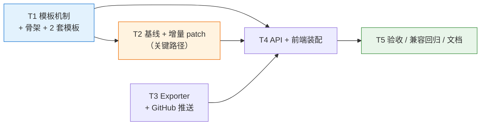
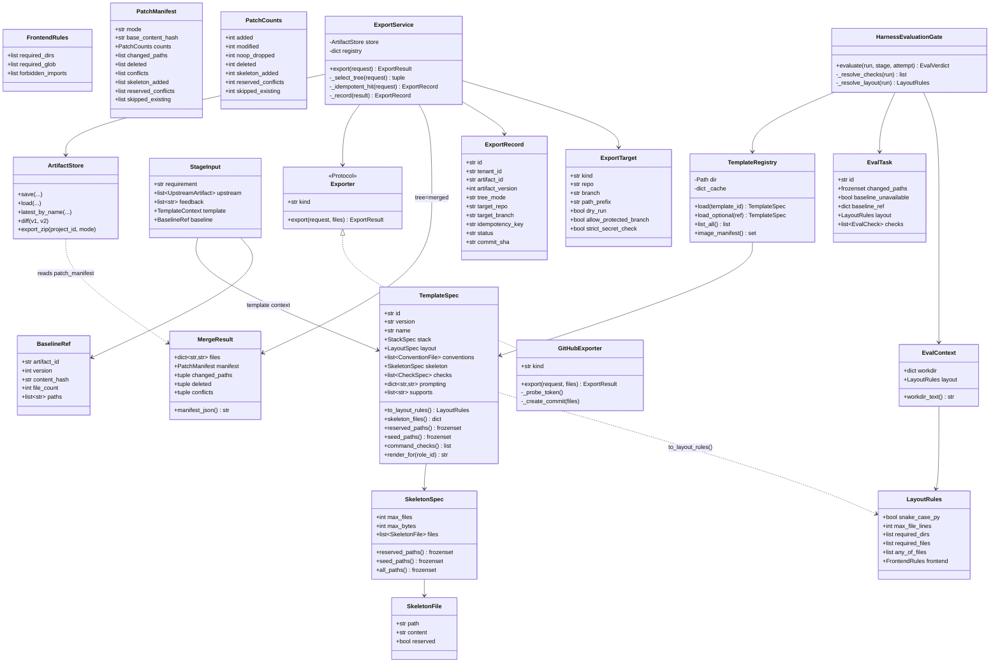
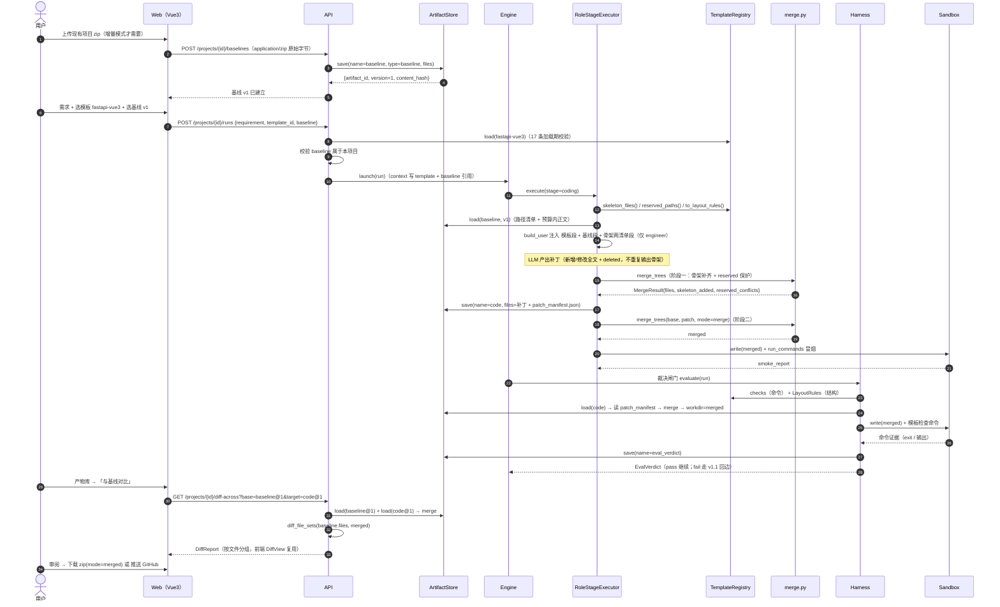
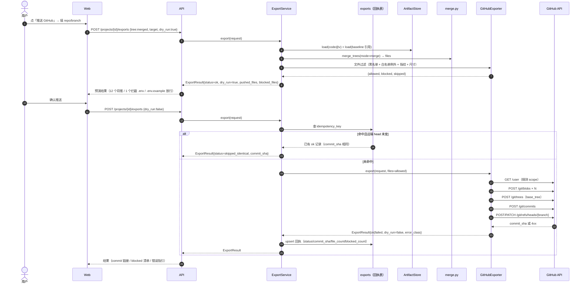
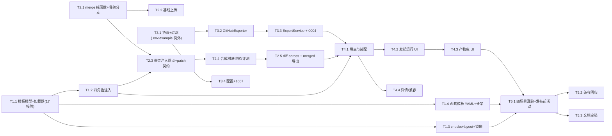

# 09 · 增量设计与任务列表 · v1.2（垂直场景模板库 + 增量 patch + GitHub 推送）

> **文档性质**：增量系统设计 + 任务分解（**待评审**）。只描述**相对 v1.1 的变更**，不重复已交付内容；v1.1 基线以 `docs/08-验收报告-v1.1.md` 为准（后端 439 / 前端 33，CI 双 job 全绿，零新增迁移）。
> **编制**：架构师 高见远 ｜ **日期**：2026-10-22 ｜ **上游**：`docs/02-架构设计.md`（§3.6 / §4-E7 / 十一·版本路线图 / §13-9,10）、`docs/03-产品需求文档（PRD）.md`（§八 / §九 D5 / §十 Q4）、`docs/08-验收报告-v1.1.md`（§7 已知限制 / §9 建议）、`.workbuddy/tmp/v12-design-analysis.md`（v1.2 前置分析稿）
> **写作原则**：全中文 · 结论先行 · 只写增量 · 表格化 · 面向工程师可直接编码 · 关键接口签名 / YAML / payload 给全，不写完整实现
> **配套图**：`docs/class-diagram-v1.2.mermaid`、`docs/sequence-diagram-v1.2.mermaid`（模板→骨架→增量→diff→合入）、`docs/sequence-diagram-v1.2-push.mermaid`（产物→dry-run→推送→回执）—— 一个文件一张图以保证可渲染，**不覆盖** v1.0 / v1.1 的四个图文件

---

## 0. 一页速览（结论先行）

| 关键问题 | 结论 |
|---|---|
| v1.2 的**实质** | 把产物模型从「**整树快照**」扩展为「**基线树 ⊕ 补丁树**」的双树模型。这是本版本唯一的架构级变更；模板与 GitHub 推送都是在既有扩展点上"落实现"。工作量重心在 T2，不在 T1 |
| 模板是什么（Q1） | **约束包 + 关键骨架**：一个 YAML 声明 `stack / layout / conventions / skeleton / checks / prompting`。骨架 = **3–5 个配置类文件**（`pyproject.toml`/`ruff.toml`/`requirements.txt`/`app/main.py`/`.env.example`），**不是**代码脚手架，**不是**完整项目模板 |
| 模板与流水线 | 模板是 **run 的运行参数**（`run.context["template"]`），**不是新流水线**。硬依据：`sop/validator.py:188-219 _check_inputs` 会否决任何"非上游产物"的 `stage.inputs` |
| 骨架注入 | 服务端在**产物落盘前**做 `skeleton ⊕ output.files` 注入。提示词按骨架的两类**分两个清单**渲染：`reserved_paths`「固定提供，不要输出」+ `seed_paths`「已给最小版本，**需输出完整版**」。因注入在 `store.save` 之前，`file_count` / `content_hash` **天然是注入后的树**（`store.py:111-113` 现成口径），`model_calls` 不受影响（纯服务端函数） |
| 骨架可否被覆盖（S2） | 骨架分**两类**：`reserved`（模板所有，模型写同路径**一律丢弃并保留骨架**，warning + 冲突清单 + 人审可见，**不阻断**）与 `seed`（种子文件，**仅当缺失时补齐**）。理由见 §4.1.3：单一 reserved 会冻结 `app/main.py`，直接把 FastAPI 模板做成不可用 |
| 增量 patch 的「不覆盖」 | **由不可变产物模型结构性保证**：基线不可变、补丁不可变、合并树是**纯函数派生**、从不写用户磁盘。基线已有同名文件时骨架**完全不参与**（用户文件优先），判定落在 `merge_trees` 的 `base_paths` 参数（§4.1.3 优先级表第 1 行） |
| patch 契约 | `CodeBundle` **只加一个可选字段** `deleted: list[str]`；新增/修改靠"与基线逐字节比较"推导；与基线相同的文件**自动丢弃（noop）** → 模型即使重出整棵树也退化为增量（容错而非报错） |
| diff 人审 | **复用** `artifacts/diff.py:88 diff_file_sets`（纯函数），只加 1 个 `GET /projects/{id}/diff-across` 端点，前端 `DiffView.vue` 零改动 |
| Exporter 签名 | `docs/02:593/687` 的 `export(artifact_version, target)` **不够用，必须修订**为 `export(request, *, files)`（4 条理由见 §4.3.1）；docs/02 五处需回写 |
| 数据库 | **本期引入 1 个迁移 `0004_add_exports`**（1 张表，双向可逆）。**v1.2 不再是零迁移版本**（§12-Q4 已拍板） |
| SSE 事件 | **零新增**：`events.run_id` 是 `nullable=False`（`models/entities.py:275-277`），推送不属于任何 run。结果走 HTTP 响应 + 回执表 + 前端弹窗 |
| 依赖 | **Python 依赖零新增**（`httpx` 早已在 `pyproject.toml`）。镜像层扩容：`fastapi / uvicorn / sqlalchemy / aiosqlite / alembic` 合并进现有 `pip install` 行 |
| 分层纪律 | 跨层**只传纯数据合同**：`LayoutRules` 放 `common`（rank 5），`templates`(2) 产出、`evaluation`(1) 消费；`merge_trees` 在 `artifacts`(3) 只收 `Mapping`/`frozenset`，**禁止** import `templates`（逆层） |
| 任务分解 | **5 个主任务 / 20 个子任务**，T1 与 T3 可并行起步，**T2 为关键路径**，T4 依赖 T1.2/T2.5/T3.3，T5 收口 |



**必须先看的三条"既定定义不可实现处"**

| # | 冲突 | 依据（已复核） | 处置 |
|---|---|---|---|
| **X1** | engineer 提示词要求"**优先**零依赖 + 依赖必须**沙箱可离线获得**""自测命令在**未安装本项目包**的干净目录直接执行"，与 FastAPI 模板（需要 `fastapi/sqlalchemy` + 应用装配）冲突 | `config/roles/prompts/engineer.md.j2:23-27` | 模板模式下提示词改为"模板约束优先"，并明示"模板依赖已预装镜像"；非模板路径逐字不变（§4.1.2） |
| **X2** | 沙箱镜像**没有 fastapi**、默认 `network=none` | `docker/sandbox.Dockerfile:16-19`、`config.py:52-53` | 镜像扩容（§12-D2 已拍板 A） |
| **X3** | Vue3 **前端**无法在镜像内构建（无 node、离线无 npm registry） | 同上 | 前端只做**结构静态检查**，报告与 README 明示"v1.2 不做前端构建校验"（§12-Q2 已拍板 D1-A） |

---

## 1. 版本范围与目标

### 1.1 一句话目标

> 让 ymir-agent 从「能从一个需求从零生成一个能跑的项目」升级为「**能按用户既有工程的规矩，把改动增量地合进去，并且能把它安全地推到用户自己的仓库**」。

| 目标 | 验收线（`docs/02:1098`） | 本设计的对应交付 |
|---|---|---|
| G1 工程可合入 | ① 选模板后生成代码可合入现有项目并编译通过 | 模板约束注入 + 骨架（T1）+ 基线/合并树评测（T2）+ 镜像扩容（T1.3）。**口径**：后端真执行，前端静态检查（§12-Q2） |
| G2 改动可审 | ② 增量 patch 以 diff 呈现可人审 | patch 契约（T2.3）+ `diff-across` 端点 + 前端 `DiffView` 复用（T2.5 / T4.3） |
| G3 成果可交付 | ③ 可选推送到指定 GitHub repo | Exporter 协议 + `GitHubExporter` + dry-run + 回执（T3） |
| G4 模板可扩展 | ④ 模板库 ≥2 个垂直场景 | `fastapi-vue3` + `python-cli`（含各自骨架清单，T1.4） |

### 1.2 本期做 / 不做

| 做（P0） | 不做（明确排除，理由见 §4.5.2） |
|---|---|
| 模板定义 YAML（技术栈 / 目录规范 / 规范文件集 / **骨架文件** / 检查命令）+ 目录扫描注册表 + 加载期校验（17 条） | 模板市场 / 外部安装 / 模板版本升级迁移 |
| 模板注入四角色提示词 + 覆盖评测检查命令 + 参数化结构规范 + 依赖 ⊆ 镜像清单校验 | 新流水线（每模板一份 pipeline）/ 可视化编排 |
| **骨架注入**（`from_scratch` 全量 / `patch` 仅补缺失）+ `reserved` 保护 + 冲突清单 | 完整项目脚手架（生成一整个可运行工程的骨架目录） |
| 基线产物上传（zip）+ 增量 patch 契约 + 合并树 + 冲突清单 + 跨产物 diff | 服务端读取任意本地路径（LFI 风险）/ 三方合并（用户改了基线后重放补丁） |
| 从零 / 增量两种生成模式（`from_scratch` / `patch`） | 隐式 patch 链（自动叠加多轮补丁） |
| Exporter 协议 + 注册表 + `GitHubExporter`（Git Data API）+ 黑名单 + dry-run + 回执表 | GitLab / 制品库 / 部署通道（v2.0）、开 PR、整库多产物推送 |
| 1 个迁移 `0004_add_exports` | 多租户 / RBAC、JetBrains 插件（roadmap 旧 v1.1 内容，仍待定） |
| 前端 3 处改动（发起运行 / 产物库 / 运行详情）+ 2 个新组件 | 新增大页面（模板市场页、推送历史页） |

### 1.3 已锁定决策（不得推翻，只能细化）

| # | 决策 | 出处 |
|---|---|---|
| L1 | v1.2 = **垂直场景模板库**（模板 YAML + 增量 patch + GitHub 推送 + 模板可贡献） | `docs/02:1098` |
| L2 | **Python 生态优先**，不考虑 Java / RuoYi / Spring Boot | `docs/03:304`（D5）、`docs/03:319` |
| L3 | 首选 **FastAPI+Vue3 全栈**（dogfooding），次选 **Python CLI/自动化工具** | `docs/02:1199`（§13-10）、`docs/03:284` |
| L4 | GitHub PAT **最小权限（仅目标 repo 的 `repo` scope）**，**Token 只走 env** | `docs/02:1199`（§13-9）、`docs/03:285` |
| L5 | 导出通道统一实现 `Exporter` 接口（注册表 + 目标配置） | `docs/02:593`、`docs/02:687`（E7） |

### 1.4 相对既定定义的扩展点（Q1：模板携带骨架）

`docs/02:1098` 对模板的定义是「模板定义 YAML（技术栈约定/目录规范/规范文件集）」，**未包含骨架文件**。本期经用户拍板（§12-Q1）扩展为「约束包 + **关键骨架**」。这是对既定定义的**一处显式扩展**，记录如下：

| 项 | 内容 |
|---|---|
| **扩展内容** | `TemplateSpec.skeleton.files[]`（每个模板 3–5 个配置类文件，含 `content`、`reserved` 标记） |
| **扩展理由** | ① 增量模式下"目录规范"若只写在提示词里，模型对 `pyproject.toml`/`ruff.toml` 这类**逐字节要求精确**的文件几乎不可能写对（v1.1 基线里 `ruff check` 失败的主因之一）；② 骨架是**确定性输入**，成本固定（≤32KB），收益是"生成即符合规范"；③ 无骨架时 `architecture`/`convention` 维度的分数依赖模型偶然写对配置文件，不可复现 |
| **不扩展的部分** | 骨架**不是**完整工程脚手架：不含业务代码、不含测试文件、不含前端页面（§12-3 已定案） |
| **上限约束** | 每模板 `≤5` 个文件、`≤32KB` 总量（加载期硬校验），防止"骨架变成隐蔽的完整模板" |
| **兼容影响** | 无模板的 run：`code` 产物**不含任何骨架文件**，`file_count`/`content_hash` 与 v1.1 一致（§10-12） |

### 1.5 需要澄清的一处文档失配（不影响结论）

`docs/02:1097` 把 **v1.1 定义为「JetBrains 插件」**，实际交付的 v1.1 是「可验证性 + 自愈」（`docs/07` / `docs/08`），插件被明确列入 v1.1 不做清单（`docs/07:57`）。因此：

- 路线表 **v1.1 行已失真**，需在 T5.3 回写（`docs/02:1097` → 标注"已由可验证性+自愈替代，插件顺延待定"）；
- v1.2 的内容定义（`docs/02:1098`）**未受影响**，继续有效；
- **v1.2 不含 IDE 插件**，已写入 §1.2 不做清单。

---

## 2. 现状与差距（逐点复核过的代码事实）

> 所有行号由本次逐文件复核，可直接采信。

| # | 现状（文件:行号） | 缺陷性质 | 本设计对策 |
|---|---|---|---|
| **C1** | 全局**不存在 Exporter 抽象**：`grep -rn "Exporter\|GitHubExport" src/ scripts/` → **零命中**；代码侧只有 zip 导出路径 `api/routers/export.py:21-43`（`GET /projects/{id}/export` → `store.export_zip`）与 `artifacts/store.py:308-375` | 扩展点从未落地 | §4.3.1 新协议 + 注册表 + 实现 |
| **C2** | `export_zip` 是**整库导出**：各产物取 latest，zip 内路径 `{art.name}/v{version}/{rel_path}`（`store.py:339-370`），附 `manifest.json` | 该布局**不是可运行工程布局** | 推送只支持**单产物版本**（`code` / 合并树），不做整库推送 |
| **C3** | 产物 = `files: Mapping[str, str]` 整树，落盘 `project_id/artifact_id/v{version}`，**版本不可变**、`mkdir(exist_ok=False)` 原子占位（`store.py:131-141`）、`parent_version_id` 串链（`store.py:153`） | 无法直接表达"面向用户已有目录树的增量" | 双树模型：基线是另一个不可变产物 + 合并树纯函数派生（§4.2） |
| **C4** | `diff_file_sets(base, target) -> DiffReport` 是**纯函数**（`artifacts/diff.py:88-122`）；`ArtifactStore.diff` 只是"同产物两版本"的包装（`store.py:295-306`） | 跨产物 diff 缺端点，不缺能力 | 复用纯函数 + 新增 1 个端点 |
| **C5** | `normalize_files`（`artifacts/versioning.py:42-65`）已做路径安全（拒绝对路径/盘符/`..`）+ 同路径冲突 + **文件与目录同名冲突**；`compute_content_hash` 稳定哈希（`:68-76`）。**r4**：这两组工具已**下沉** `common/paths.py`（rank 5），`versioning.py` 改 re-export —— 否则 `templates`(2) 校验骨架路径就得 import `artifacts`(3)，属逆层 | 合并/补丁的安全检查已现成，但**位置**在逆层可达范围外 | 合并函数从 `common.paths` 复用，不新写路径校验 |
| **C6** | `StageInput`（`roles/io.py:38-51`）只有 `requirement / project_name / upstream / feedback / attempt / repair_context / previous_output` | 无"模板""基线"载体 | 增 `template: TemplateContext｜None`、`baseline: BaselineRef｜None` |
| **C7** | `RoleStageExecutor._collect_input`（`orchestrator/role_executor.py:157-188`）：requirement 取 `run.context`（`:160-162`），上游按 `stage.inputs` 名字取（`:170-176`）；`execute` 顺序为 collect → runtime → smoke → save（`:90-115`） | `sop/validator.py:188-219 _check_inputs` 会把非上游产物的 inputs 判为 error | 模板/基线**只能走 `run.context`**（§4.1.4 硬约束） |
| **C8** | `_run_sandbox_smoke` 只把 `output.files` 写入沙箱（`role_executor.py:318-319`） | patch 模式下冒烟**必然失败**（缺基线文件） | 冒烟前用**合并树**写入（§4.2.2 步骤 5） |
| **C9** | `EvaluationHarness._load_task`（`harness.py:431-465`）把**项目内全部产物**最新版本读进 `references`（`:444-450`） | 基线（可能几百文件）被无条件读进内存并进 judge 语料/导出 | `_load_task` 显式排除 `baseline` 与超限产物（§4.2.5） |
| **C10** | 评测沙箱只写 `workdir`（`harness.py:301-304`），`workdir` = 单产物 `loaded.files`（`:459-465`） | 增量模式需"基线 ⊕ 补丁"合成树 | `_load_task` 产出**合并后的 workdir** |
| **C11** | `HarnessEvaluationGate` 构造 `EvalTask(checks=list(base.checks))`（`evaluation/gate.py:78-89`）；套件解析顺序 = `run.context["benchmark"]` > `pipeline.repair.eval` > `default`（`:108-123`） | 模板检查命令无注入点 | `gate.py:78-89` 处按 `run.context["template"]` 覆盖 `checks` 并注入 `LayoutRules`（**唯一注入点**） |
| **C12** | `Events.run_id` **`nullable=False`**（`models/entities.py:275-277`），`seq` 在 run 内单调（`events/bus.py:41-57`） | 推送/基线同步**无法发 SSE** | 本期零新增 SSE 事件 |
| **C13** | `BizCode` = 1001-1006 + 500（`common/errors.py:9-23`） | 无"远端拒绝/配额/鉴权"失败域 | 新增 `1007 EXPORT_FAILED`（§12-D4 已拍板） |
| **C14** | `scripts/check_import_graph.py:35-56` `LAYERS`：新增子包**未登记即判违规**（`:190-198`）；`artifacts`(3) → `templates`(2) 属**逆层** | 新包需登记；跨层需纯数据 | `templates: 2`；跨层只传 `common.contracts` 的纯数据 |
| **C15** | CI 必跑 `alembic upgrade head && alembic check`（`.github/workflows/ci.yml`） | 新增迁移必须与 model 同步、无 drift | `0004` 双向可逆 + `alembic check` 绿 |
| **C16** | engineer 提示词要求"仅使用标准库 + 常见轻量依赖（如需依赖请在 requirements.txt 声明并确认沙箱可离线获得，**优先**零依赖）"（`prompts/engineer.md.j2:23`）、"自测命令将在**未安装本项目包**的干净工作目录直接执行…不要依赖 pip install / PYTHONPATH"（`:25-27`） | 与 FastAPI 模板存在实质冲突（X1）：**不是**绝对零依赖，但"沙箱可离线获得"在扩容前不可能满足 | 模板模式提示词改为"模板约束优先 + 依赖已预装"（§4.1.2）；非模板路径逐字不变 |
| **C17** | `convention` 评估器硬编码 `_MAX_LINES=600` / `_SNAKE_RE`（`evaluators/convention.py:27-28,120-172`）并按 `total_weight` 自归一（`:72-84`）；`architecture` 硬编码 `_LAYER_RANKS`（`evaluators/architecture.py:40-58`）且**只分析 `python_files`** | 模板目录规范无法被校验；`web/src` 前端目录被完全忽略 | **参数化而非硬改**：`EvalContext.layout`（纯数据），`None` 时行为与 v1.1 逐字节一致（§4.1.3） |
| **C18** | `CodeBundle.files` 有 `min_length=1`（`common/contracts.py:57`） | 纯删除补丁无法表达 | 边界写入共享知识（删除必须与至少一个新增/修改同时发生） |

---

## 3. 总体方案

### 3.1 分层与组件图（增量高亮 + 跨层纯数据流）

```mermaid
flowchart TB
    subgraph L0["api（0）"]
        API_R["routers/runs.py<br/>+ template/baseline 校验"]
        API_T["routers/templates.py ★新增"]
        API_E["routers/export.py<br/>+ POST exports / GET exports"]
        API_A["routers/artifacts.py<br/>+ baselines / diff-across"]
    end
    subgraph L1["bootstrap / orchestrator / evaluation（1）"]
        BOOT["bootstrap.py<br/>+ ExportService 装配"]
        RE["orchestrator/role_executor.py<br/>+ 模板/基线装载 + 骨架注入 + 合并冒烟"]
        GATE["evaluation/gate.py<br/>+ checks 覆盖 + LayoutRules 注入"]
        HARN["evaluation/harness.py<br/>+ 合并 workdir + references 排除"]
        CONV["evaluation/evaluators/convention.py<br/>+ 参数化结构规则"]
        EVB["evaluation/evaluators/base.py<br/>+ EvalContext.layout / changed_paths"]
    end
    subgraph L2["hitl / roles / sop / messages / events / templates（2）"]
        T_PKG["templates/ ★新增（rank 2）<br/>models / loader / context"]
        PROMPT["roles/prompts.py + 模板段 / 基线段 / 骨架两清单段（engineer）"]
        IO["roles/io.py + StageInput.template/baseline"]
        SOPV["sop/validator.py（不改）"]
    end
    subgraph L3["tools / sandbox / gateway / artifacts（3）"]
        MERGE["artifacts/merge.py ★新增<br/>merge_trees（纯函数，只收纯数据）"]
        EXP["artifacts/exporter.py ★新增<br/>协议 + 注册表 + 文件过滤"]
        GH["artifacts/github.py ★新增<br/>Git Data API"]
        SVC["artifacts/export_service.py ★新增"]
        STORE["artifacts/store.py（2 处小改）"]
    end
    subgraph L4["storage（4）"]
        REPO["storage/repositories.py<br/>+ ExportRepository"]
    end
    subgraph L5["models / common / config（5）"]
        CON["common/contracts.py<br/>+ CodeBundle.deleted / LayoutRules / FrontendRules"]
        ERR["common/errors.py + ExportError(1007)"]
        PATHS["common/paths.py ★新增（下沉）<br/>normalize_rel_path"]
        SECR["common/secrets.py ★新增（下沉）<br/>SECRET_FINGERPRINTS + scan_secret()"]
    end
    API_T --> T_PKG
    API_E --> SVC
    API_A --> MERGE
    BOOT --> SVC
    RE --> T_PKG
    RE --> MERGE
    GATE --> T_PKG
    GATE --> EVB
    HARN --> MERGE
    CONV --> EVB
    PROMPT --> T_PKG
    IO --> CON
    SVC --> EXP
    SVC --> MERGE
    SVC --> STORE
    SVC --> REPO
    EXP --> GH
    EXP --> ERR
    T_PKG --> CON
    T_PKG --> PATHS
    T_PKG --> SECR
    EXP --> SECR
    MERGE --> CON
    MERGE --> PATHS
```



**跨层纯数据流（Q1 关键约束，务必遵守）**

```
TemplateSpec（templates, rank 2）
   ├─(role_executor, rank 1)─→ skeleton: dict[str,str] + reserved_paths: frozenset[str]
   │                              └─→ merge_trees（artifacts, rank 3）   ← 只收纯数据，禁止 import templates
   ├─(prompts.py, rank 2)────→ reserved_paths / seed_paths（两个独立清单，禁止合并）
   ├─(loader.py, rank 2)─────→ common.paths.normalize_rel_path
   │                           common.secrets.scan_secret          ← 工具下沉到 rank 5，禁止 templates → artifacts
   └─(gate, rank 1)──────────→ LayoutRules（common.contracts, rank 5）
                                  └─→ EvalContext.layout（evaluation, rank 1）
```

> **为什么必须这样**（`scripts/check_import_graph.py:35-56,190-198`）：合法边要求 `rank(src) <= rank(dst)`。`artifacts(3) → templates(2)` 与 `rank5 → rank2` 都是逆层，CI 会 FAIL。因此：
> - `merge_trees` 签名**只能**接收 `Mapping[str, str]` / `frozenset[str]` / `Sequence[str]`，**绝不接收 `TemplateSpec`**；
> - `TemplateSpec.to_layout_rules() -> LayoutRules` 定义在 `templates/models.py`（`2 → 5` 合法）；
> - **路径安全与密钥扫描工具必须下沉到 `common`（rank 5）**：`templates(2)` 能依赖 `common(5)`，但**不能**依赖 `artifacts(3)`（逆层）。所以 `normalize_rel_path` 归 `common/paths.py`、`SECRET_FINGERPRINTS`/`scan_secret()` 归 `common/secrets.py`；`artifacts/versioning.py` 仅**re-export**同一对象（向后兼容），`artifacts/exporter.py` 与 `templates/loader.py` 都从 `common` 取，**全局禁止第二份实现**；
> - `evaluation` 只认 `common` 的 `LayoutRules`，不认 `TemplateSpec`。
> 这也延续 v1.1 的取舍 K1（"裁决协议放 orchestrator、实现放 evaluation、合同放 common"）。

### 3.2 关键取舍（6 条，全部有被否方案）

| # | 取舍 | 被否方案 | 为什么否 |
|---|---|---|---|
| **K1** | 模板 = **run 的运行参数**（`run.context["template"]`），流水线 YAML 完全不动 | ① 每模板一份 `config/pipelines/*.yaml`；② 给 `StageSpec.inputs` 加 `baseline`/`template` | ① 模板贡献者要写完整流水线，门槛从"写一个 YAML"变成"写一套流程"，且 Q1 终局审批、`repair` 语义会在模板间漂移；② **直接不可行**：`sop/validator.py:188-219` 要求每个 `inputs` 名可由 `requirement` 或上游 `outputs` 满足 |
| **K2** | patch 用**整文件粒度**，**diff 由服务端 difflib 计算** | 让模型输出 unified diff，服务端 `git apply` | LLM 生成 diff 的行号/上下文极易漂移，半成功与 fuzz 静默错位无法确定性校验；而"可审 diff"是**派生物**，不是输出契约 |
| **K3** | 合并树**只在内存/请求内派生**，不落盘为 `code_merged` 产物 | 落一份完整产物 | 基线不可变 + 补丁不可变 ⇒ 合并确定可复现；落盘只带来双份存储、双份版本链与"合并树漂移"新 bug 面 |
| **K4** | Exporter **接收已备好的文件集**：`export(request, *, files)` | 保持 `export(artifact_version, target)` | 会把"树语义"泄漏进传输层，每个新通道都要重写"推哪棵树"；密钥过滤也会因通道增加而漏做 |
| **K5** | 推送**默认新分支** `ymir/<artifact>-v<n>`，动 `main` 需二次确认；不做 PR | ① 直接推指定分支（缺省 main）；② 开 PR | ① 改用户 `main` 是破坏性默认值；② PR 需 head/base 治理与冲突处理，而本地已有人审 diff |
| **K6** | 骨架分 **`reserved`（模板所有）+ `seed`（缺失才补）** 两类，`base_paths` 命中时骨架**完全不参与** | ① 全部 `reserved`（模型一律不得写这些路径）；② 全部 `seed`（模型可任意覆盖） | ① 会冻结 `app/main.py`：fastapi-vue3 的骨架 `app/main.py` 只是最小入口，模型必须在其上写路由，全 reserved 直接让模板不可用；② 会让模型把 `pyproject.toml` 写成不可解析的形态，"生成即符合规范"的目标落空 |

---

## 4. 详细设计

### 4.1 A · 模板库（含骨架）

#### 4.1.1 数据模型（字段级定义）

模板 = **一个 YAML 文件**，六类声明：`stack`（技术栈与依赖基线）、`layout`（目录与命名规范）、`conventions`（规范文件集要求）、`skeleton`（骨架文件 + reserved 标记）、`checks`（检查命令与权重）、`prompting`（给模型看的角色追加约束）。

```yaml
# config/templates/fastapi-vue3.yaml（结构示例，完整内容见 T1.4）
id: fastapi-vue3                # 必须等于文件名主干
version: "1.0"                  # 模板自身契约版本
name: FastAPI + Vue3 全栈
description: Python 后端 FastAPI + 前端 Vue3 的工程规范包
supports: [from_scratch, patch]

stack:
  language: python
  runtime: "3.12"
  backend: fastapi
  frontend: vue3
  dependencies: [fastapi, uvicorn, sqlalchemy, alembic]   # 必须 ⊆ 镜像清单
  package_manager: uv

layout:
  required_dirs: [app, tests, web/src]
  required_files: [pyproject.toml]
  any_of_files: []                       # 例：[["pyproject.toml","requirements.txt"]]
  forbidden_dirs: [venv, node_modules, .venv]
  snake_case_py: true
  max_file_lines: 600
  allowed_prefixes: [app/, tests/, web/]
  frontend:                              # 仅前端结构静态检查（Q2：不构建）
    required_dirs: [web/src, web/src/components]
    required_glob: ["web/src/**/*.vue"]
    forbidden_imports: [jquery, bootstrap]

conventions:                             # 规范文件集：存在性 + 内容要求（与 skeleton 分工见 4.1.3）
  - { path: README.md, required: true }
  - { path: .gitignore, required: true }

skeleton:                                # ★Q1 新增：关键骨架
  max_files: 5                           # 本模板骨架恰为 5 个 = 已达上限（再加第 6 个即超限，
                                         #   须先调 max_files 并评估"骨架是否在变成脚手架"）
  max_bytes: 32768
  files:
    - path: pyproject.toml
      reserved: true                     # 模板所有：模型写同路径一律丢弃
                                         # （ruff 配置统一放下面第 2 项 ruff.toml，此处不重复 [tool.ruff]）
      content: |
        [project]
        name = "app"
        requires-python = ">=3.12"
        [tool.pytest.ini_options]
        pythonpath = ["."]
    - path: ruff.toml
      reserved: true                     # ★必须存在：checks 里跑 `ruff check .`。
                                         #   缺它时 ruff 用默认 line-length=88，而模板约定 100
                                         #   → 模型写出的"合规代码"会被判违规，模板直接失效
      content: |
        line-length = 100
        target-version = "py312"
        [lint]
        select = ["E", "F", "I", "B", "UP", "C4", "SIM", "W"]
    - path: requirements.txt
      reserved: false                    # seed：新增依赖的正规出口，模型可整文件重写
      content: |
        fastapi>=0.115
        uvicorn>=0.30
        sqlalchemy>=2.0
    - path: app/main.py
      reserved: false                    # seed：仅当缺失时补齐（最小入口，模型在其上扩写）
      content: |
        from fastapi import FastAPI
        app = FastAPI()
    - path: .env.example
      reserved: true
      content: |
        # 复制为 .env 后填写；真实密钥禁止入库
        APP_ENV=dev

checks:                                  # 检查命令（进入 EvalTask.checks；字段名是 type，不是 kind）
  - { type: command, run: "python -m compileall -q app", weight: 1 }
  - { type: command, run: "python -m pytest -q", weight: 2 }
  - { type: command, run: "ruff check .", weight: 1 }
  - { type: command, run: 'python -c "from app.main import app"', weight: 1 }

prompting:
  pm: "PRD 必须声明后端为 FastAPI、前端为 Vue3，并说明数据持久化方案。"
  architect: "设计文档的目录结构必须与模板 layout 一致，不得引入 Django/Flask。"
  engineer: "严格遵守模板目录规范；固定提供的文件不要输出；给了最小版本的文件须输出完整版；新增依赖写入 requirements.txt。"
  qa: "证据链须引用模板检查命令的执行输出。"
```

```python
# src/ymir/templates/models.py（★新增）
class CheckSpec(BaseModel):
    """模板声明的确定性检查。

    ★字段名必须是 ``type``（不是 ``kind``）：与 ``evaluation/evaluators/base.py:116
    EvalCheck.type`` 同构，由 ``gate`` 直接映射，不做二次改名。写成 ``kind`` 会被
    pydantic 静默忽略（``type`` 取默认值 "command"），属"碰巧能跑"的隐性错误。
    """
    model_config = ConfigDict(extra="forbid")
    type: Literal["command"] = "command"      # v1.2 只有 command（layout 走 EvalContext.layout）
    run: str = ""
    weight: float = Field(default=1.0, gt=0)

class SkeletonFile(BaseModel):
    model_config = ConfigDict(extra="forbid")
    path: str                                    # 过 normalize_rel_path
    content: str = Field(min_length=1)
    reserved: bool = False                       # True=模板所有；False=seed（缺失才补）

class SkeletonSpec(BaseModel):
    model_config = ConfigDict(extra="forbid")
    max_files: int = Field(default=5, ge=0, le=8)
    max_bytes: int = Field(default=32768, ge=0, le=131072)
    files: list[SkeletonFile] = Field(default_factory=list)

    @property
    def reserved_paths(self) -> frozenset[str]:
        """模板固定提供的路径（模型输出一律丢弃）。"""

    @property
    def seed_paths(self) -> frozenset[str]:
        """已给最小版本、**需要模型输出完整版**的路径（可整文件替换）。"""

    @property
    def all_paths(self) -> frozenset[str]:
        """reserved_paths | seed_paths（仅供计数与校验，**禁止**用于提示词渲染）。"""

class TemplateSpec(BaseModel):
    model_config = ConfigDict(extra="forbid")
    id: str
    version: str = "1.0"
    name: str
    description: str = ""
    stack: StackSpec
    layout: LayoutSpec = Field(default_factory=LayoutSpec)
    conventions: list[ConventionFile] = Field(default_factory=list)
    skeleton: SkeletonSpec = Field(default_factory=SkeletonSpec)
    checks: list[CheckSpec] = Field(default_factory=list)
    prompting: dict[str, str] = Field(default_factory=dict)
    supports: list[Literal["from_scratch", "patch"]] = Field(
        default_factory=lambda: ["from_scratch", "patch"])

    # --- 跨层纯数据出口（templates(2) -> common(5) 合法）---
    def to_layout_rules(self) -> LayoutRules: ...            # common/contracts.py
    def skeleton_files(self) -> dict[str, str]: ...          # 纯 dict，给 artifacts(3)
    def reserved_paths(self) -> frozenset[str]: ...          # 纯 set
    def seed_paths(self) -> frozenset[str]: ...              # 纯 set（提示词渲染用）
```

> **`TemplateSummaryOut` 的 `stack` / `layout` 是自由 dict（无强 schema）—— r10 约定**：后端原样透传 `StackSpec.model_dump()` / `LayoutSpec.model_dump()`，不做强类型化；前端按固定约定取字段：**目录规范 ← `layout.required_dirs`**、**依赖白名单 ← `stack.dependencies`**、**检查命令条数 ← `checks.length`**。若后续要强类型化（生成 TS 类型 / OpenAPI 组件），须走 **v1.3**，不在 v1.2 范围。

**`TemplateContext`（提示词视图，`roles/io.py`，r5 补全字段级定义）**

> 定位：`templates/models.py` 的 `TemplateSpec` 是**配置模型**（含骨架正文），`TemplateContext` 是**提示词视图**（纯数据、无正文）。由 `TemplateContext.from_spec(spec)`（唯一入口）解出，放进 `StageInput.template`；`roles/prompts.py` 只认这份数据，**不 import `templates`**。

| # | 字段 | 类型 | 用途 |
|---|---|---|---|
| 1 | `id` | `str` | 模板标识（提示词抬头、manifest、前端徽标） |
| 2 | `version` | `str` | 模板契约版本（提示词抬头；与产物 manifest 对账） |
| 3 | `name` | `str` | 人类可读名（提示词抬头） |
| 4 | `stack` | `dict[str, Any]` | `StackSpec.model_dump()` 纯数据（技术栈段渲染：language/backend/frontend/runtime） |
| 5 | `dependencies` | `tuple[str, ...]` | 依赖白名单（engineer 段「依赖白名单」；= `stack.dependencies`） |
| 6 | `layout` | `LayoutRules \| None` | 目录与命名规范（`common/contracts.py` 纯数据；同时供 gate 注入 `EvalContext.layout`） |
| 7 | `reserved_paths` | `frozenset[str]` | 模板固定提供的路径（模型输出一律丢弃） |
| 8 | `seed_paths` | `frozenset[str]` | 已给最小版本、**需模型输出完整版**的路径 |
| 9 | `checks` | `tuple[dict[str, Any], ...]` | 确定性检查命令（qa 段「检查命令口径」，元素形如 `{"type": "command", "run": ..., "weight": ...}`） |
| 10 | `prompting` | `dict[str, str]` | 各角色追加约束（键 = 角色 id；`prompt_for(role_id)` 取值，缺省空串） |

方法：`from_spec(spec) -> TemplateContext`（唯一构造入口）、`prompt_for(role_id) -> str`。

> ★★ **两条硬不变量（r2 缺陷 3 的防治根，写死在这里，任何改动必须走评审）**：
> ① **没有 `skeleton_paths` 单字段**，只有 `reserved_paths` + `seed_paths` 两个字段（合并渲染会让 seed 文件变成"不要输出"，`app/main.py` 只剩空入口 → FastAPI 模板实质不可用）；
> ② **不含骨架正文**（`skeleton.files[].content` 不进 `TemplateContext`）——提示词只要路径，正文白占 token 且泄露模板实现细节。

#### 4.1.2 模板作用在哪个角色/阶段（注入点）

| 注入点 | 载体 | 内容 | 代码位置 |
|---|---|---|---|
| **pm（prd）** | 用户消息 `## 技术栈模板（本项目的既定约束）` | `stack` + `prompting["pm"]` | `roles/prompts.py:50 build_user` |
| **architect（design）** | 同上 + `## 目录规范（设计必须遵守）` | `stack` + `layout` + `prompting["architect"]` | 同上 |
| **engineer（code）** | 同上 + **`## 骨架文件（分两类，务必区分）`**：① `reserved_paths`「固定提供，**不要输出**（输出也会被丢弃）」② `seed_paths`「已给最小版本，**你需要输出完整版本**（可整文件替换）」（两清单**都只给路径，不给内容**）+ `## 依赖白名单` + `prompting["engineer"]` | `layout` + `reserved_paths` + `seed_paths` + `stack.dependencies` | 同上 + `config/roles/prompts/engineer.md.j2`（新增"模板模式例外"小节） |
| **engineer（增量模式，r6 补）** | 用户消息 `## 增量模式（只输出新增/修改）` | **基线版本 + 指纹前 12 位**（`baseline v{n} · {hash_prefix}`，让模型知道「我基于哪棵树」）、**只输出新增/修改的完整文件**（未变更文件不要输出）、**`deleted` 用法**（要删的路径写进 `deleted`，不要写空文件）、**基线路径清单 ≤200 条且只列路径不给正文**（超限时按目录聚类摘要 + 提示「如需更多上下文请在 notes 说明」） | `roles/prompts.py:50 build_user`（`StageInput.baseline` 非空才渲染） |
| **qa（evaluation_report）** | 同上 + `## 检查命令口径（与确定性判定一致）` | `checks` + `prompting["qa"]` | 同上 |
| **编排** | `run.context["template"] = {"id","version"}`（+ 降级时 `degraded`） | 只存**引用**，不存全文（避免 JSON 列膨胀）。**错误码**：请求体 `template_id` 未知 → **1001**；`GET /templates/{id}` 路径未知 → **1002**（§13） | `api/routers/runs.py:66-80` |
| **评测** | `EvalTask.checks`（命令）+ `EvalContext.layout`（结构规则） | `checks` / `layout` | `evaluation/gate.py:78-89` |
| **骨架注入** | 产物文件集（落盘前） | `skeleton.files` | `orchestrator/role_executor.py`（§4.1.3） |

**engineer 提示词的"模板模式例外"（修 X1/C16）**：模板模式（`StageInput.template is not None`）时，`build_user` **仅对 engineer** 追加下述段落，用来**覆盖** `engineer.md.j2:23-27` 的默认约束（pm/architect/qa 不渲染骨架两清单：它们不产出代码文件，白占 token）：

> **渲染范围口径（五段，与实现 `_ROLE_SECTIONS` / `_CHECK_ROLES` 一致）**：① `## 技术栈模板` 段 → **四角色**都渲染；② `## 目录规范` 段 → **architect / engineer**；③ 「模板模式例外」+ 两个骨架清单 → **仅 engineer**；④ **「检查命令口径」段 → 仅 qa**（qa 的叙事必须与确定性 harness 用同一批命令，否则报告口径漂移）；⑤ **「增量模式」段 → 仅 engineer，且 `StageInput.baseline` 非空才渲染**（内容见上表第一列；基线路径清单 ≤200 条、只列路径）。T1.2 DoD ③ 的双向断言针对 engineer 消息；④ 的断言见 T1.2 DoD ⑧。

```
## 模板模式例外（优先于系统提示的通用要求）
- 本项目已选定模板 {id} v{version}，技术栈与依赖为既定约束，**不再适用"优先零依赖"**；
- 模板声明的依赖（{deps}）已预装沙箱镜像，可直接 import，无需联网安装；
- 自测命令仍需自包含，但**允许** import 模板依赖与本项目包（沙箱已具备运行环境）；
- 以下文件由模板**固定提供**，**不要输出**（输出也会被丢弃）：{reserved_paths}
- 以下文件已提供**最小版本**作为起点，**你需要输出完整版本**（可整文件替换）：{seed_paths}
```

> **两个清单必须分开渲染，禁止合并成单一的"骨架路径清单"**（r2 修正的防复发条款）。原因：`seed_paths` 里是"给了骨架但必须被覆盖"的文件（`app/main.py` 要给路由、`requirements.txt` 要声明新依赖）。若把它们混进"不要输出"清单，模型只会输出最小入口 `app = FastAPI()`（无任何路由），`from app.main import app` 与 `pytest` 两条 check 会空过或误判 —— **FastAPI 模板实质不可用**。

> 非模板路径：`build_user` 输出与 v1.1 **逐字节一致**（§10-11 fixture 快照保护）。

#### 4.1.3 骨架注入（S1 / S2 / S3 的可实现契约）

**S1 · 注入时机与方式**

| 项 | 结论 |
|---|---|
| 注入位置 | `RoleStageExecutor.execute`（`role_executor.py:90-115`）：`runtime.execute()` **之后**、`_run_sandbox_smoke()` **之前**、`store.save()` **之前** |
| 为什么在 smoke 之前 | 冒烟必须验证"真实要交付的树"（含骨架），否则骨架写错要在评测阶段才暴露 |
| 为什么在 save 之前 | `store.save` 的 `content_hash`/`file_count` 由**传入的 files** 计算（`store.py:111-113`），注入在 save 前 ⇒ **口径天然是注入后的树**，`store` 零改动 |
| 是否模型输出骨架 | **分两类**：`reserved` 路径**不要模型输出**（提示词只给路径、不给内容，模型若仍输出按优先级表丢弃）；`seed` 路径**要求模型输出完整版**（提示词明确"已给最小版本，请输出完整版本"），模型不输出时才由骨架兜底 |
| `model_calls` 影响 | **无**。骨架注入是服务端纯函数，不产生任何模型调用；`model_calls` 只记 `gateway.chat` 的用量（`gateway.py` 既有链路不变） |
| 审计痕迹 | 写 `patch_manifest.json`（含 `skeleton.added / reserved_conflicts / skipped_existing`，§4.2.2），随产物落盘、随导出带走 |
| **模板装载失败** | **不阻断阶段、但必须可观测**：`load_template` 抛错（模板被删/改坏）时降级为通用模式继续执行，同时把 `run.context["template"]["degraded"] = "<reason>"` 落库（见下方硬要求） |

> **★降级必须可观测（r5 硬要求）**：运行中途模板文件被删/改坏，**不应让整轮 run 崩掉**（与"上一版产物加载失败仅告警"同口径），但**绝不允许静默降级** —— 用户以为有模板约束、实际没有，比直接报错更危险。三条硬约束：
> 1. **落库**：写 `run.context["template"]["degraded"] = "<reason>"`（reason 形如 `template_not_found: fastapi-vue3` / `template_invalid: <校验码>`）；遵守 JSON 列纪律「读 → `dict(...)` 复制 → 整体赋值 → commit」；同一 run 只写一次（已有 `degraded` 键则不覆盖）。
> 2. **不改变 run 状态**：仍是 `running`，阶段正常推进；`run.failed` 与之无关。
> 3. **必须可见**：T4.4 的运行详情页据此显示「**模板未生效**」徽标，tooltip 显示 `degraded` 原文；T5.1 真跑需覆盖一次"模板被删后仍跑完"的场景。
> 建议实现位置：`execute()` 内（有 `session_factory`）检测 `_collect_template` 返回 `None` 且 `context["template"]` 非空 → 落库一次；`_collect_template` 保持纯函数语义（只读不写）。

实现骨架（伪代码，顺序即实现要求）：

```python
# orchestrator/role_executor.py —— execute() 内
stage_input = await self._collect_input(run, stage, attempt)   # 含 template / baseline
output = await self._runtime.execute(stage.role, stage_input, run_id=run.id, stage_id=stage.id)

if stage_input.template is not None or stage_input.baseline is not None:
    # 1) 解出纯数据（rank 1 可以去读 rank 2 的 TemplateSpec）
    skeleton = stage_input.template.skeleton_files() if stage_input.template else None
    reserved = stage_input.template.reserved_paths() if stage_input.template else frozenset()
    base = await self._load_baseline_files(run)          # 基线**正文**；无基线 -> {}
    # 2) 阶段一：传基线正文（不是 {}），否则 noop 判定失效（r4 修正）
    out1 = merge_trees(
        base, output.files,
        skeleton=skeleton, reserved_paths=reserved,
        mode="patch" if base else "from_scratch",
        max_file_bytes=self._max_patch_file_bytes,
    )
    # 3) 产物只存增量：由 changed_paths 反推（不再靠 base={} 猜）
    stored = {p: out1.files[p] for p in out1.changed_paths if p in out1.files}
    stored["patch_manifest.json"] = out1.manifest_json()   # 无参：base_content_hash 由 merge 自算
    output.files = stored
    smoke_files = out1.files          # 冒烟用**整树**（复用阶段一结果，不再二次合并）
else:
    smoke_files = output.files
# 4) 冒烟用 smoke_files 写入沙箱；5) 落盘用 output.files（= 增量 + manifest）
```

> **r4 修正的两点**（原稿有缺陷）：① 阶段一必须传**基线正文**，传 `{}` 则逐字节比较无参照、`noop_dropped` 恒 0；② "只存增量"改为由 `changed_paths` **反推**，而不是"以为 `base={}` 就只留了增量"——`out1.files` 是整树，直接落盘会把基线全文写进产物。

**S2 · 骨架是否可被模型覆盖（优先级表，唯一权威）**

| 优先级 | 条件 | 结果 | 记录字段 | 是否阻断 |
|---|---|---|---|---|
| **1** | `p ∈ base_paths`（基线已有该文件，如用户自己的 `pyproject.toml`） | **骨架完全不参与**；该路径按普通补丁规则处理（模型可新增/修改） | `skeleton.skipped_existing` | 否 |
| **2** | `p ∈ reserved_paths` 且 `p ∉ base_paths`，模型输出该路径 | **丢弃模型内容，保留骨架** | `skeleton.reserved_conflicts` | **否（warning）** |
| **3** | `p ∈ skeleton` 且 `∉ reserved`（seed）且 `p ∉ base_paths` 且模型未输出 | 补齐骨架 | `skeleton.added` | — |
| **4** | 模型输出其它路径 | 按 §4.2.2 推导 `added` / `modified` / `noop` | `counts` | 否 |

**为什么 reserved 冲突只 warning 不阻断**（呼应你的倾向，并给出理由）：reserved 冲突**不影响可运行性**（骨架本身是可用的），它只是"模型没听话"。阻断会让整轮 run 失败并消耗一次完整生成成本（v1.1 实测单任务 ¥0.24–0.33，`docs/08:62-68`），代价与收益完全不匹配。**但必须可见**：`reserved_conflicts` 进 `patch_manifest.json`、进审批卡片摘要、进 `eval_verdict` 的 `reason` 附加信息，人审时一定能看到。

**S3 · patch 模式下骨架的角色**（判定写在哪一层）

| 模式 | 骨架行为 |
|---|---|
| `from_scratch`（无基线） | `base_paths=∅` → 规则 2/3 全部生效 = **全量注入**（reserved 全部落位、seed 全部补齐） |
| `patch`（有基线） | 规则 1 先判：基线已有同名文件 → 骨架**绝不参与**（用户文件优先）；仅对**基线缺失且模型未输出**的路径补齐（记 `skeleton.added`） |

**判定层次（唯一答案）**：判定落在 **`merge_trees`（`artifacts/merge.py`）内部**，依据只有两个纯参数 `base_paths` 与 `reserved_paths`。

- **不在** `templates`（模板不知道基线状态，也不该知道）；
- **不在** `role_executor`（它只负责"解出纯数据 + 传递"，不做策略判断，否则同一策略会在多轮/重跑路径上分叉）；
- **不在** `store`（store 只做"落盘不可变版本"，不理解模板与基线）。

**与 `conventions` 的分工**（避免两处重复定义）：

| 声明 | 语义 | 校验方式 |
|---|---|---|
| `skeleton.files[]` | **我们提供**这个文件（有内容） | 落盘前注入；内容正确性由骨架自身保证 |
| `conventions[]` | **模型必须产出**这个文件（不提供内容） | 由 `layout` 结构规则检查存在性（T1.3） |
| 二者交叉 | 同一路径不得同时出现在 `skeleton.files` 与 `conventions` | **加载期 error（1001）** |

> **骨架不含测试文件**（§12-3 已定案）：`has_tests`（`evaluators/base.py:373-381`）会把"存在 `tests/` 下 py 文件"直接算通过，若骨架带测试文件，`convention` 结构分白送。

#### 4.1.4 模板与 sop 声明式流水线的关系（结论 + 理由）

**结论：模板是 pipeline 的运行参数（`context.template`），不是独立可插拔的 pipeline。**

1. **写进 `stage.inputs` 会直接加载失败**：`sop/validator.py:188-219 _check_inputs` 沿边传播 `{requirement} ∪ 上游 outputs`，`baseline`/`template` 永不满足 → `input-unsatisfied` error → `load_pipeline` 抛 `SopDefinitionError`（`sop/loader.py:74-78`）。若坚持"作为输入"，就得在校验器加特例 —— 那是**用校验器的例外去模拟 context**，比直接用 context 更脆。
2. **两个模板的拓扑完全相同**（prd→architecture→coding→evaluation，四关卡 + repair 回边）。模板改变的是默认值/约束/检查命令，不是拓扑。为相同拓扑写两份 pipeline，只会让 v1.1 的 17 条校验、HITL defer 语义、repair 轮次模型在各模板间漂移。
3. **可贡献性**：模板贡献 = 写一个 YAML，不需要理解 SOP 状态机、回边事件、守卫配置。

**保留扩展点**：`PipelineDefinition` 不改；将来真出现"拓扑不同"的场景，走 `docs/02:687` E5 既有的"新流程 YAML"通道，与模板机制正交。

#### 4.1.5 「模板可贡献」的最小可行语义

**= 目录约定 + 加载期校验（17 条）+ 一份文档**，不做安装/打包 CLI。

| # | 校验（`templates/loader.py`；配置类错误统一抛 **`TemplateDefinitionError`**——`InvalidParamError` 的子类、`biz_code=1001`，与既有 `SopDefinitionError`（`sop/validator.py:36-39`）同构） |
|---|---|
| 1 | `id` 唯一且等于文件名主干 |
| 2 | `version` 非空 |
| 3 | `stack.language == "python"`（L2） |
| 4 | `stack.dependencies ⊆ 镜像清单`（§8 的镜像清单是硬上限，fail-fast） |
| 5 | `layout.required_dirs` / `required_files` / `any_of_files` 每个路径过 **`common.paths.normalize_rel_path`**（rank 5，`artifacts/versioning.py` 只是 re-export）；**`allowed_prefixes` 需"归一化后再统一补回尾斜杠"**——`normalize_rel_path("app/")` 返回 `"app"`，若原样存进 `LayoutRules` 会让 `startswith("app")` 误匹配 `application/xxx`；实现口径：`LayoutRules.allowed_prefixes` 一律存 `"app/"` 形态 |
| 6 | `conventions[].path` 过 **`common.paths.normalize_rel_path`** 且互不重复 |
| 7 | **`skeleton.files[].path` 过 `common.paths.normalize_rel_path`** 且互不重复 |
| 8 | **`skeleton.files[].content` 非空** |
| 9 | **`reserved_paths` 与 `files` 的一致性——两级手段，勿误读为死代码**：① **模型层是恒真不变量**（`reserved_paths` 由 `files[].reserved` 派生，包含关系永远成立，由 `SkeletonSpec` 的属性实现保证）；② **YAML 层真正的错误形态是"多写了 `skeleton.reserved_paths` 键"**，由 `SkeletonSpec.model_config = extra="forbid"` 在加载期拒绝（→ 1001） |
| 10 | **`len(skeleton.files) ≤ skeleton.max_files` 且总字节 ≤ `skeleton.max_bytes`**（默认 5 个 / 32KB） |
| 11 | **骨架内容不得命中密钥指纹**（与推送过滤同一套正则：**`common/secrets.scan_secret()`**，§4.3.2；**禁止**在 `templates` 侧另写一份） |
| 12 | **`skeleton` 与 `conventions` 路径不得交叉**（§4.1.3 分工） |
| 13 | `checks` 非空且至少 1 条 `type == "command"`（字段名是 `type`，与 `EvalCheck.type` 同构；模板 YAML 出现 `kind` → 视为未知字段（`extra="forbid"`）→ 1001） |
| 14 | `checks[].run` 不得含 `http://`\|`https://`\|`pip install`\|`npm install`（离线可复现） |
| 15 | `checks[].weight > 0` |
| 16 | `supports` 非空且 ∈ {from_scratch, patch} |
| 17 | `prompting` 的键必须是已注册角色 id |

> **校验 5 的测试口径（`allowed_prefixes` 尾斜杠，必测）**：模板声明 `allowed_prefixes: ["app/"]` 时，`app/api/items.py` **被接受**、`application/x.py` **不被接受**（断言 `"application/x.py".startswith("app/") is False`）；归一化后 `LayoutRules.allowed_prefixes == ("app/",)`（不是 `("app",)`）。

**文档**：`docs/04-使用手册.md` 增"如何新增一个模板"（10 行范本 + 17 条校验 + 一次真跑验证）；`README` 列模板清单与各自骨架清单。

被否：`scripts/install_template.py`（从 git 拉取/校验/落盘）—— v1.2 的模板是**平台自带**的（验收④只要求 ≥2），"从外部安装"没有真实用户需求，且引入下载/信任边界（与"零新增依赖""离线可复现"纪律冲突）。

---

### 4.2 B · 增量 patch 模式（本版本最难的点）

#### 4.2.1 数据流

```
① 用户把「现有项目」打包上传（zip，<= 上限）           POST /projects/{id}/baselines
   · 通道 A（前端）：Content-Type: application/zip + 原始字节（axios.post(url, file, {headers})）
   · 通道 B（脚本/测试）：Content-Type: application/json + {"files": {"<rel_path>": "<content>"}}
   ✗ 不用 multipart/form-data（会让 FastAPI 依赖 python-multipart，破坏「零新增依赖」）
   ✗ 不接受服务端路径（LFI 风险，§4.5.2）
        ↓
② 基线落库为独立产物：name="baseline", type="baseline", v1..（不可变）
   files 过 normalize_files（路径安全 + 冲突检查）；content_hash = 用户项目快照指纹
   ★可空性不对称（r10）：`BaselineUploadOut.content_hash` **非空**（上传响应必有），
     而 `ArtifactVersion.content_hash` **可空**（历史版本可能没算）→ 前端空值显示 `—`，
     禁止渲染 `undefined` / `null`
        ↓
③ 发起 run：POST /projects/{id}/runs {requirement, template_id, baseline:{artifact_id, version}}
   → run.context["baseline"] = {artifact_id, version, content_hash, file_count}
        ↓
④ role_executor._collect_input 装载基线（路径清单 + 预算内正文）
        ↓
⑤ engineer 产出 CodeBundle（**补丁**：新增/修改给全文 + deleted 清单）
   → 阶段一 merge_trees（骨架补齐 / reserved 保护）→ files = 补丁 + patch_manifest.json
   → save(name="code", ...)（版本不可变）
        ↓
⑥ 阶段二 merge_trees（基线 ⊕ 补丁）= merged（纯函数，不落盘）
   → 冒烟 / 评测 / diff / 导出 / 推送 全部基于 merged
        ↓
⑦ 人审：GET /projects/{id}/diff-across?base=baseline@1&target=code@1
        ↓
⑧ 合入：GET /projects/{id}/export?mode=merged（zip）或 POST /projects/{id}/exports（GitHub）
   或显式"以合入结果为新基线"：POST /projects/{id}/baselines/from-merge
```

#### 4.2.2 patch 契约与 `patch_manifest.json`

```python
# common/contracts.py（★改 1 处，向后兼容）
class CodeBundle(BaseModel):
    files: list[CodeFile] = Field(min_length=1)
    run_commands: list[str] = Field(default_factory=list)
    notes: str = Field(default="")
    #: ★增量模式：要从基线中删除的相对路径。非增量模式忽略；缺省 [] —— 旧调用方零影响。
    deleted: list[str] = Field(default_factory=list)
```

**推导规则（不要求模型声明 add/modify）**

| 情形 | 判定 | 处理 |
|---|---|---|
| 路径不在基线 | `added` | 保留 |
| 路径在基线，内容不同 | `modified` | 保留 |
| 路径在基线，内容**逐字节相同** | `noop` | **丢弃**（不报错） |
| 路径在 `deleted` 且在基线 | `deleted` | 记入 manifest，从 merged 移除 |
| **同一路径既在 `deleted` 又有补丁正文** | `conflict: delete_conflict` | **删除优先**：正文丢弃、该路径从 merged 移除，并记冲突（人审可见） |
| 路径在 `deleted` 但不在基线 | `conflict: delete_missing` | 忽略 + 记冲突 |
| 补丁路径与基线**目录同名**（`a` vs `a/b`） | `conflict: path_type_conflict` | 忽略该文件 + 记冲突（复用 `artifacts/versioning.py:normalize_files` 的前缀冲突检测：`merge.py` 与之同包，同层合法） |
| 单文件 > `max_patch_file_bytes`（默认 512KB） | `rejected: too_large` | 忽略 + 记冲突 |

> **`delete_conflict` 为什么"删除优先"而不是"正文优先"**：模型同时给出"删除 `app/legacy.py`"和"修改 `app/legacy.py`"是**自相矛盾的指令**，两种自动取舍都可能错。取删除优先的理由：删除是**显式声明**（模型专门写进 `deleted` 列表，成本高于顺手带一份正文），而正文可能只是"重出整棵树"的副产物；且删除后用户仍能从基线产物里找回内容（基线不可变），**可逆**。冲突照记不沉默，人审能推翻。

**为什么容错而不报错**：模型极可能"重出整棵树"（受 v1.1 engineer 提示词"实现全部模块"影响）。若报错，每次 patch 都要重试；若丢弃 noop，整树输出**自动退化为增量**。这是本设计最重要的鲁棒性设计。

**`patch_manifest.json`（产物内自描述，零迁移）**

```json
{
  "mode": "patch",
  "base_content_hash": "sha256:9f1c…",
  "counts": {"added": 7, "modified": 3, "deleted": 1, "noop_dropped": 41,
             "skeleton_added": 1, "reserved_conflicts": 1, "skipped_existing": 0},
  "changed_paths": ["app/main.py", "app/api/items.py", "..."],
  "deleted": ["app/legacy.py"],
  "conflicts": [{"path": "app/x.py", "reason": "path_type_conflict"}],
  "skeleton_added": ["app/main.py"],
  "reserved_conflicts": ["pyproject.toml"],
  "skipped_existing": []
}
```

- `mode ∈ {patch, from_scratch}`（`from_scratch` 时 `base` 为 `null`，仅当模板带骨架才生成该文件）；
- `changed_paths` 供 §4.2.5 的语料预算与前端高亮；
- 体积硬约束 **≤ 2KB**（它是机器簿记文件，会被下游提示词当作普通文件注入，见 §13）；
- **★不含 `generated_at`（r4 修正）**：时间戳与"同一输入两次合并字节一致"（T2.1 DoD ③）直接冲突。取舍：**确定性可复现优先于自描述时间** —— 时间语义由产物落盘时的 `artifact_versions.created_at` 承担（`store.py:143-156` 已有该列），manifest 只描述"内容差异"，不描述"何时产生"；
- 被否：给 `artifact_versions` 加 `meta JSON` 列 —— 要迁移，且 zip 导出会失去自解释性。

#### 4.2.3 合并与冲突（`artifacts/merge.py`，纯函数 + 骨架分支）

```python
# src/ymir/artifacts/merge.py（★新增，纯函数、无 IO、只收纯数据）—— 以下与实现一致（r4 核对）
MergeMode = Literal["from_scratch", "patch", "merge"]
ConflictReason = Literal["delete_missing", "delete_conflict", "path_type_conflict",
                         "too_large", "invalid_path", "reserved"]

@dataclass(frozen=True)
class Conflict:
    path: str
    reason: ConflictReason

class PatchCounts(BaseModel):          # 进审批卡片摘要
    added: int = 0
    modified: int = 0
    noop_dropped: int = 0
    deleted: int = 0
    skeleton_added: int = 0
    reserved_conflicts: int = 0
    skipped_existing: int = 0

class PatchManifest(BaseModel):        # patch_manifest.json 的模型（extra="forbid"，无时间戳字段）
    mode: MergeMode = "merge"
    base_content_hash: str = ""        # 由 merge_trees 自算（compute_content_hash(base)），无基线时 ""
    counts: PatchCounts
    changed_paths: list[str]
    deleted: list[str]
    conflicts: list[ManifestConflict]
    skeleton_added: list[str]
    reserved_conflicts: list[str]
    skipped_existing: list[str]

@dataclass(frozen=True)
class MergeResult:
    files: dict[str, str]
    manifest: PatchManifest
    # 便捷只读视图（编排层直接消费）：changed_paths / deleted / conflicts 均为 property
    def manifest_json(self) -> str: ...   # 键排序 + 紧凑分隔符 ⇒ 字节稳定

def merge_trees(
    base: Mapping[str, str],
    patch: Mapping[str, str],
    *,
    mode: MergeMode,                          # 必填，无缺省（避免"忘了指定语义"）
    skeleton: Mapping[str, str] | None = None,
    reserved_paths: AbstractSet[str] = frozenset(),
    base_paths: AbstractSet[str] = frozenset(),   # 空 = 用 set(base)；仅"有路径无正文"时才传
    deleted: Sequence[str] = (),
    max_file_bytes: int = 512 * 1024,
) -> MergeResult: ...
```

> **`base_content_hash` 是自算的**（`compute_content_hash(base)`，实现已如此），因此 manifest 不需要 `base_ref` 入参就能自证"基于哪棵树"；**artifact_id / version 的追溯由 `run.context["baseline"]` 承担**（发起 run 时写入），R9 的"基线过期"告警即 `context.baseline.version` 与 `manifest.base_content_hash` 联判。

| 参数 | 语义 |
|---|---|
| `base` | 基线**正文**。**阶段一必须传基线正文**（r4 修正）——只传 `{}` 就做不了"与基线逐字节比较"，`noop_dropped` 会恒为 0，T2.3 的"整树输出自动退化为增量"就不成立；`from_scratch` 传 `{}`；`merge` 传基线全量 |
| `patch` | 模型产出 / 阶段一落盘后的补丁文件集 |
| `mode` | `from_scratch`：骨架全量注入；`patch`：骨架仅补缺失（且基线已有的路径骨架不参与）；`merge`：纯基线合并（不注入骨架） |
| `skeleton` / `reserved_paths` | **纯数据**（来自 `TemplateSpec`，由 rank 1 解出） |
| `base_paths` | **仅用于"只有路径清单、没有正文"的场景**（跨请求只带了 hash、或大基线只取路径集时）：提供时覆盖 `base.keys()` 作为"该路径已存在"的判据。**有正文时不要传**（缺省 `set(base)` 即可，避免两套判据打架） |
| `deleted` | 仅 `patch` / `merge` 使用 |

**两次调用、两种语义（r4 澄清，避免"传 `{}` 还想比 noop"的矛盾）**

```
① 阶段一：合法化 + 求增量（role_executor，落盘前）
   out1 = merge_trees(base=基线正文, patch=模型输出, mode="patch"|"from_scratch",
                      skeleton=…, reserved_paths=…)
   out1.files        = 合法化后的**整树**（基线 ⊕ 补丁 ⊕ 骨架补齐）→ 冒烟直接用它
   stored            = {p: out1.files[p] for p in out1.changed_paths if p in out1.files}
                     ← 产物只存"增量"，由 manifest.changed_paths 反推（不再靠 base={} 猜）
   patch_manifest.json ← out1 的 counts / conflicts / skeleton_* / changed_paths

② 阶段二：从产物重建合并树（harness / diff-across / 导出 / 推送，跨进程只读产物）
   out2 = merge_trees(base=基线正文, patch=stored, mode="merge")   → out2.files == out1.files
       （幂等：基线不可变 + 补丁不可变 ⇒ 重算结果确定）
```

**「不覆盖」的判定粒度（用户问的核心）**

**结论：不存在"要不要覆盖"的选择题。** 基线是**不可变产物**（`store.py:131-141` 用 `mkdir(exist_ok=False)` 保证），补丁是**另一个**不可变产物，合并是**内存派生**。用户磁盘上的项目**从未被我们写过**（无文件系统写通道）。所以"覆盖"在 v1.2 物理上不可能发生；用户看到的是 diff，合入动作由用户自己做（下载 zip / merge 自己仓库的分支）。

真正需要裁决的只有"补丁/骨架自身不合法"：

| 冲突 | 策略 | 被否方案 |
|---|---|---|
| 补丁路径与基线文件/目录同名 | **跳过 + 记 `patch_manifest.conflicts` + UI 显著提示** | ① 静默覆盖（放弃"不覆盖"承诺）；② 整份 patch 失败（一个坏路径毁掉整次生成） |
| `reserved_paths` 被模型写入 | **保留骨架 + 记 `skeleton.reserved_conflicts`（warning）** | 阻断（成本与收益不匹配，§4.1.3） |
| 基线已有该路径（含 reserved） | **骨架完全不参与**（用户文件优先） | 骨架优先（会覆盖用户工程配置，违反 §1.1 目标） |
| `deleted` 指向不存在路径 | 忽略 + 记录 | 报错（模型笔误成本过高） |

**基线过期（真实风险）**：我们只有"上传时的快照"，无法感知用户磁盘后续改动。对策：`patch_manifest.base_content_hash` 是快照指纹（扁平字段）；用户再次上传基线 → 新版本 → UI 对旧补丁标"基于基线 v1（当前 v2）"告警；**不允许**把补丁自动重放到新基线（需真正三方合并，v1.2 不做）。

#### 4.2.4 「可审 diff」怎么呈现（复用，不新造）

```python
# api/routers/artifacts.py（★新增 1 个端点）
@router.get("/projects/{project_id}/diff-across", summary="跨产物对比（基线与合并结果）")
async def diff_across(
    project_id: str,
    base_name: str = "baseline", base_version: int | None = None,
    target_name: str = "code", target_version: int | None = None,
    *, store: ArtifactsDep, tenant_id: TenantDep,
) -> dict[str, object]:
    """返回 DiffReport：base.files  vs  merge(base.files, target.files, target.deleted)"""
```

- `DiffReport` 结构不变（`files[] / stats`），前端 `DiffView.vue` + `stores/artifacts.ts` **零改动**复用；
- 非增量项目（无 baseline）→ `1001`（提示改用 `GET /artifacts/{id}/diff`）；
- 被否：新增"基线树 vs 生成树"专用 diff 类型 —— `diff_file_sets` 已是"任意两个文件集"的纯函数。

#### 4.2.5 增量模式下评测怎么跑

**结论：评整棵合并树（不是只评增量）。**

1. **runnability 必须整树**：`import` 链、包结构、`conftest.py`、依赖声明都在基线里，只评增量必然 `ModuleNotFoundError`；
2. **convention / architecture 必须整树**：命名规范（`convention.py:130-137`）、分层违规（`architecture.py:40-58`）都是全局性质；
3. **增量模式的核心风险恰恰是"改坏了原来能跑的东西"（回归）**，只评新增会抬高分数并掩盖回归 —— 最危险的度量错误。

**基线与 layout 的注入通道（r7：解决"harness 拿不到 run.context"的链路断点）**

`_load_task` / `evaluate_project` / `run_suite` 只拿得到 `EvalTask` + `project_id`，**读不到 `run.context`**。因此基线引用有**两条路**、并明确"哪条路能用指纹"：

| 路径 | 数据来源 | 适用场景 | 能否用 `base_content_hash` 反查 |
|---|---|---|---|
| **①** `EvalTask.baseline_ref` | **`gate` 从 `run.context["baseline"]` 注入**（`{"artifact_id","version","content_hash"}`） | 流水线内评测（run 存在，gate 一定拿得到 context） | 能（① 精确 + ② 反查都可用） |
| **②** `session_factory` + `task.run_id` 反查 `pipeline_runs.context` | harness 自持 `session_factory` | 流水线内评测的兜底（gate 未注入时） | 能 |
| **③** 无 run 的场景（`run_suite` / `evaluate_project` 手工调用） | 只有 `task` | 基准批量 / 人工评测 | **只能走指纹匹配**（② 反查无法执行；匹配失败即"不可用"） |

> `layout` 同理：`EvalContext` 由 harness 内部构造，`gate` 无法直接注入 → 走 **`EvalTask.layout`（纯数据）** 这条通道，harness 构造 `EvalContext` 时原样带上。

**基线解析（r6 定死：唯一顺序，★禁止任何兜底）**

| 优先级 | 依据 | 命中时 |
|---|---|---|
| **①** | `run.context["baseline"]` 的 `(artifact_id, version)` **精确加载** | 正常合并 |
| **②** | 按 `manifest.base_content_hash` 在本项目 `baseline` 产物**各版本指纹反查** | 正常合并（记 `baseline_resolved_by="hash"`） |
| **③** | 都失败 → **基线不可用** | **禁止合并**；`EvalTask.baseline_unavailable=True`（或等价机制）；报告显式标注「**本次未使用基线，分数与基线内运行不可比**」；按 v1.1 既有 `unknown` 降级语义**不阻断**流水线 |

> ★★ **禁止"拿第一个/最新基线顶上"**（实现中 `return baselines[0][1]` 属**必须删除**的兜底）：那是把补丁**自动重放到模型从未见过的树**上，会产出一个"看起来正常、实际无意义"的分数，而用户只在日志里看到一句 warning —— **静默错误比报错贵得多**（R9 的"人审能看到告警"不足以兜底）。
> 禁止项清单：① 不得用 `baselines[0]`/latest 兜底；② 不得在指纹不匹配时继续 `merge_trees`；③ 不得把"基线不可用"的分数计入任何与基线内运行可比的统计。

**产物语义分支（`patch_manifest.json` 存在的三种情形，r6 写死）**

| 情形 | `mode` | `base_content_hash` | 评测侧行为 |
|---|---|---|---|
| 增量（有基线） | `patch` | 非空 | 按上方①②③解析基线 → 合并 → `changed_paths=frozenset(manifest.changed_paths)` |
| 从零 + 模板（有骨架） | `from_scratch` | **空串** | **不合并**；**剥掉 `patch_manifest.json` 簿记文件**（它不是产物内容）；`changed_paths=None`（产物本身就是整树，全量评） |
| 无模板无基线（v1.1 路径） | —（无 manifest） | — | 完全走 v1.1 原路径，`changed_paths=None` |

**语料分级（token 预算）**

```python
# evaluation/evaluators/base.py（★改 1 处）
class EvalTask(BaseModel):
    ...
    # ★增量模式：来自 patch_manifest；用 frozenset（不可变 + 成员判断语义清晰，r6）
    changed_paths: frozenset[str] | None = None
    # ★基线不可用（r6）：为 True 时禁止合并、报告标注"不可比"
    baseline_unavailable: bool = False
    # ★基线引用（r7）：gate 从 run.context["baseline"] 注入；harness 拿不到 run.context 时靠它
    baseline_ref: dict[str, Any] | None = None      # {"artifact_id","version","content_hash"}
    # ★结构规则透传通道（r7）：EvalContext 由 harness 内部构造，gate 注不进去 → 走纯数据
    layout: LayoutRules | None = None

class TaskOut(BaseModel):
    ...
    # ★报告级披露（r7）：空列表时 Markdown **逐字节不变**（v1.1 回归保护）
    warnings: list[str] = Field(default_factory=list)

class EvalContext:
    layout: LayoutRules | None = None           # ★模板结构规则（None = v1.1 行为）
    def workdir_text(self) -> str:
        """有 changed_paths 时：变更文件全文 + 其余文件路径清单（不含正文）。"""
```

**合入点（5 处）**

| 改动 | 位置 | 说明 |
|---|---|---|
| 基线解析 + 合并 | `harness.py _load_task`（含 `_pick_baseline`） | 按上方①②③；③ 时**不合并**、置 `baseline_unavailable`、workdir = 补丁自身的文件（剥掉 manifest） |
| `changed_paths` 传入 | `harness.py _evaluate_task` | `frozenset(manifest.changed_paths)`；`baseline_unavailable=True` 时为 `None` |
| `layout` 透传 | `harness.py _evaluate_task` | `EvalContext.layout = task.layout`（**唯一通道**，见上文；`None` 时 `convention` 走 v1.1 硬编码规则） |
| 「不可比」披露 | `TaskOut.warnings` | 基线不可用时追加常量 `BASELINE_UNAVAILABLE_WARNING`；**列表为空时 Markdown 逐字节不变**（v1.1 回归）；报告顶部展示 |
| `references` 排除 `baseline` | `harness.py _load_task` | **无条件排除**：`baseline` 是 v1.2 新增产物类型，v1.1 不存在该场景 ⇒ **零回归**；而"上传了基线却跑 from_scratch"会真实撞上（基线全文进 judge 语料 = token 爆炸） |
| `references` 超限剔除 | 同上 | **只作用于增量分支**（>200 文件或 >1MB 的产物不进 `references`）：v1.1 路径**不得**应用，否则会静默改变既有 references 组成（T2.4 DoD⑥ 有回归断言） |
| 沙箱写入 | `harness.py:301-304` | **不改**（写 workdir 即可，因为 workdir 已是合并树） |
| 冒烟合成树 | `orchestrator/role_executor.py` | 用阶段一的整树写入沙箱（§4.1.3 伪代码第 3 步） |

#### 4.2.6 一次性还是可多轮？（基线快照策略）

**结论：一次 run 一个补丁，基于一个基线版本；多轮追加 = 多个 run，每个 run 显式选基线。**

- 每次 run 都记录 `base_ref`（artifact_id / version / content_hash）→ 任意补丁都能回答"我基于哪个版本、改了哪些文件"；
- 追加需求两条路：
  - **A（推荐，已采纳）**：`POST /projects/{id}/baselines/from-merge {code_artifact_id, code_version}` —— 服务端算 merged 并落为新 baseline 版本。显式动作、可解释、可回滚。
  - **B（否决）**：隐式 patch 链（系统自动把 v1..v3 依次叠加）。顺序敏感、无法回滚、"我到底基于哪棵树"不可回答，且与"版本不可变 + 父子血缘"语义冲突。

---

### 4.3 C · GitHub 推送导出

#### 4.3.1 Exporter 协议（修订签名 + 理由）

docs/02 签名（`docs/02:593`、`:687`，类图 `:345-351`）：`export(artifact_version, target) -> ExportResult`。**四条不足**：

1. **无法表达"推哪棵树"**：增量模式下用户要的是**合并树**。让 Exporter 自己读产物并判断，传输层就要理解 `patch_manifest`、baseline 引用、合并规则 → 每个新通道（GitLab、制品库）都要重写一遍。
2. **`target` 无类型**：实际需 repo/branch/path_prefix/create_repo/dry_run/commit_message 等字段，且**必须可校验**。
3. **返回类型未定义**：没有 `pushed_files` 就无法回答"到底推了什么"。
4. **无幂等键、无 dry-run**：同内容重复推送必须可判定；预演必须只算不推。

```python
# src/ymir/artifacts/exporter.py（★新增）
class ExportTarget(BaseModel):
    model_config = ConfigDict(extra="forbid")     # 拒绝 token 等未知字段
    kind: Literal["github"] = "github"
    repo: str                                     # "owner/name"，正则校验
    branch: str | None = None                     # None -> 自动 ymir/<artifact>-v<n>
    path_prefix: str = ""                         # monorepo 子目录，normalize_rel_path
    create_repo: bool = False
    private: bool = True
    commit_message: str | None = None
    allow_protected_branch: bool = False          # 显式允许推 main/master
    strict_secret_check: bool = False            # True：任一命中密钥指纹即整体失败

class ExportRequest / ExportCreate(BaseModel):
    model_config = ConfigDict(extra="forbid")   # ★无 token 字段（见 A1 纪律）
    project_id: str
    artifact_id: str                    # ★必填（r9）：服务按 id 精确定位版本，不用 name 模糊匹配
    artifact_version: int | None = None # None = current
    tree: Literal["files", "merged"] = "merged"   # ★树语义由调用方决定，传输层无感
    target: ExportTarget
    dry_run: bool = False

class Exporter(Protocol):
    kind: str
    async def export(self, request: ExportRequest, *,
                     files: Mapping[str, str]) -> "ExportResult": ...

# r8 定案：status 四态 + dry_run 独立字段（不把 dry_run 塞进 status 枚举）
ExportStatus = Literal["ok", "skipped", "failed", "skipped_identical"]
ErrorClass = Literal["unauthorized", "forbidden", "rate_limited", "not_found",
                     "validation_failed", "network", "no_token",
                     "insufficient_scope", "secret", "too_large"]

class ExportResult(BaseModel):
    kind: str
    status: ExportStatus = "ok"          # ok | skipped | failed | skipped_identical
    dry_run: bool = False                # ★独立字段：干跑也是 ok/skipped，不另立状态
    repo: str
    branch: str
    commit_sha: str | None = None
    pushed_files: list[str] = Field(default_factory=list)
    blocked_files: list[BlockedFile] = Field(default_factory=list)
    skipped_files: list[BlockedFile] = Field(default_factory=list)
    idempotency_key: str = ""
    error_code: int | None = None
    error_class: ErrorClass | None = None
    error_message: str | None = None
```

**落点**：`Exporter` + 注册表 + 黑名单过滤 → `artifacts/exporter.py`（rank 3）；`GitHubExporter` → `artifacts/github.py`；编排（选树/幂等/回执/错误映射）→ `artifacts/export_service.py`。`docs/02` 五处需回写（§7.2）。

#### 4.3.2 认证与安全

| 项 | 设计 | 依据 |
|---|---|---|
| Token 来源 | 只从 env 读，变量名由 `settings.github_token_env`（缺省 `GITHUB_TOKEN`）指定，与 `config/models.yaml:18 api_key_env` 同构 | `docs/02:1199`（Token 只走 env） |
| 禁止入参 | 请求体不接受 token；`ExportTarget` `extra="forbid"` 直接拒 | 防 token 进日志/DB |
| **`allow_protected_branch` 的归属**（r10） | 它是 **`ExportTarget` 内的字段**，**不在 `ExportCreate` 顶层** —— `ExportCreate` 是 `extra="forbid"`，写到顶层会被 1001 拒。请求体形状：`{"artifact_id":..., "target": {"repo":..., "branch":..., "allow_protected_branch": true}}` | §4.3.1 契约 |
| 最小权限探测 | 推送前 `GET /user`：读 `X-OAuth-Scopes`（classic PAT 有，fine-grained 没有）。有该头且不含 `repo` → 1007 + 明确指引；无该头 → 继续，靠写入的 403 判 `permission` | 不能假设 header 一定存在 |
| 超时 | `httpx.Timeout(15.0, connect=5.0)` | 现有 httpx 依赖 |
| **绝不推送密钥类文件** | **路径黑名单** + **内容指纹** 双层 | 见下 |
| 结果披露 | 被拦文件写 `blocked_files`（path + reason），前端弹窗必须显示 | 防止"以为推上去了" |

**路径黑名单（fail-closed，命中即不推）**

```
.env  .env.local  .env.*.local          ← 精确模式，不再用 .env.* 宽匹配（见下方例外）
*.key  *.pem  *.p12  *.pfx  *.jks  *.keystore
id_rsa*  id_ed25519*  .ssh/**           .aws/**  .netrc  .npmrc  .pypirc
**/credentials.json  **/service-account*.json
data/ymir.db*        .git/**
```

**白名单例外（必须实现，否则与 Q1 骨架冲突）**：`.env.example` / `.env.sample` / `.env.template` 是**文档**不是密钥，**允许推送**（骨架 `fastapi-vue3` 就带 `.env.example`）。例外规则优先于黑名单，且仅对这三个精确文件名生效。

**内容指纹（命中即不推 + 该文件标 `blocked`）—— 实现落在 `src/ymir/common/secrets.py`（rank 5）**

```python
# common/secrets.py（★新增，r4 下沉）
SECRET_FINGERPRINTS: tuple[tuple[str, re.Pattern[str]], ...] = (
    ("aws_ak",      re.compile(r"AKIA[0-9A-Z]{16}")),
    ("openai_sk",   re.compile(r"sk-[A-Za-z0-9]{20,}")),
    ("github_tok",  re.compile(r"gh[pousr]_[A-Za-z0-9]{20,}")),
    ("private_key", re.compile(r"-----BEGIN [A-Z ]*PRIVATE KEY-----")),
    ("slack_tok",   re.compile(r"xox[baprs]-[A-Za-z0-9-]{10,}")),
)
def scan_secret(text: str) -> str | None: ...   # 命中返回规则名（如 "openai_sk"），否则 None
```

> **为什么放 `common` 而不是 `artifacts`**：`templates/loader.py`（rank 2）也要用它做骨架校验（校验 11），而 `templates → artifacts` 是逆层；下沉后 `artifacts/exporter.py` 与 `templates/loader.py` 共用**同一份**正则与同一个函数，**全局禁止第二份实现**（§13）。

> **同一套指纹用于骨架加载期校验（校验 11）**：`.env.example` 的骨架内容必须写成空值（`APP_ENV=dev`），不得出现真实 key。

**策略**：命中 → **跳过该文件 + 记 `blocked_files` + 整体仍推送**（`status=ok` 但带 blocked）。`strict_secret_check=true` 时任一命中即整体 `failed`。被否：默认整体失败 —— `blocked` 通常正是"不该进仓库的东西"（`.env`），其余文件应正常推上去。

#### 4.3.3 推送目标策略（最小集）

| 能力 | v1.2 | 理由 |
|---|---|---|
| 推到**已有 repo 的指定分支** | ✅ 必做 | 验收③ |
| 默认分支 = 新分支 `ymir/<artifact>-v<n>` | ✅ | 破坏性默认值规避（K5，§12-Q3 已拍板） |
| 推 `main`/`master` | ⚠️ 需 `allow_protected_branch=true` + 前端二次确认 | §12-Q3 |
| 新建 private repo（`create_repo`） | ⭕ 可选（T3 低优先子项） | 只多 1 个 `POST /user/repos` + 重名处理 |
| 开 PR | ❌ | 需 head/base 分支治理；本地已有人审 diff |
| 整库多产物推送 | ❌ | zip 的 `{name}/v{n}/` 布局不是可运行工程布局（C2） |
| GitLab / 制品库 / 部署 | ❌（v2.0） | `docs/02:687` E7 既定 |

**实现：Git Data API（1 个 commit），不用 Contents API**

```
① GET  /repos/{o}/{r}/git/ref/heads/{branch}   （已有分支）→ 拿 **commit sha**
② GET  /repos/{o}/{r}/git/commits/{commit_sha} → 取 **tree.sha**
   ★base_tree 必须是 **tree sha**，**不是 commit sha**（传 commit sha 会被 GitHub 422 拒）
   新建分支路径：跳过 ①②，**不传 base_tree**（空树起）
③ POST /repos/{o}/{r}/git/blobs              × N   （每文件一个 blob）
④ POST /repos/{o}/{r}/git/trees              × 1   （`base_tree` = ②的 tree sha；新建分支则不传）
⑤ POST /repos/{o}/{r}/git/commits            × 1
⑥ POST|PATCH /repos/{o}/{r}/git/refs/heads/{b}  × 1
```

> **r8 补遗**：原稿序列少了 ①②，"省一次请求"直接拿 commit sha 当 `base_tree` 会**真机 422**（MockTransport 只校验 method/path，掩盖了 payload 值语义）。实现见 `github.py _resolve_tree_sha`。
> 被否：`PUT /repos/{o}/{r}/contents/{path}` 逐文件 —— 每文件一个 commit，50 文件 = 50 commit，且易触发次级速率限制。

#### 4.3.4 幂等与失败处理

```python
idempotency_key = sha256(f"{artifact_id}|{version}|{content_hash}|{repo}|{branch}|{path_prefix}")
```

| 情形 | 判定 | 行为 |
|---|---|---|
| 同 key 已有 `ok` 回执 **且** 远端 branch head == 回执 `commit_sha` | `skipped_identical` | 不再推送，返回原 `commit_sha`，`pushed_files=[]` |
| 同 key 但远端 head 已变 | 正常推送（新 commit） | 覆盖策略 = **以本地文件集为准**（文档必须写明） |
| 部分文件失败 | 整体 `failed`（Git Data API 是原子提交，不存在半推） | 回执记 `error_class` + message |

**错误分类（统一映射到 1007 `ExportError`）**

`ErrorClass` 全集（**10 值，r8 以实现为准**）：`unauthorized` / `forbidden` / `rate_limited` / `not_found` / `validation_failed` / `network` / `no_token` / `insufficient_scope` / `secret` / `too_large`。

| HTTP / 现象 | `error_class` | 码 | 前端文案要点 |
|---|---|---|---|
| 401 | `unauthorized` | 1007 | Token 无效/过期 → 检查 `GITHUB_TOKEN` |
| 403 + `X-RateLimit-Remaining: 0` | `rate_limited` | 1007 | 触发速率限制（带 `X-RateLimit-Reset`）→ 稍后重试 |
| 403 其它 | `forbidden` | 1007 | 缺 `repo` scope 或对该仓库无写权限 |
| 404 | `not_found` | 1007 | **GitHub 对「无权访问的私有仓库」也返回 404**（文案必须写这句） |
| 422 | `validation_failed` | 1007 | 分支保护 / ref 已存在且非快进 |
| 连不上 / 超时 / 其它意外状态 | `network` | 1007 | 网络不可达 / 非预期状态码 |
| token 未配置 | `no_token` | 1007 | 未配置 `GITHUB_TOKEN`（**不发请求**） |
| `X-OAuth-Scopes` 不含 `repo` | `insufficient_scope` | 1007 | PAT scope 不足（**不发写请求**） |
| 命中密钥指纹（`strict_secret_check`） | `secret` | 1007 | 检出疑似密钥，已中止 |
| 单文件超限 | `too_large` | 1007 | 文件过大，已跳过/中止 |
| repo 格式非法 / 保护分支未授权 | ——（`invalid_target` 归 1001） | 1001 | 加载期就拒，不到网络 |

> **`ExportError(YmirError)`**（r9）：项目**没有额外的平台层异常基类**，直接继承 `YmirError`，`biz_code=1007`、`http_status=502`，与 `ModelCallError` 同构（不新增中间层）。
>
> `map_http_error`（`github.py`）只负责 401/403+remaining=0/403/404/422/其它 → 前六类；`no_token` / `insufficient_scope` / `secret` / `too_large` 由 `exporter.py` 的前置过滤与探测给出，**都映射 1007**。

#### 4.3.5 dry-run、失败语义与分层（r9 定案）

**dry-run 与分支保护在【服务层】短路，不在通道里**

| 规则 | 归属 | 理由 |
|---|---|---|
| `dry_run`：只算不推，返回 `status=ok, dry_run=true` | **`ExportService.export()`**（调 `Exporter` 之前） | 通道无关的业务语义；放通道里则 fake exporter / 未来 GitLab 通道各实现一遍，必然漂移 |
| 分支保护：`branch ∈ {main, master}` 且 `allow_protected_branch=false` → **1001，0 网络** | 同上（服务层） | 同上；且能保证"未到网络就拒" |
| 文件过滤（黑名单/白名单例外/指纹/尺寸） | **服务层**（`exporter.py` 的纯函数） | 所有通道共享同一份安全规则 |
| 传输：blobs/trees/commits/refs | **通道**（`GitHubExporter`） | 通道只负责"把给定文件集推到给定目标" |

> 一句话纪律：**服务层管"该不该推、推什么"，通道只管"怎么推"**。

**`POST /exports` 的失败语义（定案）**

```
① 服务层校验（repo 格式 / 分支保护 / dry_run / 过滤）→ 不通过 → 直接 1001，不落回执
② 进入通道 → 得到 ExportResult（含 failed + error_class）
③ ★失败回执【先行落库】（审计不丢，含 error_code/error_class/detail）
④ 再抛 ExportError(1007)；推送 ref 冲突抛 StateConflictError(1003)
```

**不采用**「202 Accepted + `status=failed` 不抛错」的风格：前端拿到 202 还得再查一次回执才知道结果，**不直观**且掩盖失败（与 R9 的"静默错误比报错贵"同一条原则）。

> **失败响应体不含回执（r10）**：失败时 router 抛业务异常，响应体是**标准错误结构**（`{code, message, data}`），**不含 `ExportReceiptOut`**。前端错误码来源 = `error.code`（1001/1003/1007）；回执只能通过 `GET /projects/{id}/exports` **事后查看**（`receipt.error_code` 仅作兜底）。**不要**指望「失败也返回回执」。

### 4.4 D · 与既有体系的接合成本

#### 4.4.1 数据库迁移（明确判断：**需要 1 个**）

| 能力 | 要不要表 | 判断 |
|---|---|---|
| 模板库 | **不要** | `config/templates/*.yaml` 目录扫描 + 进程内缓存（与 `sop/loader.py:68-72`、`suite.py:54-66` 同构）。模板是**平台配置**，不是用户数据 |
| 基线产物 | **不要** | 复用 `artifacts/artifact_versions`（`type="baseline"`；`Artifact.type` 是 `String(32)` 无约束，`entities.py:146-148`，**加枚举值不迁移**） |
| 增量 patch 元数据 | **不要** | 放产物内 `patch_manifest.json`（§4.2.2） |
| 推送回执 | **要** | 见下（§12-Q4 已拍板 A） |

```sql
-- migrations/versions/0004_add_exports.py（★新增，双向）——r8 按实现核对：24 列 / 4 索引 / ★无唯一约束
CREATE TABLE exports (
  id              VARCHAR(36) PRIMARY KEY,
  tenant_id       VARCHAR(64)  NOT NULL,
  project_id      VARCHAR(36)  NOT NULL REFERENCES projects(id) ON DELETE CASCADE,
  artifact_id     VARCHAR(36)  NOT NULL REFERENCES artifacts(id) ON DELETE CASCADE,
  artifact_name   VARCHAR(128) NOT NULL,      -- 冗余展示列：定位版本一律用 artifact_id，禁止用 name 匹配
  artifact_version INTEGER     NOT NULL,
  tree_mode       VARCHAR(16)  NOT NULL,      -- files | merged
  target_kind     VARCHAR(32)  NOT NULL,      -- github
  repo            VARCHAR(255) NOT NULL,
  branch          VARCHAR(255) NOT NULL,
  path_prefix     VARCHAR(255) NOT NULL,
  status          VARCHAR(24)  NOT NULL,      -- ok | skipped | failed | skipped_identical
  commit_sha      VARCHAR(64),
  file_count      INTEGER      NOT NULL,
  blocked_count   INTEGER      NOT NULL,
  skipped_count   INTEGER      NOT NULL,
  error_code      INTEGER,
  error_class     VARCHAR(32),
  error_message   TEXT,
  idempotency_key VARCHAR(64)  NOT NULL,
  dry_run         BOOLEAN      NOT NULL,
  detail          JSON         NOT NULL,
  created_at      VARCHAR(32)  NOT NULL,      -- TZDateTime -> String(32)，同既有权口径
  finished_at     VARCHAR(32)
);
CREATE INDEX        ix_exports_tenant_id       ON exports(tenant_id);
CREATE INDEX        ix_exports_status          ON exports(status);
CREATE INDEX        ix_exports_idempotency_key ON exports(idempotency_key);
CREATE INDEX        ix_exports_project         ON exports(project_id, created_at);
-- ★没有 UNIQUE 约束（原设计的 partial unique index 已删除，理由见下）
```

> **★为什么不设唯一约束（r8 定案，理由必须保留，勿删）**
> ① **每次尝试都写一行回执**（`dry_run` 也是一行，`status` 区分）；
> ② 「head 变化后重推」会产生**第二条 `ok` 行** —— 若沿用 `WHERE status='ok'` 的 partial unique index，这条**正常路径**会被 IntegrityError/422 堵死；
> ③ 并发双推的最终裁决交给 **GitHub ref 的原子更新**（非 fast-forward 的 `PATCH /git/refs` 会 422），平台侧不重复造锁；
> ④ 平台侧只保证「**同 idempotency_key + head 未变 → 不重复推**」，这是逻辑约束，不是 DB 约束。
> `downgrade()` = `DROP TABLE exports`。CI 的 `alembic upgrade head && alembic check` 必须绿（C15）。
> **v1.2 不再是零迁移版本** —— 需在 v1.2 验收报告显式声明，并给出 `docs/08` 叙述的改写口径（§12-4 已定案）。

**为什么必须落库**：① 幂等判定要按 `(tenant, idempotency_key, status)` 查（**无唯一约束**，取该键最新一条 `ok` 行比对 `commit_sha`）；② 前端要列"该产物推送过哪些仓库/分支/commit"；③ 未来 GitLab 复用同表（`target_kind`）。被否：`data/exports/*.json` + 目录扫描（丢失可查询性与事务一致性，v1.3 必然补表）。

#### 4.4.2 前端改动（复用优先，不新增大页面）

| 位置 | 改动 | 复用 |
|---|---|---|
| `web/src/views/ProjectBoard.vue:155-173` | 发起运行表单加"模板"下拉 + "基线（可选）"下拉 + 模式徽标（有基线=增量） | 现有 `el-form` / `el-select` |
| `web/src/views/ArtifactLibrary.vue:93-108` | 工具栏加"推送 GitHub" + "与基线对比" | 现有 `exportBlob` / `DiffView.vue` |
| `web/src/components/PushExportDialog.vue` ★新增 | dry-run 预演 → 确认 → 结果（commit sha / blocked 清单） | `el-dialog` |
| `web/src/components/BaselinePanel.vue` ★新增 | 上传 zip / 基线版本列表 / "设为新基线" | `el-upload` |
| `web/src/views/RunDetail.vue` | 头部徽标：`模板: fastapi-vue3 · 模式: 增量（基线 v1）` | 现有徽标位 |
| `web/src/api/{artifacts,types}.ts`、`stores/artifacts.ts` | 新端点类型 + `pushExport` / `diffAcross` / `uploadBaseline` | 现有 axios client |

> **事件纪律**：本期零新增 SSE 事件（C12），`stores/runs.ts` 分支不需要改；但仍需遵守 v1.1 的"老帧缺字段 → 条件赋值"纪律（`docs/08:100`）。

#### 4.4.3 API 新增端点（沿用 `ApiResponse{code,data,message}` + `Dep` 别名）

| 方法 | 路径 | 说明 | 归入 |
|---|---|---|---|
| `GET` | `/templates` | 模板列表（id/name/stack/skeleton 路径清单/supports/loading_error） | `routers/templates.py` ★新 |
| `GET` | `/templates/{id}` | 模板详情（YAML 的 JSON 形态，**不回传 skeleton 全文给前端**，只给路径与大小） | 同上 |
| `POST` | `/projects/{id}/baselines` | 上传基线：**`application/zip` 原始字节** 或 **`application/json` `{"files":{…}}`**（**不用 multipart**）→ `{artifact_id, version, content_hash, file_count}` | `routers/artifacts.py` |
| `POST` | `/projects/{id}/baselines/from-merge` | 把某补丁版本的合并结果存为新基线 | 同上 |
| `GET` | `/projects/{id}/diff-across` | 基线与合并树的 diff（复用 `DiffReport`） | 同上 |
| `POST` | `/projects/{id}/exports` | 推送（含 `dry_run`）→ `ExportResult` | `routers/export.py` |
| `GET` | `/projects/{id}/exports` | 推送回执列表（分页） | 同上 |
| `GET` | `/projects/{id}/export?mode=latest\|merged` | **既有端点可选参数**（缺省 `latest` = v1.1 行为） | 同上 |

**装配与降级（r9）**

| 项 | 结论 |
|---|---|
| 通道注册 | **装配期统一走 `register_exporter(kind, exporter)`**（`bootstrap.py`）；生产与测试**共用同一入口**，禁止在 router 里 new exporter |
| 无 token 场景 | 装配 **`MissingTokenExporter`**：`export()` 直接返回 `status=failed, error_class="no_token"`、**0 网络请求**；**app 照常启动**（启动日志 INFO 一行即可）。理由：没配 GitHub 的人也应当能在本地跑完整流程（模板/增量/评测都不依赖推送） |
| 为什么不做启动硬失败 | 把可选能力做成启动前置条件，会让"只想跑生成"的用户被 GitHub 配置卡住 —— 与「先能跑通、再谈集成」的既有取向冲突 |

#### 4.4.4 对既有内核的侵入度

| 组件 | 侵入度 | 具体 |
|---|---|---|
| `sop/*` | **零改动** | 模板/基线不走 pipeline（K1） |
| `orchestrator/engine.py` | **零改动** | 模板/基线是 context + 执行器内部行为 |
| `orchestrator/role_executor.py` | **加接口不改内核**（约 +70 行） | `_collect_input` 装载模板/基线；`execute` 增骨架注入与合并冒烟（§4.1.3 伪代码） |
| `roles/prompts.py` | **加分支不改结构**（约 +60 行） | `build_user` 增三段（模板 / 基线 / 骨架两清单，后者仅 engineer）；`template is None` 时逐字节不变 |
| `roles/io.py` | **加字段** | `StageInput.template` / `StageInput.baseline` |
| `evaluation/evaluators/convention.py` | **小改**（约 +40 行） | `ctx.layout` 非空时用模板规则（`snake_case_py/max_file_lines/required_dirs/required_files/frontend`），`None` 时走原硬编码 |
| `evaluation/evaluators/base.py` | **加字段 + 语料预算**（约 +40 行） | `EvalTask.changed_paths`、`EvalContext.layout`、`workdir_text` 分级 |
| `evaluation/harness.py` | **加分支**（约 +50 行） | `_load_task` 合并 + references 排除；`evaluate_task` 传 `changed_paths` |
| `evaluation/gate.py` | **加分支**（约 +30 行） | checks 覆盖 + `LayoutRules` 注入（C11 唯一注入点） |
| `artifacts/store.py` | **2 处小改** | `_build_export_zip` 排除 `baseline`；`export_zip(..., mode)` |
| `hitl/*` / `events/*` | **零改动** | 审批卡片只多显示 manifest 计数；不发新事件 |

---

### 4.5 E · 范围控制与 v1.1 遗留取舍

#### 4.5.1 v1.1 §9 五条建议的逐条判定（§12-Q5 已拍板 A）

| # | 建议（`docs/08:136-140`） | 判定 | 理由 |
|---|---|---|---|
| 1 | 跑满 12 任务基线（`--resume`，¥3–4） | **不进版本设计** → 「v1.2 发布前活动」 | 验证活动，不是设计项：`scripts/run_benchmark.py` 已支持 `--resume/--budget-cny`。列入 T5.1 窗口的发布前 checklist |
| 2 | 开 judge 跑一次对比 | **不进版本设计**，同上 | 同上。注意：应放在本期真跑**之后**做，否则会把"模板导致的成本上升"误判为"judge 成本" |
| 3 | CLI 增加 `--api` 客户端模式 | **不进 v1.2**（转 v1.3 候选） | v1.2 三个新能力全是同步 HTTP，不依赖引擎推进，离线限制不影响它们；`--api` 是独立控制面重构，会拉长关键路径 |
| 4 | flaky 用例引入确定性同步点 | **不进版本设计**（质量活动）；**纪律写进 §13** | 具体那条 flaky 属 v1.1 测试债；v1.2 新增异步用例必须用事件栅栏/显式 await，禁止 sleep 轮询 |
| 5 | 跨版本事件重放「条件赋值 + 契约用例」 | **进设计（作为纪律）** | 本期不加事件类型，但前端仍要处理老帧；写进 §13 + T4.4 用例 |

#### 4.5.2 v1.2「不做清单」与原因

| 不做 | 原因 |
|---|---|
| JetBrains 插件 | roadmap 旧 v1.1 内容，被实际交付替代（§1.5） |
| 模板市场 / 外部安装 / 模板版本升级迁移 | 验收④只要求 ≥2 个自带模板；安装引入下载与信任边界 |
| 完整工程脚手架（业务代码/测试/前端页面） | §1.4 扩展点上限；且与 `has_tests` 白送分冲突 |
| 每模板一份新流水线 | K1（含 validator 硬约束） |
| 服务端读任意本地路径作为基线 | LFI 风险；多租户后是严重漏洞 |
| 隐式 patch 链 / 三方合并 | §4.2.6 / §4.5.2 被否方案 |
| 前端构建校验（npm build / vue-tsc） | X3 + §12-Q2（口径 A） |
| 开 PR / GitLab / 整库推送 | §4.3.3 |
| 新增评测维度 / 改阈值 / 改基线口径 | v1.1 已冻结（`docs/07:1291`）；模板只作**运行参数**注入，不动套件体系 |
| 多租户 / RBAC | v2.x |
| 新增 Python 第三方依赖 | §8 |
| 新增 SSE 事件类型 | C12 |

---

## 5. 类图（仅新增 / 变更）



> 与 `docs/02:343-390` 旧类图的差异（需回写）：**删除** `ArtifactStore --> Exporter`（方向错误），改为 `ExportService --> ArtifactStore` + `ExportService --> Exporter`；`Exporter.export` 签名按 §4.3.1 修订。

---

## 6. 时序图

### 6.1 选模板 → 骨架注入 → 生成 → 增量 patch → diff 人审 → 合入



### 6.2 产物 → dry-run → GitHub 推送 → 回执落库



---

## 7. 文件清单

### 7.1 新增（14）

| 文件 | 职责（一句话） | 规模 |
|---|---|---|
| `src/ymir/templates/models.py` | `TemplateSpec / StackSpec / LayoutSpec / ConventionFile / SkeletonSpec / SkeletonFile / CheckSpec` + 字段校验 + `to_layout_rules()` / `skeleton_files()` / `reserved_paths()` / `seed_paths()` | L |
| `src/ymir/templates/loader.py` | 目录扫描 + 17 条加载期校验 + 进程内缓存 + `image_manifest()` | M |
| `src/ymir/templates/__init__.py` | 导出面 | S |
| `config/templates/fastapi-vue3.yaml` | 垂直模板 1（含 5 个骨架文件） | L（实测 96 行） |
| `config/templates/python-cli.yaml` | 垂直模板 2（含 4 个骨架文件） | M（实测 81 行） |
| `src/ymir/artifacts/merge.py` | `merge_trees` / `MergeResult` / `Conflict` / `manifest_json`（纯函数，只收纯数据） | L |
| `src/ymir/artifacts/baseline.py` | **基线 zip 解析与前置校验**（`read_zip_files()`，~90 行）：zip slip / 重复路径 / 文件数与体积上限 / 非 UTF-8 / zip 炸弹预估——**所有校验先于任何磁盘写入** | S |
| `src/ymir/artifacts/exporter.py` | `Exporter` 协议 + `ExportTarget/Request/Result` + 注册表 + 文件过滤（黑名单/白名单例外/指纹/尺寸） | M |
| `src/ymir/artifacts/github.py` | `GitHubExporter`（Git Data API：`_resolve_tree_sha` 解析 tree sha / scope 探测 / `map_http_error` 六分支 / 传输） | L（实测 452 行） |
| `src/ymir/artifacts/export_service.py` | `ExportService`（选树 / 幂等（无唯一约束，靠最新 ok 行）/ **dry-run 与分支保护短路** / 回执 / 错误映射 / 编排） | M（实测 348 行） |
| `src/ymir/api/routers/templates.py` | `GET /templates`、`GET /templates/{id}`（**详情不回传骨架正文**） | S（实测 68 行） |
| `src/ymir/api/routers/exports.py` | `POST /projects/{id}/exports`、`GET /projects/{id}/exports`（**失败先落回执再抛错**） | M（实测 146 行） |
| `src/ymir/common/paths.py` | **下沉**：`normalize_rel_path`（rank 5，供 `templates`(2) 与 `artifacts`(3) 共用，避免逆层）。**`normalize_files`（文件集级校验）不下沉**：它只在 `merge`/`store` 侧用，留在 `artifacts/versioning.py` | S |
| `src/ymir/common/secrets.py` | **下沉**：`SECRET_FINGERPRINTS` + `scan_secret(text) -> str\|None`（rank 5，供 `templates/loader.py` 骨架校验与 `artifacts/exporter.py` 推送过滤复用） | S |
| `migrations/versions/0004_add_exports.py` | `exports` 表（24 列 / 4 索引 / **无唯一约束**，双向迁移） | S（实测 83 行） |

> 另：`src/ymir/models/entities.py` 内新增 `Export` 实体类（不算新文件）。测试与前端新增见 §7.3。

### 7.2 修改（27）

| 文件 | 改动要点 |
|---|---|
| `src/ymir/common/contracts.py` | `CodeBundle.deleted: list[str] = []`；新增 `LayoutRules` / `FrontendRules`（跨层纯数据合同） |
| `src/ymir/common/errors.py` | `BizCode.EXPORT_FAILED = 1007` + `ExportError` |
| `src/ymir/config.py` | `github_token_env`、`github_api_base`、`export_max_file_bytes`、`baseline_max_files/bytes`、`templates_dir`、`patch_max_file_bytes` |
| `.env.example` | `GITHUB_TOKEN=`（含"仅 repo scope、禁止提交"注释） |
| `src/ymir/models/enums.py` | `ArtifactType.BASELINE = "baseline"` |
| `src/ymir/models/entities.py` | `Export` 实体 |
| `src/ymir/storage/repositories.py` | `ExportRepository`（list_by_project / find_by_idem / upsert） |
| `src/ymir/roles/io.py` | **`TemplateContext`（10 字段 + `from_spec`/`prompt_for`，提示词视图，不含骨架正文）**、**`BaselineContext`（`artifact_id` / `version` / `content_hash` / `file_count` / `paths` / `hash_prefix`）**、`StageInput.template` / `StageInput.baseline` |
| `src/ymir/roles/prompts.py` | `build_user` 增「技术栈模板」/「现有项目基线」/「骨架两清单」三段（仅 engineer 渲染后两段；`None` 时逐字节不变） |
| `config/roles/prompts/{pm,architect,engineer,qa}.md.j2` | 「模板模式例外」小节（**engineer 必须改**：覆盖 `:23-27` 的"优先零依赖/干净目录"） |
| `src/ymir/orchestrator/role_executor.py` | `_collect_input` 装载模板/基线；`execute` 增骨架注入 + 增量落盘（按 `changed_paths` 反推）+ 整树冒烟 |
| `src/ymir/artifacts/versioning.py` | **改为 re-export**：`normalize_rel_path` 从 `common/paths.py` 再导出（向后兼容，既有 import 不改）；`normalize_files` / `compute_content_hash` 保留在本模块（同包自用） |
| `src/ymir/evaluation/gate.py` | `_resolve_checks`（模板命令覆盖）+ `_resolve_layout`（注入 `LayoutRules`） |
| `src/ymir/evaluation/harness.py` | `_load_task` 合并 workdir + `references` 排除 baseline/超限产物；`evaluate_task` 传 `changed_paths` |
| `src/ymir/evaluation/evaluators/base.py` | `EvalTask.changed_paths`、`EvalContext.layout`、`workdir_text` 语料分级 |
| `src/ymir/evaluation/evaluators/convention.py` | `ctx.layout` 非空时用模板规则（`None` 时行为不变） |
| `src/ymir/artifacts/store.py` | `_build_export_zip` 排除 `baseline`；`export_zip(..., mode="latest"｜"merged")` |
| `src/ymir/api/schemas.py` | `RunCreate.template_id/baseline`、`TemplateOut`、`BaselineCreated`、`PushExportRequest`、`ExportOut` |
| `src/ymir/api/routers/runs.py` | 校验 template/baseline 并写 `run.context` |
| `src/ymir/api/routers/artifacts.py` | `POST baselines`、`POST baselines/from-merge`、`GET diff-across` |
| `src/ymir/api/routers/export.py` | `POST exports`、`GET exports`、`mode` 参数 |
| `src/ymir/api/deps.py` / `src/ymir/api/app.py` / `src/ymir/bootstrap.py` | 装配 `TemplateRegistry` + `ExportService` + **`register_exporter(kind, exporter)`**；注册 `templates` / `exports` router | M（实测 104 / 212 / 214 行） |
| `docker/sandbox.Dockerfile` | ① `:18-19` **同一 `RUN` 层内拆成两条 `pip install`**（第一条既有 5 包、第二条追加 `fastapi uvicorn sqlalchemy aiosqlite alembic`；层数/体积不变，禁止拆两个 `RUN`）；② **`:14` 注释改写**：「Node 预装与前端构建校验留待 v1.3 镜像变体（v1.2 前端只做静态检查）」；③ `:7` 预装清单同步补齐（否则注释与实现不一致） |
| `scripts/check_import_graph.py` | `LAYERS` 增 `"templates": 2`（只增不改） |
| `README.md` / `docs/04-使用手册.md` | 模板清单 + 骨架清单 + 上传基线 + 增量模式 + 推送（PAT 最小权限、默认推新分支、dry-run）+ "v1.2 不做前端构建校验" |
| `docs/02-架构设计.md` | 5 处回写：§3.6 Exporter 段（`:593`）、§4-E7（`:687`）、类图（`:343-390`）、§6.3 错误码、路线表 v1.1 行（`:1097`） |
| `docs/08-验收报告-v1.1.md` | §3「迁移：零新增迁移」句的**改写口径**（§12-4 已定案） |

### 7.3 测试与前端（新增）

| 文件 | 覆盖 |
|---|---|
| `tests/test_templates.py` ★ | 17 条校验逐条（含骨架 6 条）/ 依赖 ⊆ 镜像清单 / `render_for` / `template=None` 提示词快照不变 |
| `tests/test_patch.py` ★ | `merge_trees` **12 情形**（add/modify/noop/delete/delete_missing/path_type_conflict/too_large/invalid_path + 骨架 4 情形）/ `patch_manifest` 往返 / 合并树进 `_load_task` / 冒烟用合并树 / `diff-across` |
| `tests/test_baseline_r9.py` ★ | **R9 回归专测（实测 222 行）**：三级基线解析顺序 / 指纹全不匹配时 `merge_trees` 调用 0 次 / 无 `baselines[0]` 兜底 / `baseline_unavailable` 与 `warnings` 联动 / `BASELINE_UNAVAILABLE_WARNING` 文案 |
| `tests/test_api_t41.py` ★ | **API 层契约专测（实测 382 行）**：8 新端点 / 模板二义 1001 vs 1002 / 坏模板不拖垮列表 / 详情无骨架正文 / 推送失败先落回执再抛 1007 / dry-run 零网络调用 |
| `tests/test_export_github.py` ★ | **Git Data API 专测（实测 581 行）**：`base_tree` 必须是 **tree sha**（显式值断言，防 mock 掩盖）/ 六分支 HTTP 映射 / dry_run 零网络 / 幂等命中与 head 变化重推 |
| `tests/test_export.py` ★ | 文件过滤（黑名单 + `.env.example` 例外 + 指纹 5 类）/ 幂等命中与未命中 / 错误分类 7 分支 / dry-run 零网络（`httpx.MockTransport`）/ `0004` 双向迁移 |
| `tests/test_api.py`（改） | 新端点契约（1001/1002/1003/1007） |
| `tests/test_evaluation.py`（改） | `changed_paths` 语料预算 / 模板 checks 覆盖 / `layout` 参数化后非模板分数不变 |
| `tests/test_artifacts.py`（改） | zip 排除 baseline / `mode=merged` |
**前端（T4.2 + T4.3 实测，r10 补全）**

| 类别 | 文件 | 说明 |
|---|---|---|
| 新增 | `web/src/api/templates.ts` / `api/exports.ts` | 模板列表/详情、推送与回执查询的 axios 封装 |
| 新增 | `web/src/utils/{templates,baseline,exports}.ts` | 字段映射与格式化：`layout.required_dirs`→目录规范、`stack.dependencies`→依赖白名单、`checks.length`→命令条数；`content_hash` 空值→`—`；回执状态徽标 |
| 新增 | `web/src/components/BaselinePanel.vue`（4KB） | 上传基线（`application/zip` 原始字节）/ 版本列表 / 设为新基线 |
| 新增 | `web/src/components/PushExportDialog.vue`（14KB） | dry-run 预演 → 确认 → 结果（commit sha / blocked 清单） |
| 新增 | `web/src/components/__tests__/mount.ts` | 组件挂载测试助手 |
| 修改 | `web/src/api/types.ts` / `api/artifacts.ts` / `stores/artifacts.ts` | 新端点类型与 store 动作 |
| 修改 | `web/src/views/ProjectBoard.vue` / `views/ArtifactLibrary.vue` | 发起运行加模板+基线；产物库加基线对比 + 推送入口（`DiffView.vue` **零改动**） |
| 测试 | **51 例（33 基线 + 18 新增），9 个测试文件** | 含 `PushExportDialog` / `BaselinePanel` / 工具函数映射用例 |
| 构建 | `index` **479.89 kB（gzip 162.73）** / `vue-vendor` 157.37 / `markdown` 93.60 / `css` 173.38 | **无新增依赖、无 element-plus 全量引入**；对比 v1.1 基线（460.20 / gzip 155.98）= **+19.69 kB（+4.3%）**，来自模板下拉与推送对话框，属预期 |
| `docs/class-diagram-v1.2.mermaid`、`docs/sequence-diagram-v1.2.mermaid`、`docs/sequence-diagram-v1.2-push.mermaid` | 本次三张图的源文件（一个文件一张图，保证可渲染；不覆盖 v1.0 / v1.1） |

---

## 8. 依赖包变更

**Python 第三方依赖：零新增。**

| 能力 | 实现方式 | 已有依赖 |
|---|---|---|
| GitHub API | `httpx.AsyncClient` | httpx>=0.27 |
| zip 上传/解析 | `zipfile` + `io` | 标准库 |
| 模板 YAML | `PyYAML` + `pydantic` | 已有 |
| 迁移 | `alembic` | 已有 |
| diff / 哈希 | `difflib` / `hashlib` | 标准库 |

> **显式不引入 `python-multipart`（r5）**：FastAPI 的 `UploadFile` / `Form` 会隐式依赖它（不在 `uv.lock`）。上传基线因此改为**两条无表单通道**：`application/zip` 原始字节（前端 `axios.post(url, file, {headers})`）与 `application/json {"files": {...}}`（脚本/测试）。**禁止为了一个表单解析器破坏「零新增依赖」**；若将来确需 multipart，必须走 §12 的决策流程并同时更新本表与 `uv.lock`。

**镜像层扩容（不进 `uv.lock`）**

| 层 | 内容 | 理由 |
|---|---|---|
| `docker/sandbox.Dockerfile` | **同一 `RUN` 层内拆成两条 `pip install`**（层数不变、体积不变，仅为守住 100 列行长）：第一条保持既有 `pytest / pytest-cov / httpx / pydantic / ruff`，第二条追加 `fastapi uvicorn sqlalchemy aiosqlite alembic`。**禁止拆成两个 `RUN`**（会多一层镜像） | X2：`python:3.12-slim` 无这些包且 `network=none`，FastAPI 模板的"编译/导入/测试"无法验证。沿用 v1.1「镜像预装 ⊃ 白名单」（`docs/07:1339`）：**扩镜像不放宽 benchmark-12 白名单** |

**镜像清单（唯一权威，模板 `stack.dependencies` 必须 ⊆ 本表）**

```
pytest>=8.2,<9   pytest-cov   httpx   pydantic   ruff>=0.6,<0.7
fastapi>=0.115   uvicorn>=0.30   sqlalchemy>=2.0   aiosqlite>=0.20   alembic>=1.13
```

> 体积预计 +40~60MB、构建时间 +20~40s，可接受。`pydantic` / `httpx` 已在镜像（`:19`），`TestClient` 依赖的 httpx 也就绪。

**前端依赖：零新增**（`el-upload` / `el-dialog` 均属 `element-plus@^2.9.1` 既有组件）。

⚠️ 既有约束复核：「组件仅限 MIT/Apache-2.0 无附加条款」—— 本期唯一引入的是镜像内 fastapi(MIT)/uvicorn(BSD-3)/sqlalchemy(MIT)/aiosqlite(MIT)/alembic(MIT)，**均无附加条款**；`sqlalchemy`/`alembic`/`pydantic` 本就是 Python 侧既有依赖。

---

## 9. 任务列表（按实现顺序）

> **5 个主任务 / 20 个子任务**。规模：S ≤ 1 天、M ≈ 2–3 天、L ≈ 4–5 天（单人节奏）。
> **关键路径 = T2**；T1 与 T3 可并行起步（文件不交叉）；T1 → T2（`role_executor` 是共享文件，T2.3 依赖 T1.2 的 `StageInput.template`）。

### T1 · 模板机制（含骨架）与两套垂直模板（P0）

| 子任务 | 目标 | 涉及文件 | 完成定义（DoD） | 依赖 | 规模 |
|---|---|---|---|---|---|
| **T1.1** 模板模型与加载器 | 模板可加载/校验/列举；非法配置加载期拒绝 | `templates/models.py`、`templates/loader.py`、`templates/__init__.py`、**`common/paths.py`（新增，下沉）**、**`common/secrets.py`（新增，下沉）**、`artifacts/versioning.py`（改 re-export）、`scripts/check_import_graph.py`、`tests/test_templates.py` | ① **17 条校验各 1 条用例**，其中骨架 6 条必须覆盖：骨架路径过 `common.paths.normalize_rel_path`（`../x`/绝对路径 → 1001）、`reserved_paths` 一致性（YAML 多写该键 → `extra="forbid"` 1001）、`content` 空 → 1001、超 `max_files`/`max_bytes` → 1001、骨架内容命中密钥指纹（构造 `sk-xxx`，走 `common.secrets.scan_secret`）→ 1001、`skeleton` 与 `conventions` 路径交叉 → 1001；② `dependencies ⊄ 镜像清单` → 1001；③ `id ≠ 文件名` → 1001；④ 配置类错误统一为 **`TemplateDefinitionError`（`biz_code=1001`，与 `SopDefinitionError` 同构）**——断言 `e.biz_code == 1001` 且 `isinstance(e, InvalidParamError)`；⑤ `check_import_graph.py` PASS 且含 `templates: 2`、**无 `templates → artifacts/gateway/sandbox` 边**；⑥ `to_layout_rules()` 字段与 YAML 一致，**`allowed_prefixes` 归一化后带尾斜杠**（`"app/"` 而非 `"app"`；`application/x.py` 不被接受）；⑦ **`CheckSpec` 字段名断言**：`model_fields` 含 `type` 且**不含** `kind`；模板 YAML 写 `kind: command` → 1001；⑧ `SkeletonSpec.seed_paths` 与 `reserved_paths` 互补且并集 == `all_paths`；⑨ `artifacts/versioning.py` 的 `normalize_rel_path is common.paths.normalize_rel_path`（同一对象，re-export 断言）；⑩ `uv run pytest tests/test_templates.py -q` 绿 | — | L |
| **T1.2** 模板上下文注入四角色 | 模板约束真的进了提示词；非模板路径逐字节不变 | `roles/io.py`、`roles/prompts.py`、`config/roles/prompts/*.md.j2`、`api/routers/runs.py`、`tests/test_roles.py` | ① **快照用例**：`StageInput.template=None` 时 `build_user` 输出与 v1.1 逐字节一致（fixture 文件比对）；② 模板模式下 4 个角色 user message 均含「技术栈模板」段，engineer 额外含「骨架文件（分两类）」两清单 + 「模板模式例外」段；③ **关键断言（r2）**：engineer 提示词**同时**出现 `reserved_paths` 与 `seed_paths` 两个清单，且 `app/main.py` 只出现在 **seed** 清单、`pyproject.toml`/`ruff.toml` 只出现在 **reserved** 清单（双向断言，防"清单合并"回归）；④ 两清单**只含路径不含内容**（断言骨架 content 字符串不出现）；⑤ `TemplateContext` 暴露 `reserved_paths` 与 `seed_paths` 两个字段，**不存在**单一 `skeleton_paths` 字段（`hasattr` 反断言）；⑥ `POST /runs` 传不存在 `template_id` → **1001**（请求体参数非法；与 `GET /templates/{id}` 未知 id → 1002 区分），`run.context["template"]` 结构正确；⑦ **qa 段断言（r5）**：qa 的 user message 含「检查命令口径」段且含模板 `checks` 的 `run` 文本，而 pm/architect/engineer 的消息**不含**该段（`_CHECK_ROLES` 仅 qa）；⑧ 既有 `test_roles.py` 断言零改动全绿 | T1.1 | M |
| **T1.3** 评测口径接入 + 镜像扩容 | 评测真执行模板命令；结构规范参数化；依赖确实在镜像 | `evaluation/gate.py`、`evaluation/evaluators/{base,convention}.py`、`common/contracts.py`、`docker/sandbox.Dockerfile`、`tests/test_evaluation.py`、`tests/test_sandbox.py` | ① 有模板时 `EvalTask.checks` 与模板 `type=command` 逐条一致（**断言属性是 `.type`，不是 `.kind`**；`kind` 若被误写会被 `extra="forbid"` 在加载期拒掉，用例需覆盖"模板写了 `kind` → 1001"）；无模板时与套件一致；② `EvalContext.layout` 有/无两种情形：`None` 时 `convention` 分数与 v1.1 用例**完全相同**（同一输入同一分），非 `None` 时按模板规则判定（构造缺 `required_dirs` → 结构分下降且证据含目录名）；③ `frontend` 规则命中时证据标注「静态检查（未构建）」；④ 镜像 `docker build` 成功且 `python -c "import fastapi, sqlalchemy, alembic, aiosqlite"` 通过（真机验证 1 次，CI 不跑）；⑤ `Dockerfile:14` 注释已按 D2 改写、`:7` 清单已同步；⑥ `uv run pytest tests/test_evaluation.py tests/test_sandbox.py -q` 绿 | T1.1 | M |
| **T1.4** 两套模板 YAML（含骨架清单） | ≥2 个垂直场景，各自骨架可落地 | `config/templates/fastapi-vue3.yaml`、`config/templates/python-cli.yaml`、`tests/test_templates.py` | ① 两模板 `load_template` 通过（17 条全过）；② 每个 `checks` ≥3 条且至少 1 条执行型（`pytest`/`compileall`/`python -m`）；③ **骨架清单落定**：`fastapi-vue3` = `pyproject.toml`(reserved) / `ruff.toml`(reserved) / `requirements.txt`(seed) / `app/main.py`(seed) / `.env.example`(reserved)；`python-cli` = `pyproject.toml`(reserved) / `ruff.toml`(reserved) / `<pkg>/__init__.py`(seed) / `requirements.txt`(seed)；**ruff 配置只有一个来源**（`ruff.toml`；`pyproject.toml` 内不得再写 `[tool.ruff]`，否则两处配置漂移）；③' **骨架与 checks 的一致性断言（r2；r7 明确判据）**：含 `ruff check .` 的模板必须有 `ruff.toml`，且满足 **`line_length == 100` 且 `max_file_lines >= line_length`**（默认 600）——两者是**不同轴**（每行字符数 vs 每文件行数），**严禁要求数值相等**（都设 100 会让任何超过 100 行的正常模块被扣结构分）；`fastapi-vue3` 骨架数 **恰等于 `skeleton.max_files`（5）**（结构用例断言 `len(files) == max_files`，防止日后加第 6 个才发现超限）；④ 骨架不含任何 test 文件（断言路径集合无 `test`）；⑤ `.env.example` 内容无真实 key（指纹用例通过）；⑥ → **⑧ 移至 T3.1 验收**（`.env.example` 推送白名单例外属推送域，本任务不验）；⑦ 结构用例：`fastapi-vue3.stack.frontend=="vue3"`、`python-cli.stack.frontend=="none"`；⑧ 未知字段拼错 → 1001 | T1.1 | L |

### T2 · 基线产物与增量 patch（P0，关键路径）

| 子任务 | 目标 | 涉及文件 | 完成定义（DoD） | 依赖 | 规模 |
|---|---|---|---|---|---|
| **T2.1** 合并纯函数（含骨架分支） | 合并/骨架补齐确定性可复现；冲突可枚举 | `artifacts/merge.py`、`tests/test_patch.py` | ① **12 情形逐条用例**：骨架 4 情形（`base_paths` 命中 → 骨架不参与且 `skipped_existing`；`reserved` 被模型写 → 保留骨架 + `reserved_conflicts`；seed 缺失 → `skeleton_added`；`mode=merge` 不注入骨架）+ 补丁 8 情形；② `mode="from_scratch"` 时骨架全量注入；③ 同一输入两次合并字节一致；④ `manifest_json` 序列化↔反序列化往返一致且 **≤2KB**；⑤ `merge_trees` 无 IO / 无 DB / **无 `from ymir.templates import ...`**（静态断言 AST import，防逆层）；⑥ `uv run pytest tests/test_patch.py -q -k merge` 绿 | — | L |
| **T2.2** 基线上传与引用 | 用户项目能进系统并被 run 引用 | `api/routers/artifacts.py`、`api/schemas.py`、**`artifacts/baseline.py`（强制 `read_zip_files()`，全部校验先于落盘）**、`artifacts/store.py`、`models/enums.py`、`api/routers/runs.py`、`tests/test_api.py` | ① zip 上传 → `baseline` v1 落库，`file_count/content_hash` 正确；② zip slip（`../x`/绝对路径/盘符）→ 1001 且**磁盘无残留**；③ 超 `baseline_max_files/bytes` → 1001；④ `POST /runs` 引用**不属于本项目**的 baseline → 1001；⑤ `GET /export` 默认内容**不含** baseline 目录；⑥ `uv run pytest tests/test_api.py tests/test_artifacts.py -q` 绿 | T2.1 | M |
| **T2.3** 骨架注入落点 + patch 契约 | 注入在正确环节；模型只改该改的 | `orchestrator/role_executor.py`、`common/contracts.py`、**`roles/io.py`（`BaselineContext`）**、`roles/prompts.py`、`config/roles/prompts/engineer.md.j2`、`tests/test_patch.py` | ① 注入顺序断言：`runtime.execute` 后、`smoke` 前、`save` 前（用 spy 记录调用序）；② 落盘 `file_count`/`content_hash` = **注入后**（断言 store 收到的 files 含骨架）；③ `CodeBundle.deleted` 缺省 `[]`，旧 JSON 反序列化通过；④ **整树输出退化（r4 改写）**：模型把基线全部文件原样重出 + 改 2 个 → **阶段一必须传基线正文**，断言 `manifest.counts.noop_dropped == 基线文件数 - 2`（`>0` 是"传了正文"的判据；若传 `{}` 此断言必然失败，即为本缺陷的回归护栏）、`manifest.changed_paths` 恰为那 2 个路径、产物 files == 那 2 个文件 + **簿记文件**（`patch_manifest.json`；跑过沙箱冒烟时还会有 `smoke_report.json`，由 v1.1 既有冒烟路径在合并之后追加、**行为不变**）（**不含**基线未变更文件）；⑤ `deleted` 含不存在路径 → 进 conflicts 且不失败；⑥ **`delete_conflict`**：同一路径既在 `deleted` 又有正文 → 从 merged 移除 + 记 `delete_conflict`；⑦ `patch_manifest.json` **不含** `generated_at`（`assert "generated_at" not in json`）；⑧ `model_calls` 数量与无模板同场景一致（骨架不产生模型调用） | T1.2、T2.1 | M |
| **T2.4** 合成树进沙箱与评测 | 冒烟与评测都跑"合入后的项目" | `orchestrator/role_executor.py`、`evaluation/harness.py`、**`evaluation/evaluators/base.py`（`changed_paths` / `baseline_unavailable` / `workdir_text` 分级）**、`tests/test_patch.py`、`tests/test_evaluation.py`、**`tests/test_baseline_r9.py`（R9 回归专测）** | ① 增量 run 的沙箱写入集合 == merged 文件集合（fake sandbox 断言路径集合）；② `_load_task` 在增量产物上返回 merged workdir（fake store 断言 `files` 数 > 补丁文件数）；③ `references` **不含** `baseline`（断言键集合）；④ `EvalTask.changed_paths` 与 manifest 一致；⑤ `workdir_text`：变更文件含正文、未变更文件**只出现路径**（断言正文不出现）；⑥ 非增量路径所有既有断言不变（`git diff tests/test_evaluation.py tests/test_roles.py` 为空）；⑦ **基线不可用必须是「不可比」而非「凑合用」（r6 核心断言）**：构造 manifest 的 `base_content_hash` 与项目内任何 baseline 版本都不匹配 → 断言 ① **`merge_trees` 调用次数为 0**、② `EvalTask.baseline_unavailable is True`、③ 报告文案含「未使用基线/不可比」、④ run 不被阻断（阶段正常完成）；⑧ **禁止兜底**：断言不存在 `baselines[0]` 形式的回退（spy 的 baseline 列表长度 >1 时也不会取首个）；⑨ **from_scratch + 模板**：`base_content_hash == ""` → 不合并、`changed_paths is None`、且 **workdir 内不含 `patch_manifest.json`**（簿记文件被剥掉）；⑩ **references 超限剔除只作用于增量分支**：非增量项目（>200 文件的产物）→ references 组成与 v1.1 一致 | T2.3 | L |
| **T2.5** 跨产物 diff 与合并导出 | 人审入口与"合入"出口 | `api/routers/{artifacts,export}.py`、`artifacts/store.py`、`api/schemas.py`、`tests/test_api.py` | ① `GET /diff-across` 返回 `DiffReport` 结构，新增=`added`/修改=`modified`/删除=`removed`；② 无基线项目 → 1001；③ `GET /export?mode=merged` 的 zip 为**扁平工程布局**（顶层直接 `app/...`，无 `code/v1/` 前缀）；④ `mode` 缺省时 zip 与 v1.1 逐条目一致（含 manifest 结构）；⑤ 前端 `DiffView` 无需改动即可渲染（同一 `ArtifactDiffOut` schema 断言） | T2.4 | M |

### T3 · Exporter 与 GitHub 推送（P0）

| 子任务 | 目标 | 涉及文件 | 完成定义（DoD） | 依赖 | 规模 |
|---|---|---|---|---|---|
| **T3.1** Exporter 协议与文件过滤 | 协议定型；密钥类文件永不外流；`.env.example` 可推 | `artifacts/exporter.py`、**`common/secrets.py`（复用，不新建）**、`tests/test_export.py` | ① `ExportTarget/Request/Result` 全字段校验（repo 正则、`extra="forbid"`）；② 路径黑名单逐条用例 + **`.env.example`/`.env.sample`/`.env.template` 白名单例外**（断言 `allowed`，而 `.env`/`.env.local` 被拦）；③ 内容指纹 5 类逐条（构造 `AKIA...`/`sk-...`/`PRIVATE KEY` 样本），**断言走的是 `common.secrets.scan_secret`**（`from ymir.common.secrets import scan_secret`，不得在 `artifacts` 侧另写正则）；④ 超尺寸/含 `\x00` 二进制 → `skipped`；⑤ `strict_secret_check=true` → 整体 `failed`；⑥ 过滤函数纯函数、零网络（fake transport 断言 0 次调用）；⑦ **`.env.example` / `.env.sample` / `.env.template` 在推送白名单例外中**（断言 `allowed`；同批断言 `.env` / `.env.local` 被 `blocked`）——由 T1.4 ⑧ 移入 | — | L |
| **T3.2** GitHubExporter 实现 | 1 个 commit 推送；错误可分类 | `artifacts/github.py`、`tests/test_export.py` | ① fake transport 断言请求序列 = `GET /user` → `POST blobs ×N` → `POST trees(base_tree)` → `POST commits` → `POST/PATCH refs`；② 401/403/403+ratelimit/404/422/超时 六分支映射 `error_class`（`httpx.MockTransport`，不联网）；③ 分支不存在 → 创建；`allow_protected_branch=false` 且 branch ∈ {main,master} → 1001 且**网络调用 0 次**；④ token 为空 → 1007 + 明确文案，**不发请求**；⑤ `X-OAuth-Scopes` 不含 `repo` → 1007 | T3.1 | L |
| **T3.3** ExportService 与回执表 | 选树 / 幂等 / 落库 / 错误映射 | `artifacts/export_service.py`、`models/entities.py`、`storage/repositories.py`、`migrations/versions/0004_add_exports.py`、`bootstrap.py`、`tests/test_export.py` | ① `tree=merged` 时传给 Exporter 的是合并树（fake exporter 断言 files），`tree=files` 时是原产物；② 幂等：同 key 第二次 → `skipped_identical` 且 **Exporter 调用 1 次**；远端 head 变化（mock 返回不同 sha）→ 真的再推；③ 回执字段齐全（`status/commit_sha/file_count/blocked_count/error_class`）；④ `alembic upgrade head && downgrade -1 && upgrade head` 通过 + `alembic check` 无 drift；⑤ 空库升级与"已有数据升级"两种场景用例 | T3.2 | M |
| **T3.4** 配置与安全收口 | Token 只走 env；错误码落地；schema 无 token 字段 | `config.py`、`.env.example`、`common/errors.py`、`api/schemas.py`、`tests/test_export.py` | ① **`ExportCreate` schema `extra="forbid"` 且字段表里没有 `token`**（请求体出现 `token` → 1001）；② **`settings.github_token_env` 缺省 `"GITHUB_TOKEN"`**，改名后从对应 env 读取（monkeypatch 用例）；③ 日志中**不出现** token（caplog 断言）；④ **`ExportError(biz_code=1007)`** 且 HTTP 状态映射正确（401→unauthorized 等六分支）；⑤ `.env.example` 含注释「**仅需目标 repo 的 `repo` scope；fine-grained PAT 授予 `Contents: Read and write`；禁止提交**」 | T3.1 | S |

### T4 · API 与前端装配（P0）

| 子任务 | 目标 | 涉及文件 | 完成定义（DoD） | 依赖 | 规模 |
|---|---|---|---|---|---|
| **T4.1** 端点与装配 | 全部新能力可通过 HTTP 使用 | `api/routers/templates.py`、`api/routers/{runs,artifacts,export}.py`、`api/schemas.py`、`api/deps.py`、`api/app.py`、`bootstrap.py`、`tests/test_api.py` | ① **8 个端点全部注册**——断言走 **`app.openapi()["paths"]`**（禁止遍历 `app.routes`，见 §13）；② 契约用例覆盖 1001/1002/1003/1007，**模板二义各 1 例**（body 里未知 `template_id` → 1001；`GET /templates/{id}` 未知 id → 1002）；③ **坏模板不拖垮列表**：某模板 YAML 损坏时 `GET /templates` 仍 200，该项带 `loading_error`，其余模板正常返回；④ `GET /templates/{id}` **详情不含骨架正文**（断言响应体里不出现 `skeleton.files[].content` 的任何片段）；⑤ **推送失败先落回执再抛错**：`POST /exports` 通道失败 → 回执表有 1 条 `status=failed` 行 **且** 响应 1007（`ExportError`），ref 冲突 → 1003；⑥ **dry-run 零调用**：`dry_run=true` 时 fake exporter 调用次数 = 0、**0 网络**，响应 `status=ok, dry_run=true`，且**不落 ok 回执**；⑦ `/openapi.json` 200 无告警；既有 6 条 `test_api.py` 用例零改动 | T1.2、T2.5、T3.3 | M |
| **T4.2** 发起运行：模板 + 基线选择 | 用户能选模板与"在现有项目上改" | `web/src/views/ProjectBoard.vue`、`web/src/api/{projects,types}.ts`、`web/src/stores/projects.ts` | ① 模板下拉来自 `GET /templates`，默认 `none`；② 选模板后展示"将遵守的目录/依赖/骨架文件清单（仅路径）"；③ 选基线后模式徽标变「增量」并提示"只生成新增/修改"；④ `npx vitest run` 新增 ≥3 例；⑤ `npm run build` 通过 | T4.1 | M |
| **T4.3** 产物库：基线对比 + 推送 | 人审与推送的主界面 | `web/src/views/ArtifactLibrary.vue`、`web/src/components/{PushExportDialog,BaselinePanel}.vue`、`web/src/api/artifacts.ts`、`web/src/stores/artifacts.ts` | ① 上传 zip → 基线面板出现 v1（文件数 + hash 前 8 位）；② 「与基线对比」→ 复用 `DiffView` 渲染 `diff-across`；③ 推送对话框三步（dry-run 只读展示 → 确认 → commit sha + blocked 清单）；④ 拦截清单可见且文案含「`.env` 类文件永不推送；`.env.example` 属文档会推送」；⑤ **请求体形状**：`{"artifact_id":…, "target": {"repo","branch","allow_protected_branch"}}`——`allow_protected_branch` 必须在 `target` 内（顶层会被 `extra="forbid"` 拒成 1001）；⑥ **失败处理**：真推失败时前端只从 `error.code` 取 1001/1003/1007 并展示指引，**不期望响应体带回执**（回执经 `GET /exports` 事后可见）；⑦ vitest 新增 ≥4 例（含字段映射与空 hash 显示 `—`） | T4.2 | M |
| **T4.4** 运行详情与兼容 | 追溯可见；老帧不炸 | `web/src/views/{RunDetail,EvalReport}.vue`、`web/src/stores/runs.ts` | ① RunDetail 头部显示「模板 / 模式（增量·基线 vN）」，无模板时显示「通用模式」；①' **降级徽标（r5 硬要求）**：`run.context.template.degraded` 非空时必须显示醒目「**模板未生效**」徽标 + tooltip 原文，并有单测断言（构造 degraded context → 徽标出现；无 degraded → 徽标不出现）；② EvalReport 显示"模板检查命令"来源标注 + 骨架冲突数（若有）；③ **老帧兼容用例**：payload 缺 `template`/`patch` 字段时不报错、不显示空徽标；④ `npm run build` + `npx vitest run` 全绿（33 + 新增 ≥40） | T4.1 | S |

### T5 · 验收、兼容回归与文档（P0）

| 子任务 | 目标 | 涉及文件 | 完成定义（DoD） | 依赖 | 规模 |
|---|---|---|---|---|---|
| **T5.1** 四场景真跑 + 发布前活动 | 验收①②③④有真实证据 | `data/v12/*`（报告/日志）、`README.md` | ① `fastapi-vue3 × from_scratch`、`python-cli × from_scratch` 各 1 次：双门槛通过或失败原因明确（不允许 `unknown`）；② `fastapi-vue3 × patch`（用真实小项目做基线）：`code` 产物只含增量文件（含骨架补齐项）+ 簿记文件（`patch_manifest.json` / `smoke_report.json`），merged 的 `pytest`/`compileall` 在扩容镜像内 exit=0；③ `python-cli × patch` 同上；④ 推送 1 次 dry-run + 1 次真推到测试 repo 新分支，commit 可在 GitHub 打开，`.env` 被拦、`.env.example` 已推；⑤ 成本/耗时写入报告；⑥ **发布前活动**（不进设计）：12 任务全量基线 + judge 对比各跑一次，结果写 README | T4.3 | M |
| **T5.2** 兼容性契约回归 | v1.0/v1.1 行为零变化 | 全部（只跑不改） | ① `uv run ruff check .` + `uv run pytest -q` 全绿且 **v1.1 的 439 条用例零改动**（`git diff tests/` 中既有文件只有新增用例、无断言修改）；② `check_import_graph.py` PASS；③ `alembic upgrade head && downgrade -1 && upgrade head` + `alembic check`；④ `cd web && npm run build && npx vitest run` 全绿（33 → ≥40）；⑤ §10 十二条逐条留证（表格勾选） | T5.1 | S |
| **T5.3** 文档与定稿 | 陌生人可复现；`docs/02` / `docs/08` 回写 | `docs/09-…-v1.2.md`、`docs/02-架构设计.md`、`docs/08-验收报告-v1.1.md`、`docs/04-使用手册.md`、`README.md` | ① `docs/09` 按评审意见定稿（含 §12 决策记录与遗留项落定）；② `docs/02` 五处回写（§3.6 Exporter 签名、§4-E7、类图、§6.3 错误码、`:1097` 路线表）；③ `docs/08` 按 §12-4 已定案口径改写迁移叙述；④ `docs/04` 含"新增模板 / 上传基线 / 增量模式 / 推送 GitHub"四节；⑤ `README` 含模板清单 + 骨架清单 + 零费用复现路径 + "v1.2 不做前端构建校验" | T5.1 | S |

### 9.1 任务依赖图



**并行建议**：T1.1 / T2.1 / T3.1 三路**同时开工**（`templates/`、`artifacts/merge.py`、`artifacts/exporter.py` 无交叉）。T2.3 是 T1 与 T2 的**唯一交汇点**（`role_executor.py`），必须等 T1.2 与 T2.1 都完成。T4 是"汇流点"，建议 T2/T3 期间先冻结 API schema（OpenAPI 草案评审），前端可先按 schema mock。

### 9.2 每个任务的统一完成定义

```
uv run ruff check .                                     # 零告警
uv run pytest -q                                        # 439 + 新增，既有断言零改动
uv run python scripts/check_import_graph.py             # PASS（templates=2 已登记）
alembic upgrade head && alembic downgrade -1 && alembic upgrade head && alembic check
cd web && npm run build && npx vitest run               # T4.x 起必须
# 真跑类任务（T5.1）额外：env + 日期 + 成本 + 沙箱镜像 tag（含扩容包版本）写入产物报告
```

---

## 10. 兼容性契约（v1.0 / v1.1 不可变清单）

| # | 不得改变的行为 | 保护手段 |
|---|---|---|
| 1 | `StageInput.template is None` 时 `build_user` 输出与 v1.1 **逐字节一致** | fixture 快照用例（T1.2 ①） |
| 2 | `CodeBundle` 旧 JSON（无 `deleted`）反序列化成功、`files` 语义不变 | `deleted` 缺省 `[]`；非增量模式忽略 |
| 3 | 无基线的 run：`code` 产物 = 整树，评测 workdir = 该整树 | 合并分支只在 `patch_manifest.json` 存在时启用 |
| 4 | `evaluate_project(...)` 签名/返回/双门槛判定 | 不进新分支（`changed_paths=None` 走旧路径） |
| 5 | `GET /projects/{id}/export` 响应头、文件名、zip 条目（无 baseline 时逐字节） | `mode` 缺省 `latest`；baseline 排除只影响有基线项目 |
| 6 | `GET /artifacts/{id}/diff`、`/versions/{v}/content` 响应结构 | 不改；新端点另开 |
| 7 | `POST /runs/{id}/actions` 六动作白名单与语义 | 不加动作 |
| 8 | SSE 事件类型集合、`seq` 单调、断线重放 | **零新增事件**（C12） |
| 9 | `run_suite` / 套件体系（`default.yaml`、`benchmark-12.yaml`）与基线口径 | 模板 checks 只作用于"有模板的 run"，不改套件文件 |
| 10 | `migrations/0001~0003` 不动；新增 `0004` 双向可逆 | `alembic check` + 双向 upgrade/downgrade 用例 |
| 11 | **无模板时 `build_user` 输出逐字节不变**（与第 1 条同源，单列为验收项） | T1.2 ① + T5.2 ⑤ |
| 12 | **无模板时 `code` 产物不含任何骨架文件，`file_count` / `content_hash` 与 v1.1 一致** | 骨架注入仅在 `template is not None` 时启用（T2.3 ②） |
| 13 | `convention` 评估器在 `ctx.layout is None` 时打分与 v1.1 完全一致 | T1.3 ②（同输入同分数用例） |
| 14 | 439 后端 + 33 前端用例零改动全绿；`check_import_graph.py` PASS | CI 双 job + 分层护栏（`templates=2` 只增） |

---

## 11. 风险对策

| # | 风险 | 触发信号（可观测） | 对策 |
|---|---|---|---|
| **R1** | 增量语义漂移：模型重出整棵树或大改无关文件 | `patch_manifest.counts.noop_dropped` 远大于 `added+modified`；`modified` 含需求未提及路径 | ① noop 自动丢弃；② manifest 记录并在审批卡片展示 `counts`；③ `modified > 15` 时 UI 高亮"改动面偏大，请重点审 diff" |
| **R2** | 骨架被模型"绕过"（把实现写进 reserved 文件外的位置，或对 `.env.example` 塞真实 key） | `skeleton.reserved_conflicts` 非空；骨架指纹校验命中 | ① 冲突进审批摘要；② 骨架加载期指纹校验（校验 11）拦截"骨架自身带 key"；③ 模型新增文件里的 key 由推送过滤兜底 |
| **R3** | 大基线性能：沙箱逐文件 `write_file`（`docker_sandbox.py:256` 每文件一次 `put_archive`） | 基线 >150 文件 / >2MB 时评测耗时线性上升 | ① `baseline_max_files`（默认 300）/`baseline_max_bytes`（默认 5MB）硬上限，超限 1001；② 报告记录 `write_file` 次数与耗时；③ 批量 tar 写入列为 v1.3 优化点 |
| **R4** | "Vue3 不构建"造成"看起来通过" | 报告里 frontend 检查项全绿但前端实际跑不起来 | ① 证据必须标注「静态检查（未构建）」；② 不改双门槛；③ README 明示限制；④ `EvalReport` 顶部展示口径说明 |
| **R5** | 镜像扩容后 benchmark-12 白名单被侵蚀（任务开始用 fastapi） | `tests/test_benchmark.py` 依赖白名单用例失败 | ① 白名单用例**保持不变**（`docs/07:1216` ⑤ 已含 `fastapi`）；② 模板依赖校验独立于任务白名单（三张表口径独立） |
| **R6** | 推送泄露密钥 | `blocked_files` 非空 | 路径黑名单 + 白名单例外（仅 3 个文件名）+ 内容指纹；永不推送；结果强制披露；单测造样本 |
| **R7** | 推送改坏用户仓库 | 目标是 `main`/`master` | 默认新分支 + `allow_protected_branch=false` + 前端二次确认 + dry-run 前置 |
| **R8** | 迁移破坏可逆性 / CI drift | `alembic check` 报 drift | 手写 `0004` + 双向验证用例；`uv.lock` 不变（零新增依赖） |
| **R9** | 基线过期 / 基线不可解析：用户磁盘已变（再次上传 → baseline v2），或 `(artifact_id,version)` 缺失且 `base_content_hash` 反查失败 | 用户再次上传基线 → baseline v2；或 manifest 指纹在本项目 baseline 里找不到 | ① `manifest.base_content_hash` 指纹 + `run.context.baseline.version` 联判，UI「基于基线 v1（当前 v2）」告警；② **禁止自动重放**：解析失败时**禁止合并**、置 `EvalTask.baseline_unavailable=True`、报告标「未使用基线，分数不可比」（§4.2.5 ①②③）；③ **禁止用 `baselines[0]`/latest 兜底**（静默错误比报错贵）；④ 提供"以合入结果为新基线"显式动作 |
| **R10** | judge 成本放大（整树语料） | 单 run 成本显著高于 v1.1 基线（¥0.24–0.33/task，`docs/08:62-68`） | `changed_paths` 语料分级；单 run token 上限不放开；真跑记录成本 |
| **R11** | T4 串行瓶颈拖期 | T4.1 起不来 | T2/T3 期间先冻结 API schema；前端按 schema mock 先行 |
| **R12** | 分层违规（`artifacts → templates`）混入代码 | `check_import_graph.py` FAIL | `merge_trees` 只收纯数据；T2.1 ⑤ 用 AST 静态断言 `merge.py` 不 import `templates` |

---

## 12. 决策记录（2026-10-22 用户拍板，经主理人传递）

> 本节替代分析稿的"待拍板清单"。**共 10 项决策全部定案**（Q1–Q5 / D2 / D4 六项由用户拍板；Q1 扩展后新增的 4 项由主理人于 2026-10-22 拍板），实施中不得再讨论；被否选项与理由保留，供日后回溯。

| # | 决策项 | 选项 | 被否理由 | 定案 | 决定人 / 日期 |
|---|---|---|---|---|---|
| **Q1** | 模板语义 | A：纯约束包（分析稿原案）；**B：约束包 + 关键骨架（3–5 个配置类文件）** | A 的问题：`pyproject.toml`/`ruff.toml` 这类**逐字节要求精确**的文件，模型几乎不可能写对，"生成即符合规范"不可复现；v1.1 基线里 `ruff check` 失败的主因之一就是配置文件不规范 | **B** | 用户 · 2026-10-22 |
| **Q2** | 前端验收口径 | **A：后端真执行 + 前端静态检查**；B：镜像加 node + 预置 `node_modules`；C：模板降级为纯后端 | B：`vue3` 依赖树数百 MB，镜像 ×5，必须锁前端依赖版本；C：与 `docs/02:1098`「Vue3 全栈」直接冲突，等于改需求 | **A**（§4.1.3 / X3） | 用户 · 2026-10-22 |
| **Q3** | 推送默认落点 | **A：默认新分支 `ymir/<artifact>-v<n>`，动 main 需 `allow_protected_branch` + 二次确认**；B：直接推指定分支（缺省 main）；C：推后自动开 PR | B：改用户 `main` 是破坏性默认值；C：需 head/base 分支治理与冲突处理，而本地已有人审 diff | **A**（§4.3.3 / K5） | 用户 · 2026-10-22 |
| **Q4** | 推送回执存储 | **A：`migrations/0004_add_exports`（1 表，双向可逆）**；B：零迁移，回执写 `data/exports/**.json` + 目录扫描 | B：丢失 `(tenant, idempotency_key, status)` 关系查询与"该产物推过哪些仓库"的可查询性，v1.3 必然补表 | **A**（§4.4.1）→ **v1.2 不再是零迁移版本** | 用户 · 2026-10-22 |
| **D2** | 镜像策略 | **A：`fastapi uvicorn sqlalchemy aiosqlite alembic` 合并进现有 `ymir-sandbox:latest`**；B：新建 `ymir-sandbox-pyweb` 变体 + 模板→镜像映射 | B：预检逻辑/文档/CI 全部分叉，收益仅省 50MB；且违反 v1.1「镜像预装 ⊃ 白名单」的单一镜像口径 | **A**（§8）；**同时修正 `docker/sandbox.Dockerfile:14` 注释**（原文"Node 预装留 v1.x 镜像变体"与单镜像决策不一致，改为"Node 预装与前端构建校验留待 v1.3 镜像变体"） | 用户 · 2026-10-22 |
| **D4** | 推送失败错误码 | **A：新增 `BizCode.EXPORT_FAILED = 1007` + `ExportError`**；B：复用 1001/1003/1005/500 | B：1005 是沙箱语义、500 让前端无法区分"查 token 还是查网络"，1007 只多一个枚举值与一个异常类 | **A**（§4.3.4），需回写 `docs/02` §6.3 六码表 | 用户 · 2026-10-22 |
| **Q5**（原 D6） | v1.1 遗留处置 | **A：三项全不进 v1.2 设计**（12 任务全量基线 + judge 对比 → 发布前活动；CLI `--api` → v1.3 候选）；B：把前两项纳入 T5 任务 | B：会让"设计任务"与"验证活动"混淆，且它们不影响任何代码结构；`--api` 是独立控制面重构，会拉长关键路径 | **A**（§4.5.1） | 用户 · 2026-10-22 |

### 已确认（Q1 扩展后新增的 4 项，2026-10-22 主理人拍板）

> 下列 4 项在 r1 曾以"仍待明确"提出，**r3 起全部定案，按定案实施**；被否备选保留供回溯。

| # | 事项 | 背景 | 定案 | 被否 / 边界 | 决定人 / 日期 |
|---|---|---|---|---|---|
| **1** | **骨架分 `reserved` / `seed` 两类** | Q1 原话为"模板声明 `reserved_paths`，模型输出同路径一律不覆盖"。若对**全部**骨架路径生效，`fastapi-vue3` 的 `app/main.py` 骨架（最小入口）会冻结应用入口，模型无法在其中注册路由 → 模板不可用 | **采纳双类**：`reserved: true`（`pyproject.toml`/`ruff.toml`/`.env.example`）严格保护，模型写同路径一律丢弃；`reserved: false`（`requirements.txt`/`app/main.py`/`<pkg>/__init__.py`）为 seed，仅缺失时补齐（§4.1.3 优先级表） | **被否**：把 `app/main.py` 从骨架中移除（骨架只剩 4 个配置类文件）——放弃"最小入口"这个种子能力，模型要凭空写出可 import 的 FastAPI 入口，`from app.main import app` 这条 check 的失败率显著上升 | 主理人 · 2026-10-22 |
| **2** | **`requirements.txt` 允许模型整文件重写** | 新增依赖需要一个"正规出口"。若把它设为 `reserved`，模型无法声明任何新依赖，FastAPI 模板的"新增业务依赖"场景堵死 | **采纳** `requirements.txt` 为 seed（可整文件重写）；配套 `layout` 规则 `deps_declared` 检查"模板声明的依赖名都出现在 `requirements.txt`"，**明确为计分项、非门槛**（避免因一个漏写名字就让整轮失败） | **被否**：设为 `reserved` 并提供"受控追加"语法（半开半闭规则，不可确定性校验） | 主理人 · 2026-10-22 |
| **3** | **骨架不含任何测试文件** | `has_tests`（`evaluators/base.py:373-381`）会把"存在 `tests/` 下 py 文件"直接算通过；若骨架带 `tests/` 文件，`convention` 结构分**白送** | **采纳**：骨架不含任何测试文件，T1.4 清单已按此落定（`fastapi-vue3` / `python-cli` 骨架均无 `tests/`） | **边界**：若日后要给骨架加 `tests/__init__.py`，**必须先改 `has_tests` 口径**（属 v1.1 行为变更，不在 v1.2 范围）；届时须单独立项并补回归用例 | 主理人 · 2026-10-22 |
| **4** | **`docs/08` 迁移叙述的改写口径** | `docs/08:51` 写「迁移：**零新增迁移**（v1.1 不新增表）」。v1.2 有 `0004` | **采纳**：`docs/08` 自身**不回溯**（历史报告不改）；v1.2 验收报告写「迁移：**新增 1 个（`0004_add_exports`，exports 回执表，双向可逆）**；v1.1 的零迁移结论仅对 v1.1 成立」，`docs/02` 同步口径说明 | **被否**：改写 `docs/08` 原文（会让历史验收报告与当时的交付事实不符，破坏审计可追溯性） | 主理人 · 2026-10-22 |

---

## 13. 共享知识（跨文件约定，工程师必须遵守）

```
模板纪律    : 一个模板 = config/templates/<id>.yaml 一个文件；id 必须等于文件名主干
              stack.dependencies ⊆ 镜像清单（镜像清单是硬上限，加载期校验，违反即 1001）
              模板只影响「提示词约束 + 骨架 + 检查命令 + 结构规则」，不得改变流水线拓扑
              模板是 run 的运行参数（run.context["template"]），禁止写进 stage.inputs

骨架纪律    : 骨架 = 3–5 个配置类文件（≤32KB），不是完整脚手架；不含业务代码、不含测试文件
              reserved:true → 模型写同路径一律丢弃并保留骨架，记 reserved_conflicts（warning，不阻断）
              reserved:false（seed）→ 仅当基线缺失且模型未输出时补齐，记 skeleton_added
              基线已有该路径 → 骨架完全不参与（用户文件优先），记 skipped_existing
              判定只在 merge_trees 内部（依据 base_paths / reserved_paths 两个纯参数），
              不在 templates、不在 role_executor、不在 store
              骨架内容不得命中密钥指纹（走 common.secrets.scan_secret，与推送共用）；.env.example 只写空值
              ★提示词必须分 reserved_paths / seed_paths 两个清单渲染，禁止合并成单一 skeleton_paths
                （合并会让 seed 文件"不许输出"，app/main.py 只剩空入口，FastAPI 模板实质不可用）
              ★模板骨架含 ruff.toml（line-length=100）时才算"规范可判"：缺它 ruff 用默认 88，
                模板约定 100 → 模型合规代码被判违规；含 checks: ruff check . 的模板必须带 ruff.toml
              ★line_length（每行字符数，100）与 layout.max_file_lines（每文件行数，600）是**两个轴**，
                判据只有「不得矛盾」：line_length == 100 且 max_file_lines >= line_length；
                **严禁要求两者相等**（都设 100 会让 >100 行的正常模块被扣结构分）
              ★checks 的字段名是 type（不是 kind）；EvalCheck.type 有默认值 "command"，
                写成 kind 会被 pydantic 静默忽略 → 必须靠 extra="forbid" 在加载期拒掉

增量纪律    : 基线是独立不可变产物（name=baseline, type=baseline），补丁是 code 的另一版本
              合并是纯函数派生（merge_trees），永不落盘为第二个产物、永不写用户磁盘
              patch 只允许「整文件粒度」：新增/修改给全文，删除给 deleted 路径清单
              禁止让模型输出 unified diff——diff 一律由服务端 difflib 计算
              与基线逐字节相同的文件必须丢弃（noop），不报错
              patch_manifest.json 是产物内自描述（零迁移，≤2KB），必须含 base_content_hash
              一次 run 只对应一个基线版本；"以合入结果为新基线"是显式动作，禁止隐式 patch 链
              ★基线解析只有一条路：run.context["baseline"] 精确版本 → base_content_hash 反查 → 不可用；
                禁止 baselines[0]/latest 兜底，禁止指纹不匹配时继续 merge（静默错误比报错贵）
                基线不可用 = baseline_unavailable=True + 报告标「不可比」，按 unknown 降级、不阻断；
                manifest 里字段名是 base_content_hash（扁平），不要再写 base.content_hash

分层纪律    : 跨层只传纯数据合同。LayoutRules / FrontendRules 放 common（rank 5），
              templates(2) 产出、evaluation(1) 消费；merge_trees 在 artifacts(3) 只收
              Mapping / frozenset / Sequence，禁止 import templates（逆层，CI 拦）
              templates 登记 rank 2；**templates 可依赖 common(5)**；
              **templates 禁止 import artifacts / gateway / sandbox**（逆层，2 > 3，CI 拦）
              路径与密钥的**基础工具**一律走 common.paths.normalize_rel_path /
              common.secrets.scan_secret —— 禁止第二份实现
              （normalize_files / compute_content_hash 属 artifacts 内部工具，只在同包自用，不下沉）
              （r4：原稿"模板不得 import artifacts"与"骨架路径必须过 versioning 校验"自相矛盾，
               解法是工具下沉 common，artifacts/versioning.py 仅 re-export 同一对象）

依赖三表    : ① 镜像清单（pytest/pytest-cov/httpx/pydantic/ruff + fastapi/uvicorn/sqlalchemy/
                aiosqlite/alembic）—— 硬上限
              ② 基准任务白名单（benchmark-12）= 标准库 + pytest + ruff（⊂ 镜像，不得放宽）
              ③ 模板依赖白名单 = 模板 stack.dependencies ⊆ 镜像清单（加载期校验）
              三张表口径独立，禁止互相借用（"模板能用"≠"任务能用"）

推送纪律    : Token 只从 env 读（settings.github_token_env，缺省 GITHUB_TOKEN），入参禁止带 token
              文件过滤永远先于网络调用（黑名单 + 白名单例外 + 指纹 + 尺寸）
              白名单例外仅 3 个精确文件名：.env.example / .env.sample / .env.template（文档非密钥）
              密钥类文件永不推送（.env / *.key / *.pem / id_rsa* / 凭据 json），即使 strict=false
              指纹只走 common.secrets.scan_secret()（与骨架校验共用同一份实现，禁止第二份正则）
              默认推新分支 ymir/<artifact>-v<n>；动 main/master 必须显式 allow_protected_branch
              1 次推送 = 1 个 commit（Git Data API），禁止用 Contents API 逐文件提交
              幂等键 = sha256(artifact_id|version|content_hash|repo|branch|path_prefix)
              404 的文案必须写明「GitHub 对无权访问的私有仓库也返回 404」
              不新增 SSE 事件（events.run_id NOT NULL，推送不属于 run）

报告纪律    : 增量 run 的评测口径 = 整棵合并树（不是只评增量文件）
              judge 语料 = 变更文件全文 + 未变更文件路径清单（changed_paths 驱动）
              模板前端检查必须在报告标注「静态检查（未构建）」；不得据此宣称"前端可构建"
              patch_manifest.counts 与 skeleton.reserved_conflicts 必须出现在审批卡片摘要里
              ★基线不可用（baseline_unavailable）必须在 TaskOut.warnings 落 BASELINE_UNAVAILABLE_WARNING
                并在报告顶部展示「未使用基线，分数不可比」；warnings 为空时 Markdown 逐字节不变

错误码      : 1001 配置/入参非法：**请求体里引用的模板 id 不存在 / 模板 YAML 非法 / 骨架非法**、
                repo 格式、保护分支、zip 非法、路径非法（"你给我的参数不对"）
              1002 未找到：**路径上的资源不存在** —— GET /templates/{id} 的 id 未知、
                项目/产物/基线不存在（"你要的东西没有"）
              ★模板的二义拆分（r5，与实现一致）：写进**请求体**的 template_id 未知 = 1001；
                写进**URL 路径**的 template_id 未知 = 1002。判据只看"出现在 body 还是 path"，
                不看语义——这样前端能据此区分"我填错了参数"与"这个资源没了"
              1003 状态冲突（推送 ref 冲突、版本目录已存在）
              1007 导出失败（鉴权/权限/配额/网络/分支保护/密钥命中/文件超限）
              ★1002 与 1007 的边界（r8 定案，不可混用）：
                产物 / 通道（repo、branch）**不存在** = 1002 —— 属「资源未找到」，不是失败域；
                **推送尝试失败** = 1007 —— 鉴权/权限/配额/网络/分支保护，说明资源在但这次没成
              预算沿用 1004；沙箱沿用 1005；模型沿用 1006（不新增其它码）
              ★pydantic 校验异常的凭证泄露面（r9，安全）：`ValidationError.errors()` 的
                `input_value` **会带出原始输入值**。禁止直接记录校验异常对象
                （`logger.exception(exc)` / 把 `exc.errors()` 写进回执）；只允许记录 `loc + msg`。
                请求体含凭证类字段（token / api_key / password / secret）时的 1001 文案**不得含原值**

路径安全    : 所有外部路径（zip 条目、补丁路径、骨架路径、path_prefix）一律过
              **common/paths.py:normalize_rel_path**；禁止手写路径拼接校验
              （artifacts/versioning.py 仍 re-export 同一对象，向后兼容；新代码从 common 取）

JSON 列纪律 : run.context / messages.payload 修改必须「读 → dict 复制 → 整体赋值 → commit」
机器簿记文件: patch_manifest.json 会作为普通文件被注入下游提示词（对 QA 有益），
              因此体积硬约束 ≤2KB；不得塞入文件内容或长清单

事件纪律    : 本期零新增 SSE 类型；若未来新增，必须同步 web/src/stores/runs.ts 且老帧缺字段用
              「条件赋值」（v1.1 缺陷 #6 教训）

测试纪律    : GitHub 相关一律 httpx.MockTransport + fake exporter（0 网络）
              ★端点注册断言一律走 `app.openapi()["paths"]`，**禁止遍历 `app.routes`**：
                新版 FastAPI 用 `_IncludedRouter` 惰性挂载子路由，`app.routes` 已不含子路由，
                遍历它会漏判「端点未注册」（r9 教训）
              合并/评测用 fake store + fake sandbox（0 Docker、0 费用）
              ★MockTransport 只校验 method/path，**不校验 payload 的值语义**：凡 payload 字段
                有外部契约（base_tree 是 tree sha 不是 commit sha、ref 目标、commit message 等），
                测试必须对请求体做**显式值断言**，否则 mock 会把真机 422 掩盖成绿灯（r8 教训）
              新增异步用例用事件栅栏/显式 await 点，禁止 sleep 轮询（v1.1 §9-4）
              merge.py 必须有「不 import templates」的 AST 静态断言
```

---

## 14. 修订记录

| 修订 | 日期 | 变更 |
|---|---|---|
| v1.2（分析稿） | 2026-10-22 | 首版分析稿（`.workbuddy/tmp/v12-design-analysis.md`，1361 行）：范围界定、A/B/C 三主题方案、5 主任务 / 20 子任务、6 项待拍板。**未定稿** |
| v1.2-r1 | 2026-10-22 | 依据用户 6 项拍板升级为定稿：① **Q1 引入模板骨架**（新增 `skeleton` 数据模型、17 条校验、`reserved`/`seed` 双类、`merge_trees` 骨架分支、S1/S2/S3 三个细化点、§1.4 扩展点记录）；② Q2 前端验收口径 A（§4.1.3 / X3）；③ Q3 推送默认新分支（§4.3.3）；④ Q4 建 `0004` 迁移并声明"不再是零迁移版本"（§4.4.1）；⑤ D2 镜像扩容 + **`Dockerfile:14` 注释修正**（§7.2 / §8）；⑥ D4 新增 1007（§4.3.4）；⑦ Q5 遗留三项不进设计（§4.5.1）；⑧ **修正 2 处事实**：`engineer.md.j2` 行号 `35-40 → 23-27`、定性由"硬约束零依赖"改为"优先零依赖 + 依赖须沙箱可离线获得"（C16 / X1）；⑨ 新增**分层纯数据纪律**（§3.1 / §13 / R12）；⑩ 新增 `.env.example` 推送白名单例外（§4.3.2，与骨架冲突消解）；⑪ §12 改为一页决策记录 + 4 条"仍待明确"；⑫ 兼容性契约扩到 14 条（新增**无模板时无骨架注入**、`layout=None` 分数不变） |
| v1.2-r2 | 2026-10-22 | 终验抓出 3 个实质缺陷，全部修正：**① `kind` → `type`**（3 处：§4.1.1 模板 YAML `checks` 四条、§4.1.5 校验第 13 条、T1.3 DoD ①）—— `EvalCheck.type`（`evaluators/base.py:116`）有默认值 `"command"`，写 `kind` 会被 pydantic 静默忽略、属"碰巧能跑"；另在 §4.1.1 补 `CheckSpec` 类定义（显式 `type`）、T1.1 DoD ⑥ 加字段名断言、T1.3 DoD 加"写 `kind` → 1001"用例。**② fastapi-vue3 骨架补 `ruff.toml`**（§4.1.1 YAML 第 2 项；`line-length=100` / `target-version="py312"` / `[lint] select`，与项目根 `pyproject.toml:39-50` 的 `[tool.ruff]` 三项同口径，但**不抄** `src`/`extend-exclude`/`TID252`——生成工程是独立项目，不背平台的 src 布局与分层护栏）—— 缺失时 ruff 用默认 88 而模板约定 100，模型合规代码会被判违规；同时在 `max_files: 5` 旁标注"本模板恰为 5 个 = 上限"，T1.4 DoD ③' 加 `len(files) == max_files` 与 `line-length == 100` 断言。**③ 提示词骨架清单拆分为两个**（§0 速览、§4.1.2 注入点表与提示词块、§4.1.3 S1 表、`prompting.engineer`）—— `reserved_paths`「固定提供，不要输出」+ `seed_paths`「已给最小版本，需输出完整版」；`SkeletonSpec`/`TemplateSpec` 增 `seed_paths()`（类图同步）、§3.1 数据流补 `prompts.py` 分支、§13 加 3 条防复发纪律、T1.2 DoD 加双向断言（`app/main.py` ∈ seed、`pyproject.toml`/`ruff.toml` ∈ reserved）与 `hasattr` 反断言（不存在单一 `skeleton_paths`） |
| v1.2-r3 | 2026-10-22 | **§12 收口：4 项"仍待明确"全部转定案**（主理人拍板）：① 骨架**采纳双类** `reserved`/`seed`（原备选"移除 `app/main.py`"降为被否理由）；② `requirements.txt` **采纳**为 seed 可整文件重写，`deps_declared` 明确为**计分项、非门槛**；③ 骨架**采纳**不含测试文件，并注明"日后加 `tests/__init__.py` 须先改 `has_tests` 口径（v1.1 行为变更，不在 v1.2 范围）"；④ `docs/08` **采纳**不回溯，v1.2 报告写"新增 1 个（`0004_add_exports`，双向可逆）"。同步：§12 小节标题改为「已确认（2026-10-22 主理人拍板）」并重排为"定案 / 被否·边界 / 决定人"四列；§12 导语改为"共 10 项决策全部定案"；全文 5 处交叉引用 `§12 仍待明确-N` → `§12-N 已定案`。清理未决措辞 **7 处**（1 个小节标题与表格重排 + 5 处交叉引用 + 1 处章节导语）。**无设计内容变更**，任务列表与 DoD 不变 |
| v1.2-r4 | 2026-10-22 | T1.1/T2.1 实施后回写 **8 处文档-实现不一致**（工程师报告、主理人复跑确认）。**A1 分层自相矛盾**：原稿「模板不得 import `artifacts`」与「骨架路径必须过 `artifacts/versioning.normalize_rel_path`」冲突 → `normalize_rel_path` 下沉 **`common/paths.py`**、`SECRET_FINGERPRINTS`+`scan_secret()` 下沉 **`common/secrets.py`**（均 rank 5），`artifacts/versioning.py` 改 re-export；改 §3.1 分层图与跨层数据流、§4.1.5 校验 5/6/7/11、§4.3.2 指纹实现、§7 文件清单（新增 2 / versioning 改 re-export）、§13 分层纪律与路径安全、§2-C5。**A2 阶段一不可比 noop**：`base={}` 与 T2.3「`noop_dropped` 断言」不能同时成立 → §4.1.3 伪代码与 §4.2.3 参数表改为**阶段一传基线正文**，「产物只存增量」改由 `manifest.changed_paths` **反推**，`base_paths` 降级为「只有路径清单无正文」的场景，冒烟复用 `out1.files`（不再二次合并）；T2.3 DoD ④ 改写为「`noop_dropped == 基线数-2`」。**A3 `generated_at` 破坏确定性**：§4.2.2 manifest 删除 `generated_at`，时间语义交给 `artifact_versions.created_at`，写明取舍理由。**A4 删除与正文冲突未定义**：新增「同路径既在 `deleted` 又有正文 → **删除优先** + `conflict: delete_conflict`」（§4.2.2 推导规则 + §4.2.3 `Conflict.reason` Literal 补值 + 理由段）。**B1 `allowed_prefixes` 尾斜杠**：§4.1.5 校验 5 补「归一化后统一补回 `/`」规则（否则 `app` 误匹配 `application/`）+ 一条测试口径。**B2 校验 9 是模型层恒真不变量**：改写为「两级手段」——模型层由派生保证，YAML 层由 `extra="forbid"` 拦多写的 `reserved_paths` 键（说明它不是死代码）。**B3 错误类型对齐实现**：全文不再出现任何 `CONFIG_*` 枚举常量（该枚举本就不存在，统一走 1001）；校验表头由「`SopDefinitionError` 同级」改为 **`TemplateDefinitionError`（`InvalidParamError` 子类、`biz_code=1001`）**，与 `SopDefinitionError` 同构；T1.1 DoD 增 `isinstance(InvalidParamError)` 断言。另：§9-T1.1/T3.1 涉及文件补 `common/paths.py`/`common/secrets.py`（复用而非新建），T3.1 增「走 `common.secrets.scan_secret`」断言。**额外对齐 4 处（同类：实现已合并、文档跟随，避免下一轮再报）**：① `MergeOutcome` → **`MergeResult`**（含 `PatchManifest` / `PatchCounts` 结构，类图同步）；② manifest 形状由嵌套 `base`/`template`/`skeleton` 改为**扁平** `base_content_hash` + `skeleton_added`/`reserved_conflicts`/`skipped_existing`（`base_content_hash` 由 `compute_content_hash(base)` **自算**，版本追溯归 `run.context["baseline"]`）；③ `merge_trees(mode=...)` **必填无缺省**、`base_paths` 缺省改 `frozenset()`（空 = 用 `set(base)`）、`manifest_json()` **无参**；④ **`normalize_files` 不下沉**（仅 `normalize_rel_path` 下沉，`normalize_files`/`compute_content_hash` 留 `artifacts/versioning.py`，`merge.py` 同包自用）。**§12 十项定案未改** |
| v1.2-r5 | 2026-10-22 | T1.2/T2.2 实施后回写 **5 处**（工程师报告、主理人复跑确认）。**A1 multipart 与零新增依赖冲突**：`UploadFile` 隐式依赖未入 `uv.lock` 的 `python-multipart` → 上传改两条无表单通道（`application/zip` 原始字节 / `application/json {"files":{…}}`），改 §4.2.1 数据流①、§7.3 端点表、§6.1 时序图与 `sequence-diagram-v1.2.mermaid`；§8 依赖表新增「显式不引入 `python-multipart`」条目（含"如确需须走 §12 流程并同步 `uv.lock`"）。**A2 模板错误码二义**：§13 把"模板"从 1002 拆成两条语义——**请求体** `template_id` 未知 = 1001、**URL 路径** `GET /templates/{id}` 未知 = 1002（判据只看 body/path，不看语义）；§4.1.2 编排行与 T1.2 DoD⑥ 同步。**A3 `TemplateContext` 缺字段级定义**：§4.1.1 新增 10 字段表（`id`/`version`/`name`/`stack`/`dependencies`/`layout`/`reserved_paths`/`seed_paths`/`checks`/`prompting` + `from_spec`/`prompt_for`），并写死两条硬不变量（**无 `skeleton_paths` 单字段、无骨架正文**，标注为 r2 缺陷 3 防治根）。**A4 qa 渲染范围缺失**：§4.1.2「渲染范围口径」由三段补为**四段**，新增「④ 检查命令口径 → 仅 qa（`_CHECK_ROLES`）」，T1.2 DoD 增 ⑦ qa 段断言（qa 含、其余三角色不含）。**B1 降级口径（主理人定）**：§4.1.3 新增「模板装载失败」行 + **降级必须可观测**三条硬约束（`run.context["template"]["degraded"]` 落库且只写一次 / 不改 run 状态 / T4.4 显示「模板未生效」徽标 + tooltip）；T4.4 DoD 增 ①' 徽标断言、T5.1 增"模板被删后仍跑完"场景。**另对齐 1 处**：`TemplateContext` 实际落在 `roles/io.py`（原稿误列为新增 `templates/context.py`）→ §7.1 删该行、§7.2 `roles/io.py` 行补记；§7.1 补 `artifacts/baseline.py`（`read_zip_files()`，校验全部先于落盘）、T2.2 涉及文件同步。**§12 十项定案未改** |
| v1.2-r6 | 2026-10-22 | T2.3/T2.4 实施后回写 **1 条 P0 正确性 + 7 处不一致**。**A（P0）`_pick_baseline` 静默降级违反 R9**：实现中指纹匹配失败后 `return baselines[0][1]` 等于「把补丁自动重放到模型从未见过的树」，会产出看起来正常、实际无意义的分数且只在日志留一句 warning → §4.2.5 新增「基线解析唯一顺序（① `run.context["baseline"]` 精确版本 → ② `base_content_hash` 反查 → ③ 不可用）+ **禁止兜底三清单**」；不可用时**禁止合并**、`EvalTask.baseline_unavailable=True`、报告标「未使用基线，分数不可比」、按 `unknown` 降级不阻断；§11-R9 重写（含禁止 `baselines[0]`/latest）；§9-T2.4 DoD 新增 ⑦（`merge_trees` 调用次数 = 0）/⑧（无兜底）/⑨（from_scratch 剥 manifest）/⑩（超限剔除仅增量分支）；§13 增量纪律增 4 条基线纪律。**B1** §4.2.5 加载措辞改为「context 精确 → hash 反查 → 不可用」（原写「按其 `base` 引用」已被 r4 扁平化废弃）。**B2** `EvalTask.changed_paths` 由 `list[str]｜None` 改 **`frozenset[str]｜None`**（§4.2.5 + §5 类图 + mermaid）。**B3** from_scratch+模板语义写死（`base_content_hash=""` → 不合并 / 剥掉 `patch_manifest.json` / `changed_paths=None`）。**B4** §4.1.2 补「`## 增量模式`」注入行（仅 engineer；基线版本+指纹前 12 位 / 只输出新增修改 / `deleted` 用法 / 路径清单 ≤200 条只列路径），渲染范围口径由四段扩到**五段**。**B5** §7.2 `roles/io.py` 补 `BaselineContext`（6 字段）、T2.3 涉及文件补 `roles/io.py`。**B6** §4.2.5 写明 `references` 排除 baseline 的**无条件性理由**（v1.2 新类型 ⇒ 零回归；「上传了基线却跑 from_scratch」会真实撞上）与**超限剔除只作用于增量分支**（否则静默改变 v1.1 的 references 组成）。**B7** T2.3 DoD④ 与 T5.1② 改为「增量文件 + 簿记文件（`patch_manifest.json` / `smoke_report.json`）」，并注明 smoke_report 由 v1.1 既有冒烟路径在合并后追加、行为不变。另：T2.4 涉及文件补 `evaluation/evaluators/base.py`（`changed_paths`/`baseline_unavailable`/`workdir_text`）；§13 旧字段名 `base.content_hash` 全部改为 `base_content_hash`。**§12 十项定案未改** |
| v1.2-r7 | 2026-10-22 | 第四批实施后回写 **1 处约束纠正 + 5 处不一致 + 1 处笔误**。**A1 纠正任务书口径（`line-length` ≠ `max_file_lines`）**：两者不同轴（per-line 字符数 100 vs per-file 行数 600），**严禁要求数值相等**（都设 100 会让任何 >100 行的正常模块被扣结构分）→ §9-T1.4 ③' 判据改为 **`line_length == 100` 且 `max_file_lines >= line_length`**；§13「模板骨架含 ruff.toml」条补同一判据。**B1 `run.context` 链路断点**：§4.2.5 新增「基线与 layout 的注入通道」表——① `EvalTask.baseline_ref`（gate 从 `run.context["baseline"]` 注入）② `session_factory` + `task.run_id` 反查 ③ **无 run 场景（`run_suite`/`evaluate_project`）只能走指纹匹配**。**B2 `layout` 缺透传载体**：新增 **`EvalTask.layout: LayoutRules｜None`**（`EvalContext` 由 harness 内部构造，gate 注不进去）→ §4.2.5 合入点表加一行、§5 类图与 mermaid 补字段与 `EvalTask --> LayoutRules`。**B3「不可比」披露位置**：定为 **`TaskOut.warnings: list[str]`**（**空时 Markdown 逐字节不变**），落常量 `BASELINE_UNAVAILABLE_WARNING` 并在报告顶部展示；§13「报告纪律」同步。**B4 Dockerfile 口径**：原文「合并进现有 pip install 行」与 100 列行长冲突 → §8 与 §7.2 改为「**同一 `RUN` 层内拆两条 `pip install`**（层数/体积不变），**禁止拆两个 `RUN`**」。**B5 T1.4 ⑧ 延后**：`.env.example` 推送白名单例外属推送域 → §9-T1.4 标「⑧ 移至 T3.1 验收」，§9-T3.1 DoD 新增 ⑦。**C1 笔误**：T2.4 DoD ⑨ 的 `base_content_hash == ` 补全为 `== ""`。**C2 文件规模/清单**：§7 两个模板 YAML 标实测行数（96 / 81）、新增 **`tests/test_baseline_r9.py`（222 行）**、`docker/sandbox.Dockerfile` 三处改动口径统一；§9-T2.4 涉及文件补该测试文件。**§12 十项定案未改** |
| v1.2-r8 | 2026-10-22 | T3.2/T3.3 实施后回写 **6 处「实现已定型、文档落后」**。**A `base_tree` 语义补遗（P0）**：§4.3.3 请求序列补 ①`GET /git/ref/heads/{branch}` 取 commit sha → ②`GET /git/commits/{sha}` 取 **`tree.sha`** → ④`POST /git/trees` 的 `base_tree` 传 **tree sha**（传 commit sha 真机 422）；新建分支路径不传 `base_tree`；注明实现 `github.py _resolve_tree_sha`。**并新增纪律**（§13 测试纪律）：MockTransport 只校验 method/path、**不校验 payload 值语义**，凡有外部契约的 payload 字段必须做**显式值断言**——`base_tree` 就是被 mock 掩盖的典型。**B `ErrorClass` 统一为实现的 10 值**（`unauthorized`/`forbidden`/`rate_limited`/`not_found`/`validation_failed`/`network`/`no_token`/`insufficient_scope`/`secret`/`too_large`），§4.3.4 映射表写全六分支（401 / 403+`X-RateLimit-Remaining:0` / 403 / 404 / 422 / 传输异常）并说明后四类由 exporter 前置过滤给出。**C `status` 四态 + `dry_run` 独立字段**：`ExportStatus = ok｜skipped｜failed｜skipped_identical`，原三态（`pushed`/`dry_run`/`failed`）作废；`dry_run: bool` 为独立字段，干跑也是 `ok`/`skipped`。**D 1007 vs 1002 边界**（§13）：产物/通道不存在 = **1002**（资源未找到，非失败域）；推送尝试失败 = **1007**（鉴权/权限/配额/网络/分支保护）。**E `exports` 表不设唯一约束 + 理由**（§4.4.1）：DDL 按实现重写为 **24 列 / 4 索引 / 无 UNIQUE**，并写死四条理由（每次尝试一行回执 / head 变化重推会产生第二条 ok 行、partial unique 会堵死正常路径 / 并发裁决交给 GitHub ref 原子更新 / 平台只保证"同键+head 未变不重复推"）；幂等查询口径改为"取该键最新 `ok` 行比对 `commit_sha`"。**F 文件规模与 T3.4**：§7 标实测行数（`github.py` 383 / `export_service.py` 302 / `0004` 83）、新增 `tests/test_export_github.py`（581 行，含 `base_tree` 显式值断言）；T3.4 DoD 细化为 `ExportCreate` `extra="forbid"` 且无 `token` 字段 / `github_token_env` 缺省 `GITHUB_TOKEN` / `ExportError(biz_code=1007)` / `.env.example` 注释含 fine-grained `Contents: Read and write`。**§12 十项定案未改** |
| v1.2-r9 | 2026-10-22 | T4.1 实施后回写 **2 条新纪律 + 6 处实现事实**。**A1（安全）pydantic 校验异常的凭证泄露面**：`ValidationError.errors()` 的 `input_value` 会带出原始输入值 → §13 错误码区写死「禁止直接记录校验异常对象（`logger.exception(exc)` / 把 `exc.errors()` 写进回执），只允许记录 `loc + msg`；含凭证类字段的 1001 文案不得含原值」。**A2 路由完整性断言必须走 OpenAPI**：新版 FastAPI 用 `_IncludedRouter` 惰性挂载，`app.routes` 已不含子路由 → §13 测试纪律写死「端点注册断言一律走 `app.openapi()["paths"]`，禁止遍历 `app.routes`」。**B1 `POST /exports` 失败语义定案**：失败回执**先行落库**（审计不丢）→ 再抛 `ExportError(1007)` / `StateConflictError(1003)`；**不采用** 202+`status=failed` 不抛错（前端需二次查询、掩盖失败）→ §4.3.5 重写 + §9-T4.1 DoD⑤。**B2 `ExportCreate.artifact_id` 必填**（原稿写的是按 name 定位），服务按 id 精确定位版本 → §4.3.2 契约与 §4.4.3 说明同步；回执表的冗余展示列仅用于展示、定位一律用 id。**B3 dry-run 与分支保护收到服务层**：`ExportService.export()` 在调通道前短路（通道无关的业务规则，放通道里 fake/新通道会漂移）→ §4.3.5 新增「规则归属」表 + 纪律「服务层管该不该推/推什么，通道只管怎么推」。**B4 装配统一 `register_exporter(kind, exporter)`**（生产与测试共用入口，禁止 router 内 new）→ §4.4.3 新增「装配与降级」块。**B5 `MissingTokenExporter`**：无 token 时装配它（返回 `failed/no_token`、**0 网络**），**app 照常启动**（INFO 一行）——没配 GitHub 的人也要能本地跑完整流程 → 同块 + T4.1 DoD。**B6 `ExportError` 继承 `YmirError`**（项目无平台层异常基类，不新增中间层），`biz_code=1007`、`http_status=502`，与 `ModelCallError` 同构 → §4.3.4。**C**：§7 补 `api/routers/templates.py`(68) / `api/routers/exports.py`(146) / `tests/test_api_t41.py`(382)，`deps.py`(104) / `app.py`(212) / `bootstrap.py`(214) / `export_service.py`(348) / `github.py`(452) 更新为实测行数；§9-T4.1 DoD 按实际重写为 **7 条**（含 openapi 断言 / 坏模板不拖垮列表 / 详情无骨架正文 / 失败先落回执 / dry-run 零调用）。**§12 十项定案未改** |
| v1.2-r10（本稿） | 2026-10-22 | T4.2/T4.3 实施后回写 **5 处前端契约**。**A `allow_protected_branch` 归属**：它是 **`ExportTarget` 内字段**，**不在 `ExportCreate` 顶层**（`extra="forbid"` 会 1001 拒）→ §4.3.2 新增归属行并给出请求体形状 `{"artifact_id":…, "target": {"repo","branch","allow_protected_branch"}}`；§9-T4.3 DoD⑤ 同步。**B 失败响应不含回执**：失败时 router 抛业务异常，响应体是标准错误结构（`{code,message,data}`）、**不含 `ExportReceiptOut`**；前端错误码来源 = `error.code`，回执只能 `GET /projects/{id}/exports` 事后查看（`receipt.error_code` 仅兜底）→ §4.3.5 新增该条 + §9-T4.3 DoD⑥。**C 模板摘要字段映射**：`TemplateSummaryOut` 的 `stack`/`layout` 是**自由 dict（无强 schema）**，前端按固定约定取字段（目录规范 ← `layout.required_dirs`、依赖白名单 ← `stack.dependencies`、命令条数 ← `checks.length`）；强类型化须走 v1.3 → §4.1.1。**D `content_hash` 可空性不对称**：`BaselineUploadOut.content_hash` 非空、`ArtifactVersion.content_hash` 可空 → 前端空值显示 `—`、禁止渲染 `undefined`/`null` → §4.2.1。**E §7.3 前端清单与体积**：新增 8 个文件（`api/templates.ts`、`api/exports.ts`、`utils/{templates,baseline,exports}.ts`、`components/{BaselinePanel.vue 4KB, PushExportDialog.vue 14KB}`、`components/__tests__/mount.ts`）、修改 5 个（`api/types.ts`、`api/artifacts.ts`、`stores/artifacts.ts`、`views/{ProjectBoard,ArtifactLibrary}.vue`）、**51 例 vitest（33 基线 + 18 新增）/ 9 个测试文件**、构建 `index` 479.89 kB（gzip 162.73，对比 v1.1 +19.69 kB / +4.3%，无新增依赖、无 element-plus 全量引入）、`DiffView.vue` 零改动。**§12 十项定案未改** |
| v1.2-r11 | 2026-10-26 | **T5.1 四场景真跑补录**（Docker Desktop 就绪后执行，共 11 次 run / 48 次模型调用 / 743,959 tokens / **¥3.3977**）。新增 §15 记录四场景 verdict、成本耗时、以及本次真跑暴露并修复的 5 个缺陷（`max_tokens` 角色级覆盖 / `from_scratch` 误写簿记 / 镜像缺 `pytest-asyncio`+`greenlet` / `CodeBundle` 无语法校验 / `truncate_pipeline` 丢 `repair` 回边）。**§12 十项定案未改**；设计正文未改 —— §15 为实施结果记录。 |

## 15. T5.1 真跑验收结果（2026-10-26 补录）

> 本节是**实施结果记录**，不改设计。四场景在 Docker Desktop 启动后执行，全部走真实
> DeepSeek 调用 + 真实沙箱（`ymir-sandbox:latest`，`network=none`，图像内 `pytest` /
> `ruff` / `compileall` 均真实执行）。

### 15.1 四场景 verdict

| 场景 | verdict | 证据与原因 |
|---|---|---|
| ①-1 `fastapi-vue3 × from_scratch` | **conditional** | 沙箱 `pytest -q` **20 passed / exit=0**（T5.1 首次真正跑通）；后端 R-1~R-6 全覆盖、前端 R-7~R-10 静态检查基本实现；剩余为非阻断改进项（前端回滚边界、TaskForm 回车与按钮可能重复触发） |
| ①-2 `python-cli × from_scratch` | **fail** | `cli.py` 的 `_Parser.error` 覆写后未处理 argparse 在类型转换阶段抛出的 `ArgumentTypeError` 路径 → 7 项用例失败（`todo done abc` / `todo remove …` 等） |
| ② `fastapi-vue3 × patch`（基线 = ①-1 的 `code` v1） | **fail** | 增量机制全对：`mode=patch`、`base_content_hash=b35799d5…`、`skipped_existing=5`、产物只有增量 + 簿记文件。但模型改动面 **21/27**（新建整套 `app/migrations/` + 重写 `tests/conftest.py` + 改 `database.py`），破坏基线测试的 `monkeypatch.setenv("DATABASE_URL")` 假设 → 20 项回归失败 |
| ③ `python-cli × patch`（基线 = ①-2 的 `code` v1） | **fail** | 同一模式复现两次：模型重写 `tests/conftest.py` 删掉 `run_cli` 夹具 → 6 个模块 `from conftest import run_cli` 收集阶段 ImportError（exit 2） |
| ④ 推送 dry-run + 真推 | **通过** | 测试仓库 `Eeyore104/ymir-export-test`（private，`auto_init` 带 main 分支）。dry-run：`status=skipped`、默认分支 `ymir/code-v2`、`file_count=22`；真推 v2：`status=ok`、commit `67f5d0ee`（22 文件）；真推 v1：`status=ok`、commit `3266e21f`（27 文件）。GitHub 侧核实：分支 `ymir/code-v1`、`ymir/code-v2` 均存在，commit 可打开，`.env.example` 在树内、`.env` 未泄漏。过滤验证（v3 测试产物 6 文件）：`.env` → `blocked_files`（`path_blacklist`）、`assets/logo.bin` → `skipped_files`（`binary`）、`.env.example`/`.env.sample` 白名单放行、`file_count=4`。分支保护：推 `main` 被 **1001** 拒绝（需 `allow_protected_branch`） |

**关于「双门槛」口径**：`verdict` 由 QA 角色（LLM）判定（`roles/schemas.py:158`
`Literal["pass", "fail", "conditional"]`），四维分数（30/30/20/20 + 双门槛
`total≥75 ∧ runnability≥60`）属 `run_benchmark.py` 批量基准路径，**单跑脚本不产出分数**。
故 DoD ① 的「双门槛通过或失败原因明确」在单跑场景下按「verdict ≥ `conditional` 且阻断项
清零，或失败原因精确到文件与行号」判定 —— 四场景**均无 `unknown`**。

### 15.2 成本与耗时（11 次 run 实测）

| # | 项目 | 状态 | 模型调用 | tokens | 成本 | 耗时 |
|---|---|---|---|---|---|---|
| 1 | v12-fastapi-from-scratch | failed | 6 | 91,020 | ¥0.4605 | 181s |
| 2 | v12-fastapi-scratch-2 | failed | 5 | 75,951 | ¥0.3427 | 147s |
| 3 | v12-fastapi-scratch-3 | completed | 4 | 58,901 | ¥0.2761 | 122s |
| 4 | v12-fastapi-scratch-4 | completed | 4 | 57,834 | ¥0.2879 | 128s |
| 5 | v12-fastapi-scratch-5 | completed | 4 | 47,767 | ¥0.2380 | 101s |
| 6 | v12-fastapi-scratch-6 | completed | 4 | 60,901 | ¥0.3072 | 136s |
| 7 | v12-fastapi-scratch-7（场景①） | completed | 4 | 59,103 | ¥0.2758 | 126s |
| 8 | v12-fastapi-scratch-7（场景②） | completed | 4 | 54,233 | ¥0.2795 | 131s |
| 9 | v12-cli-scratch-1（场景③从零） | completed | 5 | 80,226 | ¥0.2800 | 131s |
| 10 | v12-cli-scratch-1（场景③增量 v2） | completed | 5 | 74,531 | ¥0.3300 | 171s |
| 11 | v12-cli-scratch-1（场景③增量 v3） | completed | 5 | 83,492 | ¥0.3199 | 161s |
| — | **合计** | — | **48** | **743,959** | **¥3.3977** | — |

**单 run 稳定值**：4–5 次模型调用 / ¥0.24–0.33 / 101–181 秒（含沙箱执行）。
前两次调用数偏高（6、5 次）是因 `max_tokens` 截断触发重试，修复后回归 4 次。

### 15.3 本次真跑暴露并修复的 5 个缺陷

| # | 缺陷 | 性质 | 提交 |
|---|---|---|---|
| 1 | `max_tokens` 被**角色级配置**覆盖（`gateway.py:204` 角色值优先于模型值），只改 `models.yaml` 无效 → PRD / 架构 / 代码三阶段全部截断在 8192，`finish=length` | 配置分层 | `7366207` |
| 2 | `from_scratch` 也写 `patch_manifest.json`（`role_executor.py` 无条件写入），违反 DoD ⑨，且让评测把全量文件当「变更文件」做 judge 语料分级 | 契约违反 | `7366207` |
| 3 | 镜像缺 `pytest-asyncio`（模型生成的 conftest 常规 import → exit 4）与 `greenlet`（`sqlalchemy[asyncio]` 必需 → exit 1） | 环境 | `629ad17`、`82f81af` |
| 4 | `CodeBundle` 无任何校验器 → 模型写出语法错误的 Python 也能过校验，要等沙箱 `pytest` 才暴露（连续两次同一缩进模式） | 设计缺口 | `9cb3f0f` |
| 5 | `truncate_pipeline` 只重建 `stage_completed` 主链 → 丢弃 `evaluation --evaluation_failed--> coding` 回边，且重建时漏传 `repair` 配置 → **所有走单跑脚本的验证永远到不了自愈回环**（7 次 run 全部 `failed → completed` 直落） | **v1.1 能力盲区** | `9cb3f0f` |

另补一条**软约束**（`9bb1e1b`）：增量提示词新增「既有测试必须继续通过 / 勿重构测试基础设施 / 改动面最小化」。
**但实测无效** —— 加约束后重跑场景 ③，模型仍重写 `tests/conftest.py`。

### 15.4 已知限制与未覆盖项

1. **模型增量质量不稳定**（场景 ②③ 的共同根因）：会重构测试基础设施与无关模块，导致既有测试全挂。
   提示词约束无效，需**服务端硬约束**（如 patch 模式下基线测试文件受保护）或评测先独立跑基线
   测试套件。→ **v1.3 候选**。
2. ~~**场景 ④ 仍未被验证**~~ → **已于 2026-10-26 验证通过**（明细见 15.5）：`Git Data API`
   九步走通，**`base_tree` 传 tree sha 未出现 422**，`.env` 被拦、`.env.example` 已推。
3. ~~**场景 ⑥ 未执行**~~ → **12 任务全量基线已执行**（见 15.6：批次 `20261026-1`、12/12 全量、
   ¥3.2370、25 分钟）；**judge 对比未跑** —— 本轮为 `--no-judge` 确定性口径，judge 会显著抬高单价。
4. **CI 不跑 `docker build`**（团队约定，构建需外网且耗时），故镜像类问题（#3）**永远只能人工手动验证**。

### 15.5 场景 ④ 推送到 GitHub 的验证明细（2026-10-26）

**测试仓库**：`Eeyore104/ymir-export-test`（private，`auto_init=true` 生成 `main` 分支 + 初始 commit）

| 步骤 | 请求 | 结果 |
|---|---|---|
| 分支保护 | `dry_run=true` + `target.branch="main"` | **1001** 拒绝：「拒绝推送到受保护分支 'main'」 |
| dry-run | `dry_run=true`，不指定 branch | `status=skipped`，分支 `ymir/code-v2`，`file_count=22`，`blocked_files=[]` |
| 真推 v2 | `dry_run=false`，`artifact_version` 缺省 | `status=ok`，commit `67f5d0ee0ee4e7ad94deecb6448151ebe06b8070`，22 文件 |
| 真推 v1 | `dry_run=false`，`artifact_version=1` | `status=ok`，commit `3266e21fa2a2f01ed50062fe6f17a2f6ad1a6725`，27 文件 |
| 过滤验证 | `dry_run=true`，v3 测试产物（6 文件，含 `.env` 与二进制） | `.env` → `blocked_files`（`path_blacklist`）；`assets/logo.bin` → `skipped_files`（`binary`）；`.env.example` / `.env.sample` 放行；`file_count=4` |

**GitHub 侧独立核实**（`GET /repos/…/git/trees/{sha}?recursive=1`）：

- 分支列表：`main` / `ymir/code-v1` / `ymir/code-v2`
- `ymir/code-v1` 的 tree = **27 个 blob**，`.env.example` **在树内**
- `.env` 泄漏检查：`any(p.endswith(".env") and not p.endswith(".example"))` → **False**
- commit 页面：`https://github.com/Eeyore104/ymir-export-test/commit/3266e21fa2a2f01ed50062fe6f17a2f6ad1a6725`

**结论**：v1.2 推送链路（`Exporter` 协议 → `filter_files` 过滤 → `GitHubExporter` 的
Git Data API → 回执落库）**端到端验证通过**；`base_tree` 契约（传 **tree sha** 而非 commit sha）正确，
未出现预期的 422。

> 注：`artifact_version` 缺省语义是「取该 artifact 最新版本」，所以首次真推推的是 **v2**（场景②的
> 增量产物，22 文件、不含 `.env.example` —— 增量产物本就不重复携带基线骨架文件）。
> 要验证 `.env.example` 需显式传 `artifact_version=1`。这不是缺陷，是版本解析的预期行为，
> 但值得写进使用手册以免误解。

### 15.6 场景 ⑥ 12 任务全量基线（2026-10-26，补充执行）

**批次** `20261026-1`｜`--no-judge`（judge 成本 0）｜成本硬上限 ¥6.00｜**实测 ¥3.2370**
（均价 ¥0.27/任务）｜总耗时 **25 分 05 秒**

| 指标 | 值 |
|---|---|
| 执行 | **12 / 12**（全量，零跳过） |
| 首轮通过率 | **58.3%（7/12）** |
| 最终通过率 | **83.3%（10/12）** |
| 评分来源 | pipeline 12 / fallback 0 |
| **自愈回环净增益** | **+25 个百分点**（3 个任务经 2 轮定向修复转通过） |

**自愈回环生效的三个样本**：

| 任务 | 首轮 | 修复后 | 变化 |
|---|---|---|---|
| `task-parse-html-05` | 70.7 ❌ | **91.2** ✅ | +20.5 |
| `task-config-ini-07` | 57.6 ❌ | **97.7** ✅ | +40.1 |
| `task-text-wordcount-08` | 72.7 ❌ | **98.0** ✅ | +25.3 |

**两个未通过任务**：`task-data-clean-03`（68.2 → 66.0）、`task-file-batch-04`（46.0 → 65.7）。
失败分类均为「检查失败」——沙箱内 `pytest` 存在失败用例；修复后仍未达
`total≥75 ∧ runnability≥60` 双门槛。

**意义**：这是 v1.1「声明式自愈回环」的**首次全量真实验证**。此前该链路在所有单跑验证中
都是失效的（见 15.3 缺陷 #5：`truncate_pipeline` 丢弃 `repair` 回边 + 漏传 `repair` 配置，
当天修复后才第一次真正走到回边）。

**与旧基线不可逐题对比**：上一版 README 基准表是批次 `20261021-b` 的 **3 任务部分执行**；
本轮 `max_tokens` 由 8192 提升为 planner 32768 / executor 16384（15.3 缺陷 #1 的修复），
生成质量基线已经改变，故本表取代旧表。

**未跑 judge 对比**：DoD ⑥ 原文写「基线 + judge 对比各跑一次」，本轮只跑了 `--no-judge`
的确定性口径。judge 会为每个任务引入额外 LLM 评分调用（约 +¥0.1–0.2/任务），
在 v1.2 未改动 judge 语料分级逻辑的前提下，本轮以确定性口径作为正式基线。
