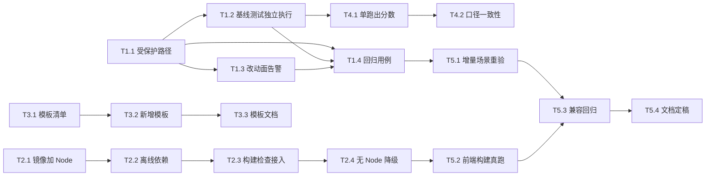

# ymir-agent 增量设计与任务列表 v1.3

> 版本：v1.3（增量质量硬化 + 前端构建校验 + 模板库扩充）
> 状态：**待评审**（用户批准后实施）
> 上游：`docs/10-验收报告-v1.2.md`（v1.2 遗留 5 条已知限制）
> 编号顺延：本文件为 `docs/11`

---

## 0. 速览

v1.2 已完成「模板库 + 增量 patch + 推送」三条主线，并用 12 任务全量基线验证。但真跑暴露了一类**v1.2 无法靠提示词解决**的问题：

> **模型在增量模式下会重写测试基础设施（`tests/conftest.py`），导致基线既有测试集体失效。**

场景 ② 与 ③ 双双栽在这上面，且加了三段提示词约束后**重跑仍然复现**（`docs/09 §15.4`）。这说明它不是提示词问题，而是**缺少服务端硬约束**。

v1.3 因此聚焦三件事：

| 主线 | 解决什么 | 对应限制 |
|---|---|---|
| **A. 增量质量硬化** | 让「改一处不破坏其他」成为机制保证，而非模型自觉 | L1 |
| **B. 前端构建校验** | 模板前端从「结构静态检查」升级为「真的能 build」 | L2 |
| **C. 模板库扩充** | 2 套 → 4 套，覆盖更多垂直场景 | — |

**不在 v1.3 范围**：多租户 / RBAC / MCP / A2A（仍属 v2.x）；CI 跑 `docker build`（L3，构建 15+ 分钟且需外网，维持人工验证）。

---

## 1. 现状与问题证据

### 1.1 增量场景失败模式（两次复现）

```
场景② fastapi-vue3 × patch（基线 = code v1）
  changed_paths 21/27 → 新建 app/migrations/ 整套 + 重写 tests/conftest.py + 改 app/database.py
  → pytest 20 项既有用例失败（DATABASE_URL setenv 被 lru_cache 吞掉）

场景③ python-cli × patch（基线 = code v1）
  changed_paths 17 个 → 重写 tests/conftest.py 删掉 run_cli 夹具
  → 6 个模块 `from conftest import run_cli` 收集阶段 ImportError（exit 2）
  补三段提示词约束后重跑（code v3）：**模型仍然重写了 conftest.py**
```

### 1.2 为什么提示词治不了

提示词是**软约束**，模型在「我要加新测试 → 我需要新夹具 → 我改 conftest」这条局部推理链里，
会把「不要重构测试基础设施」排在后面。两轮实测证明：约束写了，模型不遵守。

**结论**：必须在服务端建立**硬约束**——不是劝模型别改，而是让改动**无法生效**或被**立刻检出**。

---

## 2. 任务分解

### T1 · 增量质量硬化（P0）

| 子任务 | 目标 | 涉及文件 | 完成定义（DoD） | 依赖 | 规模 |
|---|---|---|---|---|---|
| **T1.1** 基线测试文件保护 | `patch` 模式下，基线的测试基础设施不可被静默覆盖 | `artifacts/merge.py`、`config/templates/*.yaml` | ① 模板可声明 `protected_paths`（如 `tests/conftest.py`）；② 模型输出命中受保护路径时，行为二选一且**显式**：`reject`（抛 `Conflict`，`reason=protected_path`）或 `ignore`（保留基线版本，记 manifest）；③ 默认 `reject`，模板可改；④ 冲突进 `patch_manifest.conflicts` 并在审批卡片可见；⑤ 单测覆盖两种策略 + 默认值 | T0 | M |
| **T1.2** 基线测试独立执行 | 评测时**先**跑基线自身测试，再跑合并树 —— 分离「谁弄坏的」 | `evaluation/benchmark.py`、`evaluation/evaluators/base.py`、`EvalTask` | ① `EvalTask.baseline_ref` 存在时，先对**基线产物**跑模板 `checks`；② 结果为 `baseline_runnability` 单独落报告；③ 合并树失败但基线通过 → 分类为 `regression`（新增失败分类）；④ 基线自身就失败 → 标记「基线不健康」，分数不可比、按 `unknown` 降级不阻断；⑤ 单测覆盖三态 | T1.1 | M |
| **T1.3** 改动面告警 | 改动面异常大时提示人工复核 | `artifacts/merge.py`（manifest）、`api/routers/artifacts.py`、前端审批卡片 | ① manifest 增 `change_ratio`（`changed_paths / 基线文件数`）；② 超阈值（默认 0.5）时 `patch_manifest.warnings` 记一条；③ 审批卡片显示「改动面 78%，建议复核」徽标；④ 不阻断流程（提示而非拒绝）；⑤ 阈值可在模板配置 | T1.1 | S |
| **T1.4** 增量约束回归用例 | 把场景 ②③ 的失败固化为回归测试 | `tests/test_incremental_guard.py`（新增） | ① 用例 1：模型输出改 `conftest.py` → `reject` 策略下抛冲突；② 用例 2：`ignore` 策略下保留基线版本、manifest 记录；③ 用例 3：改动面 >0.5 触发 warning；④ 用例 4：基线测试独立执行路径（三态各一） | T1.1–T1.3 | S |

### T2 · 前端构建校验（P1）

| 子任务 | 目标 | 涉及文件 | 完成定义（DoD） | 依赖 | 规模 |
|---|---|---|---|---|---|
| **T2.1** 沙箱镜像加 Node | 让 `npm ci && npm run build` 在沙箱内可执行 | `docker/sandbox.Dockerfile` | ① 预装 Node 20 LTS（`node --version` / `npm --version` 可查）；② 镜像体积增幅 ≤ 250 MB；③ 构建时长增幅 ≤ 3 分钟；④ `--no-install-recommends` + 清理 apt 缓存 | T0 | S |
| **T2.2** 离线依赖缓存 | 断网（`network=none`）下仍能装前端依赖 | `docker/sandbox.Dockerfile`、`config/templates/fastapi-vue3.yaml` | ① 镜像预置一个最小 `node_modules` 缓存（vue3 + element-plus + vite）；② 或预置 `npm` 本地 registry（`verdaccio`）；③ 模板 checks 加 `npm ci --offline`（或等价的离线路径）；④ 实测断网可 build | T2.1 | M |
| **T2.3** 构建检查接入模板 | `fastapi-vue3` 的前端从静态检查升级为真 build | `config/templates/fastapi-vue3.yaml` | ① checks 增 `npm run build`（权重与既有静态检查分配合理）；② 权重调整后总分仍为 100；③ `layout` 规则保留（结构检查与构建并存）；④ 构建失败给可读错误摘要 | T2.2 | S |
| **T2.4** 无 Node 环境降级 | 未装 Node 的镜像仍能跑（向后兼容） | `evaluation/evaluators/base.py`、模板 YAML | ① 检查命令探测 `node` 不存在时 skip 该检查并记 `skipped`；② **不扣分**（与「未绑定任务零成本跳过」同口径）；③ 报告标注「前端构建未执行（环境缺失）」 | T2.3 | S |

### T3 · 模板库扩充（P1）

| 子任务 | 目标 | 涉及文件 | 完成定义（DoD） | 依赖 | 规模 |
|---|---|---|---|---|---|
| **T3.1** 模板清单定稿 | 确定 v1.3 新增哪几套 | 本文档 §3 | ① 新增 ≥2 套，覆盖不同技术栈；② 每套有明确垂直场景与骨架清单；③ 用户拍板后写入 §3 | — | XS |
| **T3.2** 新增模板实现 | 落地新模板 YAML + 骨架 | `config/templates/*.yaml` | ① 各套通过 17 条加载期校验；② 骨架双类（reserved/seed）语义正确；③ checks 在沙箱内可执行；④ `max_files` 与骨架数一致 | T3.1 | M |
| **T3.3** 模板文档 | 使用手册补新增模板 | `docs/04-使用手册.md`、`README.md` | ① 每套模板一节（适用场景 / 骨架清单 / 检查命令）；② README 模板表格更新 | T3.2 | S |

### T4 · 工程化收口（P2）

| 子任务 | 目标 | 涉及文件 | 完成定义（DoD） | 依赖 | 规模 |
|---|---|---|---|---|---|
| **T4.1** 单跑脚本产出分数 | 单跑路径也能给出四维分数（缩小与基线的口径差） | `scripts/run_single_role.py`、`evaluation/harness.py` | ① 单跑可输出 `total_score` / 四维明细；② 与 `run_benchmark.py` 同源计算，不重复实现；③ `verdict` 仍由 QA 判定，分数作为附加信息 | T1.2 | M |
| **T4.2** 评测口径一致性校验 | 防止「同一产物两套分数」 | `tests/test_eval_parity.py`（新增） | ① 同一产物分别走单跑与批量路径，分数一致（容差 0）；② 不一致时用例失败并打印两方明细 | T4.1 | S |
| **T4.3** CI 增 docker build 可选 job | 让镜像问题能被 CI 捕获（当前只能人工验） | `.github/workflows/ci.yml` | ① 新增 `docker-build` job，`if: github.event_name == 'schedule'`（定时/手动触发，不阻塞 PR）；② 构建成功仅验证「能 build」，不推镜像；③ 失败不影响 PR 状态（独立性） | — | S |

### T5 · 验收（P0）

| 子任务 | 目标 | 涉及文件 | 完成定义（DoD） | 依赖 | 规模 |
|---|---|---|---|---|---|
| **T5.1** 增量场景重验 | 场景 ②③ 在硬约束下达到 `pass` 或原因明确 | `data/v13/*` | ① `fastapi-vue3 × patch`、`python-cli × patch` 各跑 1 次；② 若模型仍试图改 `conftest.py`，`reject` 策略下应产出**可用的增量产物**（而非整轮失败）；③ verdict 达 `conditional` 以上，或失败原因精确到文件行号；④ 基线测试独立执行结果显示「基线健康、合并树有回归」 | T1.4 | M |
| **T5.2** 前端构建真跑验证 | `fastapi-vue3` 的前端在沙箱内真的 build 出来 | `data/v13/*` | ① 断网沙箱内 `npm run build` exit=0；② 产物含 `dist/`；③ 构建耗时记录在报告 | T2.4 | S |
| **T5.3** 兼容性契约回归 | v1.0–v1.2 行为零变化 | 全部（只跑不改） | ① 14 条契约 + v1.2 新增的模板/增量/推送契约全部保持；② `ruff` / `pytest` / `check_import_graph` / `alembic check` 全绿；③ 前端 vitest 全绿 | T5.1 | S |
| **T5.4** 文档定稿 | 三份文档 + README | `docs/11`、`docs/12`、`docs/02`、`docs/04`、`README` | ① `docs/11` 补完实施回写；② `docs/12-验收报告-v1.3.md` 产出；③ `docs/02` 回写（新增能力）；④ `docs/04` 补模板/构建校验章节 | T5.3 | S |

---

## 3. 待拍板（实施前需用户确认）

| # | 议题 | 选项 | 建议 |
|---|---|---|---|
| **Q1** | 受保护路径的默认策略 | A. `reject`（模型改 conftest 直接冲突，整轮可能失败）<br>B. `ignore`（保留基线版，静默采用模型的其他改动） | **A 为默认，B 可按模板切换**。理由：静默忽略会让模型以为改成功了，下一轮还会改；显式冲突才能让它转向正确做法 |
| **Q2** | v1.3 新增哪两套模板 | A. `django-drf`（Django + DRF 后端）<br>B. `data-pipeline`（pandas + 定时任务）<br>C. `node-express`（Express + TypeScript）<br>D. `vue3-spa`（纯前端 SPA） | 建议 **B + C**：与既有 `fastapi-vue3`（全栈）、`python-cli`（CLI）形成「脚本 / 数据 / 服务端 / 全栈」四象限；`django-drf` 与 `fastapi-vue3` 重叠度偏高 |
| **Q3** | 前端构建校验的权重 | 构建设 20 分？还是保持静态检查 20 分、构建单列 10 分、总分调到 110 再归一？ | 建议**总分仍 100**：前端 20 分里「结构静态 10 + 构建 10」。理由：不破坏既有双门槛口径（`total≥75`）的历史可比性 |
| **Q4** | 是否接受「构建检查失败时整体 verdict 必为 fail」 | A. 是（构建不过就不可交付）<br>B. 否（构建计分但可 conditional） | 建议 **A**：前端 build 不过 = 项目跑不起来，属于阻断项 |

---

## 4. 任务依赖图



---

## 5. 风险与对策

| # | 风险 | 对策 |
|---|---|---|
| R1 | `reject` 策略下模型反复撞墙，整轮 run 失败率上升 | 冲突信息要**回喂模型**（复用 `_retry_instruction`），明确告知「此文件受保护，请新建文件」；并在模板里给模型列出 `protected_paths` 清单 |
| R2 | 镜像加 Node + 离线依赖导致体积增长过大（>2 GB） | 分阶段验证体积；必要时把前端构建拆**独立镜像**（`ymir-sandbox-frontend:latest`），按模板选择 |
| R3 | 基线测试独立执行让评测耗时翻倍 | 基线测试只在 `patch` 模式执行；且可缓存基线测试结果（同一基线多次评测复用） |
| R4 | 前端构建在断网下仍失败（依赖缺失） | T2.4 的降级路径是兜底：环境不满足时 skip 且不扣分，绝不因环境问题把好代码判 fail |

---

## 6. 修订记录

| 修订 | 日期 | 变更 |
|---|---|---|
| v1.3-初稿 | 2026-10-26 | 首版：基于 v1.2 验收报告 §8 的 5 条已知限制，拆 3 条主线 / 4 组任务 / 18 个子任务；4 项待拍板 |
