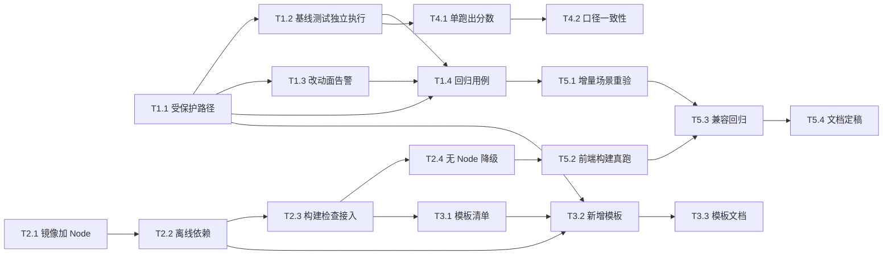

# ymir-agent 增量设计与任务列表 v1.3

> 版本：v1.3（增量质量硬化 + 前端构建校验 + 模板库扩充）
> 状态：**已实施**（T1–T4 交付完毕；T5 验收完成，结论见 `docs/12-验收报告-v1.3.md`）。实施回写见 **§8 实施记录（as-built）**
> 上游：`docs/10-验收报告-v1.2.md`（v1.2 遗留 5 条已知限制）
> 编号顺延：本文件为 `docs/11`

---

## 0. 速览

v1.2 已完成「模板库 + 增量 patch + 推送」三条主线，并用 12 任务全量基线验证。但真跑暴露了一类**v1.2 无法靠提示词解决**的问题：

> **模型在增量模式下会重写测试基础设施（`tests/conftest.py`），导致基线既有测试集体失效。**

场景 ② 与 ③ 双双栽在这上面，且加了三段提示词约束后**重跑仍然复现**（`docs/09 §15.4`）。这说明它不是提示词问题，而是**缺少服务端硬约束**。

v1.3 因此聚焦三件事：

| 主线 | 解决什么 | 对应限制 |
|---|---|---|
| **A. 增量质量硬化** | 让「改一处不破坏其他」成为机制保证，而非模型自觉 | L1 |
| **B. 前端构建校验** | 模板前端从「结构静态检查」升级为「真的能 build」 | L2 |
| **C. 模板库扩充** | 2 套 → 4 套，覆盖更多垂直场景 | — |

**不在 v1.3 范围**：多租户 / RBAC / MCP / A2A（仍属 v2.x）；CI 跑 `docker build`（L3，构建 15+ 分钟且需外网，维持人工验证）。

> **实施状态（2026-10-27 回写）**：三条主线 A/B/C 已全部落地，`T1–T4` 交付完毕（后端 **823 passed**，四套模板过 **21 条**校验，沙箱镜像 **968 MB**），`T5` 验收完成。**实施与设计的 19 条偏离见 §8**（含"三段式兜底""字节级契约收紧""镜像超 DoD"等如实记录）；设计契约见 §7，拍板记录见 §3，验收结论见 `docs/12`。

---

## 1. 现状与问题证据

### 1.1 增量场景失败模式（两次复现）

```
场景② fastapi-vue3 × patch（基线 = code v1）
  changed_paths 21/27 → 新建 app/migrations/ 整套 + 重写 tests/conftest.py + 改 app/database.py
  → pytest 20 项既有用例失败（DATABASE_URL setenv 被 lru_cache 吞掉）

场景③ python-cli × patch（基线 = code v1）
  changed_paths 17 个 → 重写 tests/conftest.py 删掉 run_cli 夹具
  → 6 个模块 `from conftest import run_cli` 收集阶段 ImportError（exit 2）
  补三段提示词约束后重跑（code v3）：**模型仍然重写了 conftest.py**
```

### 1.2 为什么提示词治不了

提示词是**软约束**，模型在「我要加新测试 → 我需要新夹具 → 我改 conftest」这条局部推理链里，
会把「不要重构测试基础设施」排在后面。两轮实测证明：约束写了，模型不遵守。

**结论**：必须在服务端建立**硬约束**——不是劝模型别改，而是让改动**无法生效**或被**立刻检出**。

---

## 2. 任务分解

### T1 · 增量质量硬化（P0）

| 子任务 | 目标 | 涉及文件 | 完成定义（DoD） | 依赖 | 规模 | 状态（v1.3 实施后） |
|---|---|---|---|---|---|---|
| **T1.1** 基线测试文件保护 | `patch` 模式下，基线的测试基础设施不可被静默覆盖 | `artifacts/merge.py`、`config/templates/*.yaml` | ① 模板可声明 `protected_paths`（如 `tests/conftest.py`）；② 模型输出命中受保护路径时，行为二选一且**显式**：`reject`（抛 `Conflict`，`reason=protected_path`）或 `ignore`（保留基线版本，记 manifest）；③ 默认 `reject`，模板可改；④ 冲突进 `patch_manifest.conflicts` 并在审批卡片可见；⑤ 单测覆盖两种策略 + 默认值 | T0 | M | ✅ 已交付（三段式，§8-1） |
| **T1.2** 基线测试独立执行 | 评测时**先**跑基线自身测试，再跑合并树 —— 分离「谁弄坏的」 | `evaluation/benchmark.py`、`evaluation/evaluators/base.py`、`EvalTask` | ① `EvalTask.baseline_ref` 存在时，先对**基线产物**跑模板 `checks`；② 结果为 `baseline_runnability` 单独落报告；③ 合并树失败但基线通过 → 分类为 `regression`（新增失败分类）；④ 基线自身就失败 → 标记「基线不健康」，分数不可比、按 `unknown` 降级不阻断；⑤ 单测覆盖三态 | T1.1 | M | ✅ 已交付（§8-4/5） |
| **T1.3** 改动面告警 | 改动面异常大时提示人工复核 | `artifacts/merge.py`（manifest）、`api/routers/artifacts.py`、前端审批卡片 | ① manifest 增 `change_ratio`（`changed_paths / 基线文件数`）；② 超阈值（默认 0.5）时 `patch_manifest.warnings` 记一条；③ 审批卡片显示「改动面 78%，建议复核」徽标；④ 不阻断流程（提示而非拒绝）；⑤ 阈值可在模板配置 | T1.1 | S | ✅ 已交付（徽标已上审批卡） |
| **T1.4** 增量约束回归用例 | 把场景 ②③ 的失败固化为回归测试 | `tests/test_incremental_guard.py`（新增） | ① 用例 1：模型输出改 `conftest.py` → `reject` 策略下抛冲突；② 用例 2：`ignore` 策略下保留基线版本、manifest 记录；③ 用例 3：改动面 >0.5 触发 warning；④ 用例 4：基线测试独立执行路径（三态各一） | T1.1–T1.3 | S | ✅ 已交付（21 条用例 / 932 行） |

### T2 · 前端构建校验（P1）

| 子任务 | 目标 | 涉及文件 | 完成定义（DoD） | 依赖 | 规模 | 状态（v1.3 实施后） |
|---|---|---|---|---|---|---|
| **T2.1** 沙箱镜像加 Node | 让 `npm ci && npm run build` 在沙箱内可执行 | `docker/sandbox.Dockerfile` | ① 预装 Node 20 LTS（`node --version` / `npm --version` 可查）；② 镜像体积增幅 ≤ 250 MB；③ 构建时长增幅 ≤ 3 分钟；④ `--no-install-recommends` + 清理 apt 缓存 | T0 | S | 🔶 已交付（体积 +642 MB，超原 DoD，§8-8） |
| **T2.2** 离线依赖缓存 | 断网（`network=none`）下仍能装前端依赖 | `docker/sandbox.Dockerfile`、`config/templates/fastapi-vue3.yaml` | ① 镜像预置一个最小 `node_modules` 缓存（vue3 + element-plus + vite）；② 或预置 `npm` 本地 registry（`verdaccio`）；③ 模板 checks 加 `npm ci --offline`（或等价的离线路径）；④ 实测断网可 build | T2.1 | M | 🔶 已交付（预置依赖池 + `fe-build`，未用 verdaccio） |
| **T2.3** 构建检查接入模板 | `fastapi-vue3` 的前端从静态检查升级为真 build | `config/templates/fastapi-vue3.yaml` | ① checks 增 `npm run build`（权重与既有静态检查分配合理）；② 权重调整后总分仍为 100；③ `layout` 规则保留（结构检查与构建并存）；④ 构建失败给可读错误摘要 | T2.2 | S | ✅ 已交付（`fe-build web` 等价实现，§8-9） |
| **T2.4** 无 Node 环境降级 | 未装 Node 的镜像仍能跑（向后兼容） | `evaluation/evaluators/base.py`、模板 YAML | ① 检查命令探测 `node` 不存在时 skip 该检查并记 `skipped`；② **不扣分**（与「未绑定任务零成本跳过」同口径）；③ 报告标注「前端构建未执行（环境缺失）」 | T2.3 | S | ✅ 已交付（`requires` + skipped 不扣分） |

### T3 · 模板库扩充（P1）

| 子任务 | 目标 | 涉及文件 | 完成定义（DoD） | 依赖 | 规模 | 状态（v1.3 实施后） |
|---|---|---|---|---|---|---|
| **T3.1** 模板清单定稿 | 确定 v1.3 新增哪几套 | 本文档 §3 | ① 新增 ≥2 套，覆盖不同技术栈；② 每套有明确垂直场景与骨架清单；③ 用户拍板后写入 §3 | — | XS | ✅ 已定稿（B + C） |
| **T3.2** 新增模板实现 | 落地新模板 YAML + 骨架 | `config/templates/*.yaml` | ① 各套通过 17 条加载期校验；② 骨架双类（reserved/seed）语义正确；③ checks 在沙箱内可执行；④ `max_files` 与骨架数一致 | T3.1 | M | ✅ 已交付（21 条校验） |
| **T3.3** 模板文档 | 使用手册补新增模板 | `docs/04-使用手册.md`、`README.md` | ① 每套模板一节（适用场景 / 骨架清单 / 检查命令）；② README 模板表格更新 | T3.2 | S | ✅ 已交付（`docs/04` §11 + README） |

### T4 · 工程化收口（P2）

| 子任务 | 目标 | 涉及文件 | 完成定义（DoD） | 依赖 | 规模 | 状态（v1.3 实施后） |
|---|---|---|---|---|---|---|
| **T4.1** 单跑脚本产出分数 | 单跑路径也能给出四维分数（缩小与基线的口径差） | `scripts/run_single_role.py`、`evaluation/harness.py` | ① 单跑可输出 `total_score` / 四维明细；② 与 `run_benchmark.py` 同源计算，不重复实现；③ `verdict` 仍由 QA 判定，分数作为附加信息 | T1.2 | M | ✅ 已交付（`evaluation/run_task.py`） |
| **T4.2** 评测口径一致性校验 | 防止「同一产物两套分数」 | `tests/test_eval_parity.py`（新增） | ① 同一产物分别走单跑与批量路径，分数一致（容差 0）；② 不一致时用例失败并打印两方明细 | T4.1 | S | ✅ 已交付（`tests/test_eval_parity.py`） |
| **T4.3** CI 增 docker build 可选 job | 让镜像问题能被 CI 捕获（当前只能人工验） | `.github/workflows/ci.yml` | ① 新增 `docker-build` job，`if: github.event_name == 'schedule'`（定时/手动触发，不阻塞 PR）；② 构建成功仅验证「能 build」，不推镜像；③ 失败不影响 PR 状态（独立性） | — | S | ✅ 已交付（schedule + dispatch） |

### T5 · 验收（P0）

| 子任务 | 目标 | 涉及文件 | 完成定义（DoD） | 依赖 | 规模 | 状态（v1.3 实施后） |
|---|---|---|---|---|---|---|
| **T5.1** 增量场景重验 | 场景 ②③ 在硬约束下达到 `pass` 或原因明确 | `data/v13/*` | ① `fastapi-vue3 × patch`、`python-cli × patch` 各跑 1 次；② 若模型仍试图改 `conftest.py`，`reject` 策略下应产出**可用的增量产物**（而非整轮失败）；③ verdict 达 `conditional` 以上，或失败原因精确到文件行号；④ 基线测试独立执行结果显示「基线健康、合并树有回归」 | T1.4 | M | ⚠️ **有条件达成**：4 次真跑，③ 走「原因精确到行」分支；④ 在 `python-cli` 达成（`healthy` → `regression`），`fastapi-vue3` 因 L7 + 需求撞车不可达；② 条件未触发（模型从未改 `conftest.py`） |
| **T5.2** 前端构建真跑验证 | `fastapi-vue3` 的前端在沙箱内真的 build 出来 | `data/v13/*` | ① 断网沙箱内 `npm run build` exit=0；② 产物含 `dist/`；③ 构建耗时记录在报告 | T2.4 | S | ✅ **达成**：`--network none` 下基线工程 `fe-build` 15.56 s 产出 `dist/`（1.03 MB JS + 362 KB CSS）；最小工程 0.52 s |
| **T5.3** 兼容性契约回归 | v1.0–v1.2 行为零变化 | 全部（只跑不改） | ① 14 条契约 + v1.2 新增的模板/增量/推送契约全部保持；② `ruff` / `pytest` / `check_import_graph` / `alembic check` 全绿；③ 前端 vitest 全绿 | T5.1 | S | ✅ **达成**：14 条 + v1.3 八条红线全部成立；口径统一为「**零放宽**」（9 个既有测试文件有等价更新，无一条放松断言）；六门全绿 |
| **T5.4** 文档定稿 | 三份文档 + README | `docs/11`、`docs/12`、`docs/02`、`docs/04`、`README` | ① `docs/11` 补完实施回写；② `docs/12-验收报告-v1.3.md` 产出；③ `docs/02` 回写（新增能力）；④ `docs/04` 补模板/构建校验章节 | T5.3 | S | 🔄 本文档为产出之一，最终结论待主理人补 |

---

## 3. 待拍板（**已拍板，2026-10-27**）

| # | 议题 | 选项 | 结论 | 决策（实施口径） |
|---|---|---|---|---|
| **Q1** | 受保护路径的默认策略 | A. `reject`（模型改 conftest 直接冲突，整轮可能失败）<br>B. `ignore`（保留基线版，静默采用模型的其他改动） | ✅ **A = `reject`** | 模板 `protected.on_hit` 默认 `reject`；命中即抛 `ProtectedPathConflict`（`reason=protected_path`，业务码 **1003/409**）。模板可切 `ignore`。**"整轮失败"已消解**：reject 在编排层被转成「1 次定向重试 + 兜底 ignore」，见 §7.3-4 —— 硬约束成立（改动不生效、必被检出），但不会因为模型撞墙而整轮报废（T5.1 ② 要求） |
| **Q2** | v1.3 新增哪两套模板 | A. `django-drf`<br>B. `data-pipeline`（pandas + 定时任务）<br>C. `node-express`（Express + TypeScript）<br>D. `vue3-spa` | ✅ **B + C** | 新增 `config/templates/data-pipeline.yaml`、`config/templates/node-express.yaml`，与既有 `fastapi-vue3` / `python-cli` 形成「全栈 / 脚本 / 数据 / 服务端」四象限。**连带契约**：加载期校验 3 须把 `stack.language` 从「必须 python」放宽为 `{python, typescript}`；校验 4 改为按语言选镜像清单（pip 表 / node 表），见 §7.2.7 |
| **Q3** | 前端构建校验的权重 | 构建设 20 分？还是总分调到 110 再归一？ | ✅ **总分仍 100**：前端 20 分 = 「结构静态 10 + 构建 10」 | 落地为「**可运行率维度内的分组配分**」：`fastapi-vue3` 声明 `scoring.runnability_points = {backend:10, frontend_static:10, frontend_build:10}` ⇒ 维度内 30 点 = 总分 30 分（1 内点 = 1 总分，因为该维度权重恰为 30%），其中**前端 20 分（静态 10 + 构建 10）、后端 10 分**。四维权重 30/30/20/20 与双门槛（75/60）**一字不动**，历史可比性保持不变。未声明 `scoring` 的模板仍走 v1.2 的「按 checks 权重归一」老口径（零变化） |
| **Q4** | 是否接受「构建检查失败时整体 verdict 必为 fail」 | A. 是<br>B. 否 | ✅ **A** | `checks[].blocking: true` 的检查任一失败 ⇒ `TaskOut.blocking_failed` 非空 ⇒ `TaskOut.passed=False` ⇒ `EvalVerdict.status="fail"`（`failure_class=check_failed`，`reason` 前缀「阻断项」）。**不新增失败分类**（复用既有 `check_failed`，避免动 A-06 六分类口径）；分数照算照披露（可能出现「总分 78 但未通过：阻断项失败」） |

---

## 4. 任务依赖图



> **批次归属（§7.6）**：`batch1 = T1.*`（无 Docker，可单测闭环）｜`batch2 = T3.* + T4.*`（不依赖镜像，可与 batch1 并行；`T4.1` 需 `T1.2` 的 probe 字段就位）｜`batch3 = T2.*`（需 Docker + 外网，最后做，因为 `Q4` 的 blocking 需先由 batch1/2 在评测侧就位）。

---

## 5. 风险与对策

> 以下是**初稿级**风险清单（拍板前视角）。实施级风险（含触发阈值、兜底路径、可验证手段）见 **§7.7**，编号一致（R1–R4 已被 §7.7 细化并扩展为 R1–R7）。

| # | 风险 | 对策 |
|---|---|---|
| R1 | `reject` 策略下模型反复撞墙，整轮 run 失败率上升 | 冲突信息要**回喂模型**（复用 `_retry_instruction`），明确告知「此文件受保护，请新建文件」；并在模板里给模型列出 `protected_paths` 清单 |
| R2 | 镜像加 Node + 离线依赖导致体积增长过大（>2 GB） | 分阶段验证体积；必要时把前端构建拆**独立镜像**（`ymir-sandbox-frontend:latest`），按模板选择 |
| R3 | 基线测试独立执行让评测耗时翻倍 | 基线测试只在 `patch` 模式执行；且可缓存基线测试结果（同一基线多次评测复用） |
| R4 | 前端构建在断网下仍失败（依赖缺失） | T2.4 的降级路径是兜底：环境不满足时 skip 且不扣分，绝不因环境问题把好代码判 fail |

---

## 6. 修订记录

| 修订 | 日期 | 变更 |
|---|---|---|
| v1.3-初稿 | 2026-10-26 | 首版：基于 v1.2 验收报告 §8 的 5 条已知限制，拆 3 条主线 / 4 组任务 / 18 个子任务；4 项待拍板 |
| v1.3-r2 | 2026-10-27 | ① §3 四项待拍板标记「已拍板」并写入决策口径；② 新增 **§7 实施设计（细化）**（数据结构 / 接口契约 / 文件级改动 / 共享知识 / 批次 / 风险 / 待明确）；③ 连带契约：加载期校验 17 → **21 条**（新增 18–21，扩展 3/4 语义）；④ manifest 采用「非默认值才序列化」以保住 A4 字节级契约；⑤ 新增依赖图/时序图 `docs/{class,sequence}-diagram-v1.3.mermaid` |
| v1.3-r3 | 2026-10-27 | **T5.4 实施回写**：① §0 加快览状态；② §2 五张任务表增「状态」列（T1–T4 已交付 / T5 验收中）；③ §7.4.1 新增 as-built 文件对账（实际新增/下沉/口径修正）；④ 新增 **§8 实施记录（as-built）**：交付概览 + **19 条与设计的偏离** + 未做/简化 + 已知遗留 G1–G5 + 待 QA 确认占位 |

---

## 7. 实施设计（细化）

> 本章是 **T1.1–T4.3 的实现契约**。原则：只描述「相对 v1.2 代码的增量」，字段名 / 模块路径 / 分层一律对齐现有实现；凡与初稿设想冲突处，**以现有代码为准**并在文中标注「现状修正」。
>
> 分层纪律（`scripts/check_import_graph.py` LAYERS）：`api(0) > orchestrator/evaluation(1) > roles/sop/templates(2) > artifacts/sandbox/gateway(3) > storage(4) > models/common/config(5)`。合法边只有 `src_rank ≤ dst_rank`，因此 **`artifacts` 永远不能 import `templates`**（模板 → 合并只传纯数据 `dict` / `frozenset`）。

### 7.1 设计基线（现状锚点，逐条对齐）

| # | 现有事实（代码位置） | 本设计如何使用 |
|---|---|---|
| B1 | `merge_trees(...)`（`artifacts/merge.py:230`）是**纯函数**，入参全为纯数据，冲突用 `Conflict` 累积（不是抛异常）；`PatchManifest` / `PatchCounts` 均 `extra="forbid"` | 受保护路径判定**必须**放在此函数内（依据只有入参）；`reject` 是本函数唯一抛异常的场景，且**先扫全量再一次性抛**（便于回喂模型全部路径） |
| B2 | `ConflictReason` 是 `Literal[...]` 六值（`merge.py:52`） | **追加**第 7 值 `"protected_path"`（只增不改，历史 manifest 仍可解析） |
| B3 | `merge_trees` 在 `role_executor._apply_patch_contract`（`orchestrator/role_executor.py:239`）被调用于 `runtime.execute` 之后、smoke / save 之前 | reject 重试的**唯一挂点**在这里（顺序不可变，否则冒烟/落盘会用到被拒的树） |
| B4 | `StageInput.feedback: list[str]`（`roles/io.py:137`）由 `prompts.build_user` 渲染成「历史反馈」节 | 受保护路径的纠正指令**复用 feedback**，不新增提示词通道、不改 `RoleRuntime.execute` 签名 |
| B5 | `EvalTask.baseline_ref` / `changed_paths` / `layout` 已存在（`evaluators/base.py:123`） | T1.2 的触发条件直接挂在既有字段上，不新增 run 级开关 |
| B6 | `harness._load_task` 已能拿到基线正文（`_resolve_baseline`，`harness.py:549`）—— 但现在**合并完就丢弃** | T1.2 让 `_load_task` 多返回一份 `base_files`，供基线独立执行（零额外 DB 读取） |
| B7 | `RunnabilityEvaluator.evaluate`（`evaluators/runnability.py:35`）按 `checks[].weight` 归一，命令证据里手写 `exit=… timed_out=…｜输出` 字符串 | 抽出共享执行器 `run_checks()`，同时产出**结构化 `CheckRun`**（gate/benchmark 不再靠正则解析字符串，但**字符串格式保持原样**以兼容既有测试） |
| B8 | `convention._frontend_rules`（`convention.py:318`）是现有唯一「前端结构静态」打分点（在 `convention` 结构组件内，`_template_structure_component`） | Q3 要求「结构静态 10 分」独立成账 ⇒ 该函数**下沉为 `base.frontend_structure_rules`**（纯函数，同包内共用），由 `runnability` 在分组配分模式下调它；`convention` 改为调用同一函数（v1.2 分数不变） |
| B9 | `LayoutRules` / `FrontendRules` 是跨层纯数据（`common/contracts.py:110`），`extra="forbid"` | 新增字段必须带默认值，且 **`LayoutRules` 不再塞打分口径** —— 打分归 `ScoringRules`（新类），职责不混 |
| B10 | `benchmark.FAILURE_ORDER` 六分类 first-match（`benchmark.py:63`）；`BaselineTable.FAILURE_LABELS` 同源（`baseline.py:46`） | 追加 `regression` / `baseline_unhealthy` 两值；**`baseline_unhealthy` 排最前**（"这行不可比"是最重要信息），`regression` 排在 `check_failed` 之前（更精确的诊断优先） |
| B11 | `BaselineTable` markdown 有「12 行字段无空缺 + 两次渲染字节一致」不变量 | **不新增表列**（避免破坏字节一致与历史表对比）；新信息只进 `baseline-<batch>.json` 的可选键 |
| B12 | `PatchManifest.manifest_json()`（`merge.py:140`）`sort_keys` + 紧凑分隔符 ⇒ 字节稳定（契约 A4） | 新增字段用「**非默认值才序列化**」保住 A4：旧输入仍产出**逐字节相同**的 `patch_manifest.json`（§7.5-2） |
| B13 | 模板加载期校验 17 条（`templates/loader.py:5` 表格 + `tests/test_templates.py` 逐条用例） | 追加 18–21，并把 3/4 语义**放宽**（python → {python, typescript}；依赖表按语言选） |
| B14 | `SANDBOX_IMAGE_PACKAGES`（`templates/models.py:41`）是「模板依赖 ⊆ 镜像」的**唯一权威表**，且镜像必须真的装得上 | `data-pipeline` 需 `pandas`/`numpy` ⇒ 扩表 + 镜像同步安装；新增 `SANDBOX_IMAGE_NODE_PACKAGES`（node 模板用）。**扩表必须与 `docker/sandbox.Dockerfile` 同一 PR**，否则"能加载但沙箱跑不通" |
| B15 | 沙箱会话只有 `exec/read_file/write_file/list_files`（`sandbox/base.py:78`），**没有删除 API** | 基线独立执行用**独立会话**（不复用主会话，避免文件残留污染合并树评测），见 §7.3-5 |
| B16 | `run_benchmark.preflight()` 硬预检 pytest/ruff，失败 `exit 2`（`scripts/run_benchmark.py:91`） | 加 node 探测但**只告警不 exit**（T2.4 有降级路径，不能因环境缺失拒绝跑分） |
| B17 | `.dockerignore` 排除 `web` / `node_modules`（构建上下文最小化，实测 23731 文件 / 300MB） | 离线前端依赖池须放 `docker/fe-baseline/`、`docker/node-baseline/` 并加**允许例外**，绝不放开 `web/` |

### 7.2 数据结构变更

> 约定：所有新增 pydantic 字段**必须带默认值**（旧 YAML / 旧 JSON 缺字段仍可解析）；所有新增 dataclass 字段**必须带默认值**（同理）；`extra="forbid"` 的模型只加字段、不改既有字段名/类型。

#### 7.2.1 模板侧（`src/ymir/templates/models.py`）

| 模型 | 字段 | 类型 | 默认 | 语义 |
|---|---|---|---|---|
| `CheckSpec`（改） | `group` | `str` | `""` | 检查组名。`""` = 默认组（后端）。仅在模板声明 `scoring.runnability_points` 时参与分组配分；否则**完全忽略** |
| | `blocking` | `bool` | `False` | 阻断项（Q4）：失败即 `verdict=fail`。`False` = v1.2 行为（仅扣分） |
| | `requires` | `str` | `""` | 依赖的可执行文件名（`node` / `npm`）。沙箱内 `command -v` 探测缺失 ⇒ 该检查 `skipped`（**不扣分**，T2.4） |
| | `timeout_s` | `float \| None` | `None` | 单条检查超时；`None` = 用 `EvalContext.exec_timeout`（构建需 300s，pytest 只需 120s） |
| `ProtectedSpec`（新） | `paths` | `list[str]` | `[]` | 受保护路径。元素语义复用 `layout.allowed_prefixes` 的**尾斜杠**约定：`tests/conftest.py`（精确文件）/ `tests/fixtures/`（目录前缀）。加载期跑 **`common.paths.normalize_scope_path`**（校验 18）—— 它比 `normalize_rel_path` 多一条规则：**末段无扩展名 ⇒ 视为目录并自动补 `/`**（`tests` → `tests/`），避免作者写目录名却退化成精确文件匹配而静默失效 |
| | `on_hit` | `Literal["reject","ignore"]` | `"reject"` | **Q1 决策点**。`reject` = 抛 `ProtectedPathConflict`；`ignore` = 丢弃模型内容、保留基线版本、记 manifest |
| | `max_change_ratio` | `float` | `0.5` | T1.3 阈值，`gt=0, le=1`。`changed_paths / 基线文件数` 超此值 ⇒ `patch_manifest.warnings` 加一条 |
| `ScoringSpec`（新） | `runnability_points` | `dict[str, float]` | `{}` | 组名 → 该组在**可运行率维度内**的点数。空 = 不启用分组配分（老口径：按 `checks[].weight` 归一） |
| | `frontend_scored_in_runnability` | `bool` | `False` | `True` ⇒ 前端结构规则**只在** `runnability` 的 `frontend_static` 组计分，`convention` 结构组件**跳过**前端规则（避免重复计分） |
| `TemplateSpec`（改） | `protected` | `ProtectedSpec` | `ProtectedSpec()` | |
| | `scoring` | `ScoringSpec` | `ScoringSpec()` | |
| | 方法 `protected_paths()` | `-> frozenset[str]` | — | 纯数据出口（供 `merge_trees` / 提示词） |
| | 方法 `to_scoring_rules()` | `-> ScoringRules` | — | 跨层纯数据（`templates(2) -> common(5)`，合法边） |
| 常量（改） | `SANDBOX_IMAGE_PACKAGES` | `frozenset[str]` | +`pandas` `numpy` | python 模板依赖白名单（校验 4 用） |
| 常量（新） | `SANDBOX_IMAGE_NODE_PACKAGES` | `frozenset[str]` | `{"express","typescript","@types/express","@types/node"}` | typescript 模板依赖白名单（校验 4 用） |
| 常量（新） | `ALLOWED_LANGUAGES` | `frozenset[str]` | `{"python","typescript"}` | 校验 3 的取值集合 |

#### 7.2.2 跨层纯数据（`src/ymir/common/contracts.py`）

```python
class ScoringRules(BaseModel):
    """模板打分口径（纯数据；templates(2) 产出、evaluation(1) 消费）。"""

    model_config = ConfigDict(extra="forbid")

    runnability_points: dict[str, float] = Field(default_factory=dict)
    frontend_scored_in_runnability: bool = False

    @property
    def enabled(self) -> bool:
        """是否启用分组配分（空字典 = 走 v1.2 的按权重归一）。"""
        return bool(self.runnability_points)
```

`EvalVerdict`（既有裁决合同，frozen dataclass）**追加 3 个带默认值字段**（`repair` 写 `history` 需要它们，否则批量表的 `regression` / `baseline_status` 无从取得）：

```python
@dataclass(frozen=True)
class EvalVerdict:
    ...
    baseline_status: str = ""                       # "" | healthy | unhealthy | skipped
    regression: bool = False
    blocking_failed: tuple[str, ...] = ()
```

> 兼容性：frozen dataclass 追加**带默认值**字段 ⇒ 既有构造点（`gate` / 测试里的手工 `EvalVerdict(...)`）零改动；`EvalVerdict` 不是 JSON 契约（不落盘、不进 API），仅进程内传递。

> **不放 `LayoutRules` 的理由**：`LayoutRules` 是「目录与命名规范」，加打分点会让同一字段承载两种语义（结构规则 vs 配分策略），`convention` 与 `runnability` 的耦合也会变脏。新增独立类，`EvalTask.scoring` 与 `EvalTask.layout` 并列。

#### 7.2.3 合并与簿记（`src/ymir/artifacts/merge.py`）

| 类型 | 变更 | 说明 |
|---|---|---|
| `ConflictReason`（`Literal`） | **追加** `"protected_path"` | 第 7 个值；六值语义不变 |
| `ProtectedPolicy`（新 `Literal`） | `"reject" \| "ignore"` | 与 `templates.ProtectedSpec.on_hit` 同构（**字符串字面量共用，不跨层 import**） |
| `DEFAULT_MAX_CHANGE_RATIO`（新常量） | `0.5` | T1.3 缺省阈值 |
| `CHANGE_RATIO_WARNING_PREFIX`（新常量） | `"change_ratio_exceeded:"` | `warnings` 短码前缀（体积可控，见 §7.5-2） |
| `PROTECTED_HIT_WARNING_PREFIX`（新常量） | `"protected_path_ignored:"` | 同上 |
| `ProtectedPathConflict`（新异常） | `class ProtectedPathConflict(StateConflictError)` | 业务码 **1003 / 409**（不新增 1008）；`details={"reason":"protected_path","paths":[...]}`；属性 `paths: tuple[str, ...]`、`reason: str = "protected_path"` |
| `PatchCounts`（改） | `+ protected_hits: int = 0` | 受保护路径被拦截的条数（`ignore` 策略下记数；`reject` 不产出 manifest，故不记） |
| `PatchManifest`（改） | `+ change_ratio: float = 0.0` | `len(changed_paths) / max(1, 基线文件数)`，保留 2 位小数；无基线（`from_scratch`）恒 `0.0` |
| | `+ warnings: list[str]` | 短码列表，≤3 条、每条 ≤64 字节。已知取值：`change_ratio_exceeded:<ratio>`、`protected_path_ignored:<n>` |

`manifest_json()` 序列化纪律（**A4 契约的关键**）：

```python
def manifest_json(self) -> str:
    payload = self.manifest.model_dump(mode="json")
    # 非默认值才序列化 ⇒ 未触发新能力时正文与 v1.2 逐字节一致（A4）
    if self.manifest.change_ratio == 0.0:
        payload.pop("change_ratio", None)
    if not self.manifest.warnings:
        payload.pop("warnings", None)
    counts = payload.get("counts")
    if isinstance(counts, dict) and not counts.get("protected_hits"):
        counts.pop("protected_hits", None)
    return json.dumps(payload, ensure_ascii=False, sort_keys=True, separators=(",", ":"))
```

> **现状修正（重要）**：`MANIFEST_MAX_BYTES = 2048` 在现有实现中**只声明、未强制**（全仓库无引用）。v1.3 **不引入强制**——强制会逼 `changed_paths` 截断，而 `changed_paths` 是 judge 语料分级与前端高亮的输入，截断即语义破坏。改为：新字段一律短码（≤3 条），并在 `docs/02` 里把该常量标注为「软预算，未强制」。

#### 7.2.4 评测侧数据结构

`src/ymir/evaluation/evaluators/base.py`：

| 类型 | 变更 | 说明 |
|---|---|---|
| `EvalCheck`（改） | `+ group: str = ""` / `+ blocking: bool = False` / `+ requires: str = ""` / `+ timeout_s: float \| None = None` | 与 `templates.CheckSpec` **逐字段同构**（`gate` 直接映射，不做二次改名） |
| `CheckRun`（新 dataclass） | `command: str` / `group: str = ""` / `status: Literal["passed","failed","skipped"] = "failed"` / `exit_code: int \| None = None` / `timed_out: bool = False` / `blocking: bool = False` / `skipped_reason: str = ""` / `output: str = ""` / `duration_ms: int = 0` | 单条检查的**结构化**执行结果（取代字符串正则解析） |
| `EvalScore`（改） | `+ check_runs: list[CheckRun] = field(default_factory=list)` | 默认空 ⇒ 既有评估器/测试零改动；`runnability` 填充 |
| `EvalTask`（改） | `+ scoring: ScoringRules \| None = None` | `None` = 老口径 |
| `EvalContext`（改） | `+ scoring: ScoringRules \| None = None` | 由 harness 从 `EvalTask.scoring` 透传 |

`src/ymir/evaluation/report.py`：

| 类型 | 变更 | 说明 |
|---|---|---|
| `BaselineCheckOut`（新） | `command` / `exit_code` / `timed_out` / `skipped` / `output` | 基线检查明细 |
| `BaselineProbeOut`（新） | `status: Literal["healthy","unhealthy","skipped"]` / `score: float = 0.0` / `passed: bool = False` / `checks: list[BaselineCheckOut]` / `reason: str = ""` / `duration_ms: int = 0` / `cached: bool = False` | `baseline_runnability` 的报告形态 |
| `SkippedCheckOut`（新） | `command` / `reason` | 被跳过检查（T2.4 可读性） |
| `TaskOut`（改） | `+ baseline_runnability: BaselineProbeOut \| None = None` | **默认 None** ⇒ 非增量 / 旧报告 JSON 渲染与 v1.2 逐字节一致 |
| | `+ regression: bool = False` / `+ regression_reason: str = ""` | 「合并树有失败 + 基线健康」 |
| | `+ blocking_failed: list[str] = []` | 阻断项失败的命令清单（Q4） |
| | `+ skipped_checks: list[SkippedCheckOut] = []` | 环境缺失跳过的检查 |

> `TaskOut.passed` 语义**收紧一处**：`passed = aggregate.passed and not blocking_failed`。这是 Q4 的落点，会传导到 `EvaluationReport.first_pass_rate` / `final_pass_rate`（预期行为：构建不过 = 不可交付 = 不计通过）。总分照算（可能出现「总分 78 但未通过」）。

`src/ymir/evaluation/benchmark.py`：

| 类型 | 变更 |
|---|---|
| 常量 | `FAILURE_REGRESSION = "regression"`、`FAILURE_BASELINE_UNHEALTHY = "baseline_unhealthy"` |
| `FAILURE_ORDER` | `(baseline_unhealthy, missing_artifact, dependency_missing, timeout, regression, check_failed, below_threshold, degraded_scoring)` —— **六分类 → 八分类**（只追加，且两个新值只可能由 v1.3 新数据触发 ⇒ 旧状态文件重渲染结果不变） |
| `FailureSignals` | `+ baseline_status: str = ""` / `+ regression: bool = False` / `+ blocking_failed: list[str] = field(default_factory=list)` |
| 状态行 | `done` 行新增可选键 `baseline_status`（`healthy`/`unhealthy`/`skipped`/`None`）、`regression`（bool）、`comparable`（bool） |

`src/ymir/evaluation/baseline.py`：`FAILURE_LABELS` 追加 `regression: "回归"`、`baseline_unhealthy: "基线不健康"`；**表列不变**（B11）；`BaselineRow.to_dict()` 追加上述 3 个可选键。

#### 7.2.5 提示词视图（`src/ymir/roles/io.py`）

| 类型 | 变更 | 说明 |
|---|---|---|
| `TemplateContext`（改，frozen dataclass） | `+ protected_paths: frozenset[str] = frozenset()` | 空 ⇒ `prompts` **不渲染该节** ⇒ 非模板/未配置模板的提示词逐字节不变 |
| | `+ change_ratio_threshold: float = 0.5` | 供「改动面最小化」提示词给出具体阈值 |

#### 7.2.6 模板 YAML schema 契约（三段示例）

```yaml
# --- 受保护路径（T1.1）---
protected:
  paths:
    - tests/conftest.py          # 精确文件
    - tests/fixtures/            # 目录前缀（尾斜杠 = 前缀语义）
  on_hit: reject                 # reject（默认，Q1）| ignore
  max_change_ratio: 0.5          # T1.3 阈值

# --- 打分口径（Q3；只有需要「显式配分」的模板才声明）---
scoring:
  runnability_points:
    backend: 10
    frontend_static: 10
    frontend_build: 10
  frontend_scored_in_runnability: true

# --- 检查命令（T2.3 / T2.4 / Q4）---
checks:
  - { type: command, run: "python -m pytest -q", weight: 2, group: backend }
  - type: command
    run: "fe-build web"          # 镜像自带脚本（不进用户产物树）
    weight: 1
    group: frontend_build
    blocking: true               # Q4：构建失败 ⇒ verdict=fail
    requires: node               # T2.4：无 node ⇒ skipped，不扣分
    timeout_s: 300
```

#### 7.2.7 加载期校验：17 条 → 21 条（`templates/loader.py`）

| # | 校验 | 状态 |
|---|---|---|
| 1–2 | id / version | 不变 |
| **3** | `stack.language` | **语义扩展**：`∈ ALLOWED_LANGUAGES = {python, typescript}`（原：必须 `python`）。python 模板行为不变 |
| **4** | `stack.dependencies ⊆ 镜像清单` | **语义细化**：按 `stack.language` 选表 —— `python` → `SANDBOX_IMAGE_PACKAGES`；`typescript` → `SANDBOX_IMAGE_NODE_PACKAGES`。python 模板行为不变 |
| 5–17 | 原样 | 不变 |
| **18** | `protected.paths` 归一化 + 组内去重 + **不得与 `skeleton` / `conventions` 交叉** | 新增。交叉即分工矛盾（骨架已 protected 由 `reserved` 机制保护；conventions 是"模型必须产出"） |
| **19** | `protected.on_hit ∈ {reject, ignore}` | 新增（Literal 已由 pydantic 拦，显式复核防默认值被放宽 —— 与校验 15 同风格） |
| **20** | `0 < protected.max_change_ratio ≤ 1` | 新增 |
| **21** | `scoring.runnability_points`：值均 > 0；键非空；声明 `frontend_static` 或 `frontend_scored_in_runnability=true` 时**必须**有 `layout.frontend` | 新增（否则配分无法兑现，属"碰巧能跑"的隐性错误） |

> 连带：`loader.py` 模块 docstring 的 17 条表格、`docs/02-架构设计.md` §4.1.5、`tests/test_templates.py` 模块 docstring 里的"17 条"文案同步改为 **21 条**（这是文档/注释级改动，不涉及 v1.0–v1.2 的 14 条契约）。

### 7.3 接口契约

> 所有函数均为**库内公共接口**（有单测直连）。★ = 新增文件/函数。

**1）受保护路径判定（`artifacts/merge.py`）**

```python
★ def detect_protected_hits(
    patch_paths: AbstractSet[str],
    protected_paths: AbstractSet[str],
) -> tuple[str, ...]:
    """返回命中的受保护路径（排序、去重）。纯函数，无 IO。

    匹配规则：精确相等，或命中以 "/" 结尾的目录前缀
    （`p == d` / `p.startswith(d)` / `p == d.rstrip("/")`）。
    """

★ def compute_change_ratio(changed_paths: Sequence[str], base_file_count: int) -> float:
    """改动面 = len(changed_paths) / max(1, base_file_count)，四舍五入 2 位；无基线返回 0.0。"""

def merge_trees(
    base: Mapping[str, str],
    patch: Mapping[str, str],
    *,
    mode: MergeMode,
    skeleton: Mapping[str, str] | None = None,
    reserved_paths: AbstractSet[str] = frozenset(),
    base_paths: AbstractSet[str] = frozenset(),
    deleted: Sequence[str] = (),
    max_file_bytes: int = DEFAULT_MAX_FILE_BYTES,
    # ---- v1.3 新增（全部有默认值，既有调用点零改动）----
    protected_paths: AbstractSet[str] = frozenset(),
    on_protected_hit: ProtectedPolicy = "reject",
    max_change_ratio: float = DEFAULT_MAX_CHANGE_RATIO,
) -> MergeResult:
    """...

    Raises:
        InvalidParamError: 既有（mode 非法 / max_file_bytes 非正）；
            v1.3 追加：``max_change_ratio`` 不在 (0, 1] / ``on_protected_hit`` 非法。
        ProtectedPathConflict: 命中 ``protected_paths`` 且策略为 ``reject``
            （1003/409，``details={"reason":"protected_path","paths":[...]}``）。
            空 ``protected_paths`` ⇒ **永不抛出**（v1.0–v1.2 行为不变）。

    Note:
        - 命中集合在应用补丁**之前**一次性算出并整批抛出（不复用前 N 个的部分结果）；
        - ★ **命中集合的定义**（QA P3-5，唯一口径）：参与判定的路径 =
          **内容真的变了的补丁路径** ∪ **`deleted` 声明的路径**。
          模型把基线文件**原样回显**（`patch[p] == base[p]`）属"未修改"，走 v1.2 的
          noop 语义（`counts.noop_dropped`）—— **不触发保护、不烧定向重试**；
          `deleted` 通道**无条件命中**（删除不可逆，不能靠"内容相同"豁免）；
        - 目录项同时匹配"本名"（F6）：`Dockerfile/` 保护 `Dockerfile` 本体与
          `Dockerfile/extra`，但**不**保护 `Dockerfile.bak`；
        - ``ignore`` 策略：该路径的模型内容被丢弃、保留基线版本，
          逐条记 ``Conflict(path, reason="protected_path")`` 且 ``counts.protected_hits += 1``；
        - ``change_ratio`` 与 ``warnings`` 只写 manifest，**不改变** ``files``。
    """
```

**2）模板数据出口（`templates/models.py`）**

```python
def TemplateSpec.protected_paths(self) -> frozenset[str]        # 纯数据，供 merge / prompts
def TemplateSpec.to_scoring_rules(self) -> ScoringRules         # 纯数据，供 evaluation
```

**3）检查执行与配分（`evaluation/evaluators/base.py` / `runnability.py`）**

```python
★ async def run_checks(
    sandbox: SandboxSession | None,
    checks: Sequence[EvalCheck],
    *,
    exec_timeout: float = 120.0,
    evidence: list[Evidence] | None = None,
) -> list[CheckRun]:
    """逐条执行 checks，返回结构化结果（顺序 = 声明顺序，确定性）。

    单条规则：
      1. ``requires`` 非空 → 先 ``sandbox.exec(f"command -v {requires}")``；非 0 ⇒
         ``status="skipped", skipped_reason="requires_missing:<name>"``（**不进分母**）；
      2. 超时取 ``check.timeout_s or exec_timeout``；
      3. ``exit_code == 0 and not timed_out`` ⇒ ``passed``，否则 ``failed``；
      4. 证据 detail 格式**保持 v1.2 原样**（``exit=… timed_out=… duration=…ms｜片段``），
         末尾追加 ``blocking=True`` 仅当 ``check.blocking``（正则 ``_EVIDENCE_RE`` 仍匹配）。
    """

★ def score_by_points(
    runs: Sequence[CheckRun],
    *,
    points: Mapping[str, float],
    static_scores: Mapping[str, float] | None = None,
) -> tuple[float, str]:
    """分组配分（Q3）：返回 ``(0-100 维度分, 人读理由)``。

    group_score(g) = Σ权重(通过) / Σ权重(非 skipped) × 100        # 分母剔除 skipped
    维度分 = Σ_g points[g] × group_score(g) / Σ_g points[g]        # 无有效检查的组不进分母
    ``static_scores``：静态组（如 ``frontend_static``）的 0-100 分，
    无对应 check，直接作为该组得分参与同一公式。
    全部组均无有效检查 ⇒ 返回 ``(0.0, "无可用检查")``。
    """

★ def frontend_structure_rules(
    frontend: FrontendRules,
    workdir: Mapping[str, str],
    evidence: list[Evidence],
) -> list[tuple[bool, str]]:
    """前端结构静态规则（由 ``convention._frontend_rules`` **原样下沉**）。"""
```

> `RunnabilityEvaluator.evaluate` 内部改为：`runs = await run_checks(...)` → 若 `ctx.scoring` 启用分组配分则 `score_by_points`，否则沿用 `ratio_score(通过权重, 总权重)`（**老口径一字不改**）。`EvalScore.check_runs = runs`。

**4）受保护路径重试（`orchestrator/role_executor.py`）**

```python
PROTECTED_RETRY_MAX: int = 1        # 模块常量：定向重试上限（1 次）

async def _execute_with_patch_contract(
    self, *, run, stage, stage_input, output, template_spec, base_files,
) -> tuple[StageOutput, MergeResult | None]:
    """阶段一/二合并 + 受保护路径三段式处置（Q1 与 T5.1 ② 的交集）。

    ① 首次：``_apply_patch_contract(..., on_protected_hit=spec.protected.on_hit)``；
    ② ``except ProtectedPathConflict`` 且策略为 reject ⇒ **定向重试 1 次**：
       ``stage_input = replace(stage_input, feedback=[_protected_feedback(exc), *feedback],
                               attempt=stage_input.attempt + 1)``，
       重新 ``runtime.execute``；两次调用的成本/ tokens **累加到返回的 StageOutput**（成本不漏计）；
    ③ 重试仍冲突 ⇒ **零成本兜底**：对**第二次产出**以 ``on_protected_hit="ignore"`` 再合一次
       （纯函数、不调模型），manifest 追加 ``warnings=["protected_path_forced_ignore:<n>"]``，
       阶段继续（**不整轮失败**）。
    """

def _protected_feedback(exc: ProtectedPathConflict) -> str:
    """回喂模型的纠正指令（复用 feedback 通道，不新增提示词通道）。

    形如：``受保护路径不可修改（tests/conftest.py）：这些文件由基线提供且必须保持原样。
    请改为新建文件（例如 tests/test_<新功能>.py）实现你的目标，不要重写 conftest.py。``
    """
```

阶段 payload 追加（`payload["patch"]` 内，纯增量键）：

```python
"change_ratio": merged.manifest.change_ratio,
"warnings": list(merged.manifest.warnings),
"protected_hits": merged.manifest.counts.protected_hits,
"protected_retry": {"paths": [...], "attempts": 1},   # 仅在发生过重试时出现
```

**5）基线独立执行（★ `src/ymir/evaluation/baseline_probe.py`）**

```python
BASELINE_HEALTHY: str = "healthy"
BASELINE_UNHEALTHY: str = "unhealthy"
BASELINE_SKIPPED: str = "skipped"

@dataclass(frozen=True)
class BaselineCheck:
    command: str
    exit_code: int | None = None
    timed_out: bool = False
    skipped: bool = False
    output: str = ""

@dataclass(frozen=True)
class BaselineProbe:
    status: Literal["healthy", "unhealthy", "skipped"] = BASELINE_SKIPPED
    score: float = 0.0
    passed: bool = False
    checks: tuple[BaselineCheck, ...] = ()
    reason: str = ""
    duration_ms: int = 0
    cached: bool = False

★ class BaselineProbeCache:
    """进程内 LRU（容量 8）。键 = ``sha256(base_content_hash + checks_fingerprint)``。

    只在**同一进程**内复用（batch 场景同一基线多次评测受益；单跑无收益）。
    刻意不落盘：基线正文可能含用户代码，落盘缓存会引入"离线副本"式的合规问题。
    """

★ async def probe_baseline(
    *,
    files: Mapping[str, str],
    checks: Sequence[EvalCheck],
    sandbox_provider: Any | None,
    exec_timeout: float = 120.0,
    cache: BaselineProbeCache | None = None,
    cache_key: str = "",
) -> BaselineProbe:
    """在**独立沙箱会话**内对基线自身跑模板 checks（T1.2）。

    降级优先（永不阻断）：
      - ``files`` 为空          → skipped("baseline_unavailable")
      - ``sandbox_provider is None`` → skipped("no_sandbox")
      - ``checks`` 为空         → skipped("no_checks")
      - 全部检查 requires 缺失  → skipped("env_missing")   # 不算 unhealthy
      - 会话获取/写入异常       → skipped("sandbox_error")
    否则：全部 check 通过 → healthy；任一失败 → unhealthy。
    """
```

**6）harness 评测入口（`evaluation/harness.py`）**

```python
BASELINE_UNHEALTHY_WARNING: str = "基线自身检查未通过（基线不健康）：本次分数与「基于健康基线」的运行不可比"
FRONTEND_BUILD_SKIPPED_WARNING: str = "前端构建未执行（环境缺失：node/npm 不可用）"

async def evaluate_task(
    self, task: EvalTask, *, project_id: str | None,
    version_override: int | None = None, suite: EvalSuite | None = None,
) -> TaskOut:            # 签名不变（v1.0 契约）
    """新增内部行为（无新参数）：

    1. ``_load_task`` 追加返回基线正文（B6）；
    2. ``task.baseline_ref`` 非空且基线正文可用 ⇒ ``probe_baseline(...)``，
       结果落 ``TaskOut.baseline_runnability``；
    3. probe.status == "unhealthy" ⇒ ``warnings += [BASELINE_UNHEALTHY_WARNING]``；
    4. ``regression = probe.status=="healthy" and 任一 CheckRun.status=="failed"``；
    5. ``blocking_failed = [r.command for r in runs if r.blocking and r.status=="failed"]``；
    6. ``skipped_checks`` 来自 CheckRun.status=="skipped"；存在 ``requires`` 跳过且
       该组为 frontend_build ⇒ ``warnings += [FRONTEND_BUILD_SKIPPED_WARNING]``。
    """

async def _load_task(self, task, project_id, version_override, *, allow_default_fallback=True
) -> tuple[dict[str, str], dict[str, Any], dict[str, dict[str, str]], dict[str, str]]:
    """（私有）返回值由 3 元组变 **4 元组**：末项为基线正文（无基线 = ``{}``）。"""
```

**7）裁决（`evaluation/gate.py`）**

```python
FAILURE_BASELINE_UNHEALTHY: str = "baseline_unhealthy"

def _to_verdict(self, suite: EvalSuite, outcome: Any, repair_round: int) -> EvalVerdict:
    """分支顺序（v1.3 新增 2 个分支，插在既有分支之间的确定位置）：

    1. status != "evaluated"                        → unknown(missing_artifact)
    2. artifact_ref["name"] is None                 → unknown(missing_artifact)
    3. ★ baseline_runnability.status == "unhealthy" → unknown(baseline_unhealthy, degraded=True)
    4. any(dim.degraded)                            → unknown(degraded_scoring)
    5. ★ outcome.blocking_failed 非空               → **fail**(check_failed, reason 前缀「阻断项」)
    6. outcome.passed                               → pass
    7. 其它                                          → fail(check_failed | below_threshold)

    所有分支都从 ``outcome`` 抄 3 个新字段进 ``EvalVerdict``
    （``baseline_status`` / ``regression`` / ``blocking_failed``），
    供 ``RepairController`` 写 history、``benchmark`` 读回分类。 
    """
```

> 分支 3 放在 4 之前：基线不健康时「分数不可比」比「某维度降级」更根本。分支 5 放在 6 之前：Q4 要求阻断项**优先级高于分数**。

**8）批量分类（`evaluation/benchmark.py`）**

```python
def classify_failure(signals: FailureSignals) -> tuple[str | None, str]:
    """first-match 顺序（v1.3）：

    1. ★ baseline_status == "unhealthy" → (baseline_unhealthy, "基线自身检查未通过…不可比")
    2. 缺文件 → missing_artifact
    3. 依赖缺失 → dependency_missing
    4. 超时 → timeout
    5. ★ regression == True → (regression, "基线通过但合并树出现失败：<首个失败命令>")
    6. 检查失败 → check_failed（含 blocking 失败项，reason 前缀「阻断项」）
    7. 未达双门槛 → below_threshold
    8. 评分降级 → degraded_scoring
    """
```

**9）单跑与批量同源打分（★ `src/ymir/evaluation/run_task.py`）**

```python
★ def build_task_for_run(
    run: PipelineRun, *, artifact_name: str = "code", default_suite: str = "default",
) -> tuple[EvalTask, EvalSuite]:
    """把「一次 run」装配成可评测任务（**唯一装配点**，T4.1/T4.2）。

    等价于现 ``HarnessEvaluationGate.evaluate`` 内的组装逻辑（套件解析 → 模板 checks
    覆盖 → layout / scoring 注入 → baseline_ref），原样抽出为纯函数（除
    ``EvalSuite.load`` 的磁盘读取）。gate 与 benchmark fallback 都改为调用它。
    """

★ async def evaluate_run(
    harness: EvaluationHarness, run: PipelineRun, *,
    artifact_name: str = "code", default_suite: str = "default",
) -> TaskOut:
    """端到端：``build_task_for_run`` → ``harness.evaluate_task``（与批量同源）。
    """
```

**10）脚本入口（`scripts/run_single_role.py`）**

```python
--evaluate            # 新 flag：run 终态后按 harness 口径补一次四维打分
--suite default       # 新 flag：评测套件 id（缺省 default）
```

输出契约（**不是裁决**，L4 口径不变）：

```
- 四维分数（确定性口径）
  需求符合度 78.00 / 代码可运行率 66.67 / 规范符合度 82.00 / 架构合理性 75.00
  加权总分 74.10（门槛 75）  可运行率 66.67（门槛 60）
  ⚠️ 该分数为附加信息，不参与 verdict（verdict 仍由 QA 角色判定）
```

**11）镜像内构建脚本（★ `docker/bin/fe-build` / `docker/bin/node-build`，需 `chmod +x`）**

```sh
# fe-build <项目子目录，缺省 web>：离线前端构建（T2.2/T2.3）
set -e
dir="${1:-web}"
cd "$dir"
[ -f package.json ] || { echo "fe-build: 缺少 $dir/package.json"; exit 2; }
export npm_config_cache=/opt/npm-cache
if ! npm ci --offline --no-audit --no-fund 2>/tmp/npm-ci.log; then
  echo "fe-build: npm ci --offline 未命中本地缓存，回退预置基线 node_modules"
  cp -an /opt/fe-baseline/node_modules ./node_modules      # -n：不覆盖模型已有文件
fi
npm run build
```

> `fe-build` **不写进用户产物树**（不是骨架文件），因此不占 `skeleton.max_files`、不进导出 zip、不被评测当源码。`npm ci` 的失败日志留在 `/tmp/npm-ci.log`（构建失败时报告摘要会带上它的尾部）。

### 7.4 文件级改动清单

> 标注：★ 新增 / ✎ 修改 / ✗ 删除（**本版无删除**）。括号内为负责的任务号。

#### 后端 · 合并与模板（T1）

| 文件 | 动作 | 改什么 |
|---|---|---|
| `src/ymir/artifacts/merge.py` | ✎ | `ConflictReason += "protected_path"`；`ProtectedPolicy` / `DEFAULT_MAX_CHANGE_RATIO` / 两个 warning 前缀常量；`ProtectedPathConflict`；`detect_protected_hits`；`compute_change_ratio`；`merge_trees` 三新参 + reject/ignore 双策略 + warnings/change_ratio/protected_hits；`manifest_json()` 非默认值才序列化（T1.1 / T1.3） |
| `src/ymir/templates/models.py` | ✎ | `ProtectedSpec` / `ScoringSpec`；`CheckSpec` 四新字段；`TemplateSpec.protected/scoring` + 两出口方法；`SANDBOX_IMAGE_PACKAGES` 扩 pandas/numpy；`SANDBOX_IMAGE_NODE_PACKAGES` / `ALLOWED_LANGUAGES`（T1.1 / T2.3 / T2.4 / T3.2） |
| `src/ymir/templates/loader.py` | ✎ | 校验 3 放宽、校验 4 按语言选表、新增校验 18–21；docstring 表格 17 → 21（T1.1 / T3.2） |
| `src/ymir/common/contracts.py` | ✎ | `ScoringRules`（跨层打分口径）；`EvalVerdict` 追加 `baseline_status` / `regression` / `blocking_failed`（带默认值）（Q3 / T1.2 / Q4） |
| `src/ymir/orchestrator/repair.py` | ✎ | `history` 条目追加 3 个键：`baseline_status` / `regression` / `blocking_failed`（**只增不改**，旧状态文件重放不受影响）（T1.2 / Q4） |
| `src/ymir/roles/io.py` | ✎ | `TemplateContext.protected_paths` / `change_ratio_threshold`（T1.1 / T1.3） |
| `src/ymir/roles/prompts.py` | ✎ | `_protected_lines(template)`（engineer 专属，仅当 `protected_paths` 非空）+ 在 `_patch_lines` 末尾追加「改动面最小化」一行（阈值取 `change_ratio_threshold`）（T1.1 / T1.3） |
| `src/ymir/orchestrator/role_executor.py` | ✎ | `_execute_with_patch_contract`（三段式）/ `_protected_feedback` / `PROTECTED_RETRY_MAX`；payload 增 4 键（T1.1 / T1.3） |
| `config/templates/fastapi-vue3.yaml` | ✎ | 增 `protected.paths`（`tests/conftest.py`）/ `scoring` 三段配分 / `npm` 构建 check（`group`+`blocking`+`requires`+`timeout_s`）（T1.1 / T2.3 / Q3 / Q4） |
| `config/templates/python-cli.yaml` | ✎ | 增 `protected.paths`（`tests/conftest.py`）；**不声明 `scoring`**（保持老口径 ⇒ 分数零变化）（T1.1） |
| `web/src/utils/patchSummary.ts` | ★ | `parsePatchSummary(raw) -> {changedCount, changeRatio, protectedHits, warnings, exceeded}`（容错：坏 JSON 一律空值，不抛）（T1.3） |
| `web/src/components/PatchSummaryTag.vue` | ★ | 徽标：`改动面 78%，建议复核` / `受保护路径命中 2 处`；无数据 `v-if` 隐藏（T1.3） |
| `web/src/components/ApprovalCard.vue` | ✎ | 「待审产物」区块嵌入 `PatchSummaryTag`（用 `fetchVersionContent(id, v, 'patch_manifest.json')` 拉取；404 → 静默隐藏）（T1.3） |
| `web/src/utils/__tests__/patchSummary.test.ts` | ★ | 解析用例：旧 manifest（无新字段）/ 新 manifest / 坏 JSON / `counts` 汇总形态（T1.3） |

#### 后端 · 评测与基线独立执行（T1.2 / T4）

| 文件 | 动作 | 改什么 |
|---|---|---|
| `src/ymir/evaluation/evaluators/base.py` | ✎ | `EvalCheck` 四字段（batch2 已落地，node 模板 `requires` 依赖它）；`CheckRun`；`EvalScore.check_runs`；`run_checks`（T1.2，已落地）。**batch3 已落地**：`EvalTask.scoring` / `EvalContext.scoring` / `score_by_points` / `frontend_structure_rules`、`CheckRun.weight`，以及 `blocking` 的**评测侧生效**（`fastapi-vue3` 的 `fe-build web` 声明 `blocking: true`） |
| `src/ymir/evaluation/evaluators/runnability.py` | ✎ | 改用 `run_checks` + 填充 `check_runs`（batch1 已落地）；**batch3 已落地**：`scoring.enabled` ⇒ `score_by_points`（含 `frontend_static` 静态组，证据与 convention 同源），否则老口径 |
| `src/ymir/evaluation/evaluators/convention.py` | ✎ | **batch3 已落地**：`_frontend_rules` 下沉为 `base.frontend_structure_rules`（输出不变）；`ctx.scoring.frontend_scored_in_runnability` 为真时结构组件跳过前端规则（Q3），避免同一规则被扣两次 |
| `src/ymir/evaluation/baseline_probe.py` | ★ | `BaselineProbe` / `BaselineCheck` / `BaselineProbeCache` / `probe_baseline`（T1.2） |
| `src/ymir/evaluation/harness.py` | ✎ | 两个新 warning 常量；`_load_task` 返回基线正文；`evaluate_task` 内 probe / regression / blocking / skipped_checks 装配（T1.2 / T2.4 / Q4） |
| `src/ymir/evaluation/report.py` | ✎ | `BaselineProbeOut` / `BaselineCheckOut` / `SkippedCheckOut`；`TaskOut` 四新字段；`passed` 收紧（Q4）；markdown 渲染**仅在有新字段时**追加行（T1.2 / T2.4 / Q4） |
| `src/ymir/evaluation/gate.py` | ✎ | `FAILURE_BASELINE_UNHEALTHY`；`_to_verdict` 插两分支；任务组装改为调 `run_task.build_task_for_run`（T1.2 / T4.1 / Q4） |
| `src/ymir/evaluation/benchmark.py` | ✎ | 两个新失败分类 + `FAILURE_ORDER` 重排；`FailureSignals` 三字段；`_row_from_history` / `_row_from_fallback` 补 `baseline_status` / `regression` / `comparable`；fallback 改用 `run_task.evaluate_run`（T1.2 / T4.1 / T4.2） |
| `src/ymir/evaluation/baseline.py` | ✎ | `FAILURE_LABELS` 两条；`BaselineRow` 三个可选键（表列不变）（T1.2） |
| `src/ymir/evaluation/run_task.py` | ★ | `build_task_for_run` / `evaluate_run`（T4.1 / T4.2） |
| `scripts/run_single_role.py` | ✎ | `--evaluate` / `--suite`；终态后 `evaluate_run` 打印四维 + 总分（明确标注"不参与 verdict"）（T4.1） |
| `scripts/run_benchmark.py` | ✎ | `preflight` 加 node 探测（**仅告警**，不 exit 2）；`meta` 增 `node_probe`（T2.4 / T4.1） |
| `.github/workflows/ci.yml` | ✎ | 触发器加 `schedule` / `workflow_dispatch`；新增 `docker-build` job（`if` 仅这两类触发）（T4.3） |

#### 沙箱与镜像（T2）

| 文件 | 动作 | 改什么 |
|---|---|---|
| `docker/sandbox.Dockerfile` | ✎ | ① 多阶段 `FROM node:20-slim AS node` + `COPY --from=node`（node/npm/npx + `/usr/local/lib/node_modules`，避免 NodeSource 外网依赖）；② 同一 `RUN` 层 pip 追加 `pandas` / `numpy`（配合 B14）；③ `COPY docker/bin/fe-build docker/bin/node-build /usr/local/bin/`；④ `COPY docker/fe-baseline /opt/fe-baseline` + `COPY docker/node-baseline /opt/node-baseline` + `ENV npm_config_cache=/opt/npm-cache`，并在**构建期**于两目录各跑一次 `npm ci`（生成 lock 一致、含 linux 原生二进制）；⑤ 注释同步（删除"留待 v1.3"字样）（T2.1 / T2.2 / T3.2） |
| `docker/bin/fe-build` | ★ | 离线前端构建（`npm ci --offline` → 回退基线 `node_modules` → `npm run build`），见 §7.3-11（T2.2 / T2.3） |
| `docker/bin/node-build` | ★ | node 模板构建（同样回退基线 `node_modules` → `npx tsc --noEmit`）（T3.2） |
| `docker/fe-baseline/{package.json,package-lock.json}` | ★ | 前端依赖池声明（vue3 + element-plus + vite + vue-tsc + typescript，**必须含** `@esbuild/linux-x64` / `@rollup/rollup-linux-x64-gnu` 平台的 optional 依赖）（T2.2） |
| `docker/node-baseline/{package.json,package-lock.json}` | ★ | node 依赖池声明（express + typescript + @types/*）（T3.2） |
| `.dockerignore` | ✎ | 加 `!docker/fe-baseline` / `!docker/node-baseline` / `!docker/bin`（**只放开这三处**，`web/` 与 `node_modules/` 继续忽略）（T2.2） |

#### 模板库与文档（T3）

| 文件 | 动作 | 改什么 |
|---|---|---|
| `config/templates/data-pipeline.yaml` | ★ | pandas + 定时任务模板：骨架 4 个（`pyproject.toml`/`ruff.toml` reserved；`pipeline/__init__.py`/`requirements.txt` seed）；checks：`compileall` / `pytest` / `ruff` / `python -c "import pandas"`；**不声明 `scoring`**（T3.2） |
| `config/templates/node-express.yaml` | ★ | Express + TS：`stack.language: typescript` + `dependencies: [express, typescript]`；骨架 5 个（`package.json`/`tsconfig.json`/`.env.example` reserved；`src/index.ts`/`src/app.ts` seed）；checks：`node-build .`（`requires: node`）/ `node --test`（Node 20 内置，零依赖）/ `npx tsc --noEmit`（T3.2） |
| `docs/04-使用手册.md` | ✎ | 每套模板一节（适用场景 / 骨架清单 / 检查命令）+「v1.3 前端真的会 build」章节 +「受保护路径」章节（T3.3） |
| `README.md` | ✎ | 模板表格 2 → 4 套；限制表删掉 L2（前端不构建）、改写 L1（已有硬约束）（T3.3） |
| `docs/02-架构设计.md` | ✎ | §4.1.5 校验表 17 → 21；§8 镜像清单加 node/pandas；§12.1 打分口径补「分组配分」；修订记录（T3.3 / T5.4） |

#### 测试（T1.4 / T4.2 / T5.3）

| 文件 | 动作 | 改什么 |
|---|---|---|
| `tests/test_incremental_guard.py` | ★ | T1.4 四类用例：① reject 抛 `ProtectedPathConflict`（含 1003 / `details.reason`）；② ignore 保留基线版本 + manifest `protected_path` 冲突 + `counts.protected_hits`；③ `change_ratio > threshold` 产生 warning 且**不阻断**；④ 基线三态（healthy / unhealthy / skipped）各一 + regression 判定（T1.1–T1.3） |
| `tests/test_templates.py` | ✎ | 校验 18–21 各一条（`test_check18_*` … `test_check21_*`）；校验 3/4 的语言分支；模块 docstring「17 条」→「21 条」（T1.1 / T3.2） |
| `tests/test_patch.py` | ✎ | `merge_trees` 新参缺省值下**字节一致**回归（同一输入 manifest 与 v1.2 相同）；`manifest_json()` 非默认值序列化（T1.1 / T1.3） |
| `tests/test_evaluation.py` | ✎ | 分组配分（10/10/10）、`blocking` ⇒ fail、`requires` 缺失 ⇒ skipped 不扣分、`passed` 收紧（Q3 / Q4 / T2.4） |
| `tests/test_eval_parity.py` | ★ | T4.2：同一产物走 `evaluate_run`（单跑）与 `BenchmarkRunner._row_from_fallback`（批量）⇒ 总分 / 可运行率 / 四维**逐项相等（容差 0）**；不一致时打印两方明细（T4.1 / T4.2） |
| `tests/test_benchmark.py` | ✎ | `FAILURE_ORDER` 新顺序；`regression` / `baseline_unhealthy` 命中与**不命中**（旧状态文件重渲染字节一致）（T1.2） |
| `tests/test_repair.py` | ✎ | `history` 条目新 3 键（缺省值形态 + 有值形态）；旧 history 条目（无新键）读回不炸（T1.2 / Q4） |

> **测试总数**：设计预估 +55 ~ +70（后端）/ 前端 +6；**实际 +98（724 → 822 后端）**，前端新增 5 条（`patchSummary`，总数待 QA 确认）。差额主要来自 `tests/test_incremental_guard.py`（21 条，含三段式兜底与 QA 发现的 F1–F6 回归）与 `tests/test_templates.py`（校验 18–21 + 语言分支）。

#### 7.4.1 as-built 对账（设计与实际落地的差异，逐项核对过）

**实际新增（设计清单未列或写法不同）**

| 文件 | 动作 | 说明 |
|---|---|---|
| `src/ymir/evaluation/baseline_probe.py` | ★ 新增（278 行） | T1.2 基线独立探测：`BaselineProbe` / `BaselineCheck` / `BaselineProbeCache`（LRU 8）/ `baseline_cache_key` / `probe_baseline`。设计里的三态、五类降级原因、缓存规则全部落地 |
| `src/ymir/evaluation/run_task.py` | ★ 新增（241 行） | T4.1/T4.2 唯一装配点：`resolve_selection` / `resolve_suite_id` / `template_spec_for_run` / `resolve_checks` / `build_task_for_run` / `evaluate_run` |
| `src/ymir/common/paths.py` | ✎ 改 | 新增 `PREFIX_SEP` / `looks_like_file_path` / `normalize_scope_path`（文件精确路径 **或** 目录前缀，末段无扩展名自动补 `/`）—— 设计里只写了"复用 `normalize_rel_path`"，实际抽了专用函数（QA F4 发现的"`paths: [tests]` 静默失效"） |
| `docker/bin/fe-build`、`docker/bin/node-build` | ★ 新增 | 镜像内离线构建脚本（1666 / 1359 字节，`0755`） |
| `docker/fe-baseline/{package.json,package-lock.json}`、`docker/node-baseline/{package.json,package-lock.json}` | ★ 新增 | 两个离线依赖池声明（构建期 `npm ci`，含 linux 原生二进制） |
| `web/src/utils/patchSummary.ts`、`web/src/components/PatchSummaryTag.vue`、`web/src/utils/__tests__/patchSummary.test.ts` | ★ 新增 | T1.3 徽标（5 条前端用例） |
| `tests/test_incremental_guard.py`（932 行 / 21 用例）、`tests/test_eval_parity.py`（355 行 / 7 用例） | ★ 新增 | T1.4 / T4.2 |
| `docs/class-diagram-v1.3.mermaid`、`docs/sequence-diagram-v1.3.mermaid` | ★ 新增 | 设计期产出，随实施一并入库 |

**实际删除 / 下沉（设计没写，但发生了）**

| 位置 | 变化 |
|---|---|
| `evaluation/gate.py` | **删掉 5 个私有方法**（`_resolve_checks` / `_resolve_layout` / `_template_spec` / `_select` / `_definition`）+ 实例字典 `self._definitions`，装配统一收敛到 `run_task.py`（T4.1） |
| `evaluation/evaluators/convention.py` | `_frontend_rules`（静态方法）与 `_directories` **下沉**到 `evaluators/base.py`，改名 `frontend_structure_rules` / `workdir_directories`（`runnability` 与 `convention` 共用一份实现） |
| `evaluation/evaluators/runnability.py` | 内联的"逐条 exec + 拼证据字符串"循环下沉为 `base.run_checks`；`_STREAM_LIMIT` 常量随之下移 |

**设计列了但实际改了别的文件（口径修正）**

| 设计写的 | 实际做法 | 原因 |
|---|---|---|
| `api/routers/artifacts.py`（T1.3 需暴露改动面） | **零改动** | 复用既有 `GET /artifacts/{id}/versions/{v}/content?path=patch_manifest.json`，前端直接读 manifest；不必为新徽标加端点 |
| `docs/02` 的"§4.1.5 17 条校验" | `docs/02` **本来就没有** §4.1.5（该表在 `docs/09 §4.1.5`） | 已改为在 `docs/02 §5.1` 补一张 21 条表（本次 T5.4 完成），`docs/09` 保留原文作历史记录 |
| `config/templates/pyproject`… 无 | — | — |

**唯一一处"设计值与实际值不同但都自洽"**：`fastapi-vue3` 的 `fe-build web` 权重实装为 **2**（设计示例写 1）。分组配分按 `Σ权重(通过)/Σ权重(非 skipped)` 归一，组内权重绝对值不影响该组得分，只影响"pytest 失败扣得多还是构建失败扣得多"的相对比例。

### 7.5 共享知识（跨文件约定）

**1）冲突 / 失败分类字面量（唯一口径，禁止同义改写）**

| 场景 | 字面量 | 位置 |
|---|---|---|
| 受保护路径命中 | `reason="protected_path"` | `ConflictReason` / `ManifestConflict` / `ProtectedPathConflict.details` |
| 失败分类 · 回归 | `"regression"` | `benchmark.FAILURE_REGRESSION` / `baseline.FAILURE_LABELS` |
| 失败分类 · 基线不健康 | `"baseline_unhealthy"` | `benchmark.FAILURE_BASELINE_UNHEALTHY` / `gate.FAILURE_BASELINE_UNHEALTHY` |
| 检查跳过原因 | `requires_missing:<bin>` | `CheckRun.skipped_reason` |
| 基线探测降级原因 | `baseline_unavailable` / `no_sandbox` / `no_checks` / `env_missing` / `sandbox_error` | `BaselineProbe.reason` |
| manifest warning 短码 | `change_ratio_exceeded:<ratio>` / `protected_path_ignored:<n>` / `protected_path_forced_ignore:<n>` | `merge.CHANGE_RATIO_WARNING_PREFIX` 等 |

**2）manifest 字段命名与序列化纪律**

- 新字段一律 snake_case，与既有 `changed_paths` / `reserved_conflicts` / `skipped_existing` 同风格；
- **非默认值才序列化**（§7.2.3）：未触发新能力 ⇒ `patch_manifest.json` 与 v1.2 **逐字节一致**（A4 契约）；
- `warnings` 只放**短码**（≤64 字节/条、≤3 条），不放自然语言句子（自然语言在报告与 payload 里）；
- `change_ratio` 用**小数**（0.78）不用百分数字符串，前端负责 `×100` 与 `%` 渲染；
- 前端解析器（`patchSummary.ts`）必须**容忍**：字段缺失、`counts` 汇总形态、坏 JSON（一律降级为空值，绝不抛）。

**3）模板 YAML schema 约束**

- `protected.paths` 元素：文件精确路径，或**以 `/` 结尾**的目录前缀（沿用 `layout.allowed_prefixes` 的尾斜杠约定，加载期自动补 `/`）；不得与 `skeleton` / `conventions` 交叉；
- `scoring.runnability_points` 的键：内置三个 `backend` / `frontend_static` / `frontend_build` 有语义约定（`frontend_static` 是**静态组**，无对应 check，由 `frontend_structure_rules` 打分）；自定义键必须有同名 `group` 的 check，否则**该组永远没有有效检查**（校验 21 只保证 `frontend_static` 有 `layout.frontend`，自定义键的误用由报告 `rationale` 显性暴露"无可用检查"）；
- `checks[].requires` 只写**可执行文件名**（`node` / `npm`），不写路径、不写参数；
- `layout.allowed_files`（v1.3 B4 落地形态）：由**模板自己声明的根级文件**自动生成 ——
  `conventions[].path` + `skeleton.files[].path` 里**不含 `/`** 的路径。
  刻意**不**塞进 `allowed_prefixes`：前缀是 `startswith` 语义，会把 `README.md.bak` 一起放行。
  两类来源缺一不可（只算 conventions 时，模板自己落位的 `pyproject.toml` / `package.json` 仍算越界 ⇒ 规则照样恒失败）；
- `checks[].run` 仍然禁止 `http://` / `https://` / `pip install` / `npm install`（校验 14 不变）—— 离线构建走 `fe-build`，它内部已固化离线路径。
- **T2.3 DoD ① 的「checks 增 `npm run build`」等价实现是 `run: "fe-build web"`**（`fe-build` 内部就是 `npm run build`，只是前置了离线依赖准备）。**禁止**在模板里写 `npm ci && npm run build`：`npm ci` 在 `network=none` 下必然失败，且 `npm install` 字面量会被校验 14 拒。验收时以「checks 里存在一条 `group=frontend_build` 的构建命令且断网可绿」为判据，不以字面量是否等于 `npm run build` 为判据。

**4）分数权重口径（Q3 的完整算式，跨文件唯一口径）**

```
维度权重：requirement 0.30 / runnability 0.30 / convention 0.20 / architecture 0.20   （不变）
总分     = Σ 维度分 × 维度权重                                                       （不变）
双门槛   = total ≥ 75 且 runnability ≥ 60                                           （不变）

当模板声明 scoring.runnability_points（仅 fastapi-vue3）：
  runnability 维度内 = Σ_g points[g] × group_score[g] / Σ_g points[g]
  points = {backend: 10, frontend_static: 10, frontend_build: 10}   → 合计 30
  ∵ 该维度权重 0.30，1 个"内点" = 1 个总分点
  ∴ 前端(静态 10 + 构建 10) = 总分 20 分；后端 = 总分 10 分                   ← Q3 的落点

当模板未声明 scoring（python-cli / data-pipeline / node-express / 无模板 / 自定义套件）：
  runnability = Σ 通过 check 权重 / Σ check 权重 × 100                        （v1.2 老口径，零变化）
```

**5）阻断项口径（Q4）**

- 触发：`checks[].blocking == true` 且该检查 `status == "failed"`；
- 传导：`TaskOut.blocking_failed` 非空 ⇒ `TaskOut.passed = False` ⇒ `EvalVerdict.status = "fail"`；
- **不新增失败分类**（复用 `check_failed`），`failure_class` 与 `failed_checks` 仍按原逻辑填充；
- 分数**照算照披露**：报告允许出现「总分 78.00 / 未通过：阻断项失败（fe-build web）」；
- 阻断项**不得**被列为「环境缺失」而跳过：`requires` 缺失是 `skipped`（不阻断），`requires` 存在但构建失败才是 `failed`（阻断）。

**6）分层与依赖方向（CI 强制）**

| 新文件 | rank | 允许依赖 | 禁止依赖 |
|---|---|---|---|
| `evaluation/baseline_probe.py` | 1 | `sandbox`(3) / `common`(5) / 本包 | `orchestrator`(1，平级可，但**不import**) / `templates`(2) |
| `evaluation/run_task.py` | 1 | `sop`/`templates`(2) / `artifacts`(3) / `storage`(4) / `models`(5) | `orchestrator`(1，平级)；`api`(0) |
| `artifacts/merge.py`（改） | 3 | `common`(5) | **`templates`(2)（逆层，CI 拦）** —— 故 `protected_paths` / `on_protected_hit` 只能是纯数据 |
| `templates/models.py`（改） | 2 | `common`(5) | `artifacts`(3)（逆层） |
| `common/contracts.py`（改） | 5 | 无 | 全部业务包 |

**7）兼容性红线（v1.0–v1.2 零变化的可验证证据）**

| 新能力 | 关闭条件（默认即关闭） | 结果必须与 v1.2 **逐字节/逐分** 一致的部分 |
|---|---|---|
| 受保护路径 | `protected` 段缺失 ⇒ `paths=[]` ⇒ 判定分支不进入 | `merged.files` / `changed_paths` / `conflicts` / `reserved_conflicts` |
| reject 异常 | 同上（空集合永不抛） | 阶段流程（无额外模型调用） |
| `change_ratio` / `warnings` / `protected_hits` | 全部为默认值 ⇒ `manifest_json()` 不序列化这三个键 | `patch_manifest.json` **正文**。★ **精确表述**：只有「**未产生任何变更**（`changed_paths` 为空）或 `from_scratch`」时正文才与 v1.2 逐字节一致；**真实的增量补丁会多出 `change_ratio` 键**（`changed_paths` 非空 ⇒ 比值非 0 ⇒ 按"非默认值才序列化"必须写出）。不存在"全局逐字节一致"的承诺（QA 澄清项） |
| 基线独立执行 | `baseline_ref is None` 或基线正文不可用 ⇒ 不 probe | `TaskOut` 全字段（新字段保持 `None`/`False`/`[]`）+ 报告 markdown |
| 分组配分 | 模板未声明 `scoring` ⇒ `scoring=None` | `runnability` 维度分（老口径算式） |
| 阻断项 | `blocking=False`（既有模板全部未设） | `TaskOut.passed` / verdict |
| 新失败分类 | 只可能由 v1.3 新数据触发 | 旧状态文件重渲染的 markdown 表**字节一致** |
| 校验 3/4 放宽 | python 模板仍走 python 分支 | 既有 2 套模板加载结果 |
| `EvalVerdict` 3 新字段 / `repair.history` 3 新键 | 带默认值（`""` / `False` / `()`）；仅在 v1.3 新数据出现时非默认 | 既有构造点零改动；旧状态文件重渲染 markdown 表字节一致；`failed_check_details` 等既有键不动 |
| 新增 manifest 键的顺序 | `sort_keys=True`（既有） | 键序稳定 |

**8）配置与常量单一来源**

| 常量 | 唯一来源 | 消费方 |
|---|---|---|
| `ProtectedPolicy` 字面量 | `artifacts/merge.py` | `templates/models.py`（字符串字面量各写一份，**不跨层 import**） |
| `DEFAULT_MAX_CHANGE_RATIO = 0.5` | `artifacts/merge.py` | `templates.models.ProtectedSpec.max_change_ratio` 的默认值（数值同源，注释互指） |
| `SANDBOX_IMAGE_PACKAGES` / `SANDBOX_IMAGE_NODE_PACKAGES` | `templates/models.py` | `loader`（校验 4）+ `docker/sandbox.Dockerfile`（pip 行）+ `docker/fe-baseline` / `docker/node-baseline`（npm 池）——**四者同一 PR**（B14） |
| `FAILURE_*` | `benchmark.py` | `baseline.py`（标签）+ `gate.py`（只复用 `baseline_unhealthy` 一个） |
| 镜像内脚本名 `fe-build` / `node-build` | `docker/bin/` | 模板 YAML 的 `checks[].run`（**不得**在模板里内联 `npm ci`） |

### 7.6 实现顺序与批次划分

| 批次 | 内容 | 任务 | 前置 | 验收命令（全部在仓库根） |
|---|---|---|---|---|
| **batch1**（无 Docker 依赖，可纯单测闭环） | 增量质量硬化 | T1.1 → T1.2 → T1.3 → T1.4 | 无 | `uv run ruff check .`<br>`uv run python scripts/check_import_graph.py`<br>`uv run pytest tests/test_incremental_guard.py tests/test_patch.py tests/test_templates.py tests/test_evaluation.py -q`<br>`uv run pytest -q`（全量不回归）<br>`cd web && npm run test:unit && npm run build` |
| **batch2**（不依赖镜像，可与 batch1 并行） | 工程化收口 + 模板库 | T4.1 → T4.2、T3.1 → T3.2 → T3.3 | T4.1 依赖 T1.2（probe 字段要进同源装配） | `uv run pytest tests/test_eval_parity.py tests/test_benchmark.py -q`<br>`uv run python -c "from ymir.templates import list_templates; print([e.id for e in list_templates() if e.ok])"`（应输出 4 套）<br>`uv run ruff check . && uv run python scripts/check_import_graph.py` |
| **batch3**（需 Docker + 外网，最后做） | 前端构建校验 | T2.1 → T2.2 → T2.3 → T2.4 | batch1（Q4 的 blocking 需先在评测侧就位） | `docker build -f docker/sandbox.Dockerfile -t ymir-sandbox:latest .`<br>`docker run --rm --network none ymir-sandbox:latest sh -lc 'node --version && npm --version && python -m pytest --version && ruff --version && python -c "import pandas"'`<br>`docker run --rm --network none -v "$PWD/docker/fe-baseline:/w" ymir-sandbox:latest sh -lc 'cd /w && fe-build .'`（**断网构建冒烟**）<br>`uv run python scripts/run_benchmark.py --suite benchmark-12 --limit 1 --no-judge`（预检不再因 node 缺失失败） |

**批次规则**

1. **每批次独立可交付**：batch1 完成后即可验收 L1（增量质量）；batch2 完成即可验收 L4 / 模板扩充；batch3 才动 L2。
2. **`manifest_json()` / 分组配分的兼容性用例必须在同一批次内先写**（测试先行：`tests/test_patch.py` 的字节一致断言、`tests/test_evaluation.py` 的老口径断言），否则后续 patch 会悄悄改掉历史分数。
3. **扩常量必须与镜像同一 PR**（B14）：`SANDBOX_IMAGE_PACKAGES` 加 pandas 而不改 Dockerfile ⇒ 模板能加载、沙箱跑不通，属最坏的一类缺陷。
4. batch3 的体积/时长**先测后写文档**（T5.2 记录实测镜像 size 与 build 耗时），文档数字必须来自实测而非估算。

### 7.7 风险与对策

| # | 风险 | 影响面 | 对策（写进实现，不只写文档） |
|---|---|---|---|
| **R1** | **`reject` 导致整轮失败率上升** | 场景 ②③ 从"产物坏"变成"run 失败" | ① 三段式（reject → 1 次定向重试 → 兜底 ignore），整轮只在模型输出非法时失败；② 纠正指令**明确给出替代路径**（"请新建 `tests/test_<功能>.py`"），不只说"禁止"；③ 模板 `prompting.engineer` 与「## 受保护路径」段**双通道**告知清单；④ payload 落 `protected_retry`，T5.1 可量化重试命中率 |
| **R2** | **基线独立执行使评测耗时翻倍** | batch 12 任务 × 2 次 pytest | ① 只跑 `checks`（**不跑 judge、不跑另外三维**）⇒ 增量约为 1 个 pytest 时长（~15–40s），不是"翻倍"；② 进程内 LRU（容量 8，键 = 基线指纹 + checks 指纹）⇒ 同批次同一基线多次评测只付一次；③ 仅 `patch` 模式触发（`from_scratch` 零额外开销）；④ 探测失败/超时一律 `skipped` 且**不重试** |
| **R3** | **Node 镜像体积膨胀** | 拉镜像/CI 缓存变慢 | ① 用 `node:20-slim` 多阶段拷贝（不做 apt 安装，省 ~200MB 且无外网源依赖）；② 依赖池 `npm ci --omit=dev` **不适用**（vite/tsc 是 dev 依赖）→ 改为"构建后 `npm cache clean --force` + 删除 `*.md`/`test` 目录"压体积；③ **硬阈值**：实测 > 1.6GB 或 build > 8 分钟 ⇒ 拆 `ymir-sandbox-frontend:latest` 变体（按模板选镜像，`Settings.sandbox_image` 已有机制，改动只在 `bootstrap` 选路）；④ 体积数字进 T5.2 报告 + `docs/02 §8` |
| **R4** | **新增模板 checks 在断网沙箱跑不通** | `data-pipeline` 的 pandas / `node-express` 的 tsc | ① pandas/numpy **预装进镜像**并把 `SANDBOX_IMAGE_PACKAGES` 与 Dockerfile 锁在同一 PR；② node 侧统一走 `node-build`（基线 `node_modules` 兜底），模板里**禁止**出现 `npm install` / `npx -y`（校验 14 已拦 http，但 `npx -y` 不联网也会失败 → 规范里显式禁写）；③ `node --test` 选 Node 20 **内置** runner（不引入 jest，零依赖）；④ 断网冒烟命令写进 batch3 验收（`--network none` 必须绿）；⑤ 兜底：环境确实缺失时 `requires` 让它 `skipped` 不扣分（T2.4），绝不把好代码判 fail |
| **R5** | 分组配分把 v1.2 历史分数"洗掉" | 基线表不可比 | ① 只有 `fastapi-vue3` 声明 `scoring`，且**新分数必须重新跑一遍并单独出一张表**（`data/benchmark/baseline-<batch>.md` 新增批次，不覆盖历史文件）；② 表头 `meta` 增 `scoring_profile: grouped|legacy`，禁止混表（沿用"两种沙箱不得混表"的纪律） |
| **R6** | `manifest_json()` 的"非默认值才序列化"被后人误删 | A4 契约悄悄破裂 | ① `tests/test_patch.py` 增加**逐字节快照**断言（同一输入 ⇒ 与 v1.2 常量字符串相等）；② 函数 docstring 写明"删除这个判断等于破坏 A4" |
| **R7** | `regression` 分类与 `check_failed` 语义重叠，被误用于人工归因 | 报告口径混乱 | ① 只在 `probe.status == "healthy"` 时可能命中（构造上互斥）；② `failure_reason` 固定格式"基线通过，合并树在 `<命令>` 失败"；③ `docs/04` 明确"`regression` ≠ 模型能力差，是增量改坏了既有功能" |

### 7.8 待明确事项（仅 3 条，均不阻塞 batch1/batch2）

| # | 事项 | 现状处置（默认采用） | 需要用户拍板的点 |
|---|---|---|---|
| **U1** | **镜像是否拆分** | 先做**单镜像**（Node + pandas + 两个依赖池），T5.2 实测体积；触发 R3 硬阈值（>1.6GB 或 build > 8min）才拆 `ymir-sandbox-frontend` 变体 | 若触发阈值：拆（多一个镜像 tag、按模板选镜像）还是接受大镜像（少一个变量）？——**可延后到 T5.2 有实测数字再决定** |
| **U2** | **`fastapi-vue3` 的 v1.3 分数与 v1.2 不可比** | 接受"不可比"，但**单独出批次表**并在表头标 `scoring_profile=grouped`（R5） | 是否需要在 v1.3 报告里同时保留一张"legacy 口径"对照表（多跑一遍 12 任务，约 ¥3 / 40 分钟）？ |
| **U3** | **`python-cli` 是否也加 `tests/conftest.py` 保护** | 加（场景 ③ 的根因就是 `conftest.py` 被重写），但**不加** `scoring`（保持老口径） | 若你希望 `python-cli` 也升级为分组配分（前端点为 0），属于"可选加分项"，可在 T5.1 后再定 |

> 三条都不阻塞 batch1 开工；U1/U2 的答案要等 T5.2/T5.1 有实测数据，提前拍板反而会拍错。


---

## 8. 实施记录（as-built）

> 本章由架构师在 T5.4 文档定稿阶段回写，只写**实际发生了什么**。口径：与 §7 的设计契约逐项对照，凡不一致都列出来（**含对设计不利的**）。数字来源：batch1/batch2 单测、batch3 镜像实测、QA 独立验证；标注「待 QA 确认」的表示本轮尚无复现证据。

### 8.1 交付概览

| 项 | 实测值 | 来源 |
|---|---|---|
| 后端测试 | **823 passed**（v1.2 收官 724，净增 **+99**） | 主理人 / QA |
| 前端测试 | **68 passed / 13 files**（v1.2 基线 63，净增 **+5**：`patchSummary`） | `npm run test:unit` 实测 |
| 新增模块 | `evaluation/baseline_probe.py`(278) / `evaluation/run_task.py`(241) / `docker/bin/{fe-build,node-build}` | `git status` / 行数实测 |
| 新增测试文件 | `tests/test_incremental_guard.py`(932 行 / **38 用例**)、`tests/test_eval_parity.py`(355 行 / **6 用例**) | `pytest --collect-only` 实测 |
| 模板 | 2 套 → **4 套**（`fastapi-vue3` / `python-cli` / `data-pipeline` / `node-express`），四套全部通过 **21 条**加载期校验 | `list_templates()` 实跑 |
| 加载期校验 | 17 → **21 条**（新增 18 protected / 19 on_hit / 20 change_ratio / 21 scoring；扩展 3 language / 4 依赖表） | `templates/loader.py` |
| 沙箱镜像 | **968 MB**（+**642 MB**，v1.2 为 326 MB 量级） | batch3 实测 |
| 镜像构建时长 | **≈ 224 s** | batch3 实测 |
| 镜像内工具链 | node **20.20.2** / npm **10.8.2** / Python **3.12.15** / pytest **8.4.2** / ruff **0.6.9** / pandas **2.3.3** / numpy **2.5.4**（断网 `--network none` 实测可 import） | 主理人 `docker run` 实测 |
| 断网 `fe-build` | **4 s**（项目自带 `package-lock.json`，命中 `/opt/npm-cache`）/ **48 s**（回退 `/opt/fe-baseline/node_modules`） | batch3 实测；T5.2 会复测 |
| 失败分类 | 6 → **8 类**（+`regression` / +`baseline_unhealthy`） | `benchmark.py` |
| 业务码 | **零新增**（受保护路径复用 `1003/409`） | `common/errors.py` 未改 |

### 8.2 与设计的偏离（19 条）

| # | 设计（§7） | 实际实现 | 为什么改 | 影响面 / 验证 |
|---|---|---|---|---|
| **1** | Q1「reject 抛冲突」只写了一段 | **三段式**：① 命中即抛 `ProtectedPathConflict`；② 捕获后**恰好 1 次**定向重试（`PROTECTED_RETRY_MAX=1`，经 `StageInput.feedback` 回喂"受保护清单 + 请改用新文件"）；③ 仍撞墙 ⇒ 以 `ignore` **零模型调用**再合一次，记 `protected_path_forced_ignore:<n>`，阶段继续 | 只抛不兜底会让"模型撞墙"升级成"整轮失败"，与 T5.1 DoD ② 冲突 | `role_executor._execute_with_patch_contract`；`tests/test_incremental_guard.py::TestProtectedThreeStage` |
| **2** | 成本"累加"未说清谁累加 | **两次模型调用的 tokens / cost / schema_attempts 相加**写回同一 `StageOutput`（`_accumulate_outputs`），文件/摘要取重试那次 | 不漏计成本是 v1.1 的硬纪律（实测口径） | 同上；payload 里 `patch.protected_retry` 记录是否重试过 |
| **3** | `merge_trees` 内部判定"是否 patch 模式" | **`merge_trees` 不看 `mode`**：纯函数只回答"给了这组参数怎么合"；`from_scratch` 是否启用保护由**编排层**用 `and base_files` 门控 | 从零生成时模型**必须**能创建 `tests/conftest.py`（否则产物缺夹具、回归防线无从建立） | `role_executor._apply_patch_contract`；`tests/test_patch.py` 覆盖 from_scratch 不拦 |
| **4** | 只拦"改写" | 受保护扫描**含 `deleted` 通道**（删除与改写同罪） | 否则"删掉 conftest"可绕过全部保护 | `merge.py` 删除应用循环里 `if path in protected_hits: continue` |
| **5** | 命中集合 = 命中受保护声明的路径 | 命中集合 = 「**内容真变的路径**（`patch[p] != base[p]`）∪ 删除路径」，再与保护声明求交 | 模型把基线文件**原样回显**属 noop，若判命中会白烧一次全量重试（reject）/ 产出假噪音（ignore） | `merge.py`：`changed_patch_paths` 过滤；QA F2 |
| **6** | `normalize_rel_path` 处理 protected 路径 | 抽 `common/paths.normalize_scope_path`：**末段无扩展名 ⇒ 视为目录并补 `/`** | 模板作者写 `paths: [tests]` 本意是目录，按精确文件匹配会**静默失效且无报错**（QA F4） | `paths.py` + 校验 18 共用同一实现 |
| **7** | 目录前缀匹配 = `p == d` 或 `p.startswith(d)` | 追加第三种：**`p == d.rstrip("/")`** | `Dockerfile` 这类**无扩展名文件**被 `normalize_scope_path` 当目录补成 `Dockerfile/`，前两种都不成立 ⇒ 改写完全不拦且无报错（QA P3-2 / F6） | `merge.detect_protected_hits` |
| **8** | `manifest_json()` 增字段仍保字节一致 | 改为「**非默认值才序列化**」（`change_ratio==0` / `warnings` 空 / `protected_hits==0` 时 pop 键） | 保住 A4 契约 | ★ **字节级契约只在「本次没有任何变更」时成立**：真实的增量补丁只要有改动就必然带 `change_ratio` 键（`changed_paths` 非空 ⇒ ratio>0）。这是设计没预见到的语义收紧，`docs/04 §11.4` 已如实写明 |
| **9** | 兜底追加短码 = 改内存对象即可 | 追加短码后**必须重新序列化回写** `output.files["patch_manifest.json"]`（`_reserialize_manifest`），并在返回前用 `_ensure_manifest_synced` **强制核对**内存与落盘一致（不一致 `raise RuntimeError`，不用 `assert`） | 第一版漏了回写 ⇒ "内存说有 forced_ignore、落盘没有"，产物与报告不一致且无报错（QA F1/P3-3）；`assert` 在 `python -O` 下会被剥离（QA-08 既有结论） | `role_executor`；对应单测断言落盘正文含短码 |
| **10** | Q3 = 「维度内分组配分 10/10/10」 | 落地一致，但 `frontend_static` 是**静态组**（无 check），由 `frontend_structure_rules` 打分；`convention` 侧在同模板下**跳过**前端规则（`frontend_scored_in_runnability`） | 避免同一条前端规则被两个维度各扣一次 | `evaluators/base.score_by_points` + `runnability._static_group_scores` + `convention` 的 `relocated` 判定 |
| **11** | Q4 = `blocking` 失败 ⇒ verdict fail | 落地一致；额外在 `TaskOut.model_post_init` 加了**模型不变量**（`blocking_failed` 非空且 `passed` ⇒ 强制 `passed=False`） | 防止将来有人手工拼一个"阻断失败却 passed=True"的报告 | `report.py`；`gate._to_verdict` 分支 5 与 `benchmark.classify_failure` 分支 6 同源 |
| **12** | 新增失败分类 `regression` 排 `check_failed` 前 | 一致；另新增 `baseline_unhealthy` 且**排最前** | "这行不可比"优先于一切质量结论 | `FAILURE_ORDER` 八项 |
| **13** | `baseline_status` 与失败分类值同名 | ⚠️ **刻意不同名**：健康度三态用 `healthy/unhealthy/skipped`，失败分类值用 `baseline_unhealthy`。混用曾导致分支永不命中（v1.3 全局审查发现） | 三态是"基线状态"，失败分类是"任务结论"，语义不同层 | `benchmark.classify_failure` 首条分支注释已写明 |
| **14** | 基线探测缓存键 = 基线指纹 + checks 指纹 | 指纹**必须拼上 checks 的全部执行相关字段**（`type/run/weight/group/blocking/requires/timeout_s`） | 少拼 `requires` 会出现"改了 `requires: node` 仍命中旧探测结果"的幽灵缓存（QA F3） | `baseline_cache_key` |
| **15** | 基线探测缓存规则 | ★ **`env_missing` / 其它降级结果一律不写缓存** | 环境缺失是"此刻"状态，缓存后"后来装上了"在整个进程生命周期内都拿不到真实结论（QA F5） | `probe_baseline` 注释 + 单测 |
| **16** | `evaluation/run_task.py` = 唯一装配点 | 一致；**gate 删掉 5 个私有方法**与实例缓存字典；`benchmark._row_from_fallback` 改调 `evaluate_run`；`run` 缺失时**显式退化**并 warn（不伪装成同源） | 消除"同一产物两套分数"的口径裂缝 | `tests/test_eval_parity.py`（7 用例，容差 0） |
| **17** | `LayoutRules` 只用 `allowed_prefixes` 表达路径白名单 | 新增 `LayoutRules.allowed_files`（根级文件白名单），来源 = **`conventions` + `skeleton`** 的根级文件 | 只算 `conventions` 时**四套模板的"路径落在允许前缀内"规则恒失败一条**（`README.md`/`pyproject.toml` 不属于任何目录前缀）；故必须两类都算 | `templates/models._root_level_files`；四套模板 Δ=0 |
| **18** | `CheckSpec` 四字段属 batch3（T2.3/T2.4） | **提前到 batch2 落地**（模板 schema 一次改完） | 避免"同一 YAML 被两批各改一次"的合并冲突；`blocking` 是 Q4 的前置，不能在镜像批次里才出现 | `templates/models.py` + `loader` 校验 21 |
| **19** | T2.1 DoD ② 镜像增幅 ≤ 250 MB | **实际 +642 MB（968 MB）**，超原 DoD **2.5 倍** | 两个离线依赖池（含 linux 原生二进制）+ pandas/numpy + Node 运行时是"断网可构建"的必要成本；拆镜像会引入"按模板选镜像"的新变量 | 由主理人决定是否拆 `ymir-sandbox-frontend`（§7.8-U1 仍开放）；已记入 `docs/04 §11.5` 与 §8.4 |

### 8.3 未做 / 简化（明确说明，避免"以为有"）

| 项 | 状态 | 说明 |
|---|---|---|
| `verdaccio` 本地 registry（T2.2 选项②） | **未采用** | 改为「构建期 `npm ci` 生成两个依赖池 + `fe-build`/`node-build` 运行时兜底」：少一个常驻进程，无端口/生命周期管理 |
| `api/routers/artifacts.py` 新增改动面端点（T1.3） | **不需要** | 复用 `GET .../content?path=patch_manifest.json`，前端直接解析 |
| `npm ci && npm run build` 字面写入 checks（T2.3 DoD ①） | **改为 `fe-build web`** | `npm ci` 断网必失败、`npm install` 字面量被校验 14 拒；`fe-build` 内部就是 `npm run build` |
| 章节 §7.8-U1 镜像拆分 | **仍开放** | 968 MB 尚未触发我们定的 1.6 GB 硬阈值，先不拆 |
| `docs/09`（v1.2 设计）的 17 条表 | **保留原文** | 历史文档不追改；21 条以 `docs/02 §5.1` 与本文 §7.2.7 为权威 |

### 8.4 已知遗留（供 T5.4 之后收尾或 v1.4 处理）

> **收尾状态（2026-10-27，主理人终验）**：G1 / G2 / G3 / G5 **已关闭**，G4 保留为已知成本。
> - G1 已修：`data-pipeline.yaml:95` 改为「镜像已预装 pandas / numpy（v1.3 T2.2），断网可跑、真能通过」；全仓 `config/ scripts/ src/ docker/ .github/` 已无 `batch3` 残留话术
> - G2 已修：`run_task.py` docstring 重复的 `scoring` 行已删
> - G3 已闭合：实测版本号已写入 §8.1「镜像内工具链」行（node 20.20.2 / npm 10.8.2 / Python 3.12.15 / pytest 8.4.2 / ruff 0.6.9 / pandas 2.3.3 / numpy 2.5.4），并注明「是实测口径、不是契约」
> - G5 已闭合：前端 `68 passed / 13 files` 已写入 §8.1

| # | 遗留 | 性质 | 建议 |
|---|---|---|---|
| G1 | `config/templates/data-pipeline.yaml` 的 checks 注释仍写「pandas 检查：镜像尚未预装（batch3 随 Dockerfile 扩表），在此之前真实失败」 | **注释过期**（镜像已装 pandas，检查已真绿） | 下次动该文件时删掉这行注释；不影响行为 |
| G2 | `evaluation/run_task.py` 的 `build_task_for_run` docstring 里 `scoring` 一行**重复出现两次** | 文档瑕疵 | 顺手删一行 |
| G3 | `docs/04 §11.5` 列了具体版本号（pytest 8.4.2 / ruff 0.6.9 / pandas 2.3.3 / numpy 2.5.4） | **版本号属实测口径，未在本文复现** | 以 T5.2 的 `docker run ... --version` 输出为准；版本变动不必改文档，但别把它当契约 |
| G4 | 镜像体积 968 MB 已超 §7.7-R3 的"体积可控"预期 | 已知成本，非缺陷 | 若 CI 拉镜像变慢明显，再启动 U1 拆分评估 |
| G5 | 前端测试总数未在本轮复现 | 口径缺口 | 由 QA 在 T5.3 给出 `vitest` 实测总数 |

### 8.5 待 QA 确认的占位（本文档中所有非实测数字）

> **收尾状态（2026-10-27）**：本节 6 项占位已由 §8.1 的实测值与 `docs/12-验收报告-v1.3.md` 逐项闭合；
> T5.1 真跑结论见 `docs/12 §1`（两场景 `fail`、原因精确到文件行号、基线探针 `unhealthy`），
> T5.3 契约回归见 `docs/12 §2.1`（14 条 + v1.3 八条红线，口径统一为「零放宽」）。本节保留作为历史记录。

| 项 | 本文写法 | 待确认内容 |
|---|---|---|
| 前端测试总数 | 「63 → 增加 5 条，总数待 QA 确认」 | `npm run test:unit` 的 passed / files 实数 |
| 断网 `fe-build` 耗时 | 4 s（有 lock）/ 48 s（回退基线） | batch3 实测值，T5.2 真跑复测是否一致 |
| 镜像 968 MB / build 224 s | batch3 实测 | T5.2 复测（不同机器 / 网络下会有 ±10%） |
| T5.1 真跑结论 | 未写（`data/v13/` 本轮仍为空） | 场景 ②③ 的 verdict 与 `baseline_status` |
| T5.2 断网构建 | 未写 | `dist/` 产物与 exit code |
| T5.3 兼容性回归 | 未写 | 14 条契约回归结果 |
