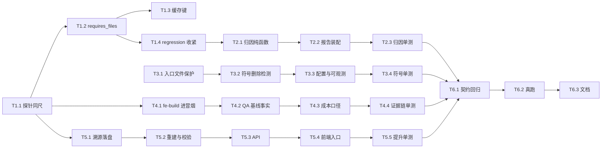

# ymir-agent 增量设计与任务列表 v1.3.1

> 版本：v1.3.1（补丁版：关闭 v1.3 验收真实暴露的 P2 缺口）
> 状态：**待评审**（用户批准后才实施；本文不含任何已实施内容）
> 上游：`docs/12-验收报告-v1.3.md`（§1 T5.1、§6.4 T2/T3、§6.5 F7/F8/F9、§7 L1/L7/L8/L9、§9 遗留与 v1.4 候选）
> 编号顺延：本文件为 `docs/13`。验收报告 `docs/14-验收报告-v1.3.1.md` **实施后才产出**，本阶段不创建。

---

## 0. 速览

### 0.1 定位（先定边界，再谈设计）

**补丁版本：只关闭 v1.3 验收真实暴露的 P2 缺口，不引入新能力。**

判断标准只有一条（三条同时成立才进本版）：

1. 不修，**归因不可信**（会冤枉模型 → 修复回边打错人）；
2. 或 **连续增量不可用**（一次 patch 之后无法再做一次 patch）；
3. 或 **QA 判定失真**（verdict 建立在不成立的事实上）。

v1.3 验收里被真实数据击中的正是这三类：L9（归因不可信）、L7/F8（连续增量不可用）、F9/L8（QA 判定失真）。**其余一律推 v1.4。**

### 0.2 工作项取舍（来自 docs/12，逐条给结论）

| 项 | 内容 | 结论 | 理由（一句话） |
|---|---|---|---|
| **W1** | L9：探针与合并树两把尺子 | **做（P0）** | T1.2 的归因能力在「存量产物」上结构性失效，不修则 `regression` 永不触发 |
| **W2** | F7：`failure_attribution` 归因粒度 | **做（P1）** | 5 条错误在基线自带文件、1 条是模型新增，布尔 `regression` 把这层信息丢了 |
| **W3** | L1/T2：保护面窄于破坏面 | **做（P0）** | 真实事故（`ymir_cli/cli.py` 删掉 4 个子命令）绕过了全部既有保护 |
| **W4** | T3：`fe-build` 进 engineer 冒烟 | **做（P1）** | QA 证据链看不到构建结果 ⇒ 写了一条"前端构建结果缺失"的误判风险 |
| **W5** | L8/F9：QA 注入基线事实 | **做（P0）** | ① 的 `fail` 有一部分基于「文件缺失」的误判 |
| **W6** | L7/F8：合入结果另存基线 | **做（P1，最大项）** | `docs/09 §4.3` R9④ 承诺过、从未实现（端点原文即 `baselines/from-merge`）；不修则 `fe-build` 在连续增量下**永远不可用** |
| **W7-1** | 单跑成本低报 | **做（P3，S）** | 现象成立（见 §1.2-C4 的**归因修正**），修法只需在 `--evaluate` 后补一行；不改任何契约 |
| **W7-2** | 目录前缀保护连带拦住**新建**文件 | **不做** | 与 v1.3 两条既有断言**直接冲突**（见 §1.2-C5），要动等于放松既有断言；本版无模板使用目录前缀 |
| **W7-3** | `MANIFEST_MAX_BYTES` 无强制点 | **不做（留 v1.4）** | 强制截断必须截 `changed_paths`，而它是 judge 语料分级与前端高亮的输入（见 §3-Q4） |

### 0.3 明确不在本版范围（v1.4 候选，逐条点名）

- 增量 HITL 门（改动面超阈值**要求人工确认**，而非仅告警）；
- 构建前置预检（模型产出时代码级校验 `package.json` 依赖是否在镜像池内）；
- 模板库继续扩（`django-drf` / `vue3-spa`）；
- 基线跨版本可比（`scoring` 口径 legacy 对照模式）。

### 0.4 真跑预算

**需要 3 次真实 run**（比原建议多 1 次 `from_scratch`，理由见 §8-A7 与 §7.8-U3）：

| # | 场景 | 验证目标 | 预估 |
|---|---|---|---|
| R-a | `python-cli` × `from_scratch`（可选，见兜底） | 产出**完整**基线，供 W6 提升 | ≈¥0.25 |
| R-b | `python-cli` × `patch` | W1 / W2 / W3 / W5 | ≈¥0.25 |
| R-c | `fastapi-vue3` × `patch`（基线 = W6 提升出的新基线）⚠ | L7 闭环 + `fe-build` 不再假阻断 + W4 | ≈¥0.40 |

> ⚠ **本行是设计缺陷，已按两步执行（T6.2 实跑修正）**：R-c 的基线不可能是"W6 提升出的新基线"——
> 因为 W6 的第一次提升必须来自**同一模板的上一次 patch 产物**，先有 R-c 的产物才谈得上提升，
> 这是循环依赖。实跑改成 **R-c1**（`fastapi-vue3` × patch，基线用零成本播种的 v1）→ **提升 v2** →
> **R-c2**（同一模板 × patch，基线 = 刚提升出的 v2）。只有 R-c2 才真正验到 L7 闭环。
> 明细见 `data/v131/INDEX.md` §1 与 `docs/14-验收报告-v1.3.1.md`。

预估 **¥0.9–1.5**（含 `--evaluate` 的 3 次 judge + 探针 + gate 复核），留 30% 余量仍在 **¥2.0** 内。
**兜底**：若 R-a 的产出本身不健康（v1.3 已有先例），W6 的机制闭环改用 `python-cli` 验证（其基线是完整树，`v1 → merged` 可直接提升，**零额外成本**），R-c 降级为「fastapi 侧只验 W1/W4 不验 L7 闭环」并如实记录。

---

## 1. 现状与问题证据

### 1.1 L9 的三类错配（docs/12 §7 原文 + 代码级定位）

`baseline_probe.probe_baseline`（`src/ymir/evaluation/baseline_probe.py:160`）把基线文件**原样**写进沙箱（L198-199 `for path, content in files.items(): await session.write_file(...)`）再跑 `checks`；而合并树的评测工作区是 `merge_trees(base, patch, mode="patch", skeleton=...)` 的结果（`role_executor._apply_patch_contract:414`）。**两条路径喂给同一组 `checks` 的树不同**：

| # | 错配 | 代码证据 | 真跑后果（docs/12） |
|---|---|---|---|
| ① | 旧产物缺当前 checks 依赖的文件 | v2 是 patch 产物 ⇒ 无 `web/` ⇒ `fe-build web` exit=2 | `blocking_failed=['fe-build web']`，`baseline_status=unhealthy` |
| ② | 当前 checks 含旧产物生成时不存在的要求 | `fe-build` 是 v1.3 新增（`fastapi-vue3.yaml:125-131`） | 任何 v1.2 时代产物用 v1.3 尺子必 unhealthy |
| ③ | 同一棵树两把尺子 | v2 原样 ruff 0 errors（无 `ruff.toml` ⇒ 默认规则集）vs 合并树 7 errors（骨架注入严格 `ruff.toml`） | `SIM108`/`B008` 类噪音在两侧不同 |

### 1.2 现状修正（读代码得到的、与 docs/12 表述不同或必须精确化的 5 条）

> 纪律：以下每条都给可核对的位置。**这些修正直接改变了 W1/W6 的实现方式**。

**C1（最重要）· `mode="merge"` 不注入骨架 ⇒ docs/12 §7-L9 修法①的字面写法不可行。**
`merge_trees` 的 docstring 明确写 `merge 纯基线合并（**不注入骨架**）`（`artifacts/merge.py:433`），代码在 `merge.py:534` 是 `if mode != "merge":` 才走骨架决策块。
⇒ W1 必须用 **`merge_trees(base, {}, mode="patch", skeleton=skeleton, base_paths=frozenset(base))`**：`patch` 模式下优先级 1（基线已有 ⇒ `skipped_existing`）保证「用户文件优先」，优先级 3 把缺的骨架补上 —— 这才是「骨架补缺后的基线」，且**与合并树用的是同一个函数、同一套优先级表**。（`store.merged_tree:411` 用的也是 `mode="merge"`，同样不带骨架，见 C3。）**落法 A/B 的定案与否决理由见 §7.2.0。**

**C2（W1 的必要伴随修复）· `_regression` 会因为 W1 把「基线缺文件」误判成 `regression`。**
`harness._regression:346-360` 的判据是 `probe.healthy and 任一 run.status=="failed"`。
W1 让 `fe-build` 在基线侧变 `skipped`（`requires_files` 缺失）后，基线整体可能变 `healthy`；此时合并树的 `fe-build` 仍 `failed`（见 §3-Q1 的不对称）⇒ `regression=True` ⇒ `classify_failure` 第 5 条先命中 ⇒ 报告写「基线通过，合并树在 `fe-build web` 失败」，**把「基线不完整」错记成「模型回归」** —— 这正是 W2 想消灭的那类冤枉。
⇒ 必须同时把判据收紧为：**只对「probe 侧实际执行且 exit=0」的命令计 regression**（`probe.checks` 里 `skipped=False and exit_code==0` 的命令集合）。该收紧在 v1.3 的配置下**无行为变化**（v1.3 没有 `requires_files`；`requires` 缺失时两侧同为 skipped，构造上不可能出现「基线跳过了、合并树失败」），可逐条验证。

**C3 · `store.merged_tree` 已存在，但不能直接拿来当 W6 的实现。**
`artifacts/store.py:368-413` 已经能做「基线 ⊕ 补丁」：按 `manifest.base_content_hash` 反查基线版本（`find_baseline_files:337`），应用 `deleted`，剥掉 `patch_manifest.json`。两个不能直接用的点：
① 用 `mode="merge"` ⇒ **不重注骨架**，与评测时的树不一致（C1）；
② 基线不可用时**静默只返回补丁**（`store.py:403-410` 只 `logger.warning`）—— 对「导出」是合理降级，对「另存为新基线」是**致命**降级（会把 F8 原样复制一份）。
⇒ W6 必须自己显式校验并**拒绝**，不能复用这条静默降级路径。

**C4 · docs/12 §6.4 末条「`print_report` 的合计只统计阶段调用」—— 现象成立，归因不准。**
`scripts/run_single_role.py:205-215` 已经按 `run_id` 查**全量** `ModelCall`，L250-252 求和。真正原因是**调用时机**：`print_report` 在 L324 被调用，而 `--evaluate` 在 L325 才执行 ⇒ judge 的 3 次调用**尚未发生**。
⇒ W7-1 的修法不是「改求和口径」（那会白改一遍），而是「在 `--evaluate` 之后补一行『合计（含 --evaluate）』」。**这也是本节存在的原因：口径描述错会让人改错地方。**

**C5 · W7-2「目录前缀连带拦住新建文件」若要修，必须动 v1.3 的既有断言。**
- `tests/test_incremental_guard.py:274-296` `test_extensionless_protection_boundaries`：`BASE` 里没有 `Dockerfile/extra`（`BASE` 见 L79-88），断言 `merge_trees(BASE, {"Dockerfile/extra": "x\n"}, ...)` **抛** `ProtectedPathConflict`；
- 同文件 `:298-310` `test_directory_prefix_protection`：`tests/fixtures/a.json` 不在 `BASE`，断言同样**抛**。

⇒ 引入「新建 vs 修改」区分等于让这两条从「抛」变成「不抛」= **放松既有断言**，与硬约束冲突。
⇒ **本版不做**（结论见 §0.2）。若将来真有模板使用目录前缀，以 **opt-in 字段**（`protected.allow_new_files: bool = False`）引入，默认仍为 False ⇒ 既有断言一字不改。

**C6（新增，读代码时发现的责任边界）· 实际上有「三棵树」，W1 只对齐其中两棵。**

| 树 | 由谁构造 | merge 形态 | 用途 |
|---|---|---|---|
| **T1 阶段合并树** | `role_executor._apply_patch_contract:414` | `mode="patch"` + **骨架注入** | 阶段冒烟；**W6 提升的就是 T1** |
| **T2 评测工作区** | `harness._load_task`（`merge_trees(base_files, client_files, mode="merge", deleted=...)`） | `mode="merge"` ⇒ **不注入骨架**；且 `client_files` 只剔除 `patch_manifest.json`（**`smoke_report.json` 会被带进去**） | 跑 checks / judge / 打分 |
| **T3 探针树** | `baseline_probe.probe_baseline:198` | 无（原样写沙箱） | 基线健康度 |

⇒ **必须写清 W1 的边界**：W1 让 **T3 与 T1 采用同一套骨架注入规则**（同一个 `merge_trees`、同一套优先级表），**不是**让 T3 等于 T2。
- 为什么**不**去对齐 T2（把 `harness` 也改成 `mode="patch"` + 骨架）：那会给评测工作区新增骨架文件 ⇒ 改变分数 ⇒ 直接违反「v1.3 交付能力零退化」。
- 为什么 T3 该向 T1 靠而不是向 T2 靠：T1 是**工程树**（可提升为基线、可供下一次增量），T2 是**派生视图**（只为打分）；探针问的是「这棵基线够不够当尺子」，自然应以工程树为准。
- **残留不对称（如实写进 `docs/04`）**：T3 与 T2 仍差一层补丁，因此「探针通过 + 合并树在**probe 未跳过**的同一命令上失败」才是可靠的 `regression`（这正是 T1.4 收紧判据的原因，C2）；对 probe **跳过**的命令，合并树失败只报 `check_failed`，**不**报 `regression`。
- 由此也解释了 W6 为何与探针用同一个 `mode="patch"`：两者都在重建 **T1**（一个不推动作、一个推动作）。

---

## 2. 任务分解

> 规模：S ≈ ≤1 人日 / M ≈ 2–3 人日。`P0` = 不修则本版无意义；`P1` = 本版承诺交付；`P2` = 顺手项。最后一项 `T6` 固定为验收。

### T1 · L9 修复：探针与合并树同尺（P0）

| 子任务 | 目标 | 涉及文件 | DoD（可测） | 依赖 | 规模 |
|---|---|---|---|---|---|
| **T1.1** 探针改用「骨架补缺后的基线」 | 让 probe 与合并树共用 `merge_trees(mode="patch")` 这一把尺子 | `evaluation/baseline_probe.py`、`evaluation/harness.py`、`evaluation/evaluators/base.py`、`evaluation/run_task.py` | ① 基线缺骨架文件、模板有骨架 ⇒ 写入沙箱的树**含**该骨架文件（单测断言会话收到的写入集）；② `probe_mode` 落报告：**只在 `skeleton_filled` 时序列化**（M7 ①：`model_serializer` pop 掉 `raw`/空值）；③ 基线**已含全部骨架** ⇒ 内部 `probe_mode="raw"`、**报告 JSON 与 v1.3 逐字节一致**（用例直接比对 JSON 文本）；④ 断言 harness 里调用的是 `artifacts.merge.merge_trees`（同一实现，不是第二套逻辑） | — | M |
| **T1.2** `checks[].requires_files` | 基线从未提供该 check 依赖的文件时记 `skipped`，不判 unhealthy | `templates/models.py`、`templates/loader.py`、`evaluation/evaluators/base.py`、`evaluation/baseline_probe.py`、`evaluation/run_task.py`、`config/templates/fastapi-vue3.yaml` | ① 元素语义：精确文件路径（必须存在）或**尾斜杠目录**（该目录下 ≥1 文件）；② 缺失 ⇒ 该 check 不执行，记 `skipped` + `skipped_reason="requires_file_missing:<path>"`；③ 全部 skipped ⇒ `status="skipped"`、`reason="baseline_incomplete"`（**新增第 6 个降级原因**，只增不改）；④ 加载期校验 22 拒非法元素（空串 / 绝对路径 / 反斜杠）；⑤ **合并树侧行为不变**：缺文件仍 `failed`（单测锁死「删掉 `web/` 不能过关」） | T1.1 | M |
| **T1.3** 缓存键纳入**骨架指纹 + `requires_files`** | 防复现 F3 幽灵缓存（两条独立入口：改骨架 / 改 requires_files） | `evaluation/baseline_probe.py`、`evaluation/harness.py` | ① `baseline_cache_key(files, checks, *, skeleton=None)`：**骨架非空时**追加 `skeleton` 的路径+正文指纹块，**骨架为空/None 时不掺入任何字节** ⇒ 与 v1.3 的键逐字节相等（既有缓存命中用例不受影响）；② checks 指纹追加 `requires_files`；③ 两条定点用例：仅改骨架 ⇒ 键不同；仅改 `requires_files` ⇒ 键不同。（★ 注意：只把「基线原样」当 `files` 传进键是不够的 —— 骨架变了而基线没变，键会不变 ⇒ 直接复现 F3） | T1.2 | S |
| **T1.4** `regression` 判据收紧（C2） | W1 不制造新误判 | `evaluation/harness.py` | ① 仅「probe 该命令 executed 且 `exit_code==0`」才计入 regression；② probe 侧 skipped 的命令在合并树失败 ⇒ `regression=False`，落 `check_failed`；③ **v1.3 配置下结果不变**：既有 38 例全绿 + 一条定点用例「probe skipped + 合并树 failed ⇒ 不判 regression」 | T1.2 | S |

### T2 · 归因粒度 `failure_attribution`（P1）

| 子任务 | 目标 | 涉及文件 | DoD（可测） | 依赖 | 规模 |
|---|---|---|---|---|---|
| **T2.1** 通用归因纯函数 | 不再靠布尔 `regression` 说话 | `evaluation/attribution.py`（新） | ① 四态 `pre_existing` / `introduced` / `mixed` / `unknown`；② 输出 `baseline_only_files`、`changed_files`、`shared_files`、`basis`、`sample_markers`；③ **不写死任何 linter 解析器**：只做「同一命令 probe 输出 vs 合并树输出的标记差集」+ `path:line` / `.py::node_id` 两类通用正则；④ 任何异常/无标记 ⇒ `unknown` + `basis` 短码，**绝不抛** | T1.4 | M |
| **T2.2** 报告装配 | 落 `TaskOut` + markdown | `evaluation/report.py`、`evaluation/harness.py` | ① `TaskOut.failure_attribution` 默认 `None` ⇒ 空时 markdown **逐字节不变**；② 有值时 `_incremental_health_lines` 追加 1–2 行（归因 + `baseline_only_files` 条数）；③ **不参与** verdict / 分数 / `regression`（报告里写清「这是归因提示，不是判据」） | T2.1 | S |
| **T2.3** 单测 | 用真实输出形态 | `tests/test_attribution.py`（新） | ① ruff 双输出（基线 5 条 `storage.py` + 合并树多 1 条 `F401`）⇒ `introduced` 且 `sample_markers` 指向新增那行；② pytest `FAILED ...::test_x` 形态；③ probe 侧该命令 skipped ⇒ `unknown`/`basis=probe_skipped`；④ 两侧输出无任何 `path:line` ⇒ `unknown`/`basis=no_markers`；⑤ 文件既是基线又被改 ⇒ 计入 `shared_files` 且整体 `mixed` | T2.2 | S |

### T3 · 保护面：入口文件 + 符号删除（P0）

| 子任务 | 目标 | 涉及文件 | DoD（可测） | 依赖 | 规模 |
|---|---|---|---|---|---|
| **T3.1** A 方案：入口文件进 `protected.paths` | 把真实事故文件显式保护 | `config/templates/python-cli.yaml` | ① `protected.paths += ymir_cli/cli.py`；② 与 skeleton/conventions **不交叉**（`ymir_cli/cli.py` 不在骨架里，校验 18 仍通过）；③ 单测：改该文件 ⇒ 抛 1003 | — | S |
| **T3.2** B′ 方案：引用感知的符号删除检测 | 通用机制，不靠逐个列文件 | `artifacts/symbols.py`（新）、`artifacts/merge.py` | ① 只对 `.py`；只检**顶层** `def`/`async def`/`class` 且名字非 `_` 开头；② 仅当被删符号**仍被未改动的基线文件引用**（`from m import n` / `m.n` / `import m` + `m.n`）才算命中 ⇒ 正常重构（同步改完引用）不误伤；③ 命中走与受保护路径**同一套**三段式，且 `_protected_feedback` 按 `reason` 分支（M2）：`symbol_regression` 文案含「恢复这些符号」+「同步更新所有引用」、**不含「受保护路径」**，`protected_path` 文案逐字节不变；④ 第三段兜底**同时**降级 `symbol_deletions→ignore`（否则二次抛异常无人捕获）；⑤ protected 已命中的路径**短路** symbol 检测（S4：同一路径只记一条冲突、只烧一次重试）；⑥ 默认 `off` ⇒ 未配置时 `merge_trees` 行为与 v1.3 逐字节一致 | T3.1 | M |
| **T3.3** 配置与可观测 | 让误伤可控、可审 | `templates/models.py`、`templates/loader.py`、`config/templates/*.yaml`、`orchestrator/role_executor.py` | ① 新增 `protected.symbol_deletions: Literal["off","reject","ignore"] = "off"`；② 四套模板显式设 `reject`（`node-express` 无 `.py` ⇒ 实际 no-op，注释写明）；③ `ConflictReason` 追加第 8 值 `symbol_regression`；④ manifest 短码 `symbol_regression_ignored:<n>`；⑤ 阶段 payload 增 `patch.symbol_removals`（≤10 条，审批卡片可见） | T3.2 | S |
| **T3.4** 单测 | 锁死「收紧而非放松」 | `tests/test_symbol_guard.py`（新） | ① 真实事故形态：`cli.py` 删 `run` 且 `tests/` 里 `from ymir_cli.cli import run` ⇒ `reject` 抛、`ignore` 保留基线版；② 同步改完所有引用的重构 ⇒ 不命中；③ 删私有函数（`_helper`）⇒ 不命中；④ `_protected_feedback` 的 `symbol_regression` 分支文案断言（含「同步更新引用」/不含「受保护路径」）；⑤ protected+symbol 双命中 ⇒ 只产生 `protected_path` 一条冲突、重试只 1 次（S4）；⑥ `symbol_deletions="off"` ⇒ manifest 与 v1.3 逐字节一致 | T3.3 | S |

### T4 · 证据链（P1）

| 子任务 | 目标 | 涉及文件 | DoD（可测） | 依赖 | 规模 |
|---|---|---|---|---|---|
| **T4.1** `fe-build` 进 engineer 冒烟 | QA 在阶段级就能看到构建结果 | `orchestrator/role_executor.py` | ① 冒烟命令 = 模型自报 `run_commands`（≤`_SMOKE_MAX_COMMANDS`=5）+ 模板 `group=frontend_build` 的检查（≤`_SMOKE_MAX_TEMPLATE_COMMANDS`=2，去重）；② 每条模板命令前先 `command -v <requires>`，缺失记 `skipped` + `reason`；③ 超时取 `check.timeout_s or exec_timeout`（构建 300s）；④ 每条记录带 `source`，**仅 template 条目写出**（`"source":"template"`），model 条目**不写** ⇒ 无模板时 `smoke_report.json` 与 v1.3 逐字节一致；⑤ `all_ok` 三态（M6）：有 executed ⇒ 按 executed 求值；**全部 skipped ⇒ `all_ok=None` + `error="skipped: 全部命令因环境缺失跳过"`**（不让空集 `all()` 变成 True）；⑥ 冒烟失败仍**不阻断**阶段 | — | M |
| **T4.2** QA 注入基线事实（L8/F9） | 增量模式下 QA 不再把基线文件判成缺失 | `roles/io.py`、`roles/prompts.py`、`orchestrator/role_executor.py` | ① `## 基线已知事实` 段**只对 qa**、且 `baseline is not None` 时渲染；② 四类事实：基线路径清单（截断 80 条）、骨架补缺清单（截断 20 条）、本次补丁清单（截断 40 条）、冒烟结论（≤400 字符，只给命令与退出码计数 + 首个失败命令）；③ **只注入事实，不注入判词**：段末固定写「以上为事实清单，不构成结论；请自行取证」；④ 不注入 `probe` 状态（理由见 §7.3-5）；⑤ 非 qa 角色 / 无基线 ⇒ 提示词**逐字节不变**（`tests/fixtures/prompts_v11/qa.txt` 快照必须仍通过） | — | M |
| **T4.3** 单跑成本口径（W7-1，C4） | 「合计」不再漏计 `--evaluate` | `scripts/run_single_role.py` | ① `--evaluate` 之后补一艘「合计（含 --evaluate）」（取 `UsageRecorder.totals(run_id=...)`）；② 未传 `--evaluate` 时输出与 v1.3 逐字节一致；③ 不动既有「合计」行（避免口径混叠） | — | S |
| **T4.4** 单测 | 两条证据链都可断言 | `tests/test_incremental_guard.py`（改）、`tests/test_prompts.py`（改） | ① 冒烟含模板命令 + `source` 字段 + skipped 不参与 `all_ok`；② QA 事实段四块齐全且不含判词关键词（`判定`/`不通过`/`regression`）；③ engineer 提示词无该段（逐字节）；④ **事实来源=本 stage 上游版本**：构造「项目里已存在比本次上游更新的 `code` 版本」，断言 QA 事实仍取本次 `stage.inputs` 那一版（P1）；⑤ 无上游 `code` 产物 / 缺 `patch_manifest.json` / 缺 `smoke_report.json` 三种缺失都只降级为空并不抛异常（"失败只告警"） | T4.1–T4.3 | S |

### T5 · L7 闭环：合入结果另存基线（P1，最大项）

| 子任务 | 目标 | 涉及文件 | DoD（可测） | 依赖 | 规模 |
|---|---|---|---|---|---|
| **T5.1** 溯源五元组落盘 | 让「重建」可被证明 | `artifacts/provenance.py`（新）、`artifacts/merge.py`、`orchestrator/role_executor.py` | ① `PatchManifest` 追加 `provenance`（含 `base_artifact_id` / `base_version` / `base_content_hash` / `patch_files_hash` / `template_id` / `template_hash` / `merged_files_hash`）；② **`template_hash` = 模板 YAML 原始字节 sha256**，由编排层（rank 1，可 import `templates`）写入（**不用 `template.version`** —— 改 YAML 不 bump 版本，那条证明是假的）；③ **非默认值才序列化** ⇒ 无基线 / 无模板时 `patch_manifest.json` 与 v1.3 逐字节一致；④ **`protected_policy` / `symbol_policy` 记录「本次实际生效值」**（M3：三段式兜底后可能是 `ignore`，不是模板声明值）；⑤ 写盘走既有 `_reserialize_manifest` + `_ensure_manifest_synced`（F1 纪律） | T1.1 | M |
| **T5.2** 重建 + 确定性校验 | 拒绝语义要可读 | `artifacts/provenance.py`（新） | ① `promote_merged_to_baseline(...)` 用 `merge_trees(mode="patch", skeleton=..., base_paths=..., on_protected_hit=prov.protected_policy, symbol_deletions=prov.symbol_policy)` 重建（C1/C3/**M3**）；**用例必须含「`reject→ignore` 兜底后的产物仍能提升成功」**（最需要 W6 的场景）；② 三道校验：`base_content_hash` 对不上（基线被替换 / 版本目录丢失，`store._read_tree:257` 会静默返回 `{}`）/ `patch_files_hash` 对不上 / `template_hash` 对不上；③ 重建结果 `compute_content_hash(...) == merged_files_hash` 才算成功；④ 失败一律 **1003/409 + 可读原因**（复用既有业务码，零新增）；⑤ 非 patch 产物（无 manifest）⇒ **1001 + 明确提示**（本版不扩 from_scratch 提升，见 §7.8-U1） | T5.1 | M |
| **T5.3** API 端点（沿用 `docs/09` 承诺） | 显式动作，不自创命名 | `api/routers/artifacts.py`、`api/schemas.py` | ① **`POST /projects/{project_id}/baselines/from-merge`**（`docs/09 §4.3` 第 605 行 / 接口表第 1133 行原文已承诺），body `{run_id, stage_id?, artifact_version?}`；② 响应 `BaselineMergeOut(BaselineUploadOut)` 只加 `reused: bool=False` ⇒ **既有上传端点字节不变**；③ 未给 `stage_id` 时按「产出 `code` 产物的阶段」解析（不靠 `role_id` 硬编码）；④ 大小上限沿用 `settings.baseline_max_files=300 / baseline_max_bytes=5MB`，超限 **1001 且不落半成品**；⑤ **幂等**：重建结果与当前基线最新版 `content_hash` 相同 ⇒ 返回该版本 + `reused=true`，不产生无意义新版本（`store.save` 本身不去重，`store.py:120-165`） | T5.2 | M |
| **T5.4** 前端入口（只收一个动作入口） | 用户点得到，且不新开页面 | `web/src/views/ArtifactLibrary.vue`、`web/src/components/BaselinePanel.vue`、`web/src/api/artifacts.ts`、`web/src/utils/promoteBaseline.ts`（新） | ① **唯一动作入口在 `ArtifactLibrary.vue` 的 `code` 版本行「另存为新基线」**（该行已带 `run_id`/`stage_id`/`version`，见 B22，零额外查询；`run_id` 为空则禁用 + tooltip「该版本无关联运行」）；② `BaselinePanel.vue` **只加一句引导文案**（「增量产物可在下方版本历史中『另存为新基线』」），**不加按钮、不加事件、不加测试**（原因：该面板只有基线版本列表、拿不到「要提升哪一版 code」，取最新即违反 R9）；③ 二次确认框展示 `run_id` 前 8 位 + `base v?` + 目标版本号；④ 成功 / `reused` 两种提示（`reused=true` ⇒「基线已是该内容」，不显示新版本号）；⑤ `api/artifacts.ts` 增 `promoteMergedToBaseline(projectId, {run_id, stage_id, artifact_version})`；⑥ `utils/promoteBaseline.ts` 的 `canPromote(manifestRaw)` 容错（坏 JSON / 无 manifest / `mode!=patch` ⇒ `{ok:false, reason}`，不抛） | T5.3 | M |
| **T5.5** 单测（后端 + 前端） | 机制 + 全部拒绝路径 + 幂等 | `tests/test_baseline_promote.py`（新）、`web/src/utils/__tests__/promoteBaseline.test.ts`（新） | ① 重建树 == 评测树（同一基线 + 同一补丁 ⇒ 内容哈希相等）；② 模板 YAML 改了（`template_hash` 不符）⇒ 1003 且文案含「模板已变更」；③ 基线版本被删 / `content_hash` 三方不一致 ⇒ 1003；④ **禁止「拿最新基线顶上」**：`base_ref` 指向 v1 而基线已有 v2 ⇒ 必须按 v1 重建（断言用 v1 的树）；⑤ 非 patch 产物 ⇒ 1001；⑥ 超 300 文件 / 5MB ⇒ 1001 且 `baseline` 产物**未新增版本**；⑦ 幂等：连调两次 ⇒ 第二次 `reused=true` 且 `baseline` 版本数只 +1；⑧ 端到端 1 例：提升后的基线能直接开启下一次 patch run（`run.context["baseline"]` 指向新版本，不调模型）；⑨ **簿记文件剔除**：产物含 `smoke_report.json` 时，提升出的基线**不含**该文件且哈希校验通过（§7.3-7-6b）；⑩ 前端 **4 例**（成功 / 指纹不符拒绝 / 超限 / 幂等命中） | T5.4 | M |

### T6 · 验收（P0）

| 子任务 | 目标 | 涉及文件 | DoD | 依赖 | 规模 |
|---|---|---|---|---|---|
| **T6.1** 契约回归 + 六门 | 零放宽 | 全部（只跑不改） | ① 14 条历史契约 + v1.3 八条红线全绿；② 新增断言「未配置 `requires_files` / `symbol_deletions` / 无 provenance / 无 attribution ⇒ `patch_manifest.json`、报告 markdown、`smoke_report.json` **逐字节**与 v1.3 一致」（四组输入）；③ `uv run pytest`（后端 ≥ 823+45）/ `uv run ruff check .` / `uv run python scripts/check_import_graph.py` / `npm run test --prefix web`（≥ 68+4）/ `npm run build --prefix web` / `uv run alembic check` 六门全绿 | T1–T5 | M |
| **T6.2** 真跑 | 用真实数据证明 5 条修复 | `data/v131/*`（新） | ① R-b 的 `failure_attribution` 至少一次给出 `pre_existing`/`introduced` 的可核对结论；② R-c 的基线探针**不再是** `unhealthy(fe-build)`；③ R-c 的 `fe-build` 因基线完整而**真的执行**（不再 `requires_file_missing`）；④ 提升出的新基线能开启下一次 patch run；⑤ QA 的 verdict 不再含「前端/迁移/测试文件缺失」这类**基线里本来就有**的误判 | T6.1 | M |
| **T6.3** 文档 | 只写实测 | `docs/13`（回写 as-built）、`docs/02`、`docs/04`、`README`、`docs/class-diagram-v1.3.1.mermaid`、`docs/sequence-diagram-v1.3.1.mermaid` | ① as-built 逐条对照本文 §7（含**对设计不利**的偏离）；② `docs/04` 补「另存为新基线」与「基线事实注入」两节；③ 校验条数 21 → 23 同步（`loader.py` docstring / `docs/02` / `tests/test_templates.py` docstring）；④ 所有数字来自实测，未实测写「待确认」 | T6.2 | S |

---

## 3. 待拍板

| # | 议题 | 选项 | 推荐 | 理由 | 不选的后果 |
|---|---|---|---|---|---|
| **Q1** | W1 的 **probe 语义不对称**：`requires_files` 在 probe 侧缺文件 ⇒ `skipped`，在合并树评测侧缺文件 ⇒ 仍 `failed` | **A. 采用不对称**（推荐）<br>B. 两侧统一 `skipped`<br>C. 两侧统一 `failed`（即不做 W1-②） | **A** | 两侧的**问题不同**：probe 问的是「这棵基线值不值得当尺子」（缺文件 ⇒ 尺子本身不可用 ⇒ 不知道 ⇒ `skipped`）；评测问的是「这棵交付树能不能 build」（缺 `web/` ⇒ 交付树缺前端 ⇒ 必须 `failed`）。若统一为 `skipped`（B），**模型删掉 `web/` 就能免掉阻断项** —— 这是给绕过留门；若统一为 `failed`（C），旧产物永远 `unhealthy`，返回 L9 原状。不对称必须**在报告里显性写出**（`baseline_runnability.checks[].skipped` + `TaskOut.failure_attribution` 的 `basis`），不能靠读者猜 | B：出现「删目录即过关」的判定漏洞（与 Q4 的阻断项红线冲突）<br>C：W1 等于没做，`regression` 对存量产物仍不可用 |
| **Q2** | W3 的保护策略 | A. 仅模板显式列入口文件<br>B. 裸 AST「删了顶层符号就冲突」<br>**B′. 引用感知的符号删除检测**（推荐，与 A 并用）<br>C. 默认「改既有文件需显式授权」白名单 | **A + B′** | A 最便宜、零误伤，但**只对 python-cli 成立**：`fastapi-vue3` 的入口 `app/main.py` 是骨架 seed（`fastapi-vue3.yaml:91-96`），校验 18 禁止 protected ∩ skeleton 交叉 ⇒ 无法保护；故必须有通用机制。B 覆盖真实事故，但「删函数」在正常重构里常见，误伤面大。B′ 把条件收紧为「被删的公共符号**仍被未改动的基线文件引用**」—— 真实事故里 `tests/` 确实 `from ymir_cli.cli import run` ⇒ B′ 命中；同时改完引用的重构 ⇒ 不命中。**误伤面**：删符号但同时漏改某个未纳入本补丁的文件 ⇒ 仍会命中（这正是我们想要的行为）；**兜底**：`symbol_deletions: ignore` 回退到基线版本 + manifest 短码 `symbol_regression_ignored:<n>` + 审批卡片可见 + 三段式的兜底 `forced_ignore`（不整轮报废）。**不放松 v1.3**：受保护语义一字不改，新增的是**另一条**独立判据 | C：patch 模式的全部价值就是「改既有文件」，默认授权会把 patch 变成一条处处冲突的路，run 失败率暴涨<br>A 单独：只保护得住 python-cli，L1 在 fastapi 场景仍开放<br>B 单独：误伤正常重构，模型会被迫绕路（改文件名），产物更差 |
| **Q3** | W6 的实现路径 | **A. 按需重建**（推荐）<br>B. 合入时快照（每次 patch 都额外落一份完整树） | **A** | ① 存储：B 让每个 patch 版本的存储 ≈ 整树（27–300 文件），且与基线内容**重复**（基线本身不可变，重复存的是同一批字节）；A 只在用户显式动作时算一次；② 一致性：A 的重建受五元组（+`merged_files_hash`）约束，**算错就拒绝**；B 的快照若与评测树不一致（例如骨架补缺在评测后才变）则**无法自证**；③ 语义：B 会让「增量产物」概念消失（每个版本都是全量），与 `docs/09 §4.2.2`「产物只存增量」的定案冲突。**确定性校验**：记录 `{base_artifact_id, base_version, base_content_hash, patch_files_hash, template_hash}` **五元组**，另加 `merged_files_hash` 作第 6 项（唯一能证明「重建树 == 当时评测树」的字段；`store._read_tree:257` 在版本目录丢失时**静默返回 `{}`**，没有这一项就无法发现「悄悄重建出一棵空树」）。任一不符 ⇒ **1003/409** + 可读原因（「模板已变更」「基线版本不可用」「产物内容不完整」），业务码**零新增**。**端点沿用 `docs/09 §4.3` 既承诺的 `POST /projects/{id}/baselines/from-merge`**，另加体积上限（沿用 `baseline_max_files/bytes`）与幂等（同 `content_hash` 返回 `reused=true`，不建无意义新版本） | B：存储×N、概念冲突、且同样需要写盘一致性校验（成本更高收益更低）<br>A 不写第 6 项：可能把一棵不完整的树提成基线，把 F8 从「已知」变成「已入库」<br>A 不自创端点名：多一轮命名口径评审，且与 `docs/09` 原文承诺不一致 |
| **Q4** | v1.3.1 是否包含 W7 | A. 全做<br>**B. 只做 W7-1，不做 W7-2 / W7-3**（推荐）<br>C. 全不做 | **B** | W7-1 只是一行输出（C4 已把归因修正到「时机」而非「口径」），零契约风险，解决验收报告自己踩过的坑（¥1.5197 是手工从 DB 数的）。W7-2 与两条既有断言**直接冲突**（C5），要做得先放松断言 ⇒ 本版拒绝。W7-3 的强制截断必须截 `changed_paths`，而它是 judge 语料分级与前端高亮的输入（`docs/11 §7.2.3` 已论证），且 W6 的 `provenance` 会让 manifest 再长 ~300 字节 —— **正确处置是「承认软预算 + 用测试盯住体积」，不是加硬截断**；留 v1.4 与「manifest 字段治理」一起做 | A：动了两条既有断言（违反零放宽）+ 引入一个会截断语义输入的行为<br>C：把已知的、零风险的口径坑留到下一版，验收时还得手工数钱 |

---

## 4. 任务依赖图



> **批次归属（§7.6）**：`batch1 = T1 + T2 + T3`（归因与保护，无 Docker 依赖）｜`batch2 = T4`（证据链，可并行但建议串行 —— 它改的是提示词与冒烟，和 batch1 改的评测侧无重叠）｜`batch3 = T5`（L7 闭环 + 前端）｜`T6` 收口。

---

## 5. 风险与对策（初稿级）

> 实施级对策见 §7.7（同编号细化）。

| # | 风险 | 对策 |
|---|---|---|
| R1 | probe 换了树 ⇒ 同一批旧报告的 `baseline_status` 会变 | **口径变更必须显式**：`probe_mode` 进报告 + `docs/04` 写「v1.3.1 起探针口径 = 骨架补缺后的基线」；历史报告 JSON 不改写（`probe_mode=""` 视作 v1.3 口径）；真跑同时给「raw / skeleton_filled」两栏对照 |
| R2 | 启用 `symbol_deletions: reject` 后真实场景撞墙率上升 | 三段式兜底（1 次定向重试 + `ignore` 兜底，`PROTECTED_RETRY_MAX=1` 已存在）；回喂文案给出替代路径；payload 落 `protected_retry` 与 `symbol_removals` 供量化 |
| R3 | 冒烟追加构建 ⇒ engineer 阶段变慢 / 超时 | 只取 `group=frontend_build`（≤2 条）且 `timeout_s` 显式 300s；`requires` 缺失直接 skipped（零等待）；冒烟失败不阻断；**真跑前先测单次耗时**再写文档 |
| R4 | QA 注入事实段把 QA 变成「盖章」 | 只给事实与计数、固定声明「不构成结论」；**不注入 probe 状态**（那是最容易被抄的判词）；用例断言段内不含 `regression`/`判定`/`不通过` 字样 |
| R5 | 重建失败被当成「产品坏了」 | 三类失败各自有可读原因 + 1003；前端透传 message；`docs/04` 写「模板变更后需重新跑一次，不能提升旧产物」 |
| R6 | `provenance` 让 `patch_manifest.json` 变长（接近软预算 2048） | 短键名 + 只存 8/12 位 hash 前缀以外的必需项；单测断言「典型补丁 manifest < 2048 字节」，超了说明该重新审视字段，而非静默截断 |

---

## 6. 修订记录

| 修订 | 日期 | 变更 |
|---|---|---|
| v1.3.1-draft1 | 2026-10-28 | 首版：基于 `docs/12` 的 L1/L7/L8/L9 + F7/F8/F9 + T2/T3，拆 6 组任务 / 23 个子任务（T1.1–T1.4、T2.1–T2.3、T3.1–T3.4、T4.1–T4.4、T5.1–T5.5、T6.1–T6.3）；4 项待拍板；新增 §1.2 的 5 条**现状修正**（C1 `mode="merge"` 不注骨架、C2 regression 需同步收紧、C3 `merged_tree` 静默降级不可复用、C4 成本低报归因修正、C5 W7-2 与既有断言冲突）；W7 三项逐条给做/不做结论 |
| v1.3.1-draft2 | 2026-10-28 | 按主理人两条纠正收敛口径：① 新增 **§7.2.0** 把探针换树的 A/B 落法写死（选 A：`mode="patch"` + `patch={}`；B 否决 —— 会动 `MergeMode` 字面量契约）；② `baseline_cache_key` 明确并入**骨架指纹**（骨架为空不掺字节 ⇒ 与 v1.3 键相等），并补 §7.3-1b/1c（骨架如何以纯数据穿透分层）；③ W6 端点改为沿用 `docs/09` 原文承诺的 **`POST /projects/{id}/baselines/from-merge`**（body `{run_id, stage_id?, artifact_version?}`），补**禁止拿最新基线顶上 / 指纹联判 / 300 文件-5MB 上限 / 幂等 `reused`**；④ `template_hash` 定为**模板 YAML 原始字节 sha256**（不用 `template.version`），存放位置与代价见 §7.3-7b + §7.8-U6；⑤ 前端主入口改为扩 **`BaselinePanel.vue`**、次入口落版本行；⑥ 新增 §7.8-U5/U6/U7 |
| v1.3.1-draft3 | 2026-10-28 | 按评审 M1–M9 / S1–S4 收敛（M1/M4/S1 已在 draft2 关闭，此处仅记剩余）：§7.3-4 修正 `_protected_feedback` 的**错误前提**并按 `reason` 分支（M2）、第三段兜底同时降级 `symbol_deletions`、provenance 记**实际生效**策略（M3）、插入点精确到 L533/L551 与 protected 短路（S2/S4）；§7.2.1 改用 `json.dumps(sort_keys)` 计算指纹（M5）；§7.3-6 `all_ok` 改三态（M6）；§7.2.3 `probe_mode` 仅 `skeleton_filled` 入报告（M7 ①）；删 `probe_baseline(probe_mode=...)` 入参（M8）；校验 22 理由改为「会被骨架满足 ⇒ 恒不 skipped」（M9）；删 `EvalTask.baseline_reserved` 死配置（S3）；新增 **§1.2-C6 三棵树责任边界**与 §7.3-7 的 6b/6c（剔除 `smoke_report.json`、provenance 写入时机）、§7.8-U8 |
| **v1.3.1-draft4（定稿）** | 2026-10-28 | 按终验两条收口：**P1** §7.3-5 的 `_baseline_facts` 事实来源由「该项目最新 `code` 产物」改为**本 stage 的上游 `code` 产物版本**（`stage.inputs` 解析出那一版），并写明为什么取最新版会把「别人那一版」的事实塞进本次 QA（与 R9「禁止拿最新顶上」同源）；T4.4 DoD 增 ④（存在更新 code 版本时仍取上游）与 ⑤（三类缺失只降级不抛）；**P2** 本版**不实现** `TemplateSpec.template_fingerprint()`（§7.2.1 删该行并加注、§7.4 `templates/models.py` 行同步、batch3 前置改为「`template YAML sha256` 由 API 层现算」、§7.3-7b 代价段同步），公式只作 v1.4 备选留在 §7.8-U6；**收口**（终验裁定）：`max_file_bytes` 记进 provenance 与 U9 的「不推荐只在非默认时序列化」均**批准**、U5 维持、**前端动作入口收成一个**（唯一入口 = `ArtifactLibrary.vue` 的 `code` 版本行「另存为新基线」；`BaselinePanel.vue` 只加一句引导文案，不加按钮/事件/用例，因为它只有基线版本列表、拿不到「要提升哪一版 code」）⇒ T5.4 DoD ①② 重写、§7.1-B21/B22 与 §7.4 前端三行同步 |
| **v1.3.1-draft5（定稿）** | 2026-10-28 | 前端入口收敛为**版本行单入口**：T5.4 DoD 重写为六条（① 唯一入口 = `ArtifactLibrary.vue` 的 `code` 版本行；② `BaselinePanel.vue` 只加引导文案、无按钮/事件/测试；③ 二次确认展示 `run_id` 前 8 位 + `base v?` + 目标版本号；④ 成功 / `reused` 两种提示；⑤ `api/artifacts.ts`；⑥ `utils/promoteBaseline.ts` 的 `canPromote` 容错），§7.4 两行同步（`BaselinePanel.vue` = **只改模板文案**，`ArtifactLibrary.vue` = 唯一动作入口）。**原因**：面板拿不到源版本，隐式取最新会违反 R9，另做版本选择弹窗对补丁版不值 |

---

## 7. 实施设计（细化）

> 原则：只描述「相对 v1.3 代码的增量」，字段名 / 模块路径 / 分层**一律对齐现有实现**；凡与 docs/12 的设想冲突处，**以代码为准**并在 §1.2 标注「现状修正」。

### 7.1 现状锚点（逐条对齐，全部可核对）

| # | 现有事实（位置） | 本设计如何使用 |
|---|---|---|
| B1 | `probe_baseline` 把 `files` 原样写入沙箱（`baseline_probe.py:198-199`），再 `run_checks`（L200） | T1.1 只换「写什么树」，不换「怎么跑检查」；`run_checks` 一行不改（合并树侧语义必须保持） |
| B2 | `merge_trees(base, patch, *, mode, skeleton, reserved_paths, base_paths, deleted, ...)`（`merge.py:413`）；`mode="merge"` **不注入骨架**（docstring L433 + L534 `if mode != "merge"`） | 探针树与 W6 重建树都用 `mode="patch"` + `patch={}`（C1） |
| B3 | 骨架优先级表：基线已有 ⇒ `skipped_existing`；`reserved` 被模型写 ⇒ 丢弃；seed 缺失才补（`merge.py:531-548`） | 探针树天然满足「用户文件优先」，无需另写逻辑 |
| B4 | `baseline_cache_key(files, checks)` 的 checks 指纹已含 7 字段（`baseline_probe.py:142-154`，F3 修复） | T1.3 追加 `requires_files` **与骨架指纹**（骨架为空则不掺字节）；`files` 传的是**基线原样**，改骨架不会改 `files` ⇒ 必须显式并入，否则复现 F3 |
| B5 | `BaselineProbe`（frozen dataclass，`baseline_probe.py:64-84`）/ `BaselineProbeOut`（pydantic，`report.py:69-81`） | 新字段一律**带默认值**；`probe_mode` 默认 `""`（= v1.3 口径，旧 JSON 可解析） |
| B6 | `_regression(probe, runs)` 判据 `probe.healthy and 任一 failed`（`harness.py:346-360`） | T1.4 收紧为「failed 命令 ∈ probe 实际通过命令集」 |
| B7 | `EvalTask` / `EvalCheck` 是 pydantic 模型且**未设** `extra="forbid"`（`base.py:187` / `:167`） | 新字段带默认值即可，旧套件 YAML 不受影响；`run_task.resolve_checks:125` 需把新字段映射过去 |
| B8 | `harness._probe(task, base_files)`（`harness.py:326`）只拿 `EvalTask` + 基线正文 | 探针树所需的骨架经 **`EvalTask.baseline_skeleton`（纯数据）** 传入，harness 不 import `templates`（保持 rank 1 只依赖纯数据） |
| B9 | `evaluation`(1) → `artifacts`(3) 是**合法边**（`check_import_graph.py` LAYERS：evaluation=1、templates=2、artifacts=3；且 `run_task.py` 已在用 `templates`） | harness 可直接 `from ymir.artifacts.merge import merge_trees` —— 这正是「同一把尺子」的字面含义：**同一个函数**，不是第二份等价实现 |
| B10 | `PatchManifest.manifest_json()` 采「非默认值才序列化」（`merge.py:215-239`，A4 契约） | T5.1 的 `provenance` 必须遵守同一纪律：`provenance is None` ⇒ pop 键 |
| B11 | `_reserialize_manifest` / `_ensure_manifest_synced`（`role_executor.py:802/817`，F1 教训） | T5.1 在 merge 之后改 manifest，**必须**跟一次重序列化 + 同步核对（不一致 `raise RuntimeError`） |
| B12 | `store.save(project_id, name, artifact_type, files, ...)` 版本不可变、同名递增（`store.py:98-180`）；`BASELINE_ARTIFACT_NAME="baseline"`、`BASELINE_TYPE`（`artifacts.py:44` / `store.py:41`） | T5.3 提升 = 对同名 `baseline` 产物 `save` 一次 ⇒ 新版本；**零 DB 迁移** |
| B13 | `store.merged_tree`（L368）/ `find_baseline_files`（L337）/ `_read_tree`（L257，目录丢失静默返回 `{}`） | T5.2 不用 `merged_tree`（C3 两个理由），但**复用** `find_baseline_files` 的按指纹回溯思路做 `base_content_hash` 交叉校验；`_read_tree` 的静默降级正是需要 `patch_files_hash` 的原因 |
| B14 | `run.context["baseline"]` = `{artifact_id, version, content_hash, file_count}`（`_resolve_baseline` 返回值，`api/routers/runs.py`）；`RunCreate.baseline_artifact_id/baseline_version`（`api/schemas.py:88-93`） | T5.3 的「指纹联判」**有据可依**：`content_hash` 已在 context 里；提升后返回新基线引用，前端可直接填进下一次 `RunCreate`；**不改旧 run 的 context** |
| B21 | `docs/09 §4.3` 已承诺 `POST /projects/{id}/baselines/from-merge`（文件级清单第 605 行、接口表第 1133 行）；第 1120 行既定 `BaselinePanel.vue` 职责含「设为新基线」 | T5.3/T5.4 **沿用既有命名与组件**，不自创端点、不新开页面。该职责最终由**同页**的 `ArtifactLibrary.vue` 版本行承载（`BaselinePanel` 就嵌在它内部 L231-235，但它自身只有基线版本列表、拿不到「要提升哪一版 code」）⇒ `BaselinePanel` 只加引导文案，动作入口收成一个 |
| B22 | `ArtifactVersionOut` 已暴露 `run_id` / `stage_id`（`api/schemas.py`），`store.save` 落 `run_id`（`store.py:148-161`） | T5.4 的**唯一动作入口**（`ArtifactLibrary.vue` 版本行）可直接拿到 `run_id`/`stage_id`/`version`，无需额外查询；`from-merge` 的请求体三字段全部可从版本行拼出 |
| B15 | `_SMOKE_MAX_COMMANDS=5`、`_SMOKE_STREAM_LIMIT=4000`、`all_ok` 用 `all(exit==0 and not timed_out)`（`role_executor.py:79/76/770-773`） | T4.1 新增独立的模板命令上限（不改 5），且 `all_ok` 需**排除 skipped 条目**（否则无 node 时 `all_ok` 会从 True 翻 False） |
| B16 | `_PATCH_ROLES={"engineer"}`（`prompts.py:49`）、`_MAX_BASELINE_PATHS_IN_PROMPT=200`（L52）、`tests/fixtures/prompts_v11/{qa,engineer,...}.txt` 是**逐字节快照** | T4.2 新增独立的 `_BASELINE_FACT_ROLES={"qa"}`，不改 `_PATCH_ROLES`；无基线时该节不渲染 ⇒ 快照仍通过 |
| B17 | `BaselineContext` 只有 `artifact_id/version/content_hash/file_count/paths`（`roles/io.py:114-135`） | T4.2 追加三个带默认值字段（补丁清单 / 骨架补缺 / 冒烟摘要），由编排层填充 |
| B18 | `print_report` 已查全量 `ModelCall`（`scripts/run_single_role.py:205-252`），但**先于** `--evaluate` 调用（L324 vs L325） | T4.3 在 `--evaluate` 之后补一行合计（C4） |
| B19 | `RUN_ACTIONS` 六动作固定（`api/routers/runs.py:38-45`），是 v1.0/v1.1 契约 | W6 **不**往 `runs/actions` 加第 7 个动作（会把「六动作」契约变成七），改用 `baselines/from-merge` 端点（`docs/09 §4.3` 原文已承诺，B21） |
| B20 | 加载期校验 21 条（`templates/loader.py` docstring 表）；校验 18 禁止 `protected.paths` 与 skeleton/conventions 交叉 | 新增校验 22（`requires_files`）/ 23（`symbol_deletions`）；`app/main.py` 因是 seed 骨架**不能**进 protected（Q2 的约束来源） |

### 7.2 数据结构变更

> 约定：新增 pydantic 字段**必须带默认值**；新增 dataclass 字段**必须带默认值**（frozen 同）；`extra="forbid"` 的模型只加字段，不改既有字段名/类型。

#### 7.2.0 前置决策：探针换树的落法（**已定 A**）

> 这一节存在的唯一目的：把「修在哪一层」写死。v1.3 的 `B008` 教训（§6.4-T1 注）就是**改在错误层级 ⇒ 看起来修了、实际没生效**，L9 极易重犯。

| 落法 | 做法 | 对 `MergeMode` 契约 | 判定 |
|---|---|---|---|
| **A（采用）** | 探针侧调 `merge_trees(base=base_files, patch={}, mode="patch", skeleton=<模板骨架纯数据>, base_paths=frozenset(base_files))` | **不动**：`MergeMode = Literal["from_scratch","patch","merge"]`（`merge.py:95`）一字不改 | ✅ 零新语义：走的就是合并树同一条路径 —— 基线已有 ⇒ `skipped_existing`（优先级 1）、缺失 ⇒ `skeleton_added`（优先级 3）；**空补丁** ⇒ `changed_paths` 只含 `skeleton_added`，不触发 protected（`patch={}` ⇒ `changed_patch_paths` 为空）也不产生 `change_ratio_exceeded`（`protected_hits` 空） |
| **B（否决）** | `merge.py` 新增纯函数 `fill_skeleton(base, skeleton)` 或新 `MergeMode` 值 | **要动**：新增字面量 = 改 `MergeMode` 契约面；`parse_patch_manifest` 的 `mode` 校验、历史 manifest 的 `mode` 值集合、四套模板的 `supports` 语义都要重新论证「对 v1.0–v1.3 零影响」 | ❌ 收益为零（A 已满足），成本是「多一条要长期维护的合并语义 + 一次契约论证」 |

**A 的已知边界（不构成否决，仅写清）**：① `mode="patch"` 会走 `_prefix_conflict` 等全量校验，比「只注骨架」多几毫秒（纯内存，可忽略）；② 探针树的 `manifest` 只用于取 `skeleton_added`，**绝不落盘**（探针不写产物、不写 `patch_manifest.json`）。

#### 7.2.1 模板侧（`templates/models.py`）

| 模型 | 字段 | 类型 | 默认 | 语义 |
|---|---|---|---|---|
| `CheckSpec`（改） | `requires_files` | `list[str]` | `[]` | 该检查依赖的**基线文件**。元素两种语义：① 精确文件路径（必须存在于树中）；② **以 `/` 结尾**的目录前缀（该目录下至少 1 个文件）。仅 **probe 侧**消费；合并树评测侧忽略（Q1 的不对称） |
| `ProtectedSpec`（改） | `symbol_deletions` | `Literal["off","reject","ignore"]` | `"off"` | 引用感知的符号删除检测（W3-B′）。`off` ⇒ 代码路径完全不进入 ⇒ 与 v1.3 逐字节一致 |

> **本版不新增 `TemplateSpec.template_fingerprint()`（P2）**：`template_hash` 一律取**模板 YAML 原始字节 sha256**（§7.3-7b `harness._load_task` 与 API 层各自现算），`templates/` 包**零新增公开方法**。补丁版不引入「定义了但没人调用」的 API 面（多一份要养的方法 + 一组用例，还会诱导工程师把它接进 W6，与 U6 的口径冲突）。规范化 spec 指纹的公式（`json.dumps(self.model_dump(mode="json"), sort_keys=True, separators=(",", ":"), ensure_ascii=False)` → `utf-8` → `sha256`；注意 `model_dump_json` 在 pydantic 2.14.1 **没有** `sort_keys` 参数）仅作为 **v1.4 备选**记录在 §7.8-U6。

#### 7.2.2 评测侧（`evaluation/evaluators/base.py`）

| 类型 | 变更 | 说明 |
|---|---|---|
| `EvalCheck`（改） | `+ requires_files: list[str] = []` | 与 `CheckSpec.requires_files` 同构；`run_task.resolve_checks` 直接映射 |
| `EvalTask`（改） | `+ baseline_skeleton: dict[str,str] = {}` | 骨架**正文**（纯数据）。`{}` ⇒ 探针树 = 基线原样 ⇒ `probe_mode` 不落盘 ⇒ 与 v1.3 一致 |

> **S3 采纳**：**不新增** `EvalTask.baseline_reserved`。理由：探针的 `patch={}` 下骨架优先级 2（`reserved` 被模型写 ⇒ 丢弃）**构造上不可能触发**（`merge.py:541` 要求 `path in patch_norm`），传进去是死配置、还多一个跨层字段。`merge_trees` 调用时 `reserved_paths` 保持默认 `frozenset()`。

#### 7.2.3 探测与报告（`evaluation/baseline_probe.py` / `evaluation/report.py`）

| 类型 | 变更 | 说明 |
|---|---|---|
| `BaselineCheck`（改，frozen） | `+ skipped_reason: str = ""` | 唯一取值：`requires_file_missing:<path>` |
| `BaselineProbe`（改，frozen） | `+ probe_mode: str = ""` | `"raw"` / `"skeleton_filled"` / `""`（旧数据 = v1.3 口径） |
| | `+ skeleton_added: tuple[str, ...] = ()` | 探针树**真的补进**的骨架路径（排序）；空 ⇒ `probe_mode="raw"` |
| 常量（新） | `PROBE_MODE_RAW="raw"` / `PROBE_MODE_SKELETON_FILLED="skeleton_filled"` / `SKIP_BASELINE_INCOMPLETE="baseline_incomplete"` / `SKIP_FILE_MISSING_PREFIX="requires_file_missing:"` | §7.5-1 的字面量唯一口径（只增不改） |
| `BaselineCheckOut`（改） | `+ skipped_reason: str = ""` | 同上 |
| `BaselineProbeOut`（改） | `+ probe_mode: str = ""` | **M7 采纳①：只在 `probe_mode == "skeleton_filled"` 时序列化** —— 用 `@model_serializer(mode="wrap")` 在 `skeleton_filled` 之外的取值（`""` / `"raw"`）下 `data.pop("probe_mode")`。**不新增 `skeleton_added` 到 Out**（该事实已由 `patch_manifest.skeleton_added` 承载，QA 事实段也从那里取） |
| `FailureAttributionOut`（新） | `verdict: Literal["pre_existing","introduced","mixed","unknown"]="unknown"` / `basis: str=""` / `baseline_only_files: list[str]=[]` / `changed_files: list[str]=[]` / `shared_files: list[str]=[]` / `sample_markers: list[str]=[]` | 归因**提示**（不参与判据） |
| `TaskOut`（改） | `+ failure_attribution: FailureAttributionOut \| None = None` | 默认 `None` ⇒ markdown 不变 |

> **M7 的语义解释（写进 `docs/04`）**：`probe_mode` **不出现** ⇒ 「探针树 == 基线原样」。这是**无损**表达：`raw` 与「v1.3 旧数据」在读者眼里是同一件事，所以 pop 掉不丢信息，且真正守住 A9 的「逐字节一致」。内部 `BaselineProbe.probe_mode` 仍然**总是**被赋值（供日志与测试断言），只是不进报告 JSON。

> **旧字段只增不改（逐条点名）**：`BaselineProbeOut` 的 `status` / `score` / `passed` / `checks[].command` / `checks[].exit_code` / `checks[].timed_out` / `checks[].skipped` / `checks[].output` / `reason` / `duration_ms` / `cached` 的**名称、类型、语义全部不动**；新增的 `checks[].skipped_reason` 带默认值，旧 JSON（缺该键）可解析、旧前端可忽略。`TaskOut` 同理（`baseline_runnability` / `regression` / `regression_reason` / `blocking_failed` / `skipped_checks` 不动）。

#### 7.2.4 合并与溯源（`artifacts/merge.py` / `artifacts/provenance.py`）

| 类型 | 变更 | 说明 |
|---|---|---|
| `ConflictReason`（改） | **追加** `"symbol_regression"` | 第 8 值；前 7 值语义不变 |
| `SymbolRegressionConflict`（新） | `class SymbolRegressionConflict(ProtectedPathConflict)` | **刻意继承** `ProtectedPathConflict`（`merge.py:106`，其 `__init__` 已接受 `reason`）：编排层既有的 `except ProtectedPathConflict` 三段式**零改动复用**（`role_executor.py:307/340`）；业务码仍是 1003/409 |
| `merge_trees`（改） | `+ symbol_deletions: SymbolPolicy = "off"`（`SymbolPolicy = Literal["off","reject","ignore"]`） | `off` ⇒ 不进入检测；`reject` ⇒ 抛；`ignore` ⇒ 丢模型内容保基线 + 记冲突 + 计数 |
| `PatchCounts`（改） | `+ symbol_removals: int = 0` | `ignore` 策略下计数（`reject` 不产出 manifest） |
| `MergeProvenance`（新，`provenance.py`） | 见 §7.3-7（**含 M3 的 `protected_policy` / `symbol_policy`**） | 纯数据；`from_manifest()` / `to_dict()` / `missing()` |
| `PatchManifest`（改） | `+ provenance: MergeProvenance \| None = None` | `None` ⇒ `manifest_json()` pop 掉该键（B10） |

#### 7.2.5 提示词视图（`roles/io.py`）

| 类型 | 变更 | 说明 |
|---|---|---|
| `BaselineContext`（改，frozen） | `+ patch_changed_paths: tuple[str, ...] = ()` | 本次补丁的变更路径（来自 `code` 产物里的 `patch_manifest.json`） |
| | `+ skeleton_added: tuple[str, ...] = ()` | 合并时**真的补进**的骨架路径 |
| | `+ smoke_summary: str = ""` | 冒烟结论的**事实摘要**（命令数 / 通过数 / 首个失败命令），≤400 字符 |

#### 7.2.6 模板 YAML schema 契约（增量片段）

```yaml
protected:
  paths:
    - tests/conftest.py
    - ymir_cli/cli.py          # W3-A：既有入口文件（python-cli）
  on_hit: reject
  max_change_ratio: 0.5
  symbol_deletions: reject     # W3-B′：引用感知的符号删除检测（默认 off）

checks:
  - type: command
    run: "fe-build web"
    weight: 2
    group: frontend_build
    blocking: true
    requires: node
    requires_files: ["web/"]   # W1-②：基线里连 web/ 目录都没有 ⇒ 探针 skipped（不是 unhealthy）
    timeout_s: 300
```

#### 7.2.7 加载期校验：21 条 → 23 条（`templates/loader.py`）

| # | 校验 |
|---|---|
| 1–21 | 原样（语义不变） |
| **22** | `checks[].requires_files`：逐元素过 `normalize_scope_path`；非空、去重、不得以 `/` 开头、不得含反斜杠；**目录前缀不得被 `skeleton` 路径满足**（**M9 修正后的理由**：骨架补缺会把 `web/package.json` 补进探针树 ⇒ `web/` **永远存在** ⇒ 该 `requires_files` **永远不会 skipped** ⇒ 这条声明是**恒真条件**，"配了等于没配"，属配置错误，必须 fail-fast。反过来说：确实需要"基线缺 `web/` 就跳过"的模板，**就不要**把 `web/**` 放进 skeleton） |
| **23** | `protected.symbol_deletions ∈ {off, reject, ignore}`（显式复核，与校验 19 同风格 —— 防默认值被静默放宽） |

### 7.3 接口契约

> 全部为库内公共接口（有单测直连）。★ = 新增，✎ = 修改。

**1）探针树构造（★ `evaluation/baseline_probe.py`）**

```python
★ def build_probe_tree(
    base_files: Mapping[str, str],
    skeleton: Mapping[str, str] | None = None,
    *,
    max_file_bytes: int = DEFAULT_MAX_FILE_BYTES,
) -> tuple[dict[str, str], str, tuple[str, ...]]:
    """构造「探针实际要跑的树」，返回 ``(tree, probe_mode, skeleton_added)``。

    ★ 与合并树**同一个函数、同一套优先级表**（docs/12 §7-L9 修法①，落法见 §7.2.0-A）：
    ``merge_trees(base_files, {}, mode="patch", skeleton=skeleton,
                  base_paths=frozenset(base_files))``。
    ``reserved_paths`` **不传**（S3：`patch={}` 下优先级 2 结构上不可达）。

    ★ **现状修正（C1）**：``mode`` 必须是 ``"patch"`` 而不是 ``"merge"`` ——
    ``merge_trees`` 在 ``mode="merge"`` 下**不注入骨架**（``merge.py:433/534``），
    用 merge 就等于没修。

    规则：
      - ``skeleton`` 为空 / 基线已含全部骨架 ⇒ ``probe_mode="raw"``、``skeleton_added=()``、
        返回 ``dict(base_files)``（**树与 v1.3 逐字节一致**，且此时 `probe_mode` 不进报告，
        见 §7.2.3-M7）；
      - 否则 ``probe_mode="skeleton_filled"``，``skeleton_added`` 来自
        ``merge_result.manifest.skeleton_added``；
      - **不做** protected 判定（探针不应用补丁，``patch={}``），**不**写 manifest。
    """
```

**1b）缓存键（✎ `baseline_cache_key`）**

```python
def baseline_cache_key(
    files: Mapping[str, str],
    checks: Sequence[EvalCheck],
    *,
    skeleton: Mapping[str, str] | None = None,     # ★ 新增，缺省 None
) -> str:
    """基线指纹 + checks 指纹 + **骨架指纹**（v1.3.1 追加，F3 同类缺陷）。

    ★ 为什么必须加骨架指纹：``files`` 传的是**基线原样**，骨架不由它体现 ——
      模板改了骨架（例如 ruff.toml 收紧规则）而基线没变，键若不变 ⇒ 命中旧探测结果
      ⇒ 「改了骨架，探针还在用旧树」，与 v1.3 的 F3 是同一个失效模式。

    纪律：``skeleton`` 为空 / None ⇒ **不 update 任何字节** ⇒ 与 v1.3 的键相等
    （既有「同基线同 checks ⇒ 缓存命中」用例零改动）。
    顺序：files 块 → checks 块（末尾追加 ``requires_files``）→ skeleton 块（最后，
    以免改变既有前缀的字节序列 —— 键是内部值不是契约，但稳定性便于排查）。
    """
```

**1c）骨架如何抵达探针（分层硬约束）**

`evaluation`(rank 1) **禁止 import `templates`**(2)（`check_import_graph.py` LAYERS，CI 拦）。因此骨架**只能以纯数据**传入，路径唯一：

```
TemplateSpec.skeleton_files()  (templates, rank 2)
  → evaluation/run_task.build_task_for_run: EvalTask.baseline_skeleton (dict[str,str])
    → evaluation/harness._probe: probe_baseline(..., skeleton=task.baseline_skeleton)
      → baseline_probe.build_probe_tree → merge_trees(skeleton=...)
```

`probe_baseline` 的 `skeleton` **缺省 `None`** ⇒ 探针树 = 基线原样 ⇒ 与 v1.3 **逐字节/逐分一致**（§7.5-2 第 1 行），且此时 `probe_mode` **不进报告**（§7.2.3-M7 ①）。

**2）探针主流程（✎ `probe_baseline`）**

```python
async def probe_baseline(
    *,
    files: Mapping[str, str],
    checks: Sequence[EvalCheck],
    sandbox_provider: Any | None,
    exec_timeout: float = 120.0,
    cache: BaselineProbeCache | None = None,
    cache_key: str = "",
    # ---- v1.3.1 新增（唯一新增入参，带默认值，既有调用点零改动）----
    skeleton: Mapping[str, str] | None = None,      # ✎ 由 harness 传入（EvalTask.baseline_skeleton）
) -> BaselineProbe:
    """新增行为（相对 v1.3）：

    ★ **M8**：**不**接收 ``probe_mode`` 入参 —— 同一个值只由 ``build_probe_tree``
    的返回值决定（双真相源会允许"调用方声明 raw、实际却补了骨架"）。

    1. ``tree, mode, added = build_probe_tree(files, skeleton, ...)``，
       **写入沙箱的是 tree**（不是 ``files``）；
    2. ``requires_files`` 过滤：逐条命令，若声明的文件/目录在 ``tree`` 里不存在 ⇒
       该命令**不执行**，记 ``BaselineCheck(skipped=True,
       skipped_reason=f"requires_file_missing:{第一个缺失项}")``；
    3. 全部命令 skipped ⇒ ``status="skipped", reason="baseline_incomplete"``
       （**新增第 6 个降级原因**，不进 unhealthy、不写缓存）；
    4. 部分 skipped ⇒ 分母只算**实际执行**的命令（与 ``env_missing`` 同口径）；
    5. 返回体带 ``probe_mode`` / ``skeleton_added``（内部字段；报告层按 §7.2.3-M7 处理）。

    降级优先（永不阻断）不变：空 files → baseline_unavailable；无沙箱 → no_sandbox；
    无 checks → no_checks；全部 requires 缺失 → env_missing；会话异常 → sandbox_error。
    """
```

**3）`requires_files` 判定（★ 纯函数）**

```python
★ def missing_requires_files(
    check: EvalCheck, tree: Mapping[str, str]
) -> tuple[str, ...]:
    """返回该 check 缺失的 ``requires_files`` 元素（保序、去重）。

    匹配规则（与 ``layout.allowed_prefixes`` 的尾斜杠约定同源）：
      - ``item.endswith("/")`` ⇒ **目录**：``any(path.startswith(item) for path in tree)``；
      - 否则 ⇒ **精确文件**：``item in tree``。
    """
```

**4）符号删除检测（★ `artifacts/symbols.py`，纯函数、零 IO）**

```python
★ @dataclass(frozen=True)
class SymbolRemoval:
    path: str          # 被改/被删的文件
    symbols: tuple[str, ...]   # 该文件里被删的公共顶层符号（排序）

★ def detect_symbol_removals(
    base: Mapping[str, str],
    patch: Mapping[str, str],
    deleted: Sequence[str] = (),
    *,
    referenced_only: bool = True,
) -> tuple[SymbolRemoval, ...]:
    """检出「删掉了仍被别处引用的公共顶层符号」的文件。

    判定链（**这是误伤面的全部来源，必须按此实现**）：
      1. 只看 ``.py``；只认顶层 ``def`` / ``async def`` / ``class``；
      2. 符号名**不得**以 ``_`` 开头（私有不保护 —— 重构最常动的就是它）；
      3. ``removed = names(base) - names(patch)``；``deleted`` 里的文件 = 全部符号被删；
      4. ``referenced_only=True``：只保留**被「本补丁未触及的基线文件」引用**的符号。
         引用形态三种（AST 分析，不用正则猜）：
           - ``from <module> import <name>``（含 ``as``）
           - ``import <module>`` 后 ``<module>.<name>``
           - ``from <module> import *`` ⇒ **该 module 的全部符号视为被引用**（保守）
      5. 解析失败（语法错误的旧文件）⇒ 该文件**跳过**，不抛异常。
    """
```

接线（`merge_trees` 内，**位置精确到行**：`counts = PatchCounts()`（L522）与 `drop_model = set(protected_hits)`（L533）都初始化之后、`for path in sorted(patch_norm)`（L551）之前 —— 也就是紧贴 L533 之后插入；`reject` 必须在**应用补丁之前**抛出，与受保护路径同纪律）：

```python
    # 前置：files = dict(base_norm)（L521）、counts = PatchCounts()（L522）、
    #       drop_model = set(protected_hits)（L533）均已就绪。
    # ★ 短码**不用**在别处新建 list：这里只算出 symbol_warning 字符串，
    #   在后面的「改动面与告警」段与 change_ratio 短码一起并入 warning_codes
    #   （顺序：forced_ignore 由编排层追加 → symbol → change_ratio），
    #   即 warning_codes 仍只有 L624 那一个初始化点。
    symbol_warning: str = ""
    symbol_removals: list[SymbolRemoval] = []
    if symbol_deletions != "off" and base_norm:
        detected = detect_symbol_removals(base_norm, patch_norm, deleted_paths)
        # ★ S4：protected 已经命中的路径不再算符号冲突 —— 同一路径只记一条冲突、
        #   只消耗一次定向重试。protected 优先（它语义更强：整文件不可动）。
        symbol_removals = [item for item in detected if item.path not in protected_hits]
        if symbol_removals:
            paths = tuple(item.path for item in symbol_removals)
            if symbol_deletions == "reject":
                raise SymbolRegressionConflict(paths, reason="symbol_regression")
            for path in paths:                                # ignore：保留基线版本
                conflicts.append(Conflict(path=path, reason="symbol_regression"))
                drop_model.add(path)                           # 复用既有 drop_model 通道
            counts.symbol_removals = len(paths)
            symbol_warning = f"{SYMBOL_REGRESSION_WARNING_PREFIX}{len(paths)}"
```

> **M2 修正：`_protected_feedback` 必须按 `reason` 分支。**
> 现状（`role_executor.py:785-804`）只拼 `conflict.paths`，固定输出「受保护路径不可修改…请改为新建文件」，**完全不读 `message`**。所以「符号回归」若走同一条文案，模型删了 `run` 却被告知"请新建文件" ⇒ 它会继续绕路（把子命令搬到新文件、入口留空壳），这比不拦更糟。
> 落法（T3.2 DoD 之一）：
> ```python
> def _protected_feedback(conflict: ProtectedPathConflict) -> str:
>     if conflict.reason == "symbol_regression":       # ★ 新增分支
>         return _SYMBOL_REGRESSION_FEEDBACK.format(paths="、".join(conflict.paths))
>     return _LEGACY_PROTECTED_FEEDBACK.format(...)     # ★ 原字符串**逐字节不动**
> ```
> `_SYMBOL_REGRESSION_FEEDBACK` 必须包含「恢复这些符号」+「同步更新所有引用」+「不要靠新建空壳/改名绕过」，且**不得出现「受保护路径」字样**（用例断言：含「同步更新引用」、不含「受保护路径」）。`protected_path` 分支的文案保持原样 ⇒ 既有 38 例文案断言零改动。

> **三段式复用与 M3 的两处连带（都必须写进实现，缺一条 W6 就会在最需要它的场景失败）**
> 1. `SymbolRegressionConflict` 继承 `ProtectedPathConflict` ⇒ `_execute_with_patch_contract`（L260）的「reject → 1 次定向重试 → 兜底 ignore」骨架**不用改**；
> 2. **但第三段的兜底必须同时降级两个策略**：现在第三段只传 `on_protected_hit="ignore"`；若 `symbol_deletions` 仍是 `reject`，第二次 `_apply_patch_contract` 会**再次抛 `SymbolRegressionConflict` 且无人捕获** ⇒ 阶段异常。⇒ 第三段改为 `on_protected_hit="ignore", symbol_deletions="ignore"`（若模板值为 `reject`）；
> 3. **实际生效值必须回写 provenance**（`§7.2.4` 的 `protected_policy` / `symbol_policy`）：三段式会把 `reject` 在运行时降级为 `ignore`，这个值**不在模板 YAML 里** —— W6 重建若用模板声明值，要么抛异常、要么把当时被丢弃的模型内容重新纳入 ⇒ `merged_files_hash` 必然不符。三段里每一次 `_apply_patch_contract` 的「实际传入值」由调用点已知（①`policy`、②`"reject"`、③`"ignore"`），据此写 provenance 即可，不需要额外回传通道。

**5）QA 基线事实段（★ `roles/prompts.py`）**

```python
#: 渲染「基线已知事实」段的角色（**仅 qa**；engineer 走 _PATCH_ROLES 的另一段）
_BASELINE_FACT_ROLES = frozenset({"qa"})
_MAX_BASELINE_PATHS_IN_QA_PROMPT = 80
_MAX_CHANGED_PATHS_IN_QA_PROMPT = 40
_MAX_SMOKE_SUMMARY_CHARS = 400

★ def _baseline_fact_lines(baseline: BaselineContext) -> list[str]:
    """「## 基线已知事实」段（**只给事实，不给判词**）。

    渲染条件（全部满足，否则返回 []）：
      role.id in _BASELINE_FACT_ROLES / baseline is not None /
      (baseline.paths or baseline.patch_changed_paths)

    四块内容：
      1. 「基线文件（共 N 个，列前 80）」—— 明确写出省略了多少；
      2. 「骨架补缺（本次合并补进的模板文件）」（≤20 条）；
      3. 「本次补丁改动（共 M 个文件）」（≤40 条 + 省略计数）；
      4. 「模型自测冒烟」—— 只给 N 条命令 / K 条 exit=0 / 首个非 0 命令
         （截断到 400 字符）。

    ★ **刻意不渲染** ``baseline_runnability.status``：那是评测量尺的中间结论，
    写进 QA 上下文会诱导 QA 直接抄判词，把「独立取证」变成「盖章」。
    ★ 段末固定一行：「以上为事实清单，不构成结论；请自行取证并给出证据链。」
    """
```

编排层填充（`role_executor._collect_input` 之后、仅 `stage.role == "qa"`）：

```python
async def _baseline_facts(self, run, baseline: BaselineContext | None) -> BaselineContext | None:
    """给 QA 的基线上下文补三块事实（失败只告警，绝不阻断阶段）。

    数据来源（都已在库，不新增读取通道）：
      - ``patch_changed_paths`` / ``skeleton_added`` ← **本 stage 的上游 ``code``
        产物**（``stage.inputs`` 里 ``read_artifacts`` 已解析出的那一版
        ``UpstreamArtifact.version``，**不是项目最新版**）里的
        ``patch_manifest.json``（``artifacts.merge.parse_patch_manifest``；无则空）；
      - ``smoke_summary`` ← **同一版本**产物里的 ``smoke_report.json``（无则空串）。

    ★ **禁止取「该项目最新 ``code`` 产物」**（P1 / 与 R9 的「禁止拿最新顶上」同源）：
    QA 要验的是**本次 run 产出的这棵树**，项目里可能已经存在更晚的 code 版本
    （重跑、并行 run、人工补跑）。取最新版会把「别人那一版」的补丁清单与冒烟结果
    塞进本次 QA 的上下文 —— 事实与结论来自不同产物，正是 v1.3 F7/F8 的同一类错误。
    """
```

**6）冒烟追加模板构建命令（✎ `_run_sandbox_smoke`）**

```python
_SMOKE_MAX_TEMPLATE_COMMANDS: int = 2      # ★ 与 _SMOKE_MAX_COMMANDS=5 独立，不改 5

async def _run_sandbox_smoke(
    self, run, output, *, files=None,
    template_spec: TemplateSpec | None = None,       # ✎ 新增（可选）
) -> dict[str, Any]:
    """v1.3.1 追加（T4.1）：把模板 ``group == "frontend_build"`` 的检查并入冒烟。

    规则（逐条可测）：
      1. 模板命令 = ``[c for c in template_spec.checks if c.group == "frontend_build"]``
         取前 ``_SMOKE_MAX_TEMPLATE_COMMANDS`` 条，并与模型自报命令**去重**；
      2. ``requires`` 非空 ⇒ 先 ``command -v <bin>``；非 0 ⇒ 记
         ``{"command":…, "source":"template", "skipped":True,
           "reason":"requires_missing:<bin>"}``（**不执行、零等待**）；
      3. 超时取 ``check.timeout_s or self._exec_timeout``（构建 300s）；
      4. 结果条目：``{"command","stdout","stderr","exit_code","duration_ms","timed_out"}``
         ``+ {"source":"template"}`` —— ★ **仅 template 条目写出 source**，
         model 条目不写 ⇒ 无模板时 ``smoke_report.json`` 与 v1.3 逐字节一致；
      5. ``all_ok``（**M6 修正**，三态，不能再用 ``all(...)`` 直接套）：
         - ``executed = [item for item in commands if not item.get("skipped")]``；
         - ``executed`` 非空 ⇒ ``all_ok = all(exit==0 and not timed_out for item in executed)``；
         - **``executed`` 为空** ⇒ ``all_ok = None`` 且
           ``error = "skipped: 全部命令因环境缺失跳过"``
           —— ★ 否则 ``all(空集)`` 求值为 **True**，报告会显示「冒烟全过」而实际一条没跑
           （无 node 的镜像 + 只有 `frontend_build` 组时必然踩到）；
      6. 冒烟失败**仍不阻断阶段**（v1.1 既有语义不变）。
    """
```

> **M6 的连带**：既有「无自测命令」分支（`role_executor.py:732-734`，`error="skipped: 无自测命令"`）**语义不变** —— 它发生在收集命令之前（模型没给命令且模板无 `frontend_build` 组）。新增的「全部因环境缺失跳过」发生在**收集之后**，两条 `error` 文案不同、可区分，用例各 1 条。

**7）溯源与提升（★ `artifacts/provenance.py`）**

```python
★ @dataclass(frozen=True)
class MergeProvenance:
    """合入溯源（W6 的确定性校验依据）。**五元组 + merged_files_hash**。

    为何要第 6 项：``store._read_tree``（store.py:257）在版本目录丢失时**静默返回 ``{}``**，
    只校验前五项无法发现「重建出一棵空树/残树」；``merged_files_hash`` 是唯一能证明
    「重建树 == 当时评测树」的字段（docs/12 只要求五元组，此为**加强**，非替代）。
    """
    base_artifact_id: str = ""
    base_version: int | None = None
    base_content_hash: str = ""
    patch_files_hash: str = ""        # 补丁文件（不含 patch_manifest.json）的内容哈希
    template_id: str = ""
    template_hash: str = ""           # 模板 YAML 原始字节 sha256（§7.3-7b）
    merged_files_hash: str = ""       # 合并树（不含 patch_manifest.json）的内容哈希
    # ---- M3：**本次实际生效**的策略/参数（不是模板声明值！）----
    protected_policy: str = ""        # "reject" | "ignore"（三段式兜底后可能是 ignore）
    symbol_policy: str = ""           # "off" | "reject" | "ignore"
    max_file_bytes: int = 0           # 本次合并实际用的单文件上限（0 = 未知 ⇒ 用默认值重建）

★ async def promote_merged_to_baseline(
    store: ArtifactStore,
    *,
    project_id: str,
    artifact_id: str,
    version: int,
    base_ref: Mapping[str, Any],          # run.context["baseline"]（API 层解析后传入，纯数据）
    skeleton: Mapping[str, str],          # TemplateSpec.skeleton_files()（纯数据）
    template_id: str,
    template_hash: str,                   # 现算：模板 YAML 正文 sha256（见 7.3-7b）
    run_id: str,                          # 仅用于 message 追溯（「from-merge: run=<id> …」）
    max_files: int = 300,                 # = settings.baseline_max_files
    max_bytes: int = 5 * 1024 * 1024,     # = settings.baseline_max_bytes
    max_change_ratio: float = DEFAULT_MAX_CHANGE_RATIO,
    tenant_id: str = DEFAULT_TENANT_ID,
) -> PromoteResult:
    """把「增量产物的合入结果」落成 **新基线版本**（W6，R9④ 的补落）。

    步骤与拒绝语义（每一道都必须有可读原因，业务码**零新增**）：

    1. 加载产物版本 → ``manifest = parse_patch_manifest(files.get(PATCH_MANIFEST_NAME))``；
       无 manifest / ``mode != "patch"`` ⇒ **1001**：``该版本不是增量产物，无 patch_manifest.json；
       如需以此为基线，请使用上传基线接口``；
    2. ``prov = manifest.provenance``；``None`` ⇒ **1003**：``该产物缺少合入溯源信息
       （v1.3.1 之前产生的产物），无法安全重建合并树``；
    3. 基线校验（**docs/09 §4.3 两条铁律**）：
       - **禁止「拿最新基线顶上」**：只认 ``base_ref``（``run.context["baseline"]``）里的
         ``artifact_id@version``，绝不回退到该 artifact 的 current_version；
       - **指纹不符不得继续 merge**：``base_ref["content_hash"] == prov.base_content_hash``
         且与加载后现算 ``compute_content_hash(files)`` **三方相等**；任一不符 ⇒ **1003**
         （``基线版本内容与产物记录不一致（基线被替换或版本目录丢失）``）；
       - ``base_ref["artifact_id"]/["version"]`` 与 ``prov`` 不一致 ⇒ **1003**；
    4. ``patch_files_hash`` 校验：``compute_content_hash(产物文件 − 两个簿记文件)`` 不符 ⇒ **1003**
       （``产物内容不完整``）。
       ★ **语义（as-built，v1.3.1 T5 实测）**：它覆盖的是**变更集**（``manifest.changed_paths``
       对应的文件），**不是**整棵合入树；第 7 步的 ``merged_files_hash`` 覆盖的是
       **基线 ∪ 变更集**的整棵树。两者 **只在 ``changed_paths`` 恰好覆盖整棵合入树时才相等**
       （即模型把每个文件都改了，且没有"提交了但与基线逐字节相同"的文件——那种不计入 changed）；
       带模板时骨架文件通常不被重写，故**常态下不等**。
       ⇒ 两者**不是冗余、不能合并**：第 4 步回答「产物有没有被改 / 缺」（修复指引：重跑该阶段），
       第 7 步回答「按溯源重建出的树对不对」（修复指引：查基线或模板是否变了）；合并会让用户丢掉一半线索；
    5. ``template_hash`` 校验：与传入的现算值不符 ⇒ **1003**
       （``模板已变更（<旧前8>→<新前8>），合并树无法按原样重建；请用当前模板重新跑一次``）；
    6. **重建**：``merge_trees(base_files, patch_files, mode="patch", skeleton=skeleton,
       base_paths=frozenset(base_files), deleted=manifest.deleted,
       symbol_deletions=prov.symbol_policy,
       max_file_bytes=(prov.max_file_bytes or DEFAULT_MAX_FILE_BYTES),
       max_change_ratio=max_change_ratio)``。

       > **★ as-built 修正（v1.3.1 T5 实测，QA 双向验证）**：本节 draft 版写「三个生效值缺一不可」
       > 「用声明值重建 ⇒ 要么重新抛冲突、要么把被丢弃的模型内容纳入 ⇒ 哈希必不符」，
       > **其中两条被实测推翻**，实现按下列**四分法**落地（性质各不相同，不能一刀切）：
       >
       > - ``mode="patch"``：**参与重建**（§7.2.0-A），取错直接改树；
       > - ``max_file_bytes``：**参与重建**。传小 ⇒ 补丁文件被判 ``too_large`` 丢弃 ⇒ 树不同
       >   （fail-closed，方向安全）；传 ``0`` 视为未知、退回落差值；
       > - ``symbol_deletions``：**参与重建，且只单向**。原 run 为 ``off``（放行了"删除仍被引用的
       >   公共符号"）时，产物里已是**删后**内容；重建按 ``ignore`` 会把模型那处删除**静默回滚**
       >   成基线版（树不同）、按 ``reject`` 直接抛 ``SymbolRegressionConflict``。
       >   **反向无害**：``ignore`` 产物里，被回滚的文件**根本不在补丁集里**，改用 ``off`` 无从检出
       >   ⇒ 因此「``ignore`` 产物 → 用 ``off`` 重建」不会暴露任何问题，**危险方向是 ``off`` → ``ignore``/
       >   ``reject``**。钉子用例：``TestSymbolPolicyIsLoadBearing``
       >   （``test_symbol_policy_off_to_ignore_is_rejected``）——删掉这个实参它会立刻红；
       > - ``on_protected_hit`` / ``protected_paths``：**审计字段，不参与重建**。本函数**刻意不传**
       >   ``protected_paths``（默认空集合 ⇒ ``merge_trees`` 永不抛），且写侧补丁集已 sanitize
       >   ⇒ 构造上无分支可触发（实测：把 ``protected_policy`` 篡改成 ``reject`` 仍成功且幂等命中）。
       >   保留它只为「当时到底用了什么策略」可审计；将来若真要它 load-bearing，必须**同时**改
       >   「重建传 ``protected_paths``」+「产物存原始模型输出」，**只改一处会造出"看起来更严、实际更松"
       >   的假护栏**（v1.4 候选）。as-built 用例：``TestProtectedPolicyIsAuditOnly``；
       > - ``max_change_ratio``：只影响 ``warnings``，**不进** ``merged_files_hash``、不改树。

       编排层写 provenance 时仍须写**本次真正传给 `_apply_patch_contract` 的值**（①`policy` /
       ②`"reject"` / ③`"ignore"`，见 §7.3-4 三段式连带 ③）—— ``symbol_policy`` 因此能如实反映
       "这一跑有没有放行符号删除"，而这正是它 load-bearing 的前提；
    7. ``compute_content_hash(merged.files) != prov.merged_files_hash`` ⇒ **1003**
       （``重建结果与当时评测树不一致``）；
    8. **体积上限**（沿用既有配置，不新造阈值）：``len(files) > max_files || size > max_bytes``
       ⇒ **1001**（``合并结果超出基线上限（N 文件 / M 字节；上限 300 / 5 MB）``），
       **不落半成品**（校验在 ``store.save`` 之前）；
    9. **幂等**（``store.save`` 本身不去重，`store.py:120-165` 每次必建新版本）：
       若 ``compute_content_hash(merged.files)`` 与**当前基线最新版**的 ``content_hash`` 相同
       ⇒ **不新建版本**，直接返回该版本并标 ``reused=True``（避免连续点两次产生无意义的 vN+1）；
    6b. **必须剔除两个簿记文件（否则哈希必不符）**：``patch_files = 产物文件 −
       {patch_manifest.json, smoke_report.json}``。原因：T1 生成时 ``smoke_report.json``
       **还不存在**（`role_executor.execute` 里 patch 契约在 L172、冒烟在 L184），但产物
       落盘时它已被写进 ``output.files`` ⇒ 重建若把它当补丁文件，就会在合并树里凭空多出
       一个 ``smoke_report.json``，``merged_files_hash`` 必然对不上。同理**基线里也不该有**
       这个文件（它是运行簿记，不是源码）。
    6c. 对应地，编排层写 ``provenance`` 的时机固定在 **`_execute_with_patch_contract`
       返回之前**（即冒烟之前）⇒ ``patch_files_hash`` / ``merged_files_hash`` 都基于
       「不含 `smoke_report.json`」的文件集，与 6b 的剔除口径严格同源。
    10. ``store.save(project_id, name=BASELINE_ARTIFACT_NAME, artifact_type=BASELINE_TYPE,
        files=merged.files, run_id=run_id, created_by="user",
        message=f"from-merge: run={run_id} base=v{prov.base_version} "
                f"(← {artifact_name} v{version})")`` → ``PromoteResult{artifact_id, version,
        content_hash, file_count, size_bytes, reused, source_artifact_id, source_version}``。
    """
```

**7b）`template_hash` 取什么（**决定：模板 YAML 正文 sha256**，不取 `version`）**

| 事实 | 位置 | 结论 |
|---|---|---|
| `run.context["template"]` 只有 `{id, version}` | `api/routers/runs.py` `_resolve_template` | `version` 是**模板作者手写的契约版本**（`python-cli.yaml:12` `version: "1.0"`），改 YAML **不必然 bump** ⇒ 拿它做「同一输入」的证明是**假的** |
| 模板正文在磁盘确定存在 | `config/templates/<id>.yaml`（`templates/loader.py` 目录约定） | `template_hash = sha256(文件原始字节)`，由 **API 层**（rank 0，可 import `templates`）现算后作为纯数据传入 |

**存放位置**：只进 `patch_manifest.json` 的 `provenance.template_hash`（产物内自描述）—— **不写 `run.context`**（不改 run 结构，`§7.8-U6` 有取舍说明）。
**已知代价**：只改注释/格式也会被拒（保守方向）。文案必须写「模板文件有改动（含注释）」而不是「模板版本变了」，否则用户会找不到原因；真实使用中若因此频繁被拒，v1.4 再换成「规范化 spec 指纹」（本版**不**预置 `TemplateSpec.template_fingerprint()`，P2；公式见 `§7.8-U6`，切换只需换 `template_hash` 的现算那一行）。

**8）API 端点（★ `api/routers/artifacts.py`，**沿用 `docs/09` 已承诺的既定契约**）**

```python
POST /projects/{project_id}/baselines/from-merge
body: {"run_id": str, "stage_id": str | None = None, "artifact_version": int | None = None}
resp: ApiResponse[BaselineMergeOut]     # = BaselineUploadOut + reused: bool = False

# ★ 端点名不是我自创：docs/09 §4.3 文件级清单（第 605 行）与接口表（第 1133 行）
#   早已写明「显式『以合入结果为新基线』：POST /projects/{id}/baselines/from-merge」。
#   本版把那句承诺**落到代码**，省掉一轮命名口径评审。
```

**处理器职责（薄层：只取纯数据 + 调服务 + 组装响应）**

| 步 | 动作 | 失败 |
|---|---|---|
| 1 | 项目存在性 | 1002 |
| 2 | `run_id` → `RunRepository.get` | 1002 |
| 3 | `stage_id` 解析：显式给则按其取 `StageExecution`；**未给**则取该 run 中「产出 `code` 产物」的**最后一次成功**阶段（`output_refs[0].name == "code"`，按 `attempt desc, started_at desc` 取首个成功态；不按 `role_id` 硬编码，见 §7.8-U7） | 1002（找不到产出 code 的成功阶段） |
| 4 | 从 `StageExecution.output_refs[0]` 取 `artifact_id`；`artifact_version` 给则覆盖版本（供「重跑后取历史版本」场景） | 1002 |
| 5 | `run.context["baseline"]` 缺失 ⇒ **1003**（``无法确定基线引用（该 run 不是增量运行）``）；`content_hash` 缺失同样 1003 | 1003 |
| 6 | `template_spec_for_run(run)`（`evaluation.run_task`，已存在）→ `skeleton_files()` / `reserved_paths()`；模板已删 ⇒ 1002 | 1002 |
| 7 | `template_hash = sha256(模板 YAML 原始字节)`（§7.3-7b） | 1002 |
| 8 | `promote_merged_to_baseline(..., max_files=settings.baseline_max_files, max_bytes=settings.baseline_max_bytes, run_id=run.id)` | 1001 / 1003 |

**`BaselineMergeOut` 的定义方式（刻意最小）**：`class BaselineMergeOut(BaselineUploadOut): reused: bool = False` —— **继承**既有响应模型，字段名/语义完全一致，只多一个布尔；**既有上传端点继续用 `BaselineUploadOut`，其响应字节不变**（若直接给基类加字段，`POST /baselines` 的 JSON 会多出 `"reused": false`，那就是「未配置也变了字节」）。取舍记在 §7.8-U5。

### 7.4 文件级改动清单

> ★ 新增 / ✎ 修改 / ✗ 删除（**本版无删除**）。括号内为任务号。

#### 后端 · 评测与归因（T1 / T2）

| 文件 | 动作 | 改什么 |
|---|---|---|
| `src/ymir/evaluation/baseline_probe.py` | ✎ | 新常量 4 个（`PROBE_MODE_*` / `SKIP_BASELINE_INCOMPLETE` / `SKIP_FILE_MISSING_PREFIX`）；`build_probe_tree`；`missing_requires_files`；`BaselineCheck.skipped_reason`；`BaselineProbe.probe_mode/skeleton_added`；`probe_baseline` **只新增 `skeleton` 一个入参**（M8：不接 `probe_mode`）+ requires_files 过滤 + 全部 skipped → `baseline_incomplete`；`baseline_cache_key(..., *, skeleton=None)` 的 checks 指纹追加 `requires_files`、并按 F3 纪律并入**骨架指纹**（空骨架不掺字节） |
| `src/ymir/evaluation/attribution.py` | ★ | 四态归因：`attribute_failure(...)`、`MARKER_RE` / `PYTEST_NODE_RE` 两条通用正则、`_new_markers(merged_output, probe_output)`、降级短码 |
| `src/ymir/evaluation/harness.py` | ✎ | `_probe` 传 `skeleton` / `reserved_paths`（来自 `EvalTask` 新字段）并调用 `build_probe_tree`；`_regression` 收紧（T1.4）；`attribute_failure` 装配进 `TaskOut`；`BASELINE_INCOMPLETE_WARNING`（walk 文案，additive） |
| `src/ymir/evaluation/evaluators/base.py` | ✎ | `EvalCheck.requires_files`；`EvalTask.baseline_skeleton`（**不加** `baseline_reserved`，S3） |
| `src/ymir/evaluation/run_task.py` | ✎ | `resolve_checks` 映射 `requires_files`；`build_task_for_run` 注入 `baseline_skeleton=spec.skeleton_files()`（**不注入 reserved**，S3） |
| `src/ymir/evaluation/report.py` | ✎ | `BaselineCheckOut.skipped_reason`；`BaselineProbeOut.probe_mode` + `@model_serializer(mode="wrap")` 在非 `skeleton_filled` 时 **pop 该键**（M7 ①）；`FailureAttributionOut`；`TaskOut.failure_attribution`；`_incremental_health_lines` 追加归因行（有值才渲染） |
| `src/ymir/evaluation/__init__.py` | ✎ | 包出口追加 `build_probe_tree` / `missing_requires_files` / `attribute_failure` / `FailureAttribution`（与既有 `probe_baseline` / `baseline_cache_key` 的导出风格一致） |

#### 后端 · 合并与保护（T3 / W7-2 结论落地）

| 文件 | 动作 | 改什么 |
|---|---|---|
| `src/ymir/artifacts/symbols.py` | ★ | `SymbolRemoval`；`detect_symbol_removals`（AST，引用感知） |
| `src/ymir/artifacts/merge.py` | ✎ | `ConflictReason += "symbol_regression"`；`SymbolPolicy`；`SYMBOL_REGRESSION_WARNING_PREFIX`；`SymbolRegressionConflict(ProtectedPathConflict)`；`merge_trees` 新参 `symbol_deletions` + 检测接线（**插入点：`counts`/`drop_model` 初始化之后（L522/L533）、`for path in sorted(patch_norm)`（L551）之前**；protected 命中路径**短路**不重复记冲突，S4）；`PatchCounts.symbol_removals`；`manifest_json()` 增加 `symbol_removals` 的非默认值 pop |
| `src/ymir/templates/models.py` | ✎ | `CheckSpec.requires_files`；`ProtectedSpec.symbol_deletions`（**不新增** `template_fingerprint()`，P2 ⇒ 见 §7.2.1 注与 §7.8-U6） |
| `src/ymir/templates/loader.py` | ✎ | 校验 22（`requires_files`）/ 23（`symbol_deletions`）；docstring 表 21 → 23 |

#### 后端 · 编排与提示词（T3 / T4）

| 文件 | 动作 | 改什么 |
|---|---|---|
| `src/ymir/orchestrator/role_executor.py` | ✎ | `_apply_patch_contract` 传 `symbol_deletions`，第三段兜底**同时**降级 `on_protected_hit="ignore"` + `symbol_deletions="ignore"`；**`_protected_feedback` 按 `conflict.reason` 分支**（M2：新增 `symbol_regression` 文案，`protected_path` 文案逐字节不变）；`_run_sandbox_smoke` 新增 `template_spec` 入参 + 追加模板命令 + `source` 字段 + `all_ok` 三态（M6，§7.3-6）；写 `provenance` 时用**本次实际生效**的 `protected_policy`/`symbol_policy`（M3）；`_baseline_facts`（QA 事实填充）；写 `provenance` 后跟 `_reserialize_manifest` + `_ensure_manifest_synced`；payload `patch.symbol_removals`（≤10 条） |
| `src/ymir/roles/io.py` | ✎ | `BaselineContext` 四新字段（带默认值） |
| `src/ymir/roles/prompts.py` | ✎ | `_BASELINE_FACT_ROLES` / 三个上限常量 / `_baseline_fact_lines`；`build_user` 在 `_patch_lines` **之后**插入该段（仅 qa 且 baseline 非空） |
| `src/ymir/artifacts/provenance.py` | ★ | `MergeProvenance`；`compute_patch_files_hash`；`promote_merged_to_baseline`（含体积上限 + 幂等判据 + 六道校验）；`PromoteResult{..., reused}` |
| `src/ymir/api/routers/artifacts.py` | ✎ | **`POST /projects/{project_id}/baselines/from-merge`**（§7.3-8）：run/stage/版本解析、`template_hash` 现算（sha256 模板 YAML 原始字节）、1001/1002/1003 分流；模块 docstring 的端点清单补一行 |
| `src/ymir/api/schemas.py` | ✎ | `BaselineMergeIn{run_id, stage_id?, artifact_version?}`；`BaselineMergeOut(BaselineUploadOut){reused: bool=False}`（**基类不动**） |
| `scripts/run_single_role.py` | ✎ | `--evaluate` 之后补「合计（含 --evaluate）」（`UsageRecorder.totals(run_id=...)`） |

#### 配置（T1 / T3）

| 文件 | 动作 | 改什么 |
|---|---|---|
| `config/templates/python-cli.yaml` | ✎ | `protected.paths += ymir_cli/cli.py`；`symbol_deletions: reject` |
| `config/templates/fastapi-vue3.yaml` | ✎ | `protected.symbol_deletions: reject`；`fe-build web` 增 `requires_files: ["web/"]` |
| `config/templates/data-pipeline.yaml` | ✎ | `protected.symbol_deletions: reject` |
| `config/templates/node-express.yaml` | ✎ | `protected.symbol_deletions: reject` + **注释写明**「本模板无 `.py`，该检测实际 no-op；保留是为了四套一致，将来加 `.py` 脚本时自动生效」 |

#### 前端（T5.4）

| 文件 | 动作 | 改什么 |
|---|---|---|
| `web/src/views/ArtifactLibrary.vue` | ✎ | **唯一动作入口**：`code` 版本行操作「另存为新基线」，直接用该行 `run_id`/`stage_id`/`version`（`ArtifactVersionOut` 已暴露，零额外查询）；`run_id` 为空 ⇒ 禁用 + tooltip「该版本无关联运行」；二次确认展示 `run_id` 前 8 位 + `base v?` + 目标版本号；成功 / `reused` 两种提示；成功重拉版本列表 |
| `web/src/components/BaselinePanel.vue` | ✎ | **只改模板文案**：加一句引导（「增量产物可在下方版本历史中『另存为新基线』」），**无按钮 / 无事件 / 无测试**（该面板只有基线版本列表、拿不到「要提升哪一版 code」；硬加按钮要么隐式取最新 ⇒ 违反 R9，要么再做一个版本选择弹窗 ⇒ 补丁版不值） |
| `web/src/api/artifacts.ts` | ✎ | `promoteMergedToBaseline(projectId, {run_id, stage_id, artifact_version}): Promise<BaselineMergeResult>`；`api/types.ts` 补 `BaselineMergeResult.reused` |
| `web/src/utils/promoteBaseline.ts` | ★ | `canPromote(manifestRaw: string \| null): {ok: boolean; reason: string}`（容错：坏 JSON / 无 manifest / `mode != "patch"` 一律 `{ok:false}`，不抛） |
| `web/src/utils/__tests__/promoteBaseline.test.ts` | ★ | `canPromote` 4 例：patch manifest / 无 manifest / `mode="from_scratch"` / 坏 JSON；**另 2 例**在 `ArtifactLibrary` 组件级（版本行「另存为新基线」成功、`run_id` 为空时禁用）⇒ 前端合计 **6 例**（远超 ≥4 线）；`BaselinePanel` 的引导文案**不写用例** |

#### 测试

| 文件 | 动作 | 改什么 |
|---|---|---|
| `tests/test_incremental_guard.py` | ✎ | 追加：`build_probe_tree` 三态（raw / skeleton_filled / 全能补）、`requires_files` skipped、全部 skipped → `baseline_incomplete`、缓存键含 `requires_files`、**regression 收紧**（probe skipped + 合并树 failed ⇒ 不判 regression）、合并树侧缺文件仍 failed、冒烟 `source` / skipped / `all_ok`。**不修改任何既有断言** |
| `tests/test_attribution.py` | ★ | T2.3 五类（§2-T2.3） |
| `tests/test_symbol_guard.py` | ★ | T3.4 四类（§2-T3.4） |
| `tests/test_baseline_promote.py` | ★ | T5.5 ①–⑧（含「禁止拿最新基线顶上」「超限不落半成品」「幂等」） |
| `tests/test_templates.py` | ✎ | 校验 22 / 23 各 2 例；docstring「21 条」→「23 条」 |
| `tests/test_prompts.py` | ✎ | QA 事实段四块 + 不含判词；engineer 无该段；`prompts_v11` 快照仍绿 |
| `tests/test_evaluation.py` | ✎ | `failure_attribution` 空/有值两种形态；markdown 逐字节（空时） |
| `tests/test_patch.py` | ✎ | `symbol_deletions="off"` 时 manifest 逐字节（含新键 pop）；`provenance=None` 时逐字节 |

> **测试增量目标**：后端 **≥ +45**（实际规划 51：`test_incremental_guard` +16〔含骨架指纹键 2 例〕、`test_attribution` +8、`test_symbol_guard` +8、`test_baseline_promote` +10、`test_templates` +4、`test_prompts` +3、`test_patch` +2）；前端 **≥ +4**。允许**等价更新**（如 docstring 条数、`_load_task` 返回值形态），**逐条说明理由**，不得放松任何断言。

### 7.5 共享知识（跨文件约定，逐条可检验）

**1）字面量唯一口径（只增不改）**

| 场景 | 字面量 | 位置 |
|---|---|---|
| 探针口径 | `raw` / `skeleton_filled` | `baseline_probe.PROBE_MODE_*`；**仅 `skeleton_filled` 进报告**（`raw` 走 `model_serializer` pop，M7 ①） |
| 探针降级原因（**新增第 6 值**） | `baseline_incomplete` | `baseline_probe.SKIP_BASELINE_INCOMPLETE` |
| 探针侧检查跳过 | `requires_file_missing:<path>` | `BaselineCheck.skipped_reason`（与合并树侧 `requires_missing:<bin>` **字符串不同**，刻意如此：一个是"文件不在树里"，一个是"镜像没这个程序"） |
| 符号删除冲突 | `reason="symbol_regression"` | `ConflictReason` / `SymbolRegressionConflict.details`；**`_protected_feedback` 据 reason 分支**（M2），文案含「同步更新所有引用」、不含「受保护路径」 |
| manifest 短码 | `symbol_regression_ignored:<n>` | `merge.SYMBOL_REGRESSION_WARNING_PREFIX` |
| 基线版本来源标记 | `from-merge: run=<id> base=v<n>` | `store.save(message=...)`（可追溯到 run 与基线版本，便于事后核对） |
| 探针口径变更说明 | `v1.3.1 起探针树 = 骨架补缺后的基线` | `docs/04`（口径断点必须与 v1.3 报告并列阅读） |
| 归因四态 | `pre_existing` / `introduced` / `mixed` / `unknown` | `attribution` → `FailureAttributionOut.verdict` |
| 归因依据 | `marker_delta` / `probe_skipped` / `probe_not_healthy` / `no_merged_failure` / `no_changed_paths` / `no_markers` / `error` | `FailureAttributionOut.basis` |

**2）零放宽（v1.0–v1.3 的 14 条历史契约 + v1.3 八条红线全部保持）**

| 新能力 | 关闭条件（默认即关闭） | 必须与 v1.3 **逐字节/逐分**一致的部分 |
|---|---|---|
| 探针换树 | `EvalTask.baseline_skeleton == {}`，或基线已含全部骨架 | 写入沙箱的树、`BaselineProbe` 各字段、报告 JSON **与 markdown 逐字节**（`probe_mode` 此时不落盘，M7 ①） |
| `requires_files` | 模板未声明（四套里只有 `fe-build` 声明） | `run_checks` 的合并树侧行为（**一行不改**） |
| `probe_mode` | 非 `skeleton_filled` ⇒ **键不出现** | `BaselineProbeOut` JSON、markdown |
| `skipped_reason` | 空串（未跳过时） | 同上 |
| `failure_attribution` | 无合并树失败 / probe 不健康 / 无标记 | `TaskOut` JSON、markdown（`None` ⇒ 不渲染） |
| `symbol_deletions` | `off`（模型默认值） | `merged.files` / `conflicts` / `counts` / `manifest_json()` |
| `provenance` | 无基线或未生成（`None`） | `patch_manifest.json` **正文**（`None` ⇒ pop 键） |
| 冒烟 `source` | 仅 `template` 条目写出 | `smoke_report.json`（无 `frontend_build` 组时逐字节一致） |
| 冒烟 `all_ok` 三态 | 恒有 executed 条目时 | 与 v1.3 同值（`None` 只可能出现在「全部 skipped」，v1.3 无 skipped 条目） |
| QA 事实段 | 角色 ≠ qa 或 `baseline is None` | `prompts_v11/*.txt` 四个快照 |
| 新 API 端点 | 不调用即不存在 | 既有 6 个产物端点响应（**含 `POST /baselines` 的 JSON —— 故 `reused` 只加在 `BaselineMergeOut` 子类上**，§7.8-U5） |
| W7-1 成本行 | 未传 `--evaluate` | 单跑既有输出 |

**3）只增字段、不改语义**

- 报告 JSON / `smoke_report.json` / `patch_manifest.json` / 消息 payload 的新键**一律纯增量**，旧读取方忽略即可；
- `PatchManifest.manifest_json()` 继续「非默认值才序列化」（B10）——**删除任何一个 pop 判断都等于破坏 A4**；
- **不改** `EvalVerdict`（v1.3 已加三字段，本版不加第四个）；**不改** `RUN_ACTIONS` 六动作（B19）；**不改** `FAILURE_ORDER` 八分类（W2 的归因只进报告，不进分类）。

**4）分层与依赖方向（`scripts/check_import_graph.py` 必须 PASS）**

| 文件 | rank | 允许 | 禁止 |
|---|---|---|---|
| `evaluation/baseline_probe.py`（改） | 1 | `evaluation` / `artifacts`(3) / `common`(5) | `templates`(2)（**逆层**，CI 拦）⇒ 骨架只能以 `Mapping[str,str]` 纯数据传入 |
| `evaluation/harness.py`（改） | 1 | `artifacts.merge`（纯函数，合法边） | `templates`（同上） |
| `evaluation/attribution.py`（新） | 1 | 仅标准库 | 全部业务包（保持可独立单测） |
| `artifacts/symbols.py`（新） | 3 | 标准库（`ast`） | `templates`(2) / `evaluation`(1) |
| `artifacts/provenance.py`（新） | 3 | `artifacts`(3) / `storage`(4) / `common`(5) | `templates`(2) ⇒ 骨架/模板指纹由 API 层传入纯数据 |
| `api/routers/artifacts.py`（改） | 0 | `templates` / `evaluation.run_task` / `artifacts` | — |

**5）依赖零新增 / 无迁移 / 业务码零新增**

- Python 与 npm **都不加新包**（AST 用标准库 `ast`；前端不引入新 UI 库）；
- **无 DB 迁移**：提升动作复用 `artifacts` 表 + 既有 `store.save`；`provenance` 落在产物文件里，不落库；
- **业务码零新增**：1001（不是增量产物 / 参数非法）、1002（项目/产物/版本/模板不存在）、1003（基线或模板不一致、产物不完整、无法确定基线引用）三码全覆盖。前端按 message 展示原因。

**6）数字与文案纪律**

- `requires_files` 的目录语义**必须**是「该前缀下 ≥1 个文件」而不是「目录存在」（沙箱里没有空目录）；
- `probe_mode` 只在**真的补进了骨架**时是 `skeleton_filled`；否则内部为 `raw` 且**该键不进报告**（这是「同一棵完整树 ⇒ 报告 JSON 与 v1.3 逐字节一致」的可验证前提，M7 ①）；
- QA 事实段的清单**必须写省略计数**（「列前 80，其余 X 个省略」），否则 QA 会以为基线只有 80 个文件 —— 那就把一种误判换成另一种；
- 归因分档（`mixed` / `shared_files`）必须在报告里显式说明「既在基线又被改，无法区分」。

### 7.6 实现批次

| 批次 | 内容 | 任务 | 前置 | 回归命令（仓库根） |
|---|---|---|---|---|
| **batch1**（归因与保护，无 Docker） | L9 修复 + 归因粒度 + 保护面 | T1.1→T1.4、T2.1→T2.3、T3.1→T3.4 | 无 | `uv run ruff check .`<br>`uv run python scripts/check_import_graph.py`<br>`uv run pytest tests/test_incremental_guard.py tests/test_attribution.py tests/test_symbol_guard.py tests/test_patch.py tests/test_templates.py -q`<br>`uv run pytest -q`（全量不回归） |
| **batch2**（证据链） | `fe-build` 进冒烟 + QA 事实注入 + 成本口径 | T4.1→T4.4 | batch1（冒烟复用 manifest 字段；QA 事实复用 `skeleton_added`） | `uv run pytest tests/test_incremental_guard.py tests/test_prompts.py tests/test_orchestrator.py -q`<br>`uv run pytest -q`<br>`uv run ruff check .` |
| **batch3**（L7 闭环 + 前端） | 溯源 + 重建 + API + 前端入口 | T5.1→T5.5 | batch1（`provenance` 需要 `template YAML sha256`，由 API 层现算，不依赖 `templates` 新方法） | `uv run pytest tests/test_baseline_promote.py tests/test_artifacts.py tests/test_api.py -q`<br>`uv run alembic check`<br>`npm run test --prefix web`<br>`npm run build --prefix web` |
| **收口** | 契约回归 + 真跑 + 文档 | T6.1→T6.3 | batch1–3 | 六门（§2-T6.1）+ `uv run pytest -q` 全量 + `data/v131/` 归档 |

**批次规则**

1. **每批结束跑一次 QA 独立对抗验证**（只跑不改）：batch1 重点验「未配置时逐字节一致」与「probe skipped 不判 regression」；batch2 重点验「QA 提示词没变成盖章」与「smoke_report 无模板时逐字节一致」；batch3 重点验「拒绝语义六条路径」。
2. **测试先行**：batch1 先写「`symbol_deletions="off"` ⇒ manifest 逐字节」「`provenance=None` ⇒ 逐字节」「`baseline_skeleton={}` ⇒ probe 结果与 v1.3 一致」三条，再改实现 —— 否则后续 patch 会悄悄改掉历史字节。
3. **不允许跨批合并提交**：T1.4（regression 收紧）必须与 T1.2 同批，否则中间态会出现「probe 会 skipped 但 regression 仍按老判据」的错误归因。
4. 真跑前先测单次冒烟耗时（构建 4–48 s 的实测基线在 `docs/12 §4`），把耗时写进报告再跑批量。

### 7.7 风险与对策（实施级）

| # | 风险 | 影响面 | 对策（写进实现，不只写文档） |
|---|---|---|---|
| **R1** | 探针换树导致历史报告口径断裂 | 所有存量 `baseline_runnability` 结论 | ① `probe_mode` 显式进报告；② 旧 JSON（`probe_mode=""`）解读为 v1.3 口径，**不改写历史报告**；③ 真跑同时对同一基线给 `raw` / `skeleton_filled` 两栏，差异写进 `docs/04`；④ `docs/04 §12` 补一节「v1.3.1 探针口径变更」 |
| **R2** | `symbol_deletions: reject` 抬升冲突率 | engineer 阶段 / 整轮 run | ① 三段式复用（`PROTECTED_RETRY_MAX=1` + 零成本 `ignore` 兜底）；② 回喂文案必须给替代路径（「新增函数 / 新建模块 / 同步更新引用」）；③ payload 落 `protected_retry` + `symbol_removals` ⇒ 真跑能量化；④ 四套模板同时开启，首个真实场景撞墙即评估是否降级为 `ignore` |
| **R3** | 冒烟追加构建拖慢阶段 | engineer 阶段 4–48 s，最坏 300 s | ① 只取 `frontend_build` 组（≤2 条）；② `requires` 缺失零等待 skipped；③ `timeout_s` 显式 300s；④ 先测后写文档（规则 4）；⑤ 失败不阻断 ⇒ 不影响 run 成功率 |
| **R4** | QA 事实段变成「盖章」 | 验收结论可信度（正是本版要修的） | ① 只给事实 + 计数；② **不注入** probe 状态；③ 段末固定「不构成结论」；④ 用例断言段内**不含** `regression` / `判定` / `不通过` 字样；⑤ 真跑时对比「注入前/后」QA 是否仍能独立指出真实缺陷 |
| **R5** | 重建被误当成「总能成功」 | 用户点了就以为有基线了 | ① 六道校验各自可读原因；② 前端透传 message；③ `docs/04` 明写「模板变更后不能提升旧产物，需重跑」；④ 单测覆盖 4 条拒绝路径 |
| **R6** | `provenance` 让 manifest 撞软预算 | `MANIFEST_MAX_BYTES=2048`（只声明未强制） | ① 键名短（`base_ref` 之类不做嵌套，扁平 7 键）；② hash 存全串但只有 3 个（`base_content_hash` 已有）；③ 单测断言「典型 27 文件补丁的 manifest < 2048 字节」，超了说明要治理字段而**不是**截断 |
| **R7** | T1.4 的收紧被后人改回宽松 | 「residual regression」悄悄回归 | ① 用例名直接写语义（`test_regression_excludes_probe_skipped_checks`）；② `_regression` docstring 写明「放宽这条 = 把'基线缺文件'重新记成'模型回归'」 |

### 7.8 待明确事项

| # | 事项 | 本版默认处置 | 需要拍板的点 |
|---|---|---|---|
| **U1** | `from_scratch` 产物能否「直接设为基线」 | **不支持**（返回 1001 + 提示用上传接口）：它是完整树，用户已有 `POST /projects/{id}/baselines` 一途；补丁版不扩能力 | 是否值得支持？若支持，需要额外定义「无 manifest 时的 provenance」= 空，校验链要另一套。**建议留 v1.4** |
| **U2** | `node-express` 的 `symbol_deletions: reject` 实际 no-op | 仍写进四套模板（一致性 + 将来加 `.py` 自动生效），注释写明 | 是否只给 python 两套加？**建议四套一致**（避免"某模板少了条约束"的隐性差异） |
| **U3** | 真跑是否必须包含 R-a（`from_scratch` 生成完整 fastapi 基线） | 默认**包含**（否则 L7 闭环在 fastapi 上无法证明）；不健康时按 §0.4 兜底降级 | 若预算紧张可砍 R-a，代价是 R-c 只验 W1/W4、L7 闭环只在 python-cli 上证明 |
| **U4** | `symbol_deletions` 是否要 `symbol_allowlist` | **不做**（`ignore` + manifest 短码 + 审批卡已够；多加一层配置会让语义碎片化） | 若真实场景出现「必须删某符号又被引用」的合法需求，再加 |
| **U5** | `reused` 字段放哪：给 `BaselineUploadOut` 加字段 vs 继承出 `BaselineMergeOut` | **继承**（`BaselineMergeOut(BaselineUploadOut)` 只多 `reused: bool=False`） | 直接给基类加字段会让**既有 `POST /baselines` 的 JSON 多出 `"reused": false`**，等于「不调用新功能也变了字节」⇒ 违反 §7.5-2；继承是把增量**限定在新端点上**的最小做法。若评审认为「不许任何新模型」，退路是让前端用「返回版本号 == 已知最新版本」推断复用（**不推荐**：隐式、易被前端缓存骗），或者干脆不表达幂等、允许产生重复版本（**不推荐**：会污染基线版本历史） |
| **U6** | `template_hash` 存哪：`patch_manifest.provenance` vs `run.context` 纯增量键 | **存 `patch_manifest.provenance`**（产物内自描述，零迁移，不改 run 结构） | 与 team-lead 的「不改 `run.context` 结构」一致；代价是**只能按产物查**，若要「按 run 反查当时的模板指纹」需先定位产物版本（`StageExecution.output_refs` 已有，成本可接受）。**另**：本版取「模板 YAML 原始字节 sha256」而不是 `TemplateSpec.template_fingerprint()`，理由是前者严格覆盖 skeleton 正文（会直接影响合并树）；代价是**只改注释也会被拒**，文案必须说「模板文件有改动（含注释）」；若真实使用中因注释改动频繁被拒，v1.4 切到**规范化 spec 指纹**（切换点只有一个：API 层现算那一行）。**v1.4 备选公式**（本版**不实现**，`templates/` 零新增公开方法，P2）：`json.dumps(spec.model_dump(mode="json"), sort_keys=True, separators=(",", ":"), ensure_ascii=False)` → `utf-8` → `sha256` —— 注意 `model_dump_json` 在 pydantic 2.14.1 **没有** `sort_keys` 参数，必须走 `model_dump(mode="json")` + `json.dumps` |
| **U9** | `max_file_bytes`（`RoleStageExecutor(max_patch_file_bytes=...)`，构造参数）也是**生效参数**，但不在模板 YAML 里 | 记进 `provenance.max_file_bytes`，重建时原样传入（`0`/缺失 ⇒ 用 `DEFAULT_MAX_FILE_BYTES`，并因此可能触发第 7 步的哈希不符而被**安全拒绝**） | 不记的话，「用非默认上限跑出来的产物」提升时会报「重建结果与当时评测树不一致」，用户看不懂原因。若评审认为多一个字段不值，可退化为**只在 `max_file_bytes != 默认值` 时序列化**并在错误文案里明示「本次运行的合并上限非默认值」——但那是把问题推给运维，不推荐 |
| **U8** | 探针树（T3）与评测工作区（T2）是否要彻底统一 | **本版不统一**（见 C6）：统一意味着给 T2 增加骨架文件 ⇒ 改变分数 ⇒ 违反零退化；W1 只统一 T3 与 T1 的骨架规则，残留差异用「regression 判据收紧」+ 报告 `basis` 显式表达 | v1.4 若要统一，必须做成**口径版本化**（`merge_mode` 记进报告，允许新旧并列），而不是静默切换 —— 否则所有历史分数不可比 |
| **U7** | `from-merge` 的 `stage_id` 省略时如何定位产物 | 取该 run 中 `output_refs[0].name == "code"` 的**最后一次成功** `StageExecution`（`attempt desc, started_at desc` 的首个成功态） | 不按 `role_id == "engineer"` 硬编码：阶段角色可被流水线定义改名（`sop` YAML 可编辑），而「产出名为 `code` 的产物」是产物契约级事实。重跑过多次 engineer 时，「最后一次成功」= 用户实际拿到的那份交付物；取到的 `stage_id` / `version` 一并回显在响应 message 里，避免"到底提升了哪一版"的争议 |

---

## 8. 验收线

| # | 验收线 | 判据 | 证据形态 |
|---|---|---|---|
| **A1** | 探针与合并树同尺（T1.1） | 同一棵「基线 + 骨架补缺」树，probe 与合并树评测对同一 `checks` 得出**同一结论方向**（都过或都挂在同一命令） | 单测（断言写入沙箱的文件集 == `merge_trees` 结果）+ 真跑（R-c 的 `fe-build` 两侧一致） |
| **A2** | 基线不完整 ≠ 基线不健康（T1.2） | 基线缺 `web/` ⇒ 该 check `skipped` + `baseline_incomplete`；`baseline_status` **不再**是 `unhealthy` | 单测 3 例 + 真跑 R-c 的探针输出 |
| **A3** | 合并树侧不放水（Q1 不对称） | 交付树缺 `web/` ⇒ `fe-build` **仍 failed** ⇒ `blocking_failed` 非空 ⇒ `passed=False` | 单测（删除 `web/` 的补丁 ⇒ 阻断）；真跑对照 |
| **A4** | 归因可读（T2） | 合并树失败时给出四态之一 + `baseline_only_files`；无标记时 `unknown` + `basis`，**绝不猜** | 单测 5 例 + 真跑 R-b 的一次真实归因 |
| **A5** | 保护面覆盖入口文件（T3） | `ymir_cli/cli.py` 被改 ⇒ 1003；删「仍被引用的公共符号」⇒ 1003；同步改完引用的重构 ⇒ 不命中 | 单测 8 例 + 真跑（若模型再撞，`protected_retry` 有记录） |
| **A6** | 证据链完整（T4） | engineer 阶段 `smoke_report.json` 含 `frontend_build` 组命令且 `source="template"`；QA 提示词含四块事实、不含判词 | 单测 + 真跑产物快照（`data/v131/`） |
| **A7** | 连续增量可用（W6/L7） | 增量产物 ⇒ `POST /baselines/from-merge` 出新基线 vN+1（幂等再次调用返回 `reused=true`）⇒ **用 vN+1 再跑一次 patch 成功**，且 `fe-build` 不再假阻断 | 单测 10 例（含 4 条拒绝路径 + 上限 + 幂等 + 禁止「拿最新基线顶上」）+ 真跑 R-a→R-c 串跑 |
| **A8** | **v1.3 已交付能力零退化** | 后端 `≥ 823 + 45` passed、前端 `≥ 68 + 4` passed；14 条历史契约 + v1.3 八条红线全绿；六门全绿（含 `alembic check` 无漂移） | 全量 `pytest` / `vitest` / `ruff` / `check_import_graph` / `npm run build` / `alembic check` 输出 |
| **A9** | **未配置时逐字节一致** | 五组输入（无 `requires_files` / `symbol_deletions="off"` / `provenance=None` / `failure_attribution=None` / **基线已含全部骨架（`probe_mode` 键不出现）**）⇒ `patch_manifest.json`、**报告 JSON**、报告 markdown、`smoke_report.json` 与 v1.3 **逐字节**相同 | 字节比对（`tests/test_patch.py` + `tests/test_evaluation.py` 快照断言） |
| **A10** | 文档只写实测 | `docs/13` as-built 逐条对照 §7（含对设计不利的偏离）；所有数字有出处；未实测标「待确认」 | 文档评审 + `data/v131/INDEX.md` |

---

## 9. as-built（实施后回写：不依赖真跑的部分）

> **本节只写可复核的静态事实**：代码、测试、文档的现状。
> **2026-10-29 更新**：T6.2 真跑已完成，依赖真跑的结论已回写到 **§9.6（真跑回写）** 与 **§9.7（遗留去向）**；
> §9.1–§9.5 保持"静态可复核"口径不变。

### 9.1 兼容性契约核对表（`docs/09` §10 的 14 条）

来源：`docs/09-增量设计与任务列表-v1.2.md:1700-1717`（`## 10. 兼容性契约` 表，行 `1`..`14` 在 :1704-:1717）。**14 条实数核对无差异。**

| # | 不得改变的行为（一句话） | 钉住它的用例（node id，行号为 T6.1 核对时） | 本次 |
|---|---|---|---|
| 1 | 无模板时 `build_user` 与 v1.1 **逐字节**一致 | `tests/test_prompts.py::test_build_user_without_template_matches_v11_snapshot`（:113，4 角色参数化） | PASS |
| 2 | `CodeBundle` 旧 JSON（无 `deleted`）反序列化成功 | `tests/test_patch.py::TestPatchContractCompat::test_deleted_defaults_to_empty_and_old_json_parses`（:690） | PASS |
| **3a** | 无基线 run：`code` 产物 = 整树（不写 `patch_manifest.json`） | `tests/test_patch.py::TestNoTemplateKeepsV11Tree::test_no_template_artifact_has_no_skeleton_and_v11_hash`（:654） | PASS |
| **3b** | 无基线 run：评测 workdir = 该整树 | `tests/test_patch.py::TestHarnessMergesTrees::test_non_incremental_task_keeps_v11_workdir`（:932） | PASS |
| 4 | `evaluate_project(...)` 签名 / 返回 / 双门槛判定 | `tests/test_evaluation.py::TestReportBindingFields::test_evaluate_project_shape_unchanged`（:1279） | PASS |
| 5 | `GET /projects/{id}/export` 响应头 / 文件名 / zip 条目 | `tests/test_api.py::test_export_default_mode_is_v11_identical`（:744）；旁证 `::test_export_zip_excludes_baseline`（:558） | PASS |
| 6 | `/artifacts/{id}/diff`、`/versions/{v}/content` 响应结构 | `tests/integration/test_artifacts_api.py::test_artifacts_api_flow`（:12）+ `tests/test_api.py::test_diff_across_reuses_artifact_diff_schema`（:709） | PASS |
| 7 | `POST /runs/{id}/actions` 六动作白名单与语义 | `tests/test_api.py::test_illegal_action_returns_1001_with_whitelist`（:89）+ `tests/integration/test_t02_boundaries.py::test_actions_invalid_name_returns_1001`（:269） | PASS |
| 8 | SSE 事件类型集合 / `seq` 单调 / 断线重放 | `tests/integration/test_t02_boundaries.py` 的 `test_sse_after_seq_zero_replays_all`（:341）、`::test_sse_after_seq_beyond_max_replays_nothing_then_live`、`::test_sse_invalid_last_event_id_header_degrades_to_zero`、`::test_sse_replays_repair_events_without_duplicates`、`::test_sse_endpoint_unknown_run_returns_1002` | PASS |
| 9 | `run_suite` / 套件体系与基线口径 | `tests/test_evaluation.py::TestHarness::test_run_suite_default`（:560） | PASS（**冒烟级**，见 §9.3-2） |
| 10 | `migrations/0001~0003` 不动、`0004` 双向可逆 | `tests/test_export_github.py::test_migration_0004_upgrade_downgrade_roundtrip`（:574） | PASS |
| 11 | 无模板时 `build_user` 输出逐字节不变（**与 #1 同源**，单列为验收项） | 同 #1 | PASS |
| 12 | 无模板时 `code` 无骨架，`file_count` / `content_hash` 同 v1.1 | 同 #3a | PASS |
| 13 | `convention` 在 `ctx.layout is None` 时打分与 v1.1 一致 | `tests/test_evaluation.py::TestConventionLayoutParameterization::test_layout_none_keeps_v11_structure_score`（:1452） | PASS |
| 14 | 「零放宽」+ `check_import_graph.py` PASS | 非单条用例：全量 `pytest` + import graph | PASS（**未全量复核**，见 §9.3-3） |

### 9.2 v1.3 八条红线核对表

来源：`docs/12-验收报告-v1.3.md:143`。**该文件里是一段以 `｜` 分隔的散文串，仓内没有编号表**；
下表的 **R1–R8 是核对时自编的编号，顺序与原文一致**，不要理解为 `docs/12` 里真有这套编号。

| 编号（自编） | 一句话 | node id | 本次 |
|---|---|---|---|
| R1 | protected 未配置 ⇒ 与 v1.2 逐字节一致 | `tests/test_patch.py::test_manifest_json_byte_identical_to_v12_when_new_features_unused`（:1058）；旁证 `tests/test_symbol_guard.py::test_symbol_deletions_off_manifest_is_byte_identical`、`::test_protected_path_feedback_is_byte_identical` | PASS |
| R2 | `python-cli` 未声明 `scoring` ⇒ 老口径 | `tests/test_evaluation.py::TestGroupedScoring::test_runnability_without_scoring_keeps_legacy_formula`（:1879） | PASS |
| R3 | `from_scratch` 保护不生效 | `tests/test_incremental_guard.py::TestProtectedThreeStage::test_from_scratch_does_not_protect`（:974） | PASS |
| R4 | `layout=None` 分数不变 | 同契约 #13（:1452） | PASS |
| R5 | `base_tree` 传 tree sha（非 commit sha） | `tests/test_export_github.py::test_base_tree_uses_tree_sha_not_commit_sha`（:184） | PASS |
| R6 | 分组配分 | `tests/test_evaluation.py::TestGroupedScoring::test_runnability_grouped_matches_10_10_10`（:1848） | PASS |
| R7 | 阻断项 ⇒ `passed=False` 但分数照披露 | `tests/test_evaluation.py::test_task_out_blocking_failed_forces_passed_false`（:1739） | PASS |
| R8 | 新失败分类不污染旧重渲染 | `tests/test_evaluation.py::test_failure_attribution_none_keeps_markdown_byte_identical`（:2055） | PASS |

### 9.3 上两表必须同读的四条限定

> 不写这四条，「14 条 + 8 条全绿」就是过度声称。

1. **14 条契约实际对应 12 个不同的主用例，不是 14 个独立证据。**
   #11 与 #1 共用同一个参数化用例（`docs/09:1714` 自述「与第 1 条同源，单列为验收项」，
   用例 docstring 亦自标 `§10-1/§10-11`）；#3 拆成 3a（产物侧）与 3b（评测 workdir 侧），
   其中 **3a 与 #12 共用同一个用例**。按「每行一个主证据」计：14 行 → 12 个主用例。
   另：#6 / #7 / #8 三行还各自列了辅助用例（总数远多于 12），但它们不改变"主证据"计数。
2. **#9 的守卫是冒烟级，不是契约级。**
   `TestHarness::test_run_suite_default` 只断言 `suite_id == "default"` / `len(tasks) == 1` /
   沙箱起停平衡 / `to_markdown()` 非空 —— **没有触及「基线口径」**。
   即：套件文件被改坏能红，但「基线口径漂移」它守不住。
3. **#14「零放宽」的复核范围要写清。**
   4 处整段删除的用例已逐处找到等价替代（且更严）；但 `_resolve_checks` 已从 `src/` 消失、
   语义迁进 `run_task`，**那三条断言没有逐条对账**，故归为「**未全量复核**」。
   口径本身（「零改动」→「零放宽」）的出处见 `docs/12:141`。
4. **八条红线编号是实现者自编的**（见 §9.2 表头说明）。

### 9.4 逐条对照 §7（只列不依赖真跑的部分）

| 设计预期（§7） | as-built 实际 | 出处 |
|---|---|---|
| A9 的「逐字节」由冻结快照钉住 | **四列强度不同**：`patch_manifest.json` / `smoke_report.json` 两列是**手写字面量**重建（已实测与黄金样本逐字节同源）；报告 `markdown` / 报告 `JSON` 两列是**与 v1.3 黄金样本比 bytes**。四列**不可视为同等强度**，尤其 markdown/JSON 两列的权威来源是外部样本，不是当时代码 | `tests/test_v131_contract.py`；样本 `tests/fixtures/v13_golden/`；生成脚本 `scripts/gen_v13_golden.py` |
| 黄金样本必须真的出自 v1.3 | 由 `9ec20b9` 的 worktree 生成（脚本自打印 `report.__file__` + `rev-parse HEAD`）；**QA 独立在 worktree 里重跑、写到独立目录，四个产物 sha256 与入库样本逐字节相同**；脚本内置四重护栏（非本仓 `src/` / 必须在 `--worktree` 下 / worktree 必须干净 / 三个 v1.3.1 字段必须不存在） | 同目录 `PROVENANCE.md` |
| 黄金样本覆盖 v1.3 渲染 | **不覆盖全形态**：样本只证明「当前代码对**这三任务输入**与 v1.3 一致」。未覆盖的分支 6 条：`cached=True`、`regression=True`、`blocking_failed` 非空、`skipped_checks` 非空（以上 4 条 v1.3 就有）、`_attribution_lines` 有值、`probe_mode=skeleton_filled` / `skipped_reason` 非空（后 2 条 v1.3.1 新增，A9 只规定"未配置态"，未覆盖**不算缺陷**） | `tests/test_v131_contract.py` 模块 docstring |
| `MergeProvenance` 字段数 | **10 个字段**；文档口径按 **9 项**记（`template_id` 与 `template_hash` 合并计一项，但**重建时两者都比**） | `src/ymir/artifacts/merge.py` 的 `MergeProvenance` |
| `patch_files_hash` / `merged_files_hash` 关系 | 前者覆盖**变更集**，后者覆盖**整棵合入树**；两者相等**当且仅当** `changed_paths` 覆盖整树所有文件 —— 不是冗余字段、**不可合并**。（历史误读：曾据"手搓全量树"夹具推断二者恒等，已撤回） | 同文件 |
| 三个策略入参的性质 | **四分法**：`max_file_bytes` 参与重建（fail-closed）；`symbol_policy` 参与重建但**只单向**（危险方向 `off → ignore` 回滚成基线版 ⇒ 树不同 ⇒ 1003；`off → reject` 抛 `SymbolRegressionConflict`；反向无害，因为被回滚的文件不在补丁集里）；`protected_policy` **仅审计**（重建不传 `protected_paths` ⇒ 默认空集合 ⇒ 永不抛）；`max_change_ratio` **不进** `MergeProvenance`，只影响 `warnings`、不进 `merged_files_hash` | `provenance.py` 步骤 6 注释 + `merge.py` |
| 冒烟 `all_ok` | **三态**：全 skipped 时为 `None`（不是 `True`；不许用 `all(空集) == True` 冒充"全过"）；只有模板补进来的条目带 `source="template"` | `role_executor._run_sandbox_smoke` |
| 探针与评测的 `requires_files` 语义 | **刻意不对称**：探针侧缺该文件 ⇒ `skipped`（基线不完整 ≠ 不健康）；评测侧缺 ⇒ 仍 `failed`（否则模型删掉 `web/` 就能免掉阻断项） | `baseline_probe` / `run_task` |
| `docs/12:141` 的改写行数 | **`+1225` 是错的，实测 `+1275`**（`git show --numstat 3945abc -- tests/`，九个既有文件）。上一版验收报告的数字**已在 `docs/12` 更正**，本节记一笔以免后人对不上 | `docs/12` |
| A1–A7 的「真跑」证据 | **已回写（T6.2，2026-10-29）**：3 次真实 run / 33 调用 / ¥0.801134；五条验收点 ①–⑤ 全 PASS（② 为"字面 PASS"，严格口径受 A3 限制）。八条偏差见 **§9.6**，遗留去向见 **§9.7** | `data/v131/INDEX.md`；本文 §9.6 |

### 9.5 已知限制清单（如实记录，不修）

| # | 限制 | 性质 / 影响 |
|---|---|---|
| 1 | `ruff format --check` 在 HEAD 上已有 **85 个文件**不干净 | **既有债，与本版无关**；本版增量债务 0。未做全仓格式化（一次全量格式化会掩盖真实 diff） |
| 2 | `symbols.py` 检不出 `import a` + `a.b.run()`（无显式 `import a.b`） | **假阴性方向（安全）**：漏检 = 少拦一次，不会误报阻断 |
| 3 | `smoke_summary` 单行渲染上限 **408 字符**（截断后以省略号结尾） | 超长输出会被截，证据链里看不到尾部；不阻断 |
| 4 | 前端「预计基线版本 vN」是**预测** | 若期间别人建了新基线，实际版本会变；**以前端二次确认框的实际返回为准** |
| 5 | `npm run build` 在**链式后台命令**里出现过一次 `emptyDir → prepareOutDir` 失败（清 `dist/` 阶段，疑似文件占用） | **环境瞬时问题，非缺陷**：单独重跑立即通过、体积一致；QA 如实报告「在链式命令里复现不了、不敢保证」 |

### 9.6 T6.2 真跑回写（2026-10-29，3 次真实 run）

> 完整证据：`data/v131/INDEX.md`（354 行，含 SQL、逐 run 台账、八条偏差 A1–A8）。
> 本节只摘**与本设计文档对照所必需**的部分。

**环境**：Windows 11 / Python 3.12 / Docker **29.8.2** / 镜像 `ymir-sandbox:latest`（968 MB）/ `network=none`。
**沙箱后端：DockerSandbox，未降级**（四重证据：`docker info`、`sandbox_sessions` 三条 64 位容器 ID、探针报告 `sandbox_backend="docker"`、产物 `backend="docker"`）。

| run | 场景 | 发起路径 | baseline | verdict | total | 成本(¥) |
|---|---|---|---|---|---|---|
| `df43c402` | R-b `python-cli` × patch | **CLI** | `c6c39290` v1（11 文件） | fail | 63.33 | 0.281217 |
| `c9bce861` | R-c1 `fastapi-vue3` × patch | API | `afc10371` v1（25 文件） | fail | 62.25 | 0.314561 |
| `eea4e603` | R-c2 同上，基线 = 提升出的 **v2** | API | `afc10371` **v2**（30 文件） | fail | 61.45 | 0.205356 |
| — | **合计** | — | — | — | — | **0.801134** |

- **33 次调用 / 232,474 tokens / ¥0.801134**（含 3×3 次取证重算 ¥0.026525）；开跑前全库 ¥14.388817 → 收尾 ¥15.189951，**差额逐分对齐**。
- **R-a 未跑**：`data/ymir.db` 里已有两个 `mode=none` 的完整树产物，直接转 `type=baseline`（走 `ArtifactStore.save`，与 `POST /baselines` 同一落盘入口）⇒ 基线成本 **¥0**，省 ¥0.25（§0.4 兜底条款允许，且比兜底更进一步：不必先产出它）。
- 三个 run 的 QA verdict **都是 fail**——这是**如实记录**：T6.2 验的是**机制**（探针同尺 / 归因 / 提升闭环），不是模型产出质量。v1.3 交付的模型能力没有变，本版也没打算变。

**五条验收点判定**（`docs/13:172` 的 T6.2 五项）

| # | 验收点 | 判定 | 一句话证据 |
|---|---|---|---|
| ① | `failure_attribution` 给 `pre_existing`/`introduced` 可核对结论 | **PASS** | R-b `introduced`，`tests/test_stats.py:9` 三方对得上；R-c2 另给一例 |
| ② | 基线探针不再 `unhealthy(fe-build)` | **PASS（字面）/ 部分（严格）** | 探针 `fe-build` exit=0；但整体仍 unhealthy——**原因是基线自带 1 条 SIM108**，不是 `fe-build` |
| ③ | R-c 的 `fe-build` **真的执行**（不再 `requires_file_missing`） | **PASS（决定性）** | 探针 `✓ built`；合并树侧真跑 vite 并报真实构建错 |
| ④ | 提升出的新基线能开启下一次 patch（+ 幂等） | **PASS** | 201 v2 `reused=false` → 再调 `reused=true` → R-c2 `provenance.base_version=2` → completed |
| ⑤ | QA verdict 不再含"基线里本来就有的文件缺失"误判 | **PASS** | 三个 verdict 每条 fail 都有 smoke/manifest 原文支撑，QA 主动引用基线事实 |

**八条与设计不符之处（A1–A8）及其去向**

| 代号 | 现象 | 严重度 | 去向 |
|---|---|---|---|
| A1 | 沙箱判定 | — | 已用四重证据钉死（见上） |
| **A2 = ★1** | CLI 发起（`run_single_role.py`）写的 `context["baseline"]` 只有 `{artifact_id, version}`，缺 `content_hash` ⇒ 提升必 1003，且文案误导成"该 run 不是增量运行" | **P0（功能不可用）** | **本版已修**：`resolve_baseline_ref()` 补齐四键 + `_promote_baseline_ref` / `_load_pinned_baseline` 拆分两种原因 |
| A3 | 现有 DB 里没有 lint-clean 的 `fastapi-vue3` 完整树（4 个候选里最好的仍有 1 条 SIM108） | 环境 | 不改：若要探针 healthy 只能花钱跑 R-a 重生成，且**不保证** lint-clean |
| **A4 = ★3** | 提升**忠实快照**坏补丁 ⇒ 坏基线喂下一轮（R-c1 前端构建就是坏的，v2 因此也坏） | **P1（语义必然，非 bug）** | **v1.4**：`from-merge` 是否在 `baseline_runnability=unhealthy` 时告警或要求 `force=true` |
| A5 | 探针 `skeleton_filled` 分支真跑**零覆盖**（两个基线都含全部骨架 ⇒ 走 `raw`） | 覆盖缺口 | **v1.4**：需要一个缺 `ruff.toml` 的 fastapi 基线；本版只有纯函数级证据（`probe_skeleton_fill_demo.txt`） |
| **A6 = ★2** | 符号删除命中 ⇒ **整文件回退**，把"重构该文件"的核心需求一起吃掉（两次增量都命中，都走 `ignore` 兜底） | **P1（影响真实用途）** | **v1.4**：回退粒度应细化到符号级，而非文件级 |
| A7 | `change_ratio` 未触发（v1.3 两次真跑都触发） | — | 非回归：场景是"加功能"而非"重写全树" |
| A8 | §0.4 场景表把 R-c 基线写成"W6 提升出的新基线"，但提升必须先有同模板的上一次 patch ⇒ 循环依赖 | 设计缺陷 | **本版已改**：§0.4 加 ⚠ 注，实跑拆 R-c1 → 提升 → R-c2 |

其余五条小项（已记录，不修）：`sample_markers` 里出现 stdlib 绝对路径 / `code.json` 未剥离 / `skeleton_filled` 真跑零覆盖（同 A5）/ R-c 场景描述不可执行（同 A8）/ `change_ratio` 未触发（同 A7）。

### 9.7 遗留清单去向

| 项 | 性质 | 版本 |
|---|---|---|
| ★2 符号回退粒度（A6） | 影响增量重构的**核心可用性** | v1.4 优先 |
| ★3 提升健康度闸门（A4） | 影响连续增量的**质量传染** | v1.4 优先 |
| ★1 CLI 四键（A2） | 已在 v1.3.1 修复并复验 | **本版闭环** |
| `skeleton_filled` 真跑覆盖（A5） | 覆盖缺口，机制有纯函数级证据 | v1.4 |
| `sample_markers` 过滤 stdlib 绝对路径 / `code.json` 记账 | 证据可读性 | v1.4 |
| `ruff check --ignore B008` 作为模板级绕法 | 5 个模板都带此参数，属"用 lint 配置掩盖框架惯例冲突" | v1.4 复核是否改用 per-file-ignores |
