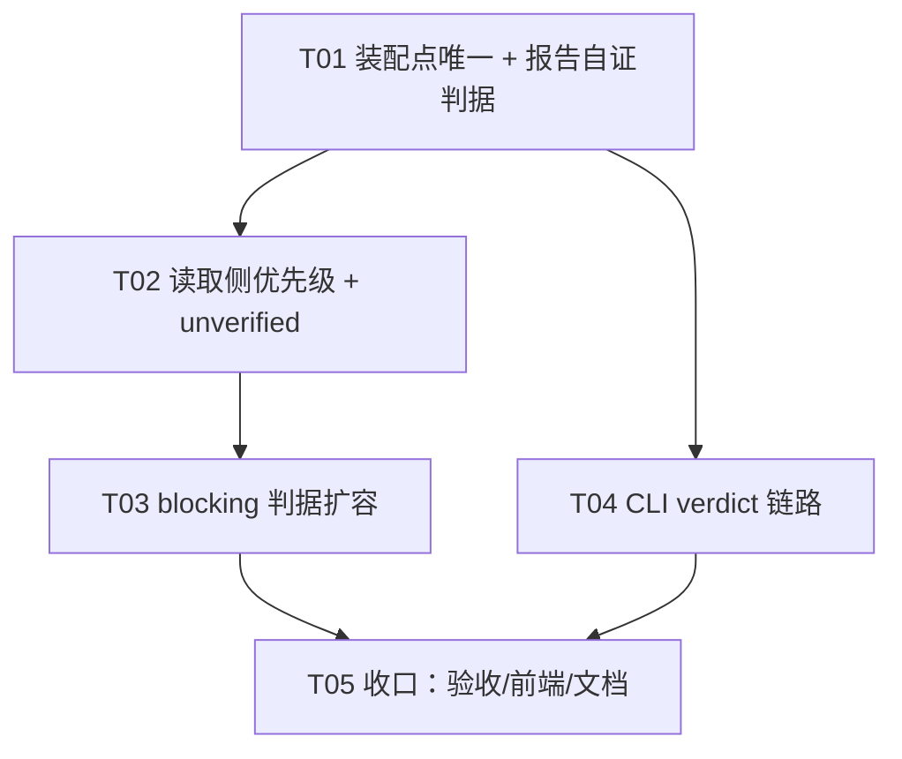

# ymir-agent 增量设计与任务列表 v1.5

> 版本：v1.5（口径版：同一棵交付树，不管走哪条路径，都必须给出同一个判定）
> 状态：**待评审**（2026-11-03；评审通过后才进入实施）
> 上游：`.workbuddy/tmp/v15-requirements.md`（许清楚 v1.5 增量 PRD，含 §0 三条事实更正）、`docs/16-验收报告-v1.4.md` §1/§6/§7.1
> 基线：v1.4 实测后端 **1102 tests** / 前端 **77 tests**（`docs/16` §4.1）
> 编号顺延：本文件为 `docs/17`。验收报告 `docs/18-验收报告-v1.5.md` **实施后才产出**，本阶段不创建。
> 编制：高见远（架构师）。本文件**只做设计与任务分解，不改任何代码**。

---

## 0. 速览

### 0.1 定位

**本版不加能力，只把"判定"这一个动作在三条路径上对齐到同一把尺子：**
`run 内 gate 裁决` / `Web 补评测` / `CLI 单跑`。凡是"同一棵树给出两个结论"的地方，本版都收敛为一个结论并留下可回查的痕迹。

判断标准（三条同时成立才进本版）：

1. 不修 ⇒ **弱口径可以静默放行坏树**（T2，P0，闸门被旁路且无留痕）；
2. 或 **判据覆盖范围**与闸门失效在用户视角没有区别（T1，P0，用户看到的是 `healthy` 三个字）；
3. 或 **主线路径拿不到结论**，用户被迫 `force`、留痕失真（T4，P1）。

### 0.2 工作项取舍（逐条给结论）

| 项 | 内容 | 结论 | 理由（一句话） |
|---|---|---|---|
| **T2** | 补评测并入唯一装配点 + 报告自证判据 + 读取侧按优先级 | **做（P0，**最先**）** | 它是 §0.3 那条**旁路**：弱口径报告会先于 `eval_verdict` 被遍历到，把坏树放行；不先修它，T1 收紧判据后用户补评测一次就绕过去 |
| **T1** | `blocking` 判据扩容到 D1/D2 三档 + 环境缺失四分类 + `unverified` 披露 | **做（P0）** | v1.4 只有 `fe-build web` 进 `blocking_failed`，"后端 pytest 全红 + 前端能构建"被判 `healthy` |
| **T4** | `--evaluate` 落盘 `eval_verdict`（**不碰** `engine.py` 的 `and`） | **做（P1）** | 改动面最小、无回边语义风险；PRD R3 已选后者 |
| — | B 方案（体验闭环：增量 HITL 门） | **不做** | 无阻塞性缺陷依赖它，插进来会让单目标失焦 |
| — | C 方案（能力扩展：`revert` 赋值/别名还原） | **不做** | v1.4 R-c 已证明"符号闭合 ≠ 语义自洽"，追加投入不解决本版口径问题 |
| — | 构建前置预检 | **不做** | 等于把检查跑两遍（成本翻倍）；"缺工具链/缺依赖"由 T1 的 `skipped` 规则覆盖 |
| — | 模板库扩容（第 5 套） | **不做** | 新模板会**放大** T1 的口径问题（再多一处"这套 blocking 是谁"） |
| — | A6 `sample_markers` 回写 `code.json` | **不做** | 需"评测期回写产物"或新开 code 版本，动的是产物契约（`docs/16` §6.1） |
| — | 补评测 judge 成本归属（`EvalTask.run_id`） | **不做** | 牵动 `harness._baseline_ref_of` 基线解析语义（`docs/16` §6.5），是独立语义决策 |
| — | 评测对话框显示归属 run | **不做** | 纯展示层（`docs/16` §7.1 第 7 条），不影响任何判定 |
| — | 放开 `engine.py:536-540` 的 `and` | **不做** | 见 §1.3：会让 `record_verdict` 在"无回边"的链上写 `context.repair.history`，语义脏 |

### 0.3 与 v1.4 的差异（一句话版）

| 维度 | v1.4 | v1.5 |
|---|---|---|
| 阻断项 | 只有 `fe-build web` | 四套模板统一：D1（可加载）+ D2（测试）阻断，D3（lint/类型）不阻断 |
| 补评测 checks | `suite.tasks[0].checks`（**绕开**装配点） | 与 gate **同一个** `build_task_*`，逐字段相同 |
| 报告可信度 | 只绑 `(run_id, artifact_version, artifact_name)` | 再加 **判据来源**（`template_id` + `criteria_version`）；缺 ⇒ fail-closed |
| 读取优先级 | `list_artifacts` 的 `created_at asc` + 版本从新到旧（隐式） | **产物名优先级** `eval_verdict` > `evaluation_report`（显式、可测） |
| 全 `skipped` | 记 `healthy`（等于宣称验过了） | 记 **`unverified`** + `baseline_promoted_unverified:1` 留痕 |
| CLI `--evaluate` | 只 `print`，不落盘 | 落 `eval_verdict`（新版本），提升闸门可用 |
| CLI 返修 | 不装配（隐式差别） | `--repair` 显式开关；链内无 `evaluation` 阶段 ⇒ **stderr 警告"未生效"** |

### 0.4 真跑预算

**4 次真实 run + 1 次补评测，预估 ¥1.10–1.40**（v1.4 为 4 次 ¥1.0169，同量级）：

| # | 场景 | 验证目标 | 预估 |
|---|---|---|---|
| R-a | `fastapi-vue3` × patch，**后端 pytest 全红 + `web/` 可构建** | A1（D2 阻断 ⇒ verdict fail ⇒ `from-merge` 409 unhealthy）+ A9（补评测同尺 ⇒ 仍 409） | ≈¥0.35 |
| R-b | `fastapi-vue3` × patch，`requirements.txt` 声明镜像未预装的 `python-multipart` | A2（`pytest`/`import` 双 `skipped` + `runnability_unverified:backend`）+ Q2（`force` ⇒ 201 + `baseline_promoted_unverified:1`） | ≈¥0.35 |
| R-c | CLI `--role engineer --evaluate`（截断链） | A14（落盘 + "评测结论已落盘"文案 + `from-merge` 不再 unknown）+ A16（`--repair` 在截断链上警告） | ≈¥0.25 |
| R-d | CLI `--role qa --evaluate`（**含** `evaluation` 阶段） | A13（`--role qa` 路径同样落盘）+ A17 的反向（有结论时不再 `absent`） | ≈¥0.35 |
| E-1 | 对 R-b 的树 `POST /evaluations` | A8/A12 的 HTTP 侧真跑取证（判据来源四字段非空） | ≈¥0.02 |

留 40% 余量仍 ≤ ¥2.0。**不新增模型调用**：以上成本全是既有 judge + 既有执行链，本版零新增提示词与零新增调用点。

---

## 1. 设计

> 三条硬约束贯穿全篇：① 不改四维权重（30/30/20/20）与双门槛（75/60）、不动 `scoring.runnability_points`（`fastapi-vue3.yaml:165-170`）；
> ② 产物不可变契约——所有新数据只走**新版本 / 新字段 / 独立文件**；③ 零新增模型调用。
> **新增字段一律带默认值，且沿用 `patch_manifest` 的「非默认值才序列化」纪律**，否则 `tests/test_v131_contract.py::TestG6ReportJson` 的键路径全集断言会红（见 §5.5）。

### 1.1 T2 · 补评测并入唯一装配点（P0，**必须最先落地**）

#### 1.1.1 为什么它是 P0 而不是"口径不统一"（读代码复核）

`_known_merged_health`（`api/routers/artifacts.py:755`）的遍历结构是：

```
list_artifacts(project)  → 按 created_at ASC（storage/artifact_repo.py:42）
  for artifact in artifacts:                       # 只要 name ∈ {evaluation_report, eval_verdict}
    matched = [row for row in versions if row.run_id == run_id]
    for version_row in reversed(matched):          # 版本从新到旧
      status = _report_health_status(...)
      if status: return status                     # ★ 第一份能给出结论的就 return
```

而 `evaluation_report` 是 **QA 阶段**产物、artifact 创建**更早**（`report.py:38` 与 QA 阶段同名、`store.save` 按 `(project, name)` 复用 artifact 递增版本），`eval_verdict` 是 coding 后 `evaluation` 阶段才创建 ⇒ **`evaluation_report` 在遍历顺序上先于 `eval_verdict`**。

再叠加 `evals/suites/default.yaml:34-36` 的套件 checks **没有 `blocking`/`group`** ⇒ 补评测的 `blocking_failed` 恒空 ⇒ `_report_health_status`（`:611-690`）只要有一个 `status=="evaluated"` 的任务就返回 `healthy`。

**结论：用户对一棵已被判坏的树点一次补评测，就能让 `evaluation_report` 多出一版 `healthy` 报告，并且它在遍历里先被读到。** 闸门被旁路，且响应无 `warning`、无日志——静默。

⇒ **T1 必须先等 T2 落地**，否则 T1 把后端 pytest 变成阻断项后，同一条旁路让收紧白费。

#### 1.1.2 设计：唯一装配点扩到"项目维度"

现状：`build_task_for_run(run, ...)`（`evaluation/run_task.py:156`）是 run 维度的唯一装配点；`evaluate_project`（`evaluation/harness.py:614`）自己拼了一份 `EvalTask`，且 `checks = suite.tasks[0].checks`（`:641`）——**这就是双实现的裂缝**。

**新增 `build_task_for_project`（同文件，与 `build_task_for_run` 并列）**：

```python
def build_task_for_project(
    *, project_id: str, artifact_name: str = "code", version: int | None = None,
    template_id: str | None = None,          # ① 调用方反查（最高优先级）
    template_hash: str | None = None,        # 与 template_id 同源，配 criteria_version
    manifest_files: Mapping[str, str] | None = None,   # ② patch_manifest 兜底
    run_id: str | None = None, requirement: str | None = None,
    default_suite: str = "default",
) -> tuple[EvalTask, EvalSuite, TaskCriteria]
```

`TaskCriteria` = `(template_id, criteria_source, criteria_version)` 三元组纯数据。

装配顺序（**与 `build_task_for_run` 逐项同构**，共用 `_assemble(spec, base, ...)` 私有实现，杜绝第三份拼装）：

1. `suite = EvalSuite.load(suite_id)`；`base = suite.task(task_id) or suite.tasks[0]`（沿用 `resolve_selection` 的套件选择口径，不另立）；
2. `spec = load_template(template_id)`（① 或 ② 解析出的 id）；`checks = resolve_checks(spec, base)`（**同一个函数**，模板 checks 覆盖套件 checks）；
3. `layout / scoring / baseline_skeleton` 三项与 run 维度完全同源（`_assemble` 内共享）；
4. `image_packages`（见 §1.2）同样注入。

**`evaluate_project` 改造**（`harness.py:614-671`）：删掉自拼的 `EvalTask` 与 `checks = suite.tasks[0].checks`，改为由调用方传入已装配的 `task`（保留 `evaluate_project` 作为薄壳以兼容既有调用方，内部 `task = build_task_for_project(...)` 或直接用新入口 `evaluate_project_task(task, suite)`）。

#### 1.1.3 R4 · 补评测装配点形态（阻塞问题，结论）

**结论：候选 ③（两者按优先级回退）。** 具体来源优先级与"都拿不到"的处置：

| 优先级 | 来源 | 取什么 | 代价 |
|---|---|---|---|
| 1 | **归属 run**（端点已有的 `_infer_report_run_id`，`evaluations.py:180`）→ `RunRepository.get(run_id).context["template"]["id"]` | `template_id`；`criteria_version` = **现算** `template_yaml_hash(DEFAULT_TEMPLATES_DIR, id)` | 1 次 DB 读（主键） |
| 2 | 目标产物版本内的 `patch_manifest.json` → `provenance.template_id` / `provenance.template_hash`（`artifacts/merge.py:331-333`、`run_task` 已合法可 import `artifacts.merge`） | `template_id`；`criteria_version` = **产物里记的** `template_hash`（当时那把尺子） | 1 次 `store.load`（仅当 1 拿不到时才付） |
| 3 | 都拿不到（手工导入 / 脚本写入的产物） | `spec=None` ⇒ 套件 checks（= v1.4 行为）；`criteria_source="suite"`，`template_id=""`，`criteria_version=""`（**显式空串**，A12 要求 jq 不返回 null） | 0 |

**"都拿不到"时的标注与可用性**（PRD T2-R4 边界）：

- 报告根部写 `{"criteria_source": "suite", "template_id": "", "criteria_version": ""}`，markdown 首行注「判据来源：套件 `default`（**未绑定模板**）」；
- 该结论**不得**给"有模板的树"背书 —— 闸门侧天然成立，因为提升时 `_promote_template_ref` 已经知道这棵树属于哪个模板，比对 `template_id` 不等即按拿不到结论（409 unknown）。**判据不同源 = 不可比，不需要额外机制。**

> 设计取舍：为什么不用"模板指纹清单"（候选②）做唯一来源 —— 它只能覆盖 patch 产物（`patch_manifest` 是 patch 模式专有），`from_scratch` 的产物没有 manifest，会永久落进第 3 档。③ 让 `from_scratch` 也能拿到强口径（只要它由某个 run 产出）。

> 已知代价（如实标注）：第 2 档需要一次额外 `store.load`，而 `harness._load_task` 稍后还会再读一次。选在**第 1 档已失败**时才付这笔钱，且本地产物读取是毫秒级；若日后 profiling 显示是热点，再引入"预读文件集透传"（`task.preloaded_files`），本版不做。

#### 1.1.4 R5 · 报告自证判据来源（阻塞问题，结论：**必须有显式字面量**）

**结论：需要一个显式 `criteria_source` 枚举 + `criteria_version` + `template_id` 三个根字段，不允许"字段缺失 ⇒ 弱口径"这种隐式判定。**

| 字段 | 取值 | 写入方 | 语义 |
|---|---|---|---|
| `criteria_source` | `"template"` \| `"suite"` | 报告构建器（唯一） | 本次用的判据**种类** |
| `template_id` | 模板 id，`suite` 时为 `""` | 同上 | 判据**归属** |
| `criteria_version` | 模板 YAML 原始字节 sha256（复用 `provenance.template_yaml_hash`，**单一实现**），`suite` 时为 `""` | 同上 | 判据**版本**（"换了尺子就不是同一件事"） |

- **写入侧唯一**：`EvaluationReport.build(...)` **从 `tasks[0]` 派生**这三个根字段（`TaskOut.criteria_*`），不设 caller 参数 —— 这样"忘传就失效"在构造上不可能（该 codebase 反复吃过这个亏：`_known_merged_health(artifact_version=...)` 的"忘传就静默退回串味口径"）。
- **读取侧严格**：`_report_health_status` 要求 `criteria_source ∈ {"template","suite"}`，且当调用方给了 `expected_template_id/expected_template_hash`（HTTP 主路径恒给）时必须相等；否则返回 `""`。
- **历史报告**（v1.4 生成，无这三字段）⇒ `criteria_source` 缺失 ⇒ 弱口径 ⇒ 409 `baseline_health_unknown`（A11）。用户处置路径唯一：**重评一次**（成本 1 次评测）。

#### 1.1.5 R·T2-R3 · 读取优先级改造（阻塞问题，结论）

**结论：遍历结构从"按 artifact 创建顺序"改为"按产物名优先级成组"；`criteria_diverged:1` 在**读侧**产生。**

```python
# 优先级由 tuple 顺序显式表达（不再依赖 created_at，那是隐式的、不可测的）
_REPORT_PRIORITY: tuple[str, ...] = ("eval_verdict", "evaluation_report")

@dataclass(frozen=True)
class MergedHealthReading:
    status: str = ""          # healthy | unhealthy | unverified | ""
    source_name: str = ""     # 采纳了哪个产物名的报告（排障用）
    divergent: bool = False   # 两份结论不一致（披露用）

async def _known_merged_health(...) -> MergedHealthReading:
    by_name = group artifacts by name
    winner = None
    for name in _REPORT_PRIORITY:                     # ★ 优先级 = 这个循环的顺序
        for artifact in by_name.get(name, ()):
            for row in reversed(matched_versions(run_id)):   # 同 run 内版本从新到旧
                status = _report_health_status(raw, ver, art, tmpl_id, tmpl_hash)
                if status: winner = (name, status); break
            if winner: break
        if winner: break
    # 只在"胜者给的是宽松结论"时补读败者一次，判 diverged（有界）
    if winner and winner.status in {"healthy", "unverified"}:
        loser = first_conclusive(_REPORT_PRIORITY after winner.name)
        divergent = loser is not None and loser != winner.status
    return MergedHealthReading(...)
```

- **`criteria_diverged:1` 只能在读侧产生**：写侧（gate / 补评测）各自只看得到自己那一份，无从比较。披露点 = 提升响应 `warning`（`baseline_promoted_*` 与 `criteria_diverged:1` 用 `,` 拼装）。
- **N+1 评估**：`get_artifact_detail` 每产物 1 次查询（≤2）；`store.load` 上限 = 2 + 1（仅在宽松结论时补读败者最新匹配版）⇒ **≤3 次文件读**，与现状同阶（现状最坏也是 N 版本 × 2 产物）。**不做批量改**：`list_for_artifacts` 批量确实存在，但这里最多 6 行元数据，换来的复杂度大于收益；若 QA 在本版提出，按"先给证据再优化"处理。
- **A10 的双向保证**：`eval_verdict` 在 tuple 首位 ⇒ 无论 `created_at` 谁先，gate 的结论永远赢（反向用例 `test_weak_report_alone_is_unknown` + 正向 `test_eval_verdict_wins_over_evaluation_report`）。

#### 1.1.6 T2 改动点清单（文件 + 函数 + 行号）

| 文件 | 改动 |
|---|---|
| `src/ymir/evaluation/run_task.py` | 新增 `build_task_for_project`（:156 之后）；抽 `_assemble(...)` 供两入口共享；`resolve_checks`（:125）转发 §1.2 的新字段；新增 `build_run_report(...)`（见 §1.3.3） |
| `src/ymir/evaluation/harness.py` | `evaluate_project`（:614-671）不再自拼 `EvalTask`/不自取 `suite.tasks[0].checks`；`_evaluate` 内 `TaskOut`（:321-349）补 criteria 透传（来自 `task`） |
| `src/ymir/evaluation/report.py` | `TaskOut`（:175）新增 `criteria_source/criteria_version/template_id/unverified_groups`；`EvaluationReport`（:289）新增三个根字段 + `build()`（:354）从 `tasks[0]` 派生；`to_markdown`（:406）加"判据来源"与"未验证"行；三字段全空 ⇒ `model_serializer` pop（保 G6） |
| `src/ymir/api/routers/evaluations.py` | `run_evaluation`（:220）在 `_infer_report_run_id` 之后加 `_resolve_template_ref(session, run_id)`；把 `template_id/template_hash/manifest_files` 传给装配点 |
| `src/ymir/api/routers/artifacts.py` | `_REPORT_ARTIFACT_NAMES`（:596）旁新增 `_REPORT_PRIORITY`；`_report_health_status`（:611）加 criteria 校验与 `unverified` 分支；`_known_merged_health`（:755）改优先级遍历 + 返回 `MergedHealthReading`；端点（:449-487）透传 criteria、拼装多码 `warning` |
| `src/ymir/artifacts/provenance.py` | 见 §1.2.6（`unverified` 枚举与留痕码） |
| `src/ymir/api/schemas.py` | `BaselineMergeOut.warning` 描述改为"逗号分隔的留痕码集合"（字段类型不变 ⇒ 逐字节兼容） |

**失败降级**：装配点任何异常（模板不可读 / manifest 损坏）⇒ 退化到第 3 档（套件判据 + `criteria_source="suite"`），**不让评测本身 500**（与 `template_spec_for_run` 的既有纪律一致）；报告落盘失败不影响返回结论。

---

### 1.2 T1 · blocking 判据扩容（P0）

#### 1.2.1 模型：把 PRD 的"三档"做成**一等字段**，而不是靠 `blocking` 暗示

现状只有 `blocking: bool`，于是"这条检查属于 D1 还是 D2"只存在于注释里，A6 那种参数化断言没法写。**新增 `tier` 字段**：

```yaml
- { type: command, run: "python -m pytest -q", weight: 2, group: backend,
    tier: behavior, blocking: true, requires_deps: ["python:*"],
    no_tests_exit_code: 5, timeout_s: 180 }
```

| 档 | `tier` | 失败语义 | 是否 `blocking` | 对报告的作用 |
|---|---|---|---|---|
| D1 不可加载 | `loadable` | 解释器/构建器读不进来 | **是（强制）** | 进 `blocking_failed` ⇒ `TaskOut.passed=False` ⇒ gate `fail(check_failed)`；分数照算照披露 |
| D2 行为不符 | `behavior` | 能加载但行为不符 | **是（强制）** | 同上 |
| D3 规范不符 | `style` | 能跑对数但风格/类型不达标 | **否（强制）** | 只进组得分 ⇒ `runnability` 下降；verdict 由双门槛决定 |
| 未声明 | `""` | 老口径 | 由 `blocking` 决定 | 与 v1.4 逐字节一致（默认值 ⇒ 零行为变化） |

**加载期校验 24（新）**：`tier ∈ {loadable, behavior}` ⇒ 必须 `blocking: true`；`tier == "style"` ⇒ 必须 `blocking: false`。理由：`tier` 是**规格**，`blocking` 是**后果**，两者不一致就是模板作者在自相矛盾（例如把 ruff 标成 `style` 又写 `blocking: true`）。校验 24 同时要求 `blocking: true` 的检查**显式声明 `timeout_s`（≥60）**——PRD T1-R4 的"不得沿用默认值"由加载期硬保证。

#### 1.2.2 四套模板的目标 checks（统一口径）

| 模板 | D1 `loadable`（阻断） | D2 `behavior`（阻断） | D3 `style`（不阻断） | 环境声明 |
|---|---|---|---|---|
| `fastapi-vue3` | `python -m compileall -q app`（无需 deps：不 import）；`python -c "from app.main import app"`（`requires_deps: ["python:*"]`）；`fe-build web`（`requires: node` + `requires_deps: ["node:*"]` + `requires_files: ["web/"]`） | `python -m pytest -q`（`requires_deps: ["python:*"]` + `no_tests_exit_code: 5` + `timeout_s: 180`） | `ruff check --per-file-ignores "app/**:B008" .` | 既有 + 新增 |
| `python-cli` | `python -m compileall -q ymir_cli`；`python -c "import ymir_cli"`（`python:*`） | `python -m pytest -q`（`python:*` + exit5 + 180s） | `ruff check .` | 同上 |
| `data-pipeline` | `python -m compileall -q pipeline`；`python -c "import pipeline"`（`python:*`） | `python -m pytest -q`（`python:*` + exit5 + 180s） | `ruff check .`；`python -c "import pandas"`（`requires_deps: ["pandas"]`，**环境探针**，永不阻断） | 同上 |
| `node-express` | `node-build .`（`requires: node-build` + `node:*`） | `node --test dist`（`requires: node` + `node:*` + `requires_build_output: "dist/"`） | `npx tsc --noEmit`（`requires: npx` + `node:*`） | 同上 |

- 四套的后端三条检查统一补 `group: backend`（`python-cli`/`data-pipeline`/`node-express` 现在没有 group）。**这对分数零影响**：这三个模板都没有声明 `scoring`，走的是"按 `checks[].weight` 归一"的老口径，`group` 只作标签（`score_by_points` 不被调用）。`fastapi-vue3` 的 `backend: 10 / frontend_static: 10 / frontend_build: 10` **一字不动**（A18）。
- **`fe-build web` 保留 `requires_files: ["web/"]`（探针侧语义不变）**：合并树缺 `web/` 仍判 `failed`（`docs/13` §3-Q1 的不对称，本版不碰）。

#### 1.2.3 R1 · 环境缺失怎么表达（阻塞问题，结论）

**结论：选候选 ①（`requires_deps` 语义：交付树依赖声明 ∩ 镜像预装清单），并用"构建期/CI 期一致性钉子"替代候选 ②（镜像指纹）的可信度收益。**

| 候选 | 结论 | 理由 |
|---|---|---|
| ① `requires_deps`：读树内依赖声明 ∩ 镜像包表 | **采用** | 声明式、**运行前**、与代码无关、可重复（同树两次跑同结论）；镜像包表 `SANDBOX_IMAGE_PACKAGES`/`SANDBOX_IMAGE_NODE_PACKAGES`（`templates/models.py:47/72`）本来就是**唯一权威表**且被校验 4 强制与模板依赖对齐（B14 规则：扩表与 Dockerfile 同一 PR） |
| ② 镜像指纹（构建期写清单、评测期比对） | **不采用（本版）** | 需要改镜像 + 运行期 `cat /opt/image-manifest.json`（多一次沙箱调用，与"零额外沙箱调用"纪律冲突），且清单在镜像内仍是**另一份需要人工同步的表** —— 它把漂移从"仓内表↔镜像"换成"镜像内文件↔仓内表"，没有消除漂移 |
| ③ 解析报错文本 | **否决**（产品已锁） | 同一棵树两次跑可能给出不同结论，那不是判据 |

**① 的可信度由 CI 钉子补足**（替代 ② 的价值）：新增 `tests/test_sandbox_image_manifest.py`，用 `ast`/正则解析 `docker/sandbox.Dockerfile` 的 `pip install` 行与 `docker/node-baseline/package.json`，断言与两张包表**集合相等**。这把"表与镜像漂移"从运行期不可知变成 **CI 必红**。方向也安全：表比镜像**小**（镜像多了包但表没加）是唯一危险方向（会误 skip），该用例恰好只咬这一边。

**"5 个依赖缺 1 个"的粒度：整条检查 `skipped`（按检查粒度，不是按命令/按包）。**

理由：
1. 一条 check = 一条命令，**命令级粒度不存在**；
2. `pytest` 缺 1 个包时是**收集期 ImportError**，跑出来的"部分通过"没有语义，按包粒度给分等于编造证据；
3. 粒度落在"检查"这一层，所以 D1 的 `compileall`/`ruff` **照常执行**——不会因为缺 1 个包把整棵树判成未验证（这正是 A2 与 A6 要求的形态）；
4. `blocking_failed` 只由 `failed` 产生，`skipped` 永不进 ⇒ 不阻断（硬约束）。

**数据流（新增模块 `src/ymir/evaluation/deps.py`，纯函数、零 IO、绝不抛）**

```
EvalTask.image_packages  ← 注入（`run_task`：`image_packages_for(spec.stack.language)` + 另一生态表）
EvalContext.workdir      ← 交付树文件集（已在内存）
        │
        ▼
deps.declared_deps(files) ──► {"python": frozenset[name...], "node": frozenset[name...]}
        │   读 requirements.txt / pyproject.toml[project].dependencies / package.json{dependencies,devDependencies}
        │   只解析 PEP 508 / npm 名字形态；URL、`-e`、`-r`、`--index-url` 行**跳过不判**（证据里记 `deps_probe_ignored:<n>`）
        ▼
deps.missing_image_deps(declared, image_packages) ──► ("python-multipart",)   # 保序去重
        │
        ▼
run_checks(..., missing_deps=...)   # 每条 check 按自己的 requires_deps 判定
        ├─ requires_deps 含 "python:*" 且 python 有缺失 ⇒ skipped(requires_missing_deps:<pkg>[...])
        ├─ requires_deps 含具体包名且该包不在镜像表 ⇒ skipped(requires_missing_deps:<pkg>)
        └─ 否则照常执行
```

**为什么 `"python:*"` / `"node:*"` 用带语言前缀的 token**：`fastapi-vue3` 的后端检查与前端构建在**同一棵树**里；若 `"*"` 表示"树内全部依赖"，`web/package.json` 里模型新增的 `vue-router` 会让后端 `pytest` 被 skip —— 那是把无关生态的缺失算到后端头上。带前缀把"按生态"显式化。

**加载期校验 25（新）**：
- token 只允许 `python:*` / `node:*`，且该语言的镜像表必须非空（空表 ⇒ 全部声明都算缺失 ⇒ 永久 skip，必须加载期拒）；
- **具体包名必须 ∈ 该模板语言的镜像表**（防 typo 变成"永久静默未验证"）。`data-pipeline` 的 `pandas` 满足；若镜像将来收缩，`pandas` 会先在校验 4/25 处红，而不是静默跳过。
- 运行期仍对具体包名做比对（兜底路径：镜像被人手工改动时，宁可 skip 也不误判 fail）。

**已知限制（必须写进 `docs/04`）**：`declared − image ≠ ∅` 是"声明了但镜像没有"，不是"真的 import 了"。模型声明了不用的包会导致过度跳过（方向是**宽松**），由 `unverified` + 提升留痕兜住；这是"零解析报错文本"这条产品红线的必然代价，取声明而不取运行结果。

#### 1.2.4 R2 · 组内全 `skipped` 的健康度取值（阻塞问题，结论）

**结论：`unverified`（新增第四态）。不选 `healthy`，不选 `unknown`。**

| 候选 | 判定 | 理由 |
|---|---|---|
| `healthy`（现状） | ✗ | 等于宣称"验过了"，与 `docs/16` §1 第 8 条"没评测 ≠ 跑得好"直接冲突 |
| `unverified`（新增） | **✔** | 不阻断 + 留痕，语义与"我确实不知道"一致 |
| `unknown` | ✗ | `strict_health=True` 下必然 409 ⇒ 无 node 的镜像、纯 lint 镜像每次提升都要 `force`，用户会习惯性 `force`，闸门退化（Q2 已否决） |

**触发条件（精确到"档"而不是"组整体"，否则 A2 不成立）**：

对每个 `(group, tier)`，若该组该档**声明了检查**且**一条都没真的执行**（全部 `skipped`）⇒ 该组记未验证，报告 `warnings` 追加 `runnability_unverified:<group>`（同组多档只报一次）。

> 为什么不能是"整组全 skipped"：A2 的场景里 `compileall`（D1）**是跑过并通过的**，但 `pytest`（D2）与 `import app` 全被跳过 ⇒ 若按"整组全 skipped"判，`backend` 组不算未验证，A2 的 `warnings` 断言不成立。按"档"判才与产品意图（"行为有没有验证过"）对齐。

**改动面**：

| 位置 | 改动 |
|---|---|
| `evaluation/evaluators/base.py` | `CheckRun`（:122）新增 `tier: str = ""`（`run_checks` 从 `EvalCheck.tier` 抄）；新增常量 `MISSING_DEPS_PREFIX="requires_missing_deps:"`、`NO_TESTS_COLLECTED="no_tests_collected"`、`MISSING_BUILD_OUTPUT_PREFIX="requires_missing_files:"` |
| `evaluation/harness.py` | `_evaluate`（:287-349）计算 `unverified_groups`（用 `task.checks` 的 `tier`+`group` 与 `runs` 比对），追加 `runnability_unverified:<group>` 与 `no_tests_collected` 警告；`TaskOut.unverified_groups=...` |
| `evaluation/report.py` | `TaskOut.unverified_groups: list[str]`（空 ⇒ pop）；markdown 加一行「未验证（环境缺失：backend）——**未验证 ≠ 通过**」 |
| `artifacts/provenance.py` | `HEALTH_UNVERIFIED="unverified"`（:147 旁）；`BASELINE_PROMOTED_UNVERIFIED_CODE="baseline_promoted_unverified:1"`；`MergedHealth.known`（:243-250）**加入 `unverified`**（否则 `strict_health and not known` 会把它当未知 ⇒ 409，违反 Q2）；新增 `MergedHealth.unverified` property；`promote_merged_to_baseline` 步骤 8b（:538-574）加分支：`elif health.unverified: warning = BASELINE_PROMOTED_UNVERIFIED_CODE`（**不 raise**，`force` 无关） |
| `api/routers/artifacts.py` | `_report_health_status`（:674-690）新增：`blocking_failed` 空 + `regression` False + 任务里 `unverified_groups` 非空 ⇒ 返回 `unverified`；空 `tasks`/全 skipped ⇒ 仍返回 `""`（"什么都没评"≠"没验证过"） |

**对外文案（R8，落字段 + 唯一文案表）**：

| 场景 | 文案（**禁止出现"通过"字样**） |
|---|---|
| 报告 markdown | `- 未验证（环境缺失：backend）— 该组的 D2 检查一条都没执行；未验证 ≠ 通过` |
| 提升响应 `warning` | `baseline_promoted_unverified:1` → 前端/CLI 渲染「基线已提升，但部分检查未执行（环境缺失）；未验证 ≠ 通过」 |
| CLI | `[verdict] unverified（部分检查未执行：backend）— 未验证 ≠ 通过` |

#### 1.2.5 T1-R4 与 T1-R6 的机制落点

- **`pytest` 退出码 5**：`EvalCheck.no_tests_exit_code: int | None`（默认 `None` ⇒ 老行为）。`run_checks` 命中该码 ⇒ `status="skipped"`、`skipped_reason="no_tests_collected"`，**不阻断**；同时 `warnings` 追加 `no_tests_collected`（A4）。
- **超时**：`timed_out=True` 仍判 `failed`（现状）；新增的是"`blocking` 必须显式 `timeout_s`"（校验 24）。后端 `pytest` 声明 `timeout_s: 180`（≥120 的产品要求），`compileall`/`ruff`/`import` 各 120，`fe-build`/`node-build`/`node --test` 保持 300。
- **级联跳过（T1-R6）**：新增 `EvalCheck.requires_build_output: str = ""`（单一路径前缀，必须 `/` 结尾）。
  - 语义与 `requires_files` **刻意分开**：`requires_files` 是"基线里的**源码**依赖"（**探针侧**生效，合并树缺了仍判 failed —— `web/` 的不对称）；`requires_build_output` 是"**本 run 上游检查产出的构建物**"（两侧都 `skipped`，`requires_missing_files:<path>`）。
  - 用法：`node --test dist` 声明 `requires_build_output: "dist/"`；`node-build .` 因环境缺失跳过 ⇒ `dist/` 不存在 ⇒ `node --test dist` 级联 `skipped`，**不判 fail**（A7）。
  - **加载期校验 26（新）**：`requires_build_output` 不得与 `layout.required_dirs` / `skeleton` 的路径重叠 —— 这条防的正是"有人把 `web/` 写成构建产物，从而悄悄把 `web/` 的不对称抹平"（那会把 v1.3.1 的 Q1 定案推翻）。
  - 若构建**真的跑了并失败**，`dist/` 可能不存在 ⇒ 下游按"缺产物"跳过。这不掩盖问题：D1 的构建失败本身已阻断（verdict fail），下游跳过只是避免同一件事被记两次失败。

#### 1.2.6 分数映射（四档 → 现有 `blocking_failed` / `passed` / `score_by_points`）

| 结果 | `CheckRun.status` | `blocking_failed` | `TaskOut.passed` | `score_by_points` | verdict |
|---|---|---|---|---|---|
| D1 通过 | `passed` | — | 不受影响 | 计入分子/分母 | 由双门槛 |
| D1 失败（阻断） | `failed` | **+命令名** | **False**（`model_post_init` 也守） | 该组得分下降（分数照算） | `fail(check_failed)`，`reason` 含「阻断项失败」+ 命令名 |
| D2 失败（阻断） | `failed` | **+命令名** | **False** | 同上 | 同上 |
| D3 失败（不阻断） | `failed` | — | 不受影响 | 该组得分下降 | 由双门槛（78/65 ⇒ `pass`，A5） |
| 环境缺失 | `skipped` | — | 不受影响 | **不进分母** | 该组该档记 `unverified` |
| 无用例（exit 5） | `skipped` | — | 不受影响 | 不进分母 | `unverified` + `no_tests_collected` |
| 缺构建物 | `skipped` | — | 不受影响 | 不进分母 | 视上游：构建失败已阻断 |
| 超时 | `failed`（`timed_out=True`） | 视 `blocking` | 视 `blocking` | 同失败 | 同失败 |

**A1 的 `reason` 契约**：`reason` 必须同时含「阻断项失败」与命令名（`gate.BLOCKING_REASON_PREFIX` 既有文案，`:241-246` 已是这个形状，无需改）。

---

### 1.3 T4 · CLI 单跑的 verdict 链路（P1）

#### 1.3.1 R3 · 为什么不放开 `engine.py:536-540` 的 `and`（结论）

`should_evaluate` 要求 `stage.id == definition.eval_stage_id()`（`repair.py:147-151`），`--role engineer` 的截断链**不含** `evaluation` 阶段 ⇒ 只装 gate 也没用。要"放开 `and`"就得让 gate 在**任意阶段**触发，那会顺带改 `record_verdict` 的语义：它写 `context.repair.history`（`repair.py:153-180`），而"回边未接线"的链上写 history 是**假证据**（会让人以为返修机制跑过）。

⇒ **按 PRD R3 的后者：`engine.py` 一行不改**，T4 只做"`--evaluate` 落盘 `eval_verdict`"。改动面最小、零回边语义风险。

#### 1.3.2 设计：脚本层落盘 + 与 gate 同一个报告构建器

```
scripts/run_single_role.py::run_main（:436-465）
  └─ if args.evaluate:
        outcome = await evaluate_run(harness, run, default_suite=args.suite)   # 既有，与 gate 同源
        report  = build_run_report(run, suite, outcome, repair_round=_repair_round(run.context))
        saved   = await report.save(store, project_id=..., run_id=run.id,
                                    created_by="cli", name=VERDICT_ARTIFACT_NAME)   # 新版本，不覆写
        print(「评测结论已落盘（eval_verdict vN，绑定 code vM）—— 提升闸门可用」)
        verdict = reduce_to_verdict(suite, outcome, artifact_name="code", repair_round=...)
```

- `build_run_report`（**新增于 `run_task.py`**）与 `gate._build_report`（`gate.py:106-126`）**同一实现**：`gate._build_report` 改为一行委托。这样 A13/A14 的落盘产物与 gate 的裁决报告在结构上不可能漂移（这是 A8"同尺"的第三层保障）。
- `reduce_to_verdict`：把 `HarnessEvaluationGate._to_verdict`（`gate.py:147`）**提为模块级公开函数**（`_to_verdict` 保留为薄壳，防既有测试红）。CLI 打印的 verdict 与 gate 的裁决**同一段代码**，不是另写一份。
- `verdict_source="harness"`（`EvaluationReport.build` 默认值，无需显式传）。
- **落盘失败不改变 run 终态与退出码**（评测是附加信息，与 `gate._save_report:128-143` 的降级口径一致）：`stderr` 打印 `[verdict] <status>（未落盘：<原因>）— 提升仍需 force`，并继续。

#### 1.3.3 默认不返修 + 显式开关 + "不裁决 ≠ 通过"（T4-R2 / T4-R3）

| 状态 | 触发 | 输出（stdout） | `from-merge` |
|---|---|---|---|
| `verdict=pass` | `--evaluate` 且落盘成功且双门槛过且无阻断项 | `[verdict] pass（eval_verdict vN ← code vM）— 提升闸门可用` + 既有四维分数块 | 201，无 warning |
| `verdict=fail` | 同上，结论为 fail | `[verdict] fail（…）— 阻断项失败：<cmd>` | 409 `baseline_unhealthy` |
| `verdict=unverified` | 同上，某组某档全跳过 | `[verdict] unverified（部分检查未执行：backend）— 未验证 ≠ 通过` | 201 + `baseline_promoted_unverified:1` |
| `verdict=absent` | 未加 `--evaluate`（或落盘失败） | `[verdict] absent（未裁决）— 提升需 force；如需结论请加 --evaluate` | 409 `baseline_health_unknown`（口径不放松） |

`--repair`（新，**默认关**）：

```python
Args: --repair（action="store_true"）；默认不注入 eval_gate / repair ⇒ run 内无回边、无额外轮次、无额外成本
校验：if args.repair:
        chain_ids = {s.id for s in truncated.stages}
        if definition.eval_stage_id() not in chain_ids or not truncated.repair_active():
            print("--repair 未生效：本次阶段链不含 evaluation 阶段", file=sys.stderr)   # ★ stderr，非 stdout
        else:
            stack_rs = build_repair_stack(session_factory=..., events=..., messages=..., harness=..., store=...)
            orchestrator = OrchestrationEngine(..., eval_gate=stack_rs.gate, repair=stack_rs.controller)
```

- **不改变退出码**（A16）：警告只是警告，退出码仍按 run 终态（0/1）。
- `--role qa --repair` 是**真的生效**的（截断链 `prd→architecture→coding→evaluation`，`truncate_pipeline` 保留两端都在链上的回边 `evaluation→coding`，`sop/loader.py:112` 注释已写明）⇒ 该分支有用例价值，但**不做真跑**（自动返修 ≤2 轮可到 3 倍成本，本版预算不含）。
- `--dry-run` 不建 run、不落任何产物（现状保持）；`--evaluate` 与 `--repair` 同用时的语义写进 `docs/04`：`--repair` 让 run 内 evaluation 阶段产生 verdict（由 gate 落盘），`--evaluate` 在终态后**再**落一版；`_known_merged_health` 取同 run 最新匹配版 ⇒ 无害但有两条记录（文档要说清）。

#### 1.3.4 改动点清单

| 文件 | 改动 |
|---|---|
| `scripts/run_single_role.py` | `parse_args`（:53）加 `--repair`；`run_main`（:386）加 repair 校验与注入；`--evaluate` 块（:436-465）加落盘 + 新文案 + `absent` 分支；`print_evaluation`（:351）加 verdict 行 |
| `src/ymir/evaluation/run_task.py` | 新增 `build_run_report(...)` |
| `src/ymir/evaluation/gate.py` | `_build_report`（:106）委托 `build_run_report`；`_to_verdict`（:147）→ 公开 `reduce_to_verdict` + 薄壳 |
| `docs/04-使用手册.md` | `--repair` / `--evaluate` 落盘语义 / `verdict=absent` / `unverified` 与 `criteria_diverged` 文案 |
| `src/ymir/api/routers/evaluations.py` | 无需改动（T2 已改）；确认 `POST /evaluations` 仍按 `payload.version`（缺省 latest）评，报告 `artifact_version` 取**实际加载版本**（v1.4 返修 4 的成果，保持） |

---

### 1.4 R1–R8 逐条结论（汇总）

| # | 事项 | 本设计结论 | 落点 |
|---|---|---|---|
| **R1** | 环境缺失表达 | **① `requires_deps`（树声明 ∩ 镜像包表）**；粒度 = **整条检查 `skipped`**；`python:*`/`node:*` 按生态分区；可信度由 CI 钉子（Dockerfile ↔ 包表集合相等）替代镜像指纹 | §1.2.3、T03 |
| **R2** | 组内全 skipped | **`unverified`**（新增第四态）；`MergedHealth.known` 必须纳入它；`baseline_promoted_unverified:1` 留痕、**不阻断** | §1.2.4、T02 |
| **R3** | T4 如何实现"只装 gate" | **不做**。`engine.py` 一行不改；改为 `--evaluate` 落盘 `eval_verdict` | §1.3.1、T04 |
| **R4** | 补评测装配点形态 | **③ 优先级回退**：归属 run 的 `context.template.id` > `patch_manifest.provenance.template_id` > `criteria_source="suite"`（显式空串标注，结论只给无模板的树用） | §1.1.3、T01 |
| **R5** | 历史报告口径迁移 | **需要显式字面量**：`criteria_source` ∈ {template, suite} + `criteria_version` + `template_id`；缺 ⇒ 弱口径 ⇒ 409，重评一次可解 | §1.1.4、T01 |
| **R6** | 模板 YAML 改 ⇒ `template_hash` 失配 | **接受**（宁严不松）。4 套 YAML 全改 ⇒ v1.4 存量 patch 产物在本版后**无法提升**（`provenance.py:477-481` 1003）。发版说明必须写、错误文案已含"请用当前模板重新跑一次"，**不为绕开它放松指纹校验** | §5.1、T03/T05 |
| **R7** | pytest 阻断后的返修成本 | `max_rounds=2` **不变**；预算预检（`bootstrap.py:187-190`）为唯一闸；Web 全链单 run 上限 ≤3 倍不新增闸 | §5.2 |
| **R8** | `unverified` 对外文案 | 唯一文案表（§1.2.4 末表），全部**禁止**"通过"字样；后端只出字面量与码，前端/CLI 共用同一句 | T02/T05 |

---

## 2. 任务列表（按实施顺序，5 个任务）

> 规模：S ≈ ≤1 人日 / M ≈ 2–3 人日 / L ≈ 4–5 人日。
> **顺序纪律**：T01 → T02 **必须先落地**（否则 T03 收紧判据后用户补评测一次即绕过）。T04 与 T03 可并行（都只依赖 T01）。T05 收口。

### T01 · Batch A-1：补评测并入唯一装配点 + 报告自证判据（P0，L）

| 子项 | 做什么 | 改哪个文件（函数 / 行号） | 完成判据 |
|---|---|---|---|
| T01.1 | 抽 `_assemble(spec, base, ...)`，新增 `build_task_for_project(...)`（候选③ 优先级回退 + `TaskCriteria`） | `src/ymir/evaluation/run_task.py`（:156 后） | 同一 `(project, artifact, version, template)` 下 `build_task_for_project` 与 `build_task_for_run` 产出的 `checks` **逐字段相等** |
| T01.2 | `evaluate_project` 停用自拼 `EvalTask` 与 `suite.tasks[0].checks` | `src/ymir/evaluation/harness.py:614-671` | `grep "suite.tasks\[0\].checks"` 无输出；A8 绿 |
| T01.3 | 报告三根字段 + 从 `tasks[0]` 派生（禁止 caller 传） | `src/ymir/evaluation/report.py`（`TaskOut`:175、`EvaluationReport`:289、`build`:354、`to_markdown`:406）+ `evaluation/harness.py`（`TaskOut` 构造 :321） | A12；`tests/test_v131_contract.py::TestG6ReportJson` 全绿（默认 pop） |
| T01.4 | 端点反查归属 run 的模板（`_resolve_template_ref`）并透传 | `src/ymir/api/routers/evaluations.py:220-256` | UI 口径请求（无 `run_id`）⇒ 报告 `criteria_source="template"` 且 `template_id` = 归属 run 的模板 |
| T01.5 | `build_run_report(...)`（与 gate 同一构建器） | `src/ymir/evaluation/run_task.py` + `src/ymir/evaluation/gate.py:106-126`（改委托） | gate 落盘正文与 CLI 落盘正文在字段集合上相等 |

**依赖**：无（本版第一个任务）　**源文件**：6 个

### T02 · Batch A-2：读取侧优先级 + `unverified` 第四态（P0，M）

| 子项 | 做什么 | 改哪个文件 | 完成判据 |
|---|---|---|---|
| T02.1 | `_REPORT_PRIORITY` + `_known_merged_health` 改优先级遍历，返回 `MergedHealthReading(status, source_name, divergent)` | `src/ymir/api/routers/artifacts.py:755-835` | A10 双向（谁先 `created_at` 都取 `unhealthy`；只有弱报告 ⇒ 409 unknown） |
| T02.2 | `_report_health_status` 加 criteria 校验（`expected_template_id`/`expected_template_hash`，`None` ⇒ 不绑定以兼容既有单测）+ `unverified` 分支 | 同上 :611-690 | A11（v1.4 风格报告 ⇒ 409 unknown）、A12 的反向（别模板的报告不背书） |
| T02.3 | 端点拼装多码 `warning`（`,` 连接）+ 透传 criteria | 同上 :449-487 + `api/schemas.py`（`BaselineMergeOut.warning` 说明） | `force` + unhealthy ⇒ 仍是 `warning == "baseline_promoted_unhealthy:1"`（既有断言不破）；diverged 时追加 `,criteria_diverged:1` |
| T02.4 | `unverified` 枚举 + 留痕码 + `MergedHealth.known` 纳新态 + 步骤 8b 分支 | `src/ymir/artifacts/provenance.py`（:147-159、:243-250、:538-574） | 全 skipped 树 ⇒ 201 + `baseline_promoted_unverified:1`（**不 409**）；`MergedHealth(status="unverified").known is True` |
| T02.5 | 测试夹具迁移：`_store_report` 自动按 run 的模板填 criteria（现算 hash） | `tests/test_baseline_promote.py`（`_report_json`:1309、`_store_report`） | 既有 HTTP 用例不因"缺 criteria"集体变 409 |

**依赖**：T01　**源文件**：4（含 1 个测试文件）

### T03 · Batch B：blocking 判据扩容（P0，L）

| 子项 | 做什么 | 改哪个文件 | 完成判据 |
|---|---|---|---|
| T03.1 | `CheckSpec` + `EvalCheck` 新增 4 字段：`tier`、`requires_deps`、`requires_build_output`、`no_tests_exit_code`（全部带默认值） | `src/ymir/templates/models.py:91-127`、`src/ymir/evaluation/evaluators/base.py:167-191` | 旧模板 / 旧套件 YAML 加载零改动 |
| T03.2 | ⚠ **加载期转发**：`_validate` 的 `CheckSpec(...)` 重建块（`loader.py:555-567`）必须转发 4 个新字段 —— 忘转发 ⇒ 字段加载后**静默消失**、无任何报错（本文件最阴的坑） | `src/ymir/templates/loader.py:550-570` | 新增用例：读回 `load_template("fastapi-vue3").checks[i].tier == "behavior"` |
| T03.3 | 校验 24（`tier` ↔ `blocking` 一致性 + blocking 必带 `timeout_s`≥60）/ 25（`requires_deps` 语法 + 具体包 ∈ 镜像表 + token 语言表非空）/ 26（`requires_build_output` 不得与 `required_dirs`/`skeleton` 重叠） | `src/ymir/templates/loader.py`（`_validate`，:514 之后） | 三条校验各有正/反例 |
| T03.4 | 新增 `evaluation/deps.py`：`declared_deps(files)` / `missing_image_deps(...)` / `check_requires_deps(...)` / 常量；只解析名字形态，URL/`-e`/`-r` 记 `deps_probe_ignored:<n>` | `src/ymir/evaluation/deps.py`（新） | 纯函数用例：requirements.txt / pyproject.toml / package.json（含 `web/package.json`）/ 畸形行 |
| T03.5 | `run_checks` 接入：`tier` 抄进 `CheckRun`、`requires_deps` 判定、`no_tests_exit_code` 映射、`requires_build_output` 缺物跳过 | `src/ymir/evaluation/evaluators/base.py:444-524` | A2/A4/A7 单测（fake sandbox） |
| T03.6 | `runnability`/`baseline_probe`/`benchmark` 三处执行点传 `missing_deps` 与 `image_packages` | `evaluators/runnability.py:44-100`、`baseline_probe.py:319-400`、`benchmark.py:546` | 探针侧与合并树侧同口径（`env_missing` 复用既有降级原因） |
| T03.7 | harness 计算 `unverified_groups` + 两条新警告 | `src/ymir/evaluation/harness.py:287-349` | A2 的 `warnings` 含 `runnability_unverified:backend`；A4 含 `no_tests_collected` |
| T03.8 | 四套模板 checks 重写（§1.2.2 表） | `config/templates/*.yaml` ×4 | A6 参数化 4 例全绿；A18 断言值不变（10/10/10、75/60、30/30/20/20） |
| T03.9 | 冒烟报告同口径（否则"冒烟说 failed、评测说 skipped"自相矛盾） | `src/ymir/orchestrator/role_executor.py:1057-1103` | 冒烟侧对 `requires_deps` 缺失的条目记 `skipped` 而非 `failed` |
| T03.10 | Dockerfile ↔ 包表一致性钉子（R1 的可信度来源） | `tests/test_sandbox_image_manifest.py`（新） | 故意从表里删一个包 ⇒ 用例红 |

**依赖**：T01、T02（`unverified` 的**写入侧**在 T03、**读取侧**在 T02；两侧必须都就位，A2 才完整）　**源文件**：11

### T04 · Batch C：CLI verdict 链路（P1，M）

| 子项 | 做什么 | 改哪个文件 | 完成判据 |
|---|---|---|---|
| T04.1 | `reduce_to_verdict` 提为模块级公开函数（`_to_verdict` 保薄壳） | `src/ymir/evaluation/gate.py:147-280` | 既有 gate 用例零改动通过 |
| T04.2 | `--evaluate` 落盘 `eval_verdict`（新版本）+ 三行新文案 + `absent` 分支 | `scripts/run_single_role.py:436-465` | A13/A14/A17（stub executor，零模型调用） |
| T04.3 | `--repair` 开关 + 截断链 stderr 警告 + 不改变退出码 | `scripts/run_single_role.py:53-103、386-467` | A15（默认不返修：`coding` 执行 1 次、无 `round>0` 历史）、A16（stderr 命中且退出码不变） |
| T04.4 | `_dry-run` 仍不建 run / 不落产物；落盘失败降级 | 同上 | 落盘异常注入用例：退出码/终态不变、有 stderr 提示 |
| T04.5 | `docs/04` 用法与文案 | `docs/04-使用手册.md` | CLI/闸门/未验证/`criteria_diverged` 四处均有说明 |

**依赖**：T01（`build_run_report`）　**源文件**：4

### T05 · Batch D：收口（验收 + 前端文案 + 文档）（P1，M）

| 子项 | 做什么 | 改哪个文件 | 完成判据 |
|---|---|---|---|
| T05.1 | 新增验收用例套件（A1–A7 / A8 / A9–A12 / A13–A17） | `tests/test_blocking_tiers.py`、`tests/test_deps_probe.py`、`tests/test_eval_parity_v15.py`、`tests/test_criteria_sources.py`、`tests/test_cli_verdict.py`（均为新） | A1–A20 逐条有对应用例或命令 |
| T05.2 | 前端：`warning` 多码拆分 + `unverified` / `criteria_diverged` 文案 | `web/src/utils/promoteBaseline.ts`（:112-190）+ `web/src/utils/__tests__/promoteBaseline.test.ts` | 多码 `a:1,criteria_diverged:1` 时toast 仍命中；单测覆盖 unverified |
| T05.3 | 六门 + 真跑台账 + as-built 回填 | `data/v15/INDEX.md`（gitignore 内）、本文件 §7（新增） | 1102→≥1142 / 77→≥79；ruff/import graph/alembic/build 全绿；4 次真跑台账 |
| T05.4 | 发版说明（R6：模板指纹变更 ⇒ 存量产物需重跑） | `README.md` v1.5 小节 + `docs/04` | 明写"v1.4 遗留的待提升 patch 产物在本版后无法提升" |

**依赖**：T03、T04　**源文件**：8

### 依赖图



> 硬纪律：**T01/T02 未合并前不得动模板 YAML**（T03.8）。否则"后端 pytest 阻断"上线当天，补评测旁路仍在，收紧被判据旁路吃掉 —— 这正是 §0.3 的顺序理由。

---

## 3. 类图 / 时序图

结构有新增（`unverified` 第四态、`requires_deps` 探针、criteria 三元组、`MergedHealthReading`、`build_task_for_project`）⇒ **产出两份图**：

- `docs/class-diagram-v1.5.mermaid`：新增/变更的类与字段（只画**变化面**，不重画 v1.4 全图）
- `docs/sequence-diagram-v1.5.mermaid`：两条关键链路（补评测同尺 / 提升读取优先级与 disclosure）

（图文件见同目录，正文不重复粘贴。）

---

## 4. 验收线（A1–A20 → 任务 → 测试 → 是否真跑）

| # | 验收线 | 任务 | 测试/命令 | 真跑 |
|---|---|---|---|---|
| A1 | 后端起红不再 healthy | T03 | `tests/test_blocking_tiers.py::test_backend_pytest_failure_blocks_promotion` | **R-a** |
| A2 | 环境缺失不误伤且可区分（+ 反例） | T03 | `test_missing_deps_are_skipped_not_failed` / `test_declared_dep_present_still_runs` | **R-b** |
| A3 | 语法错误阻断 | T03 | `test_compileall_failure_is_blocking` | 夹具 |
| A4 | no tests ≠ fail | T03 | `test_empty_tests_dir_is_skipped` | 夹具 |
| A5 | ruff 不阻断 | T03 | `test_ruff_failure_is_not_blocking` | 夹具 |
| A6 | 四套模板同口径（参数化 4 例） | T03 | `test_all_templates_declare_blocking_consistently[<id>]` ×4 | 夹具（加载期） |
| A7 | 级联跳过 | T03 | `test_cascading_skip_on_missing_build` | 夹具（缺 `node-build` 用 fake sandbox 模拟，不真跑） |
| A8 | 同尺总断言 | T01 | `tests/test_eval_parity_v15.py::test_supplementary_eval_matches_gate` | 夹具（FakeJudge+FakeSandbox） |
| A9 | 闸门不可绕过 | T01+T02+**T03** | `test_supplementary_eval_cannot_bypass_unhealthy_gate` | **R-a + E-1** |
| A10 | 优先级确定不靠创建顺序（+ 反向） | T02 | `test_eval_verdict_wins_over_evaluation_report` / `test_weak_report_alone_is_unknown` | 夹具 |
| A11 | 历史报告 fail-closed | T02 | `test_legacy_report_without_criteria_is_unknown` | 夹具 |
| A12 | 报告自证（字段 + jq） | T01 | `test_report_self_describes_criteria_source` + `curl POST /evaluations \| jq` | **E-1** |
| A13 | CLI 落盘解锁（`--role qa`） | T04 | `test_cli_evaluate_persists_verdict_artifact`（stub executor） | **R-d** |
| A14 | 截断链也解锁（`--role engineer`） | T04 | `test_cli_engineer_run_verdict_unlocks_promotion` | **R-c** |
| A15 | 默认不返修 | T04 | `test_cli_default_does_not_repair` | **R-c**（顺带取证） |
| A16 | 开关不静默 | T04 | `test_repair_flag_warns_on_truncated_chain`（`2>&1 \| grep`） | **R-c** |
| A17 | 不裁决 ≠ 通过 | T04 | `test_absent_verdict_is_labelled_absent` | **R-c** 的反向取证 |
| A18 | 权重/门槛/配分不动 | T03 | 既有 `test_templates` / `test_eval_parity` 保持绿（**不得改断言值**） | 六门 |
| A19 | 产物不可变（23 例字节契约） | T01/T02 | `tests/test_v131_contract.py` 全绿 | 六门 |
| A20 | 零退化（1102/77 不减） | T05 | 后端 ≥1142、前端 ≥79；ruff/import graph/alembic/build | 六门 |

**真跑预算**：R-a / R-b / R-c / R-d / E-1 共 **4 次 run + 1 次补评测 ≈ ¥1.10–1.40**（明细 §0.4）。`A7` 的"镜像缺 `node-build`"**不真跑**：需要重建镜像（`docker/sandbox.Dockerfile` 里删 node 工具链），成本与收益不成比例，用 fake sandbox 模拟 `command -v node-build` 返回非 0 即可；该场景的**机制**已被既有 `requires` 用例覆盖，本版新增的只是 `requires_build_output` 的级联判定（纯函数级可测）。

**两条容易写歪的判据（实施时按此读）**：

- **A9 需要 T1 就位**，不是"T2 落地即绿"：它的第一个断言是"补评测报告 `blocking_failed` **非空**"，而这一条依赖模板把 `pytest` 标成 `blocking`（T03.8）。若在 T03 之前就跑 A9，前半段必红 —— 那不是"§0.3 的推论错了"，是判据还没装。**A9 的绿点 = T01+T02+T03 全绿。**
- **A13/A14 必须用"本版模板产出"的新 run**，不能用 v1.4 存量产物：本版改了 4 套 YAML ⇒ 存量 patch 产物的 `template_hash` 与新模板不符 ⇒ 提升会以 1003「模板已变更」被拒（那是 R6 的**预期**行为，不是 A13 的失败）。夹具与真跑都现场生成 run，天然满足。


---

## 5. 风险与回退

### 5.1 模板 YAML 改动 ⇒ `template_hash` 失配（R6，**必然发生**）

`provenance.py:477-481`：模板 YAML 指纹一变，存量 patch 产物的提升就被 1003 拒（"模板已变更（含注释）"）。本版四套模板全改 ⇒ **v1.4 遗留的待提升产物在本版后无法提升**。

- 处置：接受（宁严不松）。发版说明必须写（T05.4）；错误文案已含"请用当前模板重新跑一次"（`:480`），**不为绕开它放松指纹校验**。
- **对验收的影响（必须提前说清）**：A13/A14 若拿 v1.4 存量产物做原料，`from-merge` 会先被步骤 5（1003「模板已变更」）拦下，**根本走不到健康度闸门** ⇒ 看起来像"CLI 落盘没生效"。所有 T4 用例与真跑都必须用**本版模板现场产出的 run**。这不是本版新增的坑（v1.4 也这样），但本版**必然**触发它，所以写在这里。
- 回退：本版所有 YAML 改动都集中在 `checks` 与注释，**不动 `stack/layout/skeleton/scoring/protected`** ⇒ 若需紧急回退，只 revert YAML 不会牵连任何 Python 行为（`tier`/`requires_*` 字段都有默认值，老 YAML 照常加载）。
- ≥1 条用例钉住这条：A18 断言 `fastapi-vue3.yaml` 的 `scoring.runnability_points == {backend:10, frontend_static:10, frontend_build:10}`，防"顺手改配分"。

### 5.2 T1 阻断后 Web 全链返修成本上升（R7）

后端 pytest 转阻断 ⇒ "测试全红"的树会触发 `evaluation_failed` 回边，单 run 成本上限从 ~¥0.23 升到 ≤3 倍（`max_rounds=2`）。

- 处置：`max_rounds` **不变**；预算预检（`bootstrap.py:187-190` 的 `BudgetProbe`）是唯一闸，本版不加新闸（PRD R7 已定）。
- 风险残余：CLI 默认 `--repair` 关 ⇒ CLI 用户不受影响；Web 用户本来就在全链上，且"坏树不该进下一轮"正是不返修更贵的理由（返修一次 ¥0.5 < 坏基线污染下一轮）。

### 5.3 `unverified` 对外文案（R8）

风险：前端/CLI/报告三处各写一句，出现"修复了但文案说通过"这类过度声称（v1.4 被 QA 抓过三次同类问题）。

- 处置：文案表唯一来源写进 §1.2.4；后端只出**字面量 + 短码**，前端/CLI 用同一句；`grep -rn "通过" 新增文案` 必须无命中（T05 检查项）。
- 前端 `promoteBaseline.ts:177` 现用**严格相等**比对单一短码 ⇒ 必须改成"按 `,` 拆分后逐码匹配"，否则多码时 toast 静默退回默认文案（**这是本版前端唯一的必改点**）。

### 5.4 A20 零退化（1102 / 77 不得下降）

- 后端：新增用例 ≥40（A1–A7 ×~10、A8 1、A9–A12 ×~8、A13–A17 ×~6、deps 纯函数 ×~10、Dockerfile 一致性 ×2、loader 校验 24/25/26 正反 ×6）。
- **夹具迁移不是退化**：`_report_json` 若不加 criteria，既有 HTTP 用例会从 201 变 409 —— 这属**计划内迁移**（T02.5），迁移后计数不减少。
- 若实施中出现"为了让新用例绿而放宽既有断言"，一律视为退化，由 QA 按 v1.4 的变异验证纪律复核（每处变异 `try/finally` 逐字节还原 + sha256 复核）。

### 5.5 字节契约风险（A19）

新字段默认值必须被 `model_serializer` pop 掉，否则 `TestG6ReportJson::test_g6_report_json_key_paths_match_v13_exactly` 立刻红（它断言报告 JSON 键路径集合**恰好**等于 v1.3 表）。

- 明确规则：`TaskOut` 的 4 个新字段与 `EvaluationReport` 的 3 个根字段，**全部为空**时才 pop；`criteria_source ∈ {template, suite}` 时**三个根字段一起保留**（`template_id`/`criteria_version` 允许空串 —— A12 要求 jq 不返回 null）。
- 钉住：T01.3 的完成判据直接引用该用例。

### 5.6 判据串味的残余口子（如实标注）

`_report_health_status` 绑定的是"报告**自称**的 criteria"（`templates` 侧现算 vs 报告里记的值）。本地产物本来就可人工改写 —— 这条判据防的是**串味**，不是**伪造**（与 `docs/16` §1 第 8 条同口径）。要防伪造需签名，不在本版。

---

## 6. 待用户确认（≤3，只留真正需要拍板的）

| # | 问题 | 建议 | 影响 |
|---|---|---|---|
| **①** | **PRD 内部冲突**：T1-R5 的表格把 `npx tsc --noEmit` 列进 `node-express` 的 **D1 阻断**列，但同节 A6 ③ 明确要求"不存在 D3 检查（`ruff`/`tsc`）被标 `blocking`"，T1-R1 也把 `tsc --noEmit` 定义为 D3。**按哪个执行？** | **按 A6 ③ + T1-R1：`tsc` 判 D3、不阻断。** 理由：① 可测的判据优先于描述性表格；② `node-build .` 本身就是 `tsc -p tsconfig.json`，把 `tsc --noEmit` 也设阻断属同一件事记两次；③ 与 python 侧 `ruff` 对称（"能跑对数但类型不达标"不是"用不了"）。若按 D1 执行，A6 ③ 必须相应放宽，且四套模板的"统一口径"叙述要重写<br><br>**⚠️ 本条建议已被推翻（2026-11-05，修复轮 D-3）：`tsc` 改判 D2（`tier: behavior` + `blocking: true`）。** 理由见 §7.1 第 10 条（真实 Node 树里它是唯一能跑的 D2 判据）。原建议保留在此，仅作决策轨迹 | `node-express.yaml` 的 `npx tsc --noEmit` **现在**是 `behavior` + `blocking: true`；A6 ③ 的 `tsc` 子句随之失效（`ruff` 子句仍有效） |
| **②** | `requires_deps` 的 `"python:*"`/`"node:*"` token 形态是否可接受？（PRD 只说"新增 `requires: deps` 语义"，未定语法） | 接受 token 形态（`python:*` / `node:*`）。**不接受**复用 `requires` 字段表达（`requires` 现在语义是"可执行文件名"、用 `command -v` 探测，写成 `requires: deps` 会被探成 `requires_missing:deps` 永久跳过 —— 是个静默陷阱） | 模板 YAML 的写法与校验 25 的实现 |
| **③** | `unverified` 是否也适用于"只有 D1 跳过、D2 跑过"的场景？（本设计只对"某组某档一条都没执行"记未验证） | **不适用**（保持本设计的窄口径）：D1 跳过而 D2 跑过 ⇒ 树的行为验过了，D1 的缺失由 `fe-build` 既有警告披露 | `unverified_groups` 的计算范围 |

---

## 7. 变更记录

| 日期 | 内容 |
|---|---|
| 2026-11-03 | 初版：v1.5 增量设计（T1/T2/T4 三节 + R1–R8 结论 + 5 个任务 + 2 份图），状态 **待评审** |
| 2026-11-04 | **as-built 回填**（见 §7.1–§7.4）：T01–T05 全部落地；后端 1102 → **1292**、前端 77 → **80**；4 次真跑 + 2 次补评测 ¥0.689 298（含 1 次作废重跑）；与设计偏差 8 处、未取证 4 项、新增遗留风险 6 条 |

### 7.1 as-built：实际改动面（与 §1/§2 的偏差，逐条给原因）

| # | 设计写的 | 实际做的 | 原因 |
|---|---|---|---|
| 1 | §1.3.4「`print_evaluation` 加 verdict 行」 | verdict 行放在 `print_evaluation` **之外**（`run_main` 内单独 `print`） | 既有红线用例 `test_usage_line_absent_keeps_v13_output_byte_identical` 把"空 `usage_line` ⇒ 输出逐字节等于 v1.3 常量"钉死了，加进去必红；语义（CLI 输出）不变 |
| 2 | §1.2.3「具体包名 ∈ **该模板语言**的镜像表」 | `*` token 用**生态表**（`image_package_map()`：python/node），具体包名用**模板语言**表 | `node:*` 的生态名是 `node`，而 `stack.language` 是 `typescript` —— 同一套名字套不上；桥接集中在 `loader._validate_requires_deps` 一处并有注释 |
| 3 | §1.2.3「`image_packages` 注入（`run_task`）」 | 合并入口 `templates.models.image_package_map()`；`EvalTask.image_packages` 键用**生态名** | 两张表的权威定义在 `models`，合并入口跟着走才不会出现第二份映射 |
| 4 | §1.2.3 未提包表变更 | `SANDBOX_IMAGE_PACKAGES` 补 `greenlet` / `pytest-asyncio` | T03.10 要求"表 == 镜像集合相等"，而 Dockerfile 早就装了这两个（B14 允许同 PR 补表，Dockerfile 未改）；方向是**收紧** |
| 5 | §1.1.5「只在胜者宽松时补读败者一次（有界 ≤3 次读）」 | **双向披露**：胜者严格时也补读（上界 ≤4 次读） | team-lead 裁决：PRD T2-R3 的字面口径不区分方向；`eval_verdict=unhealthy` + `evaluation_report=healthy` 正是最需要解释的场景 |
| 6 | §1.2.5「缺构建物 ⇒ skipped」未指定检测方式 | 用 `sandbox.list_files(".")` 判存在（目录前缀语义 = ≥1 文件） | 与 `requires_files` 的目录前缀判定同构；也保证"构建失败 ⇒ 下游按缺产物跳过，不把同一件事记两次失败" |
| 7 | §1.3.2 伪码里 CLI 直接用 `suite` | 新增 `run_task.evaluate_run_report()`（返回 `(outcome, suite, report)`），`evaluate_run` 委托它 | `evaluate_run` 只回 `TaskOut`；加一层薄壳避免 CLI 二次装配（否则又成"两份装配"） |
| 8 | §1.2.6 只规定 `TaskOut.passed=False` | 追加 **`EvaluationReport.build` 的报告级不变量**：`blocking_failed` 非空 ⇒ 报告 `passed=false` | T05.1 写 A9 端到端用例时发现：报告根 `passed` 只看双门槛，会出现 `tasks[0].passed=false` 却 `report.passed=true` ⇒ `/evaluations` 与列表页对坏树显示"✅ 通过"（v1.4 遗留裂缝，本版一并堵上） |
| 9 | §1.3.3 状态表只有一行 verdict | CLI 在 `pass` + 有未验证组时**只印 unverified 行**（修复轮 D-6） | 设计写的是"只印一行"，但实现曾同时印 `[verdict] pass` 与 `[verdict] unverified` ⇒ 同一块输出里"通过"与"未验证 ≠ 通过"并存，读起来自相矛盾 |

**修复轮（QA 对抗验证后）追加的 3 处实现改动**（不是设计偏差，是设计**没覆盖到**的活口）：

| # | 缺陷 | 落点 | 判据 |
|---|---|---|---|
| **D-2** | 补评测的 `requirement` 由调用方随便传 ⇒ **同一棵树两个分数**（真跑 R-a：92.65 vs 62.65，差值恰是需求维权重；其余三维逐位相同） | `evaluations.py::run_evaluation`：有归属 run 就忽略 `payload.requirement`；报告新增 `requirement_source ∈ {run, caller, none}`（由 `build` 从 `tasks[0]` 派生、默认 pop） | 同一棵树传两个不同 `requirement` ⇒ `total_score` 相同、`requirement_source="run"`、`tasks[0].requirement` 等于 run 的 |
| **D-3** | `node-express` 三条检查全挂 `node:*` ⇒ 真实树（`package.json` 必然声明镜像外 npm 包）里 **D1/D2 全被跳过**，`executed=[]` ⇒ 该模板的阻断判据是假的 | `node-express.yaml`：`npx tsc --noEmit` 改 `tier: behavior` + `blocking: true` + `requires_deps: ["typescript"]`（镜像恒真）；`node-build` / `node --test dist` 保留 `node:*` 与级联语义 | 真实形态的 node 树 ⇒ `tsc` **真的执行**、`node-build` 为 `skipped(requires_missing_deps:…)`、`node --test dist` 跳过；A6 的"每套 ≥1 D1、≥1 D2"按新配置成立 |
| **D-1** | 同一 run **没有** `eval_verdict` 时（CLI 未加 `--evaluate`），补评测报告无探针 ⇒ `regression` 恒 false ⇒ 仅 D3 回归的树被判 `healthy` ⇒ `from-merge` **201 无 warning**（静默放行） | `artifacts.py`：用**既有**字段 `baseline_runnability` 判"回归是否检查过"（缺失 / `skipped` ⇒ 未检查）⇒ 201 时 `warning` 追加 `baseline_promoted_regression_unknown:1`；**不改判定、不动基线解析**（根治属 v1.6） | 删掉 `eval_verdict` ⇒ 回归树 `from-merge` 201 且 warning 含该码；探针真跑过 ⇒ 不误报 |

**§7.1 第 10 条（PRD/A6 口径被有意推翻，必须有记录）**

| # | 设计写的 | 实际做的 | 原因与代价 |
|---|---|---|---|
| 10 | PRD **A6 ③**："不存在 D3 检查（`ruff`/`tsc`）被标 `blocking`"；§6① 的裁决也是"`tsc` 判 D3、不阻断" | **有意推翻**：`node-express` 的 `npx tsc --noEmit` = `tier: behavior` + `blocking: true` + `requires_deps: ["typescript"]`（D-3） | **原因**：`node-build .` 与 `node --test dist` 都挂 `node:*`，而真实 Node 树必然声明镜像外的 npm 包 ⇒ 它们**全被跳过**；若 `tsc` 也不阻断，`node-express` 在真实树里**一条判据都不剩**（D-3 的初衷就是让 D2 可达）。<br>**代价（如实记）**：`test_style_checks_are_never_blocking` 现在只按 `tier == "style"` 断言、并**按名字兜底 `ruff`**，**没有任何断言守护 `tsc` 为 blocking** —— 将来若有人把 `tsc` 改回不阻断，**不会有测试变红**，只会在真实 node 树上静默丢失唯一 D2。这条只能靠本行文字 + QA 的独立复核兜住（不加断言是刻意的：加了会与"有意推翻 A6③"打架，见本轮 N-1 裁决） |

### 7.2 as-built：验收线状态（详见 §4 原表 + `data/v15/INDEX.md`）

- **夹具层全绿**（A1–A7 / A10 / A11 / A18 / A19 / A20）：`tests/test_blocking_tiers.py`（68）、
  `tests/test_deps_probe.py`（36）、`tests/test_sandbox_image_manifest.py`（4）、
  `tests/test_criteria_sources.py`（27）、`tests/test_eval_parity_v15.py`（11）、
  `tests/test_cli_verdict.py`（28）、`tests/test_baseline_promote.py`（117）。
- **A8**：`test_supplementary_eval_matches_gate`（HTTP + FakeJudge）通过。
  真跑下两份报告的 `total_score` 曾**不等**（92.65 vs 62.65），根因不是 judge 抖动，
  而是**调用方传了不同的 `requirement`**（需求维 100.00 → 0.00，差值恰是该维权重）；
  该根因已由修复轮 **D-2** 关闭（有归属 run 就用 run 的需求）。修后两者同源，
  但 LLM judge 仍有小幅抖动 ⇒ "完全相等"这一条只在 `FakeJudge` 下成立。
- **A1 / A2 / A9 / A12 / A13 / A14 / A15 / A16 / A17**：**真跑取证完成**
  （R-a / R-b / R-c / R-d / 补评测 ×2），原文见 `data/v15/INDEX.md` §3。
- **A3 / A4 / A5 / A6 / A7**：按 §0.4 的约定**只做夹具**（A7 缺 `node-build` 需重建镜像，不真跑）。
- **A6 的 tsc 子句已失效**（有意推翻，见 §7.1 第 10 条）；**A2 出现一条经裁决的口径例外**：
  真实 node 树声明镜像外的 `lodash` 时，`npx tsc --noEmit` 仍会执行、报
  `error TS2307: Cannot find module 'lodash'` 且 **exit=2** ⇒ 进 `blocking_failed` ⇒ 判不可交付。
  这与 PRD T1-R2「环境缺失一律 skipped、不阻断」**字面冲突**，裁决与三条理由见 §7.3-N2。

### 7.3 as-built：未取证项（4 项，如实列出）

| # | 项 | 原因 |
|---|---|---|
| U1 | "前端/构建"在**真实生态树**下的"已执行"证据 | 镜像只有 `express/typescript/@types/*`。**两类模板都受影响**：① `fastapi-vue3` 的真实 Vue 应用（`package.json` 声明 `vue`/`vite`）⇒ `fe-build web` 判 `skipped(requires_missing_deps:vue)`；② `node-express` 的 `node-build .` / `node --test dist` 同理（真实树必然声明镜像外 npm 包）⇒ 只有 `npx tsc --noEmit` 能真跑（**D-3 修复后才成立**）。这是设计的正确行为（环境缺失 ⇒ skipped + `unverified` 披露），但意味着"构建/测试"类检查在本镜像下**大多只能拿到"未验证"**。要真正验证需在镜像里补 `vue`/`vite` 等**树内常用依赖**，或让模板声明"离线依赖池"范围 |
| U2 | A8 的 `total_score` 真跑相等 | **根因已查明并修复**（修复轮 D-2：调用方 `requirement` 覆盖 run 的）。残余差异只有 LLM judge 的自抖（同输入两次调用分数可能差几百分之一）⇒ "完全相等"只在 `FakeJudge` 下成立，真跑只保证**确定性字段**相等 |
| U3 | 补评测路径的 `regression` 同尺 | 项目维度没有 `baseline_ref` ⇒ 探针不跑 ⇒ `regression` 恒 false。**"方向安全"只在同一 run 存在 `eval_verdict` 时成立**（读取侧优先取更严的那份）；只有补评测报告时方向不安全 —— 修复轮 **D-1** 已加 `baseline_promoted_regression_unknown:1` 披露，但**判定仍是 201**。根治要把基线引用引进项目维度，属 §5「明确不做」第 6 条（v1.6） |
| U4 | `criteria_diverged:1` 的真跑 | 需"胜者宽松 + 败者严格"的两份报告组合，本批轮次/预算未覆盖；夹具层已钉住（后端 2 例 + 前端 3 例） |

**N2 · 经裁决的口径例外：`tsc` 的 `TS2307` 按"不可交付"处理（不 skip）**

QA 实测（真实 node 树，`package.json` 声明镜像没有的 `lodash`）：

```
node-build .      → skipped(requires_missing_deps:lodash)
node --test dist  → skipped(requires_missing_deps:lodash)
npx tsc --noEmit  → failed(exit=2)   # error TS2307: Cannot find module 'lodash'
⇒ blocking_failed=["npx tsc --noEmit"] ⇒ passed=false ⇒ 不可交付
```

`tsc` 只依赖 `typescript`（镜像预装、恒真），因此它**不会被依赖缺失连带跳过** ——
于是"树里写了一个镜像装不上的依赖"会以**编译错误**的形式被判为**交付缺陷**，
而不是按 PRD T1-R2 的"环境缺失 ⇒ skipped"。

**裁决：接受当前行为，作为刻意例外记录。三条理由**：

1. **否则 `node-express` 一条判据都不剩**：`node-build` / `node --test` 已因 `node:*` 全跳，
   若 `tsc` 也 skip，该模板在真实树下**没有任何"真的跑过"的 D2**（这正是 D-3 要修的问题）；
   一个"永远全跳"的阻断判据等于没有判据。
2. **在离线沙箱里，"引入了镜像装不了的依赖"本身就是交付缺陷**：目标环境（同样的离线镜像）
   跑不起来这棵树 —— 这不是"我们的环境缺东西"，而是"这棵树要求了环境给不了的东西"。
   把它记成 `skipped` 会让"模型乱加依赖"永远不被扣分。
3. **无法按"环境缺失"区分而不违反产品红线**：要区分"依赖没装"与"代码写错"只能解析
   `tsc` 的报错文本（`TS2307`），而 PRD 已明确否决"解析报错文本"（同一棵树两次跑可能给出
   不同文本，那不是判据 —— 与 `requires_deps` 选用"声明 ∩ 清单"同一条红线）。

**代价（如实记）**：这条例外**只由代码行为 + 本段文字**守护，没有专门用例断言
"TS2307 ⇒ failed"（那需要真实 `tsc`，属镜像级真跑）；等价机制层用例只覆盖
"tsc 会被执行"（`test_tsc_runs_when_tree_declares_unknown_npm_deps`）与
"tsc 失败 ⇒ 阻断"（`test_tsc_failure_is_blocking_on_a_real_shaped_tree`）。

**v1.6 候选**：评估 `tsc --noEmit --noResolve`（或限定 `--types` / `rootDir` 的编译目标）
能否让"缺包"不再产生 `TS2307`。若能，这类失败可安全降级为
`skipped(requires_missing_deps:…)`，与 T1-R2 完全对齐。

### 7.4 as-built：真跑成本与新增风险

- **成本**：4 次有效 run + 2 次补评测 = **¥0.524 623**；含 1 次作废重跑合计
  **¥0.689 298**（34 次调用）—— **低于**预算下界 ¥1.10（省在 4 次 run 都一次通过）。
- **新增遗留风险**（6 条，按严重度）：
  1. 镜像缺 `vue`/`vite` ⇒ 真实前端模板的 `fe-build` 只能"未验证"（U1）；
  2. 模型违约会直接变成"不可交付"（真跑观测到两次：改写 `VERSION`、自造失败用例）——
     `protected` 只保护模板声明的路径；
  3. 补评测与 gate 在 `regression` 上不同尺（U3）；
  4. v1.4 存量报告/产物需重评/重跑（R6 + A11）；
  5. `criteria_diverged` 的真跑链路未取证（U4）；
  6. `tier` 只在加载期校验，绕过 `templates.loader` 直接造 `EvalCheck` 可跳过校验 24；
  7. **D-4（v1.6 候选，本版不修）**：judge 少给一项（结构化输出里缺某个 `item_id`）时，
     该维按 0 分计且 `degraded=False` ⇒ 报告看起来"正常"、分数却偏低。属 v1.x 既有行为，
     改动面（judge 覆盖度校验）较大，记入 v1.6。

**QA 复验提出、经裁决"不收"的 4 项（明确记录，不修）**

| # | 项 | 裁决与理由 |
|---|---|---|
| N-1 | 为 `tsc` 的 `blocking` 补断言守护 | **代码侧不收**：加了会与"有意推翻 A6③"（§7.1 第 10 条）打架 —— 一边说"A6③ 被推翻"，一边在测试里断言 A6③ 的**反面**，会把下一轮读者搞糊涂。改由文档（§7.1 第 10 条"代价"段）+ QA 独立复核兜住 |
| N-3 | `_report_regression_checked` 对**坏正文** fail-open（`baseline_runnability` 是 dict 但无 `status` ⇒ 判"已检查"） | **不修**：与"防串味不防伪造"（`docs/16` §1 第 8 条）同族 —— 写入侧（`harness`）不可能产出这种正文，只有人工改写才可能；判据在这里做严格化收益极低 |
| N-4 | 探针**部分执行**（1/N 真跑）仍算"回归已检查" | **不修**：需要给探针加 `baseline_partial` 语义（新增字段 + 读取侧分支），属 v1.6；当前写入侧只产出"全跑 / 全跳"两种形态 |
| N-5 | `verdict_lines` 里 `groups` 计算两次 | **已修**（只删重复计算，行为不变）；另一处"`test_all_templates_declare_blocking_consistently` 与 `TestAllTemplatesShareOneRuler` 同义"**保留** —— 那是 QA 的独立覆盖，冗余在此处是安全网 |

